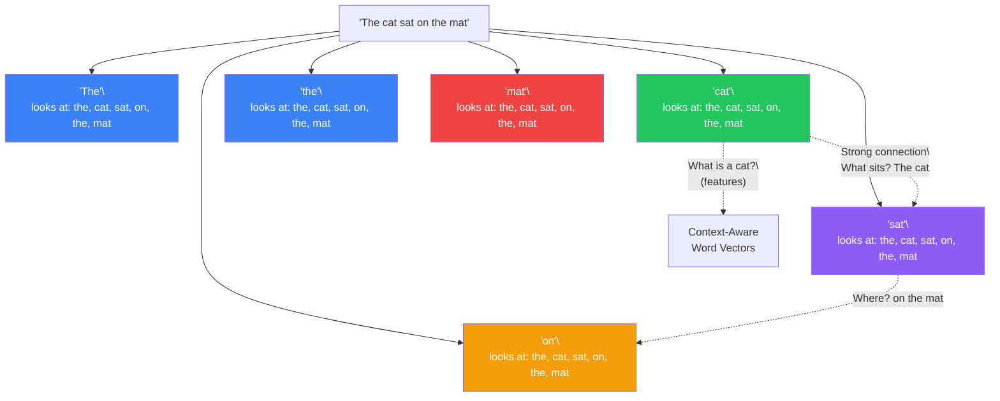
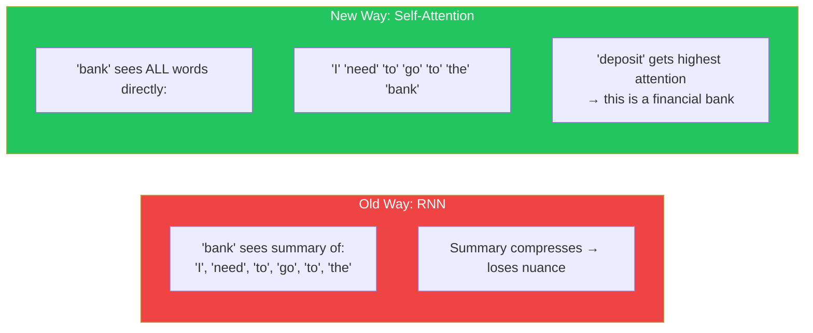
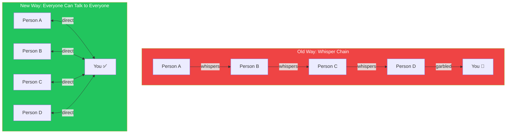
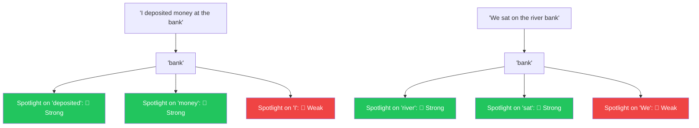
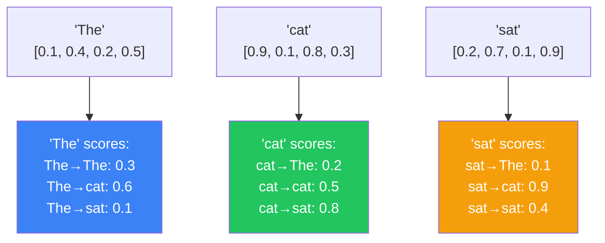
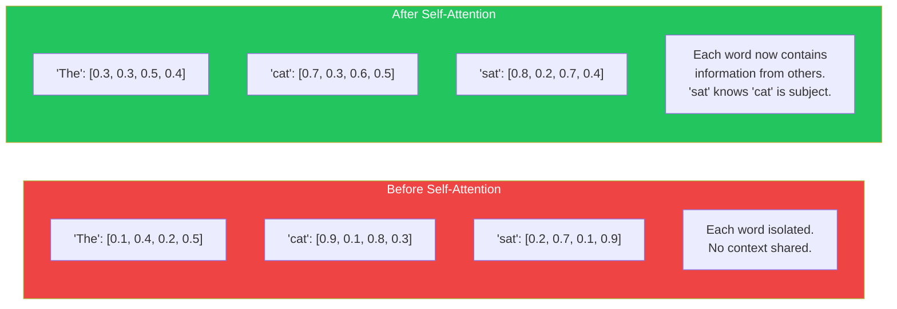
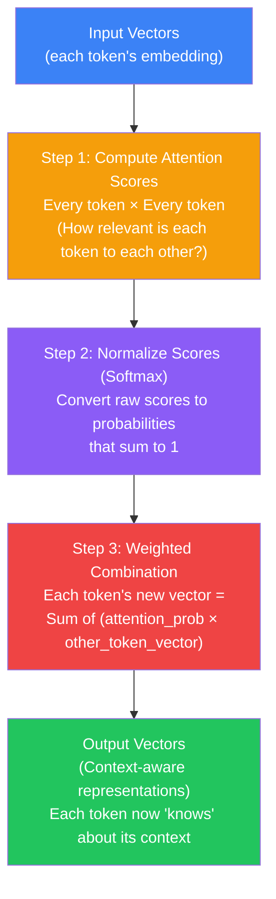
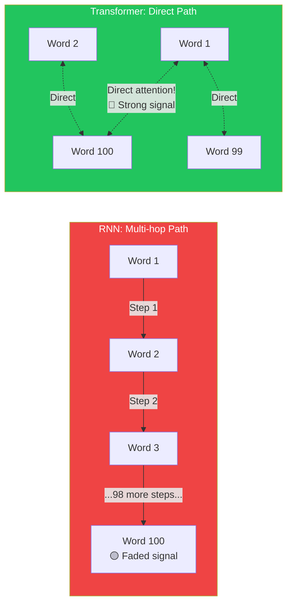
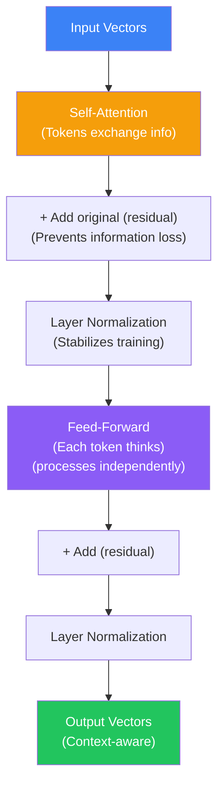

## Introduction

> **Self-attention is a mechanism that lets each token in a sequence look at every other token and decide how much each one matters for understanding its own meaning.**

If the Transformer is the engine of modern AI, self-attention is the fuel injector — it's the critical innovation that makes everything work. Before self-attention, models processed words in isolation or through a compressed summary. Self-attention lets every word build its understanding by **directly consulting every other word**.



---

## The Story: The Pronoun Problem

### How Humans Resolve Ambiguity

Read this sentence:

> "The trophy would not fit in the brown suitcase because **it** was too big."

What is "too big" — the trophy or the suitcase?

Most people say "the trophy." Now read this one:

> "The trophy would not fit in the brown suitcase because **it** was too small."

What is "too small" — the trophy or the suitcase?

This time, "it" refers to "suitcase." The same pronoun, but different meanings, based entirely on context. You figured this out without thinking — your brain automatically connected "it" to the right noun and resolved the ambiguity.

**Self-attention does exactly this.** It's the mechanism that lets the model resolve ambiguity by looking at all the relevant words simultaneously.

---

## Why This Exists

### The Problem: Words Need Context

The same word can mean completely different things in different contexts:

| Sentence | Meaning of "bank" |
|----------|-------------------|
| I need to go to the **bank** to deposit money | Financial institution |
| We sat on the river **bank** watching the water | Side of a river |
| The pilot made a **bank** turn to the left | Tilted turn |

A word's meaning is determined by its context — the words around it. Before self-attention, models struggled to use context effectively because they passed a compressed summary rather than having direct access to all words.

### How Different Architectures Handle Context



---

## Real-World Analogy

### The Conference Room

Imagine you're in a conference room with 10 people. Someone says something you didn't quite catch. You can:

**Old way (RNN):** Only the person next to you can whisper what they heard, and they whisper to the next person, and so on. By the time the message reaches you, it's garbled. You have no way to ask the original speaker directly.

**Self-attention way:** You can turn to any person in the room and ask them directly. You can hear the original speaker. You can ask multiple people. You get the full picture.



### The Spotlight Analogy (Deepened)

Imagine each word holds a **spotlight** that it can shine on every other word. The spotlight isn't equally bright for all words — it's brighter for words that are more relevant.

- In "I deposited money at the **bank**," the word "bank" shines:
  - 🔦🔦🔦 **Bright** on "deposited" and "money" (these define its meaning)
  - 🔦 **Dim** on "I" and "at" and "the" (these are less important)

- In "We sat on the river **bank**," the word "bank" shines:
  - 🔦🔦🔦 **Bright** on "river" and "sat" (these define its meaning)
  - 🔦 **Dim** on "We" and "on" and "the"

The model learns these spotlight patterns. It learns that "bank" + "deposit" + "money" → financial context. It learns that "bank" + "river" + "sat" → geographical context.



---

## How Self-Attention Works (Step by Step)

Let's walk through self-attention step by step for a simple sentence: **"The cat sat"**

### Step 1: Each Token Has a Vector

Each token has been converted to a vector of numbers (an embedding). For simplicity, let's say each vector has 4 numbers:

```
"The" → [0.1, 0.4, 0.2, 0.5]
"cat" → [0.9, 0.1, 0.8, 0.3]
"sat" → [0.2, 0.7, 0.1, 0.9]
```

### Step 2: Each Token Scores Every Other Token

For each token, the model computes an **attention score** with every other token — including itself. This score represents "how relevant is this other token to me?"



The word "sat" gives a score of 0.9 to "cat" — because "cat" is the subject doing the sitting. It gives 0.1 to "The" (less relevant).

### Step 3: Normalize the Scores (Softmax)

The scores are normalized so they sum to 1. This turns them into a **probability distribution**:

```
'sat' attention distribution:
- 'The': 0.05 (5% attention)
- 'cat': 0.85 (85% attention)  ← most of 'sat's attention is on 'cat'
- 'sat': 0.10 (10% attention)
```

### Step 4: Create Context-Aware Vectors

Each token's final vector is a **weighted combination** of all tokens' vectors, weighted by the attention scores:

```
'sat's new vector = 
    0.05 × 'The' vector  + 
    0.85 × 'cat' vector  +    ← mostly 'cat'
    0.10 × 'sat' vector
```

The result: **'sat' now contains information about 'cat' in its vector**. The word 'sat' now "knows" that 'cat' is the subject.



---

## The Self-Attention Flow



---

## Why Self-Attention Is Better Than Sequential Processing

| Aspect | Sequential (RNN) | Self-Attention (Transformer) |
|--------|-----------------|------------------------------|
| **Distance** | Far apart words have weak connections | Any distance = same direct connection |
| **Speed** | Must process word 1, then 2, then 3... | Process all words simultaneously |
| **Memory** | Compressed hidden state loses information | Every word sees all words directly — no compression |
| **Parallelization** | Cannot parallelize (needs previous step) | Fully parallelizable on GPU |
| **Long sentences** | Performance degrades after ~100 words | Handles 100K+ tokens equally well |

### The "Direct Path" Advantage

In an RNN, information travels through a chain:
```
Word 1 → Word 2 → Word 3 → ... → Word 100
```
Information from Word 1 must pass through 99 compressions to reach Word 100. Each compression loses detail.

In a Transformer, every word has a direct path to every other word:
```
Word 1 ←→ Word 100  (direct connection, no compression)
```



---

## Visualizing Attention Weights

Attention weights are often visualized as heat maps:

```
          The   cat   sat   on   the   mat
    The   0.3   0.4   0.1   0.1   0.1   0.0
    cat   0.1   0.4   0.3   0.1   0.0   0.1
    sat   0.0   0.6   0.2   0.1   0.0   0.1
    on    0.0   0.1   0.2   0.2   0.3   0.2
    the   0.1   0.1   0.0   0.2   0.3   0.3
    mat   0.0   0.1   0.0   0.1   0.3   0.5
```

Reading row "sat": it gives 60% of its attention to "cat." This tells us the model has learned that the subject (cat) is highly relevant to the verb (sat).

---

## Code Example: Simplified Self-Attention

```python
import numpy as np

def simple_self_attention(vectors):
    """
    A simplified self-attention computation.
    Real self-attention uses learned QKV matrices (next document).
    """
    n_tokens = len(vectors)
    dim = len(vectors[0])

    # Step 1: Compute attention scores (dot products)
    scores = np.zeros((n_tokens, n_tokens))
    for i in range(n_tokens):
        for j in range(n_tokens):
            # Dot product: how similar are these two vectors?
            scores[i][j] = np.dot(vectors[i], vectors[j])

    # Step 2: Normalize (softmax) so each row sums to 1
    def softmax(x):
        exp_x = np.exp(x - np.max(x))
        return exp_x / np.sum(exp_x)

    attention_weights = np.array([softmax(row) for row in scores])

    # Step 3: Weighted combination
    output = np.dot(attention_weights, vectors)

    return output, attention_weights


# Example: "The cat sat"
vectors = np.array([
    [0.1, 0.4, 0.2, 0.5],   # 'The'
    [0.9, 0.1, 0.8, 0.3],   # 'cat'
    [0.2, 0.7, 0.1, 0.9],   # 'sat'
])

output, weights = simple_self_attention(vectors)

print("Attention Weights:")
print(np.round(weights, 2))
#          The    cat    sat
# The:   [0.33,  0.42,  0.25]
# cat:   [0.23,  0.42,  0.35]
# sat:   [0.13,  0.67,  0.20]  ← sat mostly attends to cat!

print("\nOutput Vectors (context-aware):")
print(np.round(output, 2))
```

---

## JavaScript Example: Visualizing Attention

```javascript
// Simplified self-attention visualization
function selfAttention(vectors) {
  const n = vectors.length;

  // Step 1: Compute attention scores (dot products)
  const scores = Array.from({ length: n }, () => new Array(n).fill(0));
  for (let i = 0; i < n; i++) {
    for (let j = 0; j < n; j++) {
      scores[i][j] = vectors[i].reduce((sum, v, k) => sum + v * vectors[j][k], 0);
    }
  }

  // Step 2: Softmax normalization
  function softmax(arr) {
    const max = Math.max(...arr);
    const exp = arr.map(x => Math.exp(x - max));
    const sum = exp.reduce((a, b) => a + b, 0);
    return exp.map(x => x / sum);
  }

  const attentionWeights = scores.map(row => softmax(row));

  // Step 3: Weighted combination
  const output = attentionWeights.map(row =>
    vectors[0].map((_, dim) =>
      row.reduce((sum, weight, j) => sum + weight * vectors[j][dim], 0)
    )
  );

  return { output, weights: attentionWeights };
}

// Test
const vectors = [
  [0.1, 0.4, 0.2, 0.5],   // 'The'
  [0.9, 0.1, 0.8, 0.3],   // 'cat'
  [0.2, 0.7, 0.1, 0.9],   // 'sat'
];

const { weights } = selfAttention(vectors);
console.log('Attention weights (row attends to column):');
weights.forEach((row, i) => {
  console.log(`Word ${i}: [${row.map(w => w.toFixed(2)).join(', ')}]`);
});
// Word 2 (sat): [0.13, 0.67, 0.20] → 67% attention on word 1 (cat)
```

---

## The Big Picture: Where Self-Attention Lives

Self-attention is one component of a Transformer block. Each block contains:

1. **Self-Attention** → Tokens exchange information
2. **Feed-Forward** → Each token processes what it learned



This entire block is stacked 12 times (BERT-base) to 96 times (GPT-3) or more. Each layer lets tokens exchange more refined information.

---

## Common Misconceptions

| Misconception | Truth |
|--------------|-------|
| "Self-attention means the model is conscious of what it's doing" | It's a mathematical operation — dot products and weighted averages. No consciousness. |
| "Each token can only attend to nearby tokens" | Self-attention connects every token to every other token equally, regardless of distance |
| "Self-attention is the same as attention" | Self-attention = tokens attending to other tokens in the same sequence. Regular attention = attending between two different sequences (e.g., encoder-decoder attention) |
| "Attention weights are human-interpretable" | Sometimes patterns emerge (like "it" → "animal"), but often the weights are inscrutable |
| "Self-attention replaces all other processing" | Self-attention is followed by feed-forward layers — both are needed |

---

## Interview Questions

### Easy

**Q: What is self-attention in one sentence?**

> Self-attention is a mechanism that lets each word in a sentence look at every other word and decide how much each one matters for understanding its own meaning.

**Q: How does self-attention help with ambiguous words?**

> Words like "bank" have multiple meanings. Self-attention lets the word "bank" look at surrounding words like "deposit" and "money" or "river" and "sat" to determine which meaning is correct. It computes attention scores between "bank" and every other word, and the highest-scoring context words disambiguate the meaning.

### Medium

**Q: Explain the difference between how an RNN and a Transformer handle the word 'it' in a long sentence.**

> An RNN processes words sequentially, passing a compressed hidden state forward. By the time the RNN reaches "it," the hidden state contains a lossy summary of all previous words. Information about the noun that "it" refers to (e.g., "animal" from 20 words earlier) may be weakened or lost. A Transformer's self-attention lets "it" directly attend to "animal" regardless of distance — there's no compression, no fading. The attention weight between "it" and "animal" can be as high as if they were adjacent.

**Q: What are attention weights and what do they represent?**

> Attention weights are numerical scores that represent how much one token should "pay attention" to another token. They are computed as a dot product between token vectors, then normalized with softmax to sum to 1. A high weight (e.g., 0.85) means the model considers that pair highly relevant. A low weight (e.g., 0.02) means the pair is not important for the current context. The model learns which weights to assign through training — it's not hardcoded.

### Hard

**Q: What is the computational complexity of self-attention and why does it matter?**

> Self-attention has O(n²) computational complexity where n is the sequence length. For every token, we compute a score with every other token — so a sequence of 1,000 tokens requires 1,000,000 score computations. This is both a strength (every token sees every other token) and a limitation (quadratic cost for long sequences). This is why context windows are limited: a 128K token sequence requires ~16 billion attention computations. Various optimizations (Flash Attention, sparse attention, ring attention) reduce this cost to enable longer contexts.

**Q: How does self-attention handle the fact that words at different positions need different attention patterns?**

> The model doesn't use the raw token embeddings for attention. Instead, it transforms each token into three different vectors — Query, Key, and Value (QKV) — through learned linear projections. Each attention head learns different QKV projection matrices, allowing it to specialize in different relationship types. One head might learn to attend to syntactic subjects (verbs → nouns), another to attend to pronouns and their referents, another to attend to nearby words for local context. This is covered in depth in the next document.

---

## Summary

| Concept | Key Point |
|---------|-----------|
| **Self-attention** | Each token looks at every other token to understand context |
| **Attention weight** | A score (0-1) representing how relevant one token is to another |
| **Weighted combination** | Each token's new vector = weighted sum of all tokens' vectors |
| **Direct connections** | Any two tokens connect directly — no compression or fading |
| **Parallel processing** | All attention scores computed simultaneously on GPU |
| **Context resolution** | Resolves ambiguity ("bank" → financial or river?) using surrounding words |
| **No distance penalty** | Token 1 and Token 100,000 are equally connected |
| **Part of a block** | Self-attention + feed-forward, repeated N times |
| **Quadratic cost** | O(n²) — each token attends to every token |

---

## Navigation

**Previous:** [05 — Transformer Overview](/ai/phase-04-large-language-models/05-transformer-overview)

**Next:** [07 — Query, Key, Value](/ai/phase-04-large-language-models/07-query-key-value)

**Related Topics:**
- [Transformer Overview](/ai/phase-04-large-language-models/05-transformer-overview)
- [Query, Key, Value](/ai/phase-04-large-language-models/07-query-key-value)
- [Multi-Head Attention](/ai/phase-04-large-language-models/08-multi-head-attention)

**Practice Questions:**
1. Explain why self-attention handles long sentences better than RNNs.
2. What does an attention weight of 0.9 between two tokens mean?
3. Draw the three steps of self-attention: Score → Normalize → Weight.
4. Why is self-attention's quadratic complexity a problem for very long sequences?
5. Give an example of a sentence where self-attention resolves word ambiguity.

**Further Reading:**
- [The Illustrated Transformer — Jay Alammar](https://jalammar.github.io/illustrated-transformer/)
- [3Blue1Brown — Attention in transformers, visually](https://www.youtube.com/watch?v=eMlx5fFNoYc)
- [Attention Is All You Need — Section 3.2](https://arxiv.org/abs/1706.03762)
- [Hugging Face Course — Attention Mechanism](https://huggingface.co/learn/nlp-course/chapter4/1)
