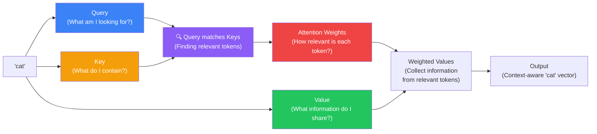
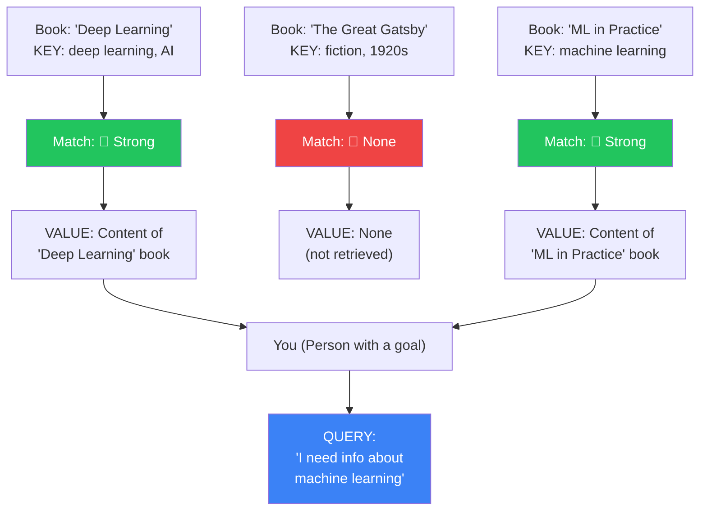
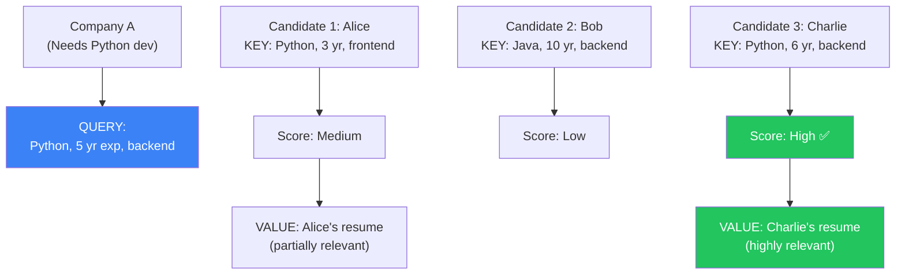
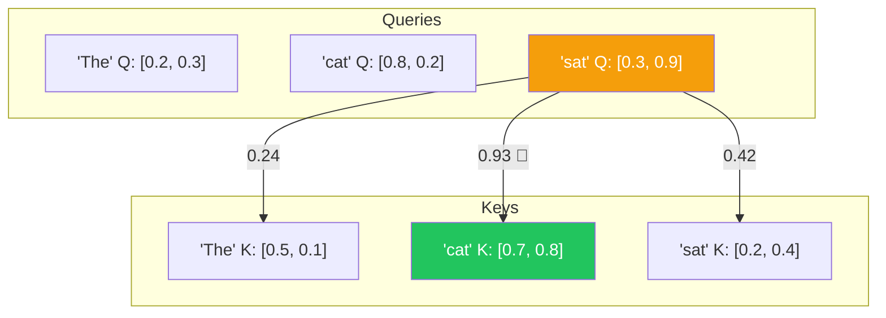
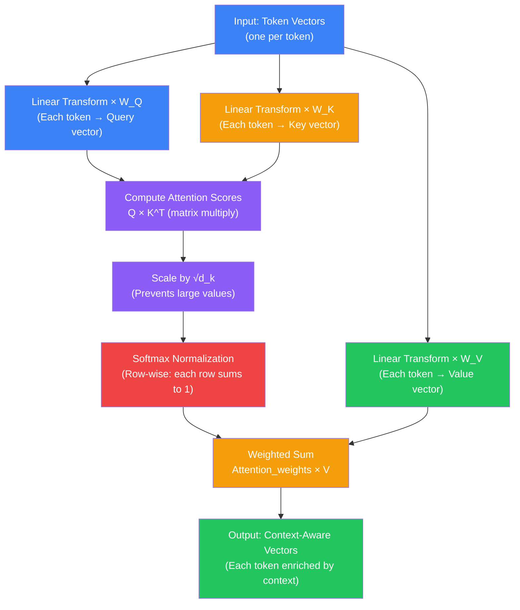

## Introduction

> **Query, Key, Value (QKV) is the mechanism by which self-attention computes relevance — each token is transformed into three roles: the one asking (Query), the ones being asked (Keys), and the information they return (Values).**

In the previous document, we saw self-attention at a high level: each token looks at all others, computes a relevance score, and creates a context-aware vector. But how, exactly, does it compute relevance? How does the model know which words to pay attention to?

The answer is QKV: **Query, Key, Value**. This is the mathematical machinery behind the "spotlight."



---

## The Story: The Library Search

### How You Find Information in a Library

Imagine walking into a massive library. You need a book about machine learning.

**Step 1: You have a Query.** Your query is a question or topic you're looking for: "machine learning."

**Step 2: Each book has a Key.** Every book on the shelf has a title, a subject tag, and a table of contents. These are the book's "keys" — they describe what the book contains.

**Step 3: You match your Query against the Keys.** You scan the shelves, looking at each book's title and subject. Some matches are strong: "Hands-On Machine Learning" → great match. Some are weak: "The Great Gatsby" → no match.

**Step 4: You retrieve the Value.** For good matches, you pull the Value — the actual content of the book. For bad matches, you ignore the book.



### This Is Exactly What QKV Does

Self-attention uses the same three-part structure:

| Role | Library Analogy | Self-Attention Meaning |
|------|----------------|----------------------|
| **Query (Q)** | Your search topic | What is this token looking for? |
| **Key (K)** | Book title/subject | What does this token contain? |
| **Value (V)** | Book content | What information does this token share? |

---

## Why QKV Exists

### The Problem: Raw Vectors Aren't Good at Finding Relevance

In our simplified self-attention (previous document), we used raw token vectors and computed dot products directly. This works, but it's not flexible enough. Why?

Because a token's embedding vector needs to serve **three separate purposes**:

1. **As a Query** — "What am I looking for?" (e.g., 'sat' needs to find its subject)
2. **As a Key** — "What do I contain?" (e.g., 'cat' needs to advertise that it's a subject)
3. **As a Value** — "What info do I share?" (e.g., 'cat' needs to provide its full meaning)

These three roles require **different representations of the same token**. A single vector can't do all three jobs well.

### The Solution: Three Different Views of Each Token

QKV solves this by transforming each token's embedding into **three different vectors** using learned weight matrices:

```
Original embedding:      [0.9, 0.1, 0.8, 0.3]  (just one vector)

Query transformation:    Q = embedding × W_Q     → Query vector
Key transformation:      K = embedding × W_K     → Key vector
Value transformation:    V = embedding × W_V     → Value vector
```

The model learns the weight matrices W_Q, W_K, and W_V during training. It learns what makes a good query, what makes a good key, and what information should be shared as values.

---

## Real-World Analogy

### The Job Fair

Imagine a job fair where:

- Each **company** has a **Query**: "We need a Python developer with 5 years experience"
- Each **candidate** has a **Key**: "I know Python, JavaScript, and have 3 years experience"
- The company (Query) matches against each candidate's Key → finds good matches
- For matched candidates, the company reads their **Value**: their full resume, portfolio, references



Each token at the job fair plays all three roles simultaneously: it has its own Query (what it needs), its own Key (what it offers), and its own Value (what it shares when matched).

---

## How QKV Works (Step by Step)

Let's trace through the QKV computation for our sentence **"The cat sat."**

### Step 1: Create Q, K, V for Each Token

Each token starts with its embedding vector. Three learned matrices (W_Q, W_K, W_V) transform it:

```
'The' embedding:     [0.1, 0.4, 0.2, 0.5]
'cat' embedding:     [0.9, 0.1, 0.8, 0.3]
'sat' embedding:     [0.2, 0.7, 0.1, 0.9]

After transformation (simplified):

'The' → Q: [0.2, 0.3]   K: [0.5, 0.1]   V: [0.4, 0.6, 0.2]
'cat' → Q: [0.8, 0.2]   K: [0.7, 0.8]   V: [0.9, 0.3, 0.7]
'sat' → Q: [0.3, 0.9]   K: [0.2, 0.4]   V: [0.5, 0.8, 0.1]
```

Note: Q and K vectors are usually the same dimension (so we can dot-product them). V can have its own dimension.

### Step 2: Compute Attention Scores (Query × Key)

For each Query (each token), compute dot product with every Key (every token):

```
'sat' Query = [0.3, 0.9]

Dot with 'sat' Key [0.2, 0.4]:  0.3×0.2 + 0.9×0.4 = 0.42
Dot with 'cat' Key [0.7, 0.8]:  0.3×0.7 + 0.9×0.8 = 0.93  ← high!
Dot with 'The' Key [0.5, 0.1]:  0.3×0.5 + 0.9×0.1 = 0.24
```

The model has learned that 'sat' (verb) is looking for its subject. 'cat' has a high Key match because it's a noun that can be a subject. 'The' has a lower match.



### Step 3: Softmax Normalization

Convert raw scores to probabilities:

```
'sat' raw scores:  [0.24, 0.93, 0.42]
'sat' softmax:     [0.18, 0.58, 0.24]
                    18%    58%    24%
```

'sat' will pay 58% attention to 'cat', 24% to itself, 18% to 'The'.

### Step 4: Weighted Sum of Values

Each Value vector is multiplied by its attention weight and summed:

```
'sat' new vector = 
    0.18 × V('The') +     [0.4, 0.6, 0.2] × 0.18
    0.58 × V('cat') +     [0.9, 0.3, 0.7] × 0.58  ← mostly this
    0.24 × V('sat')       [0.5, 0.8, 0.1] × 0.24

'sat' new vector = [0.72, 0.48, 0.47]
```

'sat' now contains a lot of information from 'cat' — it "knows" that 'cat' is its subject.

---

## The QKV Flow Diagram



---

## Why Three Separate Transformations?

| If we only had... | Problem |
|------------------|---------|
| **Q and V** (no K) | No way to describe what a token *contains* — can't match relevance |
| **K and V** (no Q) | No way for a token to express *what it's looking for* |
| **One vector for all three** | Conflict: the features needed for "what am I looking for?" differ from "what do I contain?" |
| **Q and K** (no V) | Can find relevance but has no information to share |

**The three transformations allow each token to specialize:**

- The **Query** asks: "What should I pay attention to?"
- The **Key** answers: "Here's what I contain — see if it matches your query."
- The **Value** provides: "Here's the information to pass along if I'm relevant."

The model learns **W_Q, W_K, W_V** during training to optimize these roles.

---

## The "Dot Product" Matching Explained

The matching between a Query and a Key is done via **dot product** — a simple mathematical operation that measures similarity.

```python
# Dot product: how aligned are two vectors?
query =  [0.3, 0.9]    # 'sat' looking for something
key_a =  [0.7, 0.8]    # 'cat': "I contain noun/subject info"
key_b =  [0.1, 0.2]    # 'the': "I contain article info"

# Dot product = sum of element-wise multiplication
match_a = 0.3*0.7 + 0.9*0.8 = 0.93  # Strong match!
match_b = 0.3*0.1 + 0.9*0.2 = 0.21  # Weak match
```

When two vectors point in similar directions (their values are aligned), the dot product is high. When they point in different directions, the dot product is low.

The model learns the Q and K transformations so that **related tokens have aligned Q and K vectors**.

---

## The Scale Factor: Why √d_k?

After computing Q × K^T, the scores are divided by √d_k (where d_k is the dimension of the Key vectors). Why?

Without scaling, dot products in high dimensions can become very large. Large values push softmax into extreme territory (one value near 1, all others near 0), making attention too "sharp" and reducing the gradient for learning.

Scaling by √d_k keeps the values in a reasonable range where softmax produces smoother distributions.

---

## Python Example: QKV Self-Attention

```python
import numpy as np

def qkv_attention(embeddings, d_k=4, d_v=4):
    """
    Self-attention using learned QKV transformations.
    """
    n_tokens, d_model = embeddings.shape
    
    # Learned weight matrices (randomly initialized for demo)
    # In a real model, these are learned during training
    np.random.seed(42)
    W_Q = np.random.randn(d_model, d_k) * 0.1
    W_K = np.random.randn(d_model, d_k) * 0.1
    W_V = np.random.randn(d_model, d_v) * 0.1
    
    # Step 1: Transform embeddings into Q, K, V
    Q = np.dot(embeddings, W_Q)  # (n_tokens × d_k)
    K = np.dot(embeddings, W_K)  # (n_tokens × d_k)
    V = np.dot(embeddings, W_V)  # (n_tokens × d_v)
    
    # Step 2: Compute attention scores
    # Q × K^T: each query with every key
    scores = np.dot(Q, K.T)  # (n_tokens × n_tokens)
    
    # Step 3: Scale
    scores = scores / np.sqrt(d_k)
    
    # Step 4: Softmax (row-wise)
    def softmax(x):
        exp_x = np.exp(x - np.max(x, axis=1, keepdims=True))
        return exp_x / np.sum(exp_x, axis=1, keepdims=True)
    
    attention = softmax(scores)
    
    # Step 5: Weighted sum of values
    output = np.dot(attention, V)  # (n_tokens × d_v)
    
    return output, attention


# Example
embeddings = np.array([
    [0.1, 0.4, 0.2, 0.5],   # 'The'
    [0.9, 0.1, 0.8, 0.3],   # 'cat'
    [0.2, 0.7, 0.1, 0.9],   # 'sat'
])

output, attention = qkv_attention(embeddings)

print("Attention weights (row → column):")
for i, token in enumerate(['The', 'cat', 'sat']):
    row = [f"{a:.2f}" for a in attention[i]]
    print(f"  {token}: [{', '.join(row)}]")

# The model has learned (through random init, not training)
# to distribute attention based on discovered patterns!
```

---

## JavaScript Example: QKV Visualizer

```javascript
function qkvAttention(embeddings) {
  const n = embeddings.length;
  const dModel = embeddings[0].length;
  const dK = 4;
  const dV = 4;

  // Random weight matrices (in reality: learned during training)
  const rand = () => (Math.random() - 0.5) * 0.2;
  const W_Q = Array.from({ length: dModel }, () =>
    Array.from({ length: dK }, () => rand()));
  const W_K = Array.from({ length: dModel }, () =>
    Array.from({ length: dK }, () => rand()));
  const W_V = Array.from({ length: dModel }, () =>
    Array.from({ length: dV }, () => rand()));

  // Matrix multiply helper
  function matMul(mat, vec) {
    return mat[0].map((_, j) =>
      mat.reduce((sum, row, i) => sum + row[j] * vec[i], 0)
    );
  }

  // Transform to Q, K, V
  const Q = embeddings.map(e => matMul(W_Q, e));
  const K = embeddings.map(e => matMul(W_K, e));
  const V = embeddings.map(e => matMul(W_V, e));

  // Attention scores: Q × K^T
  const scores = Q.map(q =>
    K.map(k => q.reduce((sum, v, i) => sum + v * k[i], 0))
  );

  // Scale
  const scaled = scores.map(row =>
    row.map(s => s / Math.sqrt(dK))
  );

  // Softmax
  function softmax(arr) {
    const max = Math.max(...arr);
    const exp = arr.map(x => Math.exp(x - max));
    const sum = exp.reduce((a, b) => a + b, 0);
    return exp.map(x => x / sum);
  }

  const attention = scaled.map(row => softmax(row));

  // Weighted sum of values
  const output = attention.map(row =>
    V[0].map((_, j) =>
      row.reduce((sum, w, i) => sum + w * V[i][j], 0)
    )
  );

  return { output, attention };
}

// Run on example
const embeddings = [
  [0.1, 0.4, 0.2, 0.5],  // 'The'
  [0.9, 0.1, 0.8, 0.3],  // 'cat'
  [0.2, 0.7, 0.1, 0.9],  // 'sat'
];

const { attention } = qkvAttention(embeddings);
console.log('Attention:');
attention.forEach((row, i) => {
  console.log(`Token ${i}: [${row.map(v => v.toFixed(2)).join(', ')}]`);
});
```

---

## QKV in Real Transformers

In real models like GPT-4, the QKV mechanism is identical in concept but differs in scale:

| Model | d_model | d_k (per head) | Heads | Total QKV Parameters |
|-------|---------|----------------|-------|---------------------|
| BERT-base | 768 | 64 | 12 | 768×64×3×12 = 1.8M |
| GPT-3 | 12,288 | 128 | 96 | 12,288×128×3×96 = 453M |
| LLaMA 3 70B | 8,192 | 128 | 64 | 8,192×128×3×64 = 201M |

The concept scales, but the numbers get enormous.

---

## Common Misconceptions

| Misconception | Truth |
|--------------|-------|
| "Q, K, V are hand-designed" | The transformations W_Q, W_K, W_V are learned during training — the model discovers good query/key/value representations |
| "Q, K, V are separate tokens" | Every token has all three — every token acts as a query, a key, and a value simultaneously |
| "QKV only applies to text" | Any data that can be embedded (images, audio, protein sequences) can use QKV attention |
| "The dot product measures semantic similarity" | It measures vector alignment after learned transformations — not directly semantic similarity |
| "QKV is unique to Transformers" | The QKV formulation (from "Attention Is All You Need") is widely used but attention mechanisms existed before 2017 |

---

## Interview Questions

### Easy

**Q: What do Q, K, and V stand for in self-attention?**

> Q = Query — what the token is looking for. K = Key — what the token contains or describes itself as. V = Value — the actual information the token provides. The Query matches against Keys to find relevant tokens, then the Values of those tokens are collected.

**Q: Why can't we just use the original embedding vector instead of Q, K, V?**

> A single embedding vector would need to serve three conflicting purposes simultaneously: (1) expressing what the token is looking for (Query), (2) describing what the token contains (Key), and (3) providing information to pass along (Value). These three roles need different views of the same token, which is why we transform the embedding into three different vectors using learned weight matrices.

### Medium

**Q: Walk through how 'it' in a sentence uses QKV to find its referent.**

> The word "it" is transformed into a Query vector that represents "I'm a pronoun, I need to find the noun I refer to." Every other word (including "it" itself) is transformed into a Key vector that describes what kind of information it contains. The Query of "it" is dot-producted with every Key. Words like "animal" (in "the animal was tired so it rested") have Keys that strongly match the "pronoun-finding" Query — the model has learned that nouns make good referents for pronouns. The attention weight from "it" to "animal" becomes very high. Then "it" collects the Value from "animal" — information about being a tired animal — and incorporates it into its own representation. Now "it" knows it refers to the animal.

**Q: Why is the dot product used for matching Q and K?**

> The dot product measures how aligned two vectors are — when they point in similar directions, the dot product is high. This is computationally efficient (can be parallelized as matrix multiplication on GPUs) and works well with softmax normalization. The model learns the Q and K transformation matrices so that tokens that should attend to each other have aligned Q and K vectors (high dot product), and tokens that shouldn't attend have unaligned vectors (low dot product).

### Hard

**Q: Explain the scaling factor √d_k in attention. Why is it necessary?**

> Without scaling, dot products in high-dimensional spaces can become very large in magnitude. As d_k increases, the variance of the dot product grows proportionally to d_k. Large dot products push the softmax function into regions with extremely sharp gradients — almost all probability mass goes to the largest value, and gradients become very small (saturating softmax). Dividing by √d_k normalizes the variance, keeping the softmax in a region where gradients flow well. This is especially important for training stability. The √d_k factor comes from the observation that for two d_k-dimensional vectors with independent random components with mean 0 and variance 1, the expected dot product has variance d_k — so dividing by √d_k normalizes variance to 1.

**Q: How does the model learn good Q, K, V weight matrices?**

> The weight matrices W_Q, W_K, W_V are initialized randomly and updated through backpropagation during training. The training objective is next-token prediction (for GPT-like models): the model outputs a probability distribution over the vocabulary, and the loss is the cross-entropy between the predicted distribution and the actual next token. Gradients flow back through the entire network, including through the attention mechanism, updating W_Q, W_K, W_V to minimize prediction error. Over billions of training examples, the matrices learn to produce Q vectors that find the right context, K vectors that accurately describe token content, and V vectors that provide useful information. No human labels the Q, K, V matrices — they emerge from the training process.

---

## Summary

| Concept | Key Point |
|---------|-----------|
| **Query (Q)** | What is this token looking for? (e.g., "I'm a verb, find my subject") |
| **Key (K)** | What does this token contain? (e.g., "I'm a noun, I can be a subject") |
| **Value (V)** | What information does this token share when matched? |
| **Dot product (Q·K)** | Measures how well a Query matches a Key (alignment) |
| **Scale factor √d_k** | Prevents large dot products from saturating softmax |
| **Learned matrices** | W_Q, W_K, W_V are learned during training — no hand-designing |
| **Three views** | QKV provides three different views of the same token |
| **Matching** | Q of each token matched against K of all tokens |
| **Collection** | Weighted sum of V from all tokens (weighted by Q·K matches) |

---

## Navigation

**Previous: [06 — Self-Attention](/ai/phase-04-large-language-models/06-self-attention)

**Next: [08 — Multi-Head Attention](/ai/phase-04-large-language-models/08-multi-head-attention)

**Related Topics:**
- [Self-Attention](/ai/phase-04-large-language-models/06-self-attention)
- [Multi-Head Attention](/ai/phase-04-large-language-models/09-multi-head-attention)
- [Transformer Architecture](/ai/phase-04-large-language-models/12-gpt-architecture)

**Practice Questions:**
1. Explain the library search analogy for QKV in your own words.
2. Why does each token need three different vectors (Q, K, V) instead of one?
3. What would happen if we removed the scaling factor √d_k?
4. Trace how 'bank' in "I deposited money at the bank" uses QKV to disambiguate its meaning.
5. How does the model learn what makes a good Query vs a good Key?

**Further Reading:**
- [Attention Is All You Need — Section 3.2.1 (Scaled Dot-Product Attention)](https://arxiv.org/abs/1706.03762)
- [The Illustrated Transformer — Jay Alammar](https://jalammar.github.io/illustrated-transformer/)
- [3Blue1Brown — QKV in Transformers](https://www.youtube.com/watch?v=eMlx5fFNoYc)
- [Hugging Face Course — Attention Mechanism](https://huggingface.co/learn/nlp-course/chapter4/1)
