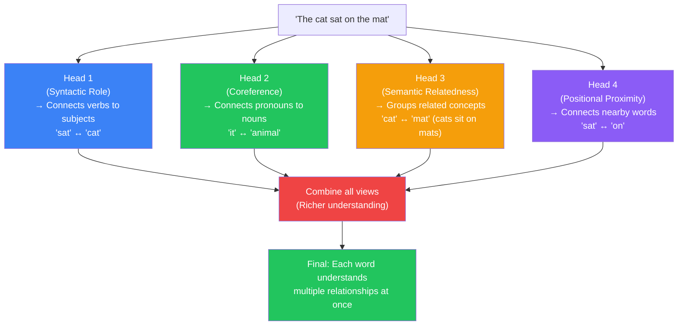
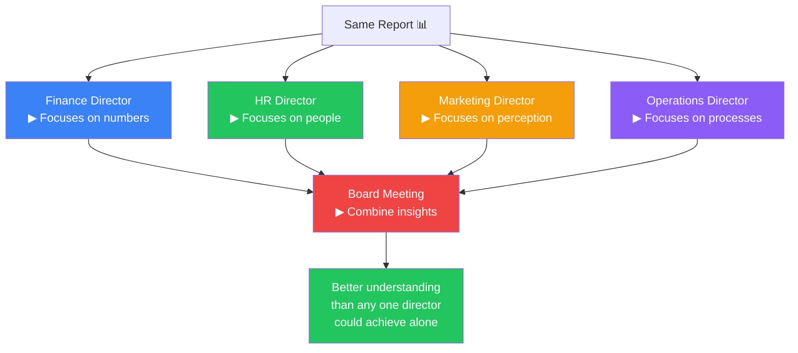
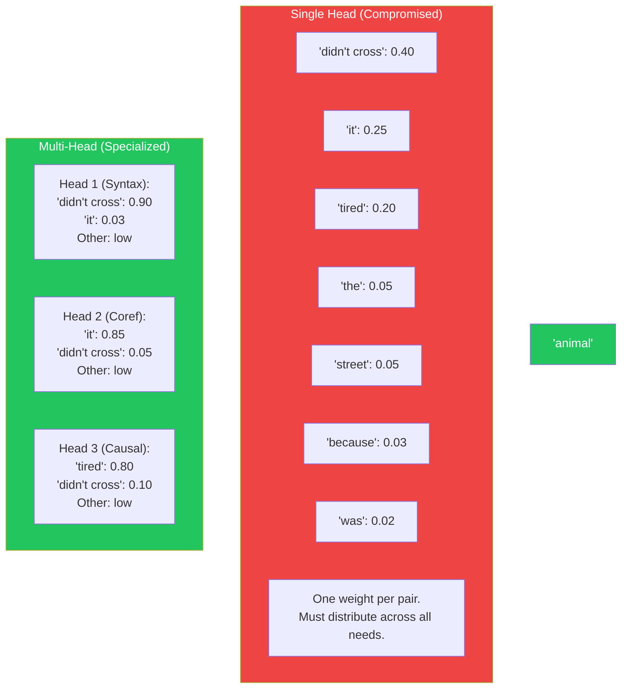
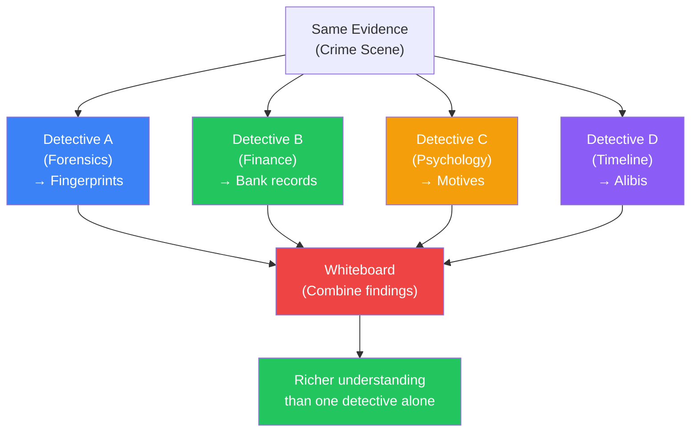
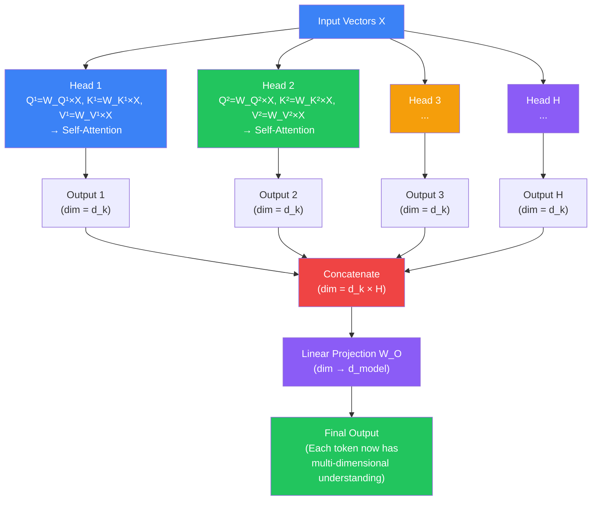
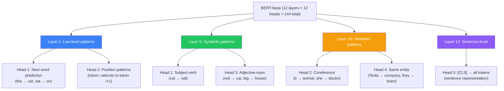

## Introduction

> **Multi-Head Attention runs self-attention multiple times in parallel, each with a different 'view' of the data, so the model can simultaneously track different types of relationships between tokens.**

In a single self-attention layer, each token produces one attention weight for every other token. But one weight per pair isn't enough — a sentence has many types of relationships happening at the same time:

- **Syntactic**: Which words are the subject and verb?
- **Semantic**: Which words are related in meaning?
- **Coreference**: Which pronouns refer to which nouns?
- **Positional**: Which words are nearby?

Multi-head attention lets the model track **all of these simultaneously**.



---

## The Story: The Board of Directors

### One Person Can't Track Everything

Imagine a company with a single CEO trying to understand the company's health. The CEO reads a monthly report. But the CEO can only focus on one thing at a time:

- If they focus on **revenue**, they might miss the **employee satisfaction** problem
- If they focus on **customer feedback**, they might miss the **cash flow** issue
- If they focus on **operations**, they might miss the **market trends**

One person can't track all the important dimensions simultaneously.

### The Solution: Multiple Experts

Now imagine a **board of directors**, each with a different specialty:

| Director | Specialty | What They Watch |
|----------|-----------|----------------|
| Head 1 | Finance | Revenue, costs, cash flow |
| Head 2 | HR | Employee satisfaction, hiring |
| Head 3 | Marketing | Brand perception, customer feedback |
| Head 4 | Operations | Production, logistics |

Each director reads the same report but focuses on different aspects. After the meeting, they combine their insights. The company now has a **multi-dimensional understanding** of its health.



**This is exactly what multi-head attention does.** Each attention "head" is like a specialist director that reads the same sentence but focuses on a different type of relationship.

---

## Why Multi-Head Exists

### The Problem: One Relationship Pattern Isn't Enough

Single-head self-attention computes **one** attention weight per token pair. But words in a sentence participate in multiple relationships simultaneously.

**Example: "The animal didn't cross the street because it was too tired."**

The word "animal" simultaneously:

- Is the **subject** of "didn't cross" (syntactic relationship)
- Is the **referent** of "it" (coreference relationship)
- Is **semantically related** to "tired" (causal relationship)
- Is **semantically unrelated** to "street" (not about streets)

A single attention head must learn one set of weights that tries to capture all of these — but it's forced to compromise. It can't give "animal" high attention for both "didn't cross" (subject) and "tired" (it's the animal that's tired) and "it" (coreference) all at the same time with just one weight per pair.



### The Solution: Multiple Parallel Views

Multi-head attention runs N independent attention computations (each "head"), each with its own learned QKV matrices. Head 1's QKV matrices might learn to detect subject-verb relationships. Head 2's QKV matrices might learn to detect coreference. And so on.

The outputs of all heads are concatenated and projected back to the model dimension, creating a richer representation than any single head could produce.

---

## Real-World Analogy

### The Team of Detectives

A crime has been committed. Instead of one detective investigating, a **team of specialists** examines the same evidence:

| Detective | Specialty | What They Notice |
|-----------|-----------|-----------------|
| **Detective A** | Forensics | Fingerprints, DNA, fibers |
| **Detective B** | Finance | Bank records, transactions |
| **Detective C** | Psychology | Witness statements, motives |
| **Detective D** | Timeline | Alibis, timing, sequences |

They all examine the same crime scene (the same input) but notice different things. At the end of the day, they combine their findings.

**The combined understanding is much richer than any one detective's view.**



---

## How Multi-Head Attention Works

### Step 1: Create Multiple QKV Sets

Instead of one set of W_Q, W_K, W_V matrices, we create H sets (where H = number of heads):

```
Head 1:    W_Q¹, W_K¹, W_V¹
Head 2:    W_Q², W_K², W_V²
Head 3:    W_Q³, W_K³, W_V³
...
Head 8:    W_Q⁸, W_K⁸, W_V⁸ (original Transformer)
Head 96:   W_Q⁹⁶, W_K⁹⁶, W_V⁹⁶ (GPT-3)
```

Each head's matrices are **initialized randomly** and **learn different patterns** through training.

### Step 2: Run Independent Self-Attention Per Head

Each head performs the same QKV self-attention (from document 08) independently:

```
Head 1: Q¹ = X × W_Q¹, K¹ = X × W_K¹, V¹ = X × W_V¹
       Attention¹ = softmax(Q¹ × K¹ᵀ / √d_k) × V¹

Head 2: Q² = X × W_Q², K² = X × W_K², V² = X × W_V²
       Attention² = softmax(Q² × K²ᵀ / √d_k) × V²
```

Each head produces its own output. Because each head has different weight matrices, each produces a different "view" of the relationships between tokens.

### Step 3: Concatenate All Heads

The outputs of all heads are concatenated into one large vector:

```
[Head 1 output, Head 2 output, ..., Head H output]
```

If each head produces a 64-dimensional vector and there are 8 heads, the concatenated vector is 512-dimensional.

### Step 4: Project Back Down

The concatenated vector is passed through a final linear layer (W_O) to project it back to the model's original dimension:

```
Final = Concat[Head 1, ..., Head H] × W_O
```

This gives the model a **single vector per token** that contains information from all heads.



---

## What Each Head Learns

Researchers have visualized attention heads in trained models and found that different heads specialize in different relationship types:

### BERT's Heads (Example)



**Key finding:** Lower layers learn local, syntactic patterns. Higher layers learn semantic, long-range patterns. Different heads within the same layer learn different specializations.

---

## Number of Heads Across Models

| Model | Layers | Heads per Layer | Total Heads | d_k per Head |
|-------|--------|----------------|-------------|-------------|
| Original Transformer (base) | 6 | 8 | 48 | 64 |
| BERT-base | 12 | 12 | 144 | 64 |
| BERT-large | 24 | 16 | 384 | 64 |
| GPT-2 | 12 | 12 | 144 | 64 |
| GPT-3 (175B) | 96 | 96 | 9,216 | 128 |
| LLaMA 3 70B | 80 | 64 | 5,120 | 128 |
| GPT-4 (estimated) | ~120 | ~96 | ~11,520 | ~128 |

Each head adds capacity for the model to track another type of relationship. But more heads also means more parameters and more compute.

---

## Code Example: Multi-Head Attention

```python
import numpy as np

class MultiHeadAttention:
    def __init__(self, d_model=64, num_heads=8):
        self.num_heads = num_heads
        self.d_k = d_model // num_heads  # dimension per head
        self.d_model = d_model

        # Initialize QKV weight matrices for ALL heads at once
        # (efficient: one large matrix instead of H separate small ones)
        np.random.seed(42)
        self.W_Q = np.random.randn(d_model, d_model) * 0.1
        self.W_K = np.random.randn(d_model, d_model) * 0.1
        self.W_V = np.random.randn(d_model, d_model) * 0.1
        self.W_O = np.random.randn(d_model, d_model) * 0.1

    def split_heads(self, x):
        """Split the last dimension into (num_heads, d_k)."""
        batch_size, seq_len, _ = x.shape
        x = x.reshape(batch_size, seq_len, self.num_heads, self.d_k)
        return x.transpose(0, 2, 1, 3)  # (batch, heads, seq, d_k)

    def combine_heads(self, x):
        """Inverse of split_heads."""
        batch_size, heads, seq_len, d_k = x.shape
        x = x.transpose(0, 2, 1, 3)  # (batch, seq, heads, d_k)
        return x.reshape(batch_size, seq_len, self.d_model)

    def scaled_dot_product_attention(self, Q, K, V):
        """Compute attention for a single batch of heads."""
        scores = np.matmul(Q, K.transpose(0, 1, 3, 2))
        scores = scores / np.sqrt(self.d_k)

        # Softmax
        exp_scores = np.exp(scores - np.max(scores, axis=-1, keepdims=True))
        attention = exp_scores / np.sum(exp_scores, axis=-1, keepdims=True)

        return np.matmul(attention, V), attention

    def forward(self, X):
        """X shape: (batch_size, seq_len, d_model)"""
        batch_size = X.shape[0]

        # 1. Linear projections for Q, K, V
        Q = np.dot(X, self.W_Q)  # (batch, seq, d_model)
        K = np.dot(X, self.W_K)
        V = np.dot(X, self.W_V)

        # 2. Split into multiple heads
        Q = self.split_heads(Q)  # (batch, heads, seq, d_k)
        K = self.split_heads(K)
        V = self.split_heads(V)

        # 3. Apply attention to each head independently
        attn_output, attention = self.scaled_dot_product_attention(Q, K, V)

        # 4. Combine heads
        attn_output = self.combine_heads(attn_output)

        # 5. Final projection
        output = np.dot(attn_output, self.W_O)

        return output, attention


# Example usage
d_model = 64
batch_size = 1
seq_len = 4  # "The cat sat"

X = np.random.randn(batch_size, seq_len, d_model)

mha = MultiHeadAttention(d_model=d_model, num_heads=8)
output, attention = mha.forward(X)

print(f"Input shape: {X.shape}")
print(f"Output shape: {output.shape}")
print(f"Attention shape: {attention.shape}")
# Input:  (1, 4, 64)   — 4 tokens, 64-dim vectors
# Output: (1, 4, 64)   — same shape (content is now richer)
# Attention: (1, 8, 4, 4) — 8 heads, each with 4×4 attention matrix

# Show attention for first head, first token
print(f"\nHead 0, Token 0 attention weights:")
print(np.round(attention[0, 0, 0], 2))
```

### JavaScript: Multi-Head Attention Concept

```javascript
class MultiHeadAttention {
  constructor(dModel, numHeads) {
    this.numHeads = numHeads;
    this.dK = dModel / numHeads;
    this.dModel = dModel;

    const rand = () => (Math.random() - 0.5) * 0.2;

    // Create weight matrices for each head (simplified)
    this.heads = Array.from({ length: numHeads }, () => ({
      W_Q: Array.from({ length: dModel }, () =>
        Array.from({ length: this.dK }, () => rand())),
      W_K: Array.from({ length: dModel }, () =>
        Array.from({ length: this.dK }, () => rand())),
      W_V: Array.from({ length: dModel }, () =>
        Array.from({ length: this.dK }, () => rand())),
    }));

    // Output projection
    this.W_O = Array.from({ length: dModel }, () =>
      Array.from({ length: dModel }, () => rand()));
  }

  forward(X) {
    // Run each head independently
    const headOutputs = this.heads.map(head => {
      const { Q, K, V } = this._computeQKV(X, head);
      return this._attention(Q, K, V);
    });

    // Concatenate all head outputs
    const concat = X.map((tokenVec, i) =>
      headOutputs.flatMap(headOut => headOut[i])
    );

    // Output projection
    return concat.map(vec =>
      this.W_O[0].map((_, j) =>
        vec.reduce((sum, v, k) => sum + v * this.W_O[k][j], 0)
      )
    );
  }

  _computeQKV(X, head) {
    const matMul = (mat, vec) =>
      mat[0].map((_, j) => mat.reduce((s, r, i) => s + r[j] * vec[i], 0));

    return {
      Q: X.map(v => matMul(head.W_Q, v)),
      K: X.map(v => matMul(head.W_K, v)),
      V: X.map(v => matMul(head.W_V, v)),
    };
  }

  _attention(Q, K, V) {
    const n = Q.length;
    const scores = Q.map(q =>
      K.map(k => q.reduce((sum, v, i) => sum + v * k[i], 0))
    );

    // Scale
    const scaled = scores.map(row =>
      row.map(s => s / Math.sqrt(this.dK))
    );

    // Softmax
    const softmax = arr => {
      const max = Math.max(...arr);
      const exp = arr.map(x => Math.exp(x - max));
      const sum = exp.reduce((a, b) => a + b, 0);
      return exp.map(x => x / sum);
    };

    const attn = scaled.map(row => softmax(row));

    // Weighted values
    return V[0].map((_, j) =>
      attn.map((row, i) =>
        row.reduce((sum, w, k) => sum + w * V[k][j], 0)
      )
    );
  }
}

// Test
const mha = new MultiHeadAttention(64, 8);
const input = Array.from({ length: 4 }, () =>
  Array.from({ length: 64 }, () => Math.random() - 0.5));

const output = mha.forward(input);
console.log('Input tokens:', input.length);
console.log('Output tokens:', output.length);
console.log('Output dim per token:', output[0].length);
```

---

## The "Attention Head" Intuition

Think of each head as a **lens** through which the model views the sentence:

- **Head 1** → Lens that highlights subject-verb relationships
- **Head 2** → Lens that highlights pronoun-noun relationships
- **Head 3** → Lens that highlights nearby word relationships
- ...

The same sentence looks different through each lens. The model combines all these views to build a complete picture.

---

## Best Practices

1. **More heads isn't always better** — The original Transformer used 8 heads; GPT-3 uses 96. But more heads means more parameters and compute. The optimal number depends on the model size.
2. **Head dimension (d_k) matters** — If d_k is too small, each head can't capture rich relationships. If too large, the computational cost increases. 64-128 is typical.
3. **d_k × num_heads = d_model** — This is the standard design: the total dimension is evenly divided among the heads.
4. **Some heads can be pruned** — Research has shown that some attention heads can be removed without significantly impacting performance. Not all 96 heads in GPT-3 are equally important.
5. **Lower layers vs. higher layers** — If you're analyzing attention patterns, expect lower layers to focus on local/syntactic patterns and higher layers to focus on semantic/long-range patterns.

---

## Common Misconceptions

| Misconception | Truth |
|--------------|-------|
| "Each head has an interpretable purpose" | Some heads show clear patterns (like coreference), but many are inscrutable — they contribute to the model in ways we can't easily name |
| "All heads are equally important" | Some heads are critical; others can be removed with minimal performance loss (head pruning research) |
| "More heads always means better performance" | There's a diminishing return — after a point, more heads add compute without proportional benefit |
| "Each head processes different parts of the input" | All heads process the same input — they just have different learned weight matrices |
| "Multi-head attention is the same as ensemble learning" | Ensemble averages separate models; multi-head concatenates into one richer representation |

---

## Interview Questions

### Easy

**Q: What is multi-head attention?**

> Multi-head attention runs the self-attention mechanism multiple times in parallel, each with different learned weight matrices. Each "head" learns to focus on a different type of relationship between words. The outputs of all heads are concatenated and projected back to the model's dimension, creating a richer representation than a single head could produce.

**Q: How many heads do different Transformer models use?**

> The original Transformer used 8 heads. BERT-base uses 12 heads per layer. BERT-large uses 16. GPT-3 uses 96 heads per layer. LLaMA 3 70B uses 64 heads per layer. The number of heads generally scales with the model size.

### Medium

**Q: Explain the difference between what different attention heads learn.**

> Different attention heads specialize in different types of relationships. For example, in BERT, one head might learn subject-verb dependency (connecting verbs to their subjects), another head might learn coreference (connecting pronouns to their referent nouns), another might learn semantic relatedness (connecting related concepts), and another might learn positional proximity (nearby words). Lower-layer heads tend to focus on local, syntactic patterns; higher-layer heads focus on more abstract, semantic patterns. These specializations are not hand-designed — they emerge from the training data.

**Q: How are the outputs of multiple attention heads combined?**

> Each head produces a vector of dimension d_k (e.g., 64). If there are H heads, the H vectors are concatenated into a single vector of dimension H × d_k (e.g., 8 × 64 = 512). This concatenated vector is then passed through a linear projection layer (W_O) that projects it back to the model's original dimension d_model (e.g., 512). The final output is a single vector per token that contains information from all heads, projected into the same space as the input.

### Hard

**Q: What is the relationship between d_model, num_heads, and d_k? Why is this design used?**

> In the standard Transformer design, d_k = d_model / num_heads. This means the total computational budget (d_model) is evenly divided among the heads. The concatenation of all heads (d_k × num_heads = d_model) produces a vector of exactly the same dimension as the input, which makes the residual connections work cleanly. This design has several advantages: (1) each head gets a fixed compute budget that scales with the model, (2) the output dimension matches the input dimension for residual connections, (3) the per-head dimension (d_k) stays constant even as models grow — GPT-3 uses d_k = 128 whether the model has 12 heads or 96 heads. The key constraint is the scaling factor √d_k in the attention formula — keeping d_k around 64-128 ensures stable gradients.

**Q: Explain how head specialization emerges during training. Is it predictable?**

> Head specialization emerges purely from the training objective (next-token prediction) and random initialization. Different random seeds produce different specializations. However, some patterns are consistent across training runs: lower layers consistently learn local/syntactic patterns, and higher layers consistently learn semantic/long-range patterns. Within a layer, which head learns which specialization is not predictable — it depends on the random initialization. The model discovers whatever division of labor is most useful for minimizing the loss. Some heads may develop clear, interpretable patterns (like attending to punctuation), while others may have complex, distributed patterns that aren't easily characterized. Research has also shown that many heads are redundant — you can prune up to 30-50% of heads in some models without significant performance loss, suggesting that the model has more capacity than needed.

---

## Summary

| Concept | Key Point |
|---------|-----------|
| **Multi-Head Attention** | Running self-attention H times in parallel with different weight matrices |
| **Each head** | Learns a different type of relationship (syntax, coreference, proximity, etc.) |
| **Concatenation** | All head outputs are concatenated into one vector |
| **Output projection** | W_O projects concatenated heads back to model dimension |
| **d_k = d_model / heads** | Standard design for evenly distributing compute |
| **Specialization emerges** | Heads naturally specialize during training |
| **144 total (BERT-base)** | 12 layers × 12 heads |
| **9,216 total (GPT-3)** | 96 layers × 96 heads |
| **Not all needed** | Some heads can be pruned without major performance loss |

---

## Navigation

**Previous:** [07 — Query, Key, Value](/ai/phase-04-large-language-models/07-query-key-value)

**Next:** [09 — Positional Encoding](/ai/phase-04-large-language-models/09-positional-encoding)

**Related Topics:**
- [Query, Key, Value](/ai/phase-04-large-language-models/07-query-key-value)
- [Self-Attention](/ai/phase-04-large-language-models/06-self-attention)
- [GPT Architecture](/ai/phase-04-large-language-models/12-gpt-architecture)

**Practice Questions:**
1. Why is one attention head not enough? What's the limitation?
2. Draw the multi-head attention flow: Input → Split → Attend per head → Concat → Project.
3. If a model has 768 dimensions and 12 heads, what is d_k?
4. Give examples of 4 different relationship types that different heads might learn.
5. Why might some heads be prunable (removable) without major performance loss?

**Further Reading:**
- [Attention Is All You Need — Section 3.2.2 (Multi-Head Attention)](https://arxiv.org/abs/1706.03762)
- [The Illustrated Transformer — Jay Alammar](https://jalammar.github.io/illustrated-transformer/)
- [Analyzing Multi-Head Self-Attention (Clark et al., 2019)](https://arxiv.org/abs/1906.04341)
- [Are Sixteen Heads Really Better than One? (Michel et al., 2019)](https://arxiv.org/abs/1905.10650)
- [What Does BERT Look At? An Analysis of BERT's Attention](https://arxiv.org/abs/1906.04341)
