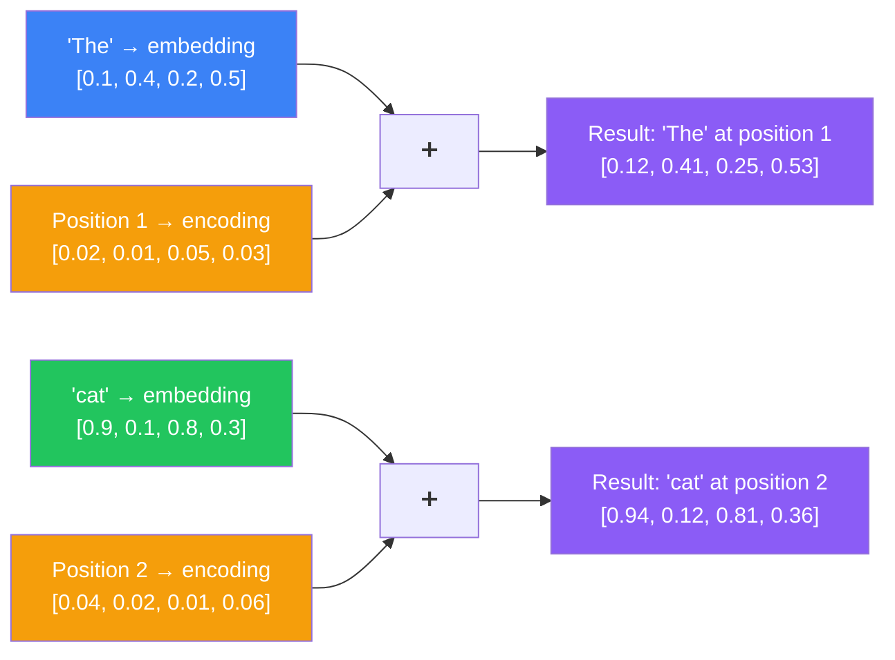
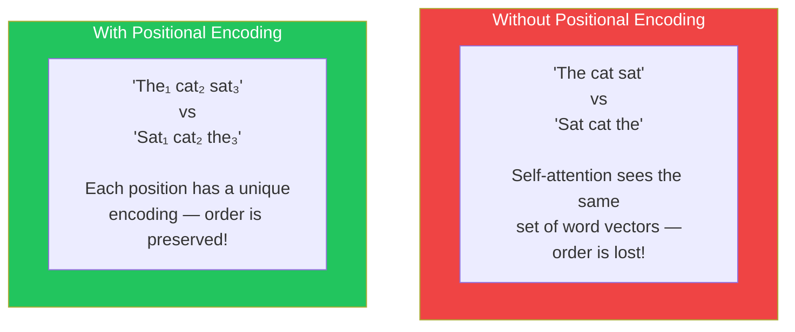
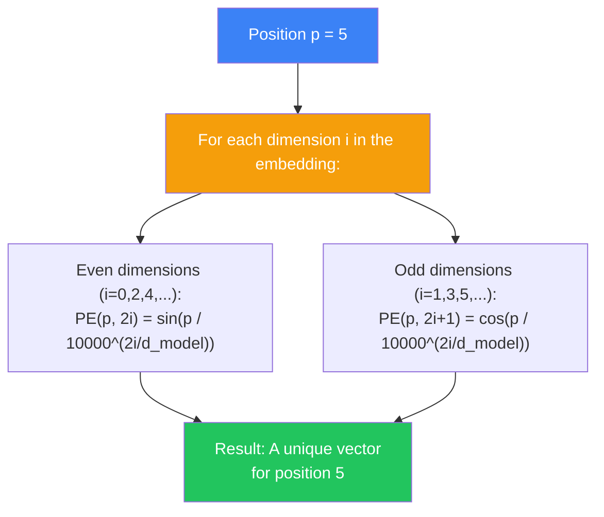
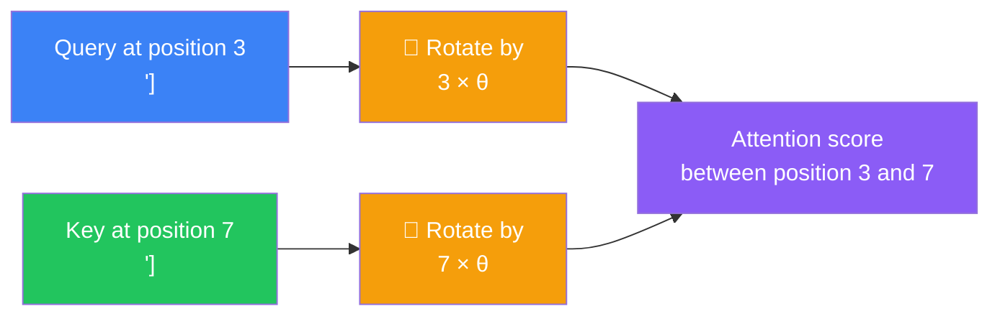
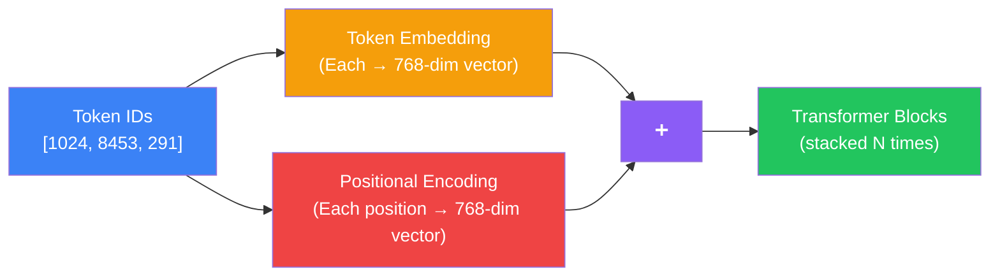

## Introduction

> **Positional encoding is the mechanism that gives a Transformer a sense of word order — adding position information to each token's embedding so the model can distinguish between 'cat bites dog' and 'dog bites cat.'**

Since the Transformer processes all tokens simultaneously, it has no built-in sense of sequence. Without positional encoding, the words "cat sat" and "sat cat" would produce identical attention patterns. Positional encoding solves this by injecting position information into each token's vector.



---

## Why This Exists

### The Problem: Self-Attention Is Order-Blind

Self-attention computes relationships based on similarity between token vectors. If two tokens have similar embeddings, they get high attention scores — regardless of where they appear in the sequence.



**Analogy:** Without page numbers, shuffling the pages of a book produces the same set of pages in a different order. With page numbers, every page knows its position.

---

## Real-World Analogy

### The Numbered Seats

Imagine a theater. Every seat has a row and seat number. Two people might look identical (same embedding), but their seat numbers tell you where they are.

In the Transformer:
- The **token embedding** is the person's appearance
- The **positional encoding** is their seat number
- The **sum** is the person at their specific seat

Without seat numbers, you couldn't tell if the same person was sitting in row 1 or row 10. But with seat numbers, their position is known.

---

## Types of Positional Encoding

### 1. Sinusoidal Positional Encoding (Original Transformer)

The original Transformer used fixed sine and cosine functions at different frequencies:



**Why sine and cosine?** Different frequencies let the model learn relative positions:
- Low-frequency dimensions encode position identity
- High-frequency dimensions encode proximity (nearby vs. far positions)
- The linear nature of sine/cosine allows the model to easily learn **relative** position patterns

### 2. Learned Positional Embedding

Instead of fixed functions, let the model learn position vectors during training:

```
Position 1 → [learned vector 1]
Position 2 → [learned vector 2]
...
Position 512 → [learned vector 512]
```

**Pros:** The model can optimize position representations for its specific task.
**Cons:** Cannot generalize beyond the maximum sequence length seen during training (e.g., if trained on 512 positions, can't handle 600).

### 3. Rotary Position Embedding (RoPE)

Used by LLaMA, Mistral, and most modern LLMs. Instead of adding position to the embedding, RoPE **rotates** the query and key vectors based on their position:



**Why RoPE wins:** The attention score naturally depends only on the **relative position** between two tokens (e.g., distance of 3 rather than absolute positions). This makes it easier for the model to learn position-independent patterns.

### 4. ALiBi (Attention with Linear Biases)

Used by some models (e.g., MPT). Instead of encoding position in the embeddings, ALiBi adds a bias directly to the attention scores:

```
Attention score between token i and token j =
    query_i · key_j  +  bias(i, j)

where bias(i, j) = -m × |i - j|
```

Nearby tokens get a small bias penalty. Distant tokens get a large bias penalty. This naturally makes the model focus more on nearby tokens.

### Comparison

| Method | Used By | Fixed or Learned | Handles Long Sequences? |
|--------|---------|-----------------|----------------------|
| **Sinusoidal** | Original Transformer | Fixed | Yes (infinite) |
| **Learned** | BERT, GPT-2 | Learned | No (limited to max trained length) |
| **RoPE** | LLaMA, Mistral, GPT-NeoX | Learned rotation | Yes (can extrapolate) |
| **ALiBi** | MPT, some Bloom variants | Fixed bias | Yes (excellent extrapolation) |

---

## How Positional Encoding Is Applied

The positional encoding is **added** to the token embedding before the first Transformer block:



---

## Code Example: Sinusoidal Encoding

```python
import numpy as np

def sinusoidal_positional_encoding(seq_len: int, d_model: int) -> np.ndarray:
    """
    Generate sinusoidal positional encodings.
    
    Args:
        seq_len: Length of the input sequence
        d_model: Dimension of the embedding
    
    Returns:
        Array of shape (seq_len, d_model) with positional encodings
    """
    pe = np.zeros((seq_len, d_model))
    
    for pos in range(seq_len):
        for i in range(0, d_model, 2):
            # Even dimensions: sin
            pe[pos, i] = np.sin(pos / (10000 ** (i / d_model)))
            # Odd dimensions: cos
            if i + 1 < d_model:
                pe[pos, i + 1] = np.cos(pos / (10000 ** (i / d_model)))
    
    return pe

# Example: sequence of 10 tokens, 512-dim embeddings
encodings = sinusoidal_positional_encoding(seq_len=10, d_model=512)

print(f"Shape: {encodings.shape}")  # (10, 512)
print(f"Position 0, first 5 dims: {encodings[0, :5].round(3)}")
print(f"Position 5, first 5 dims: {encodings[5, :5].round(3)}")
```

---

## Best Practices

1. **Use RoPE for modern LLMs** — It handles relative position naturally and can generalize to longer sequences than seen during training.
2. **Absolute position is not enough** — Modern architectures combine absolute and relative position information for best results.
3. **Consider context window when choosing** — Sinusoidal and RoPE can theoretically handle infinite positions, while learned embeddings max out at the training length.
4. **Positional encoding is critical** — Don't skip or disable it. The model cannot learn word order without it.

---

## Common Misconceptions

| Misconception | Truth |
|--------------|-------|
| "Positional encoding is just for word order" | It also encodes distance and relative position — the model learns patterns like "words 3 positions apart typically relate this way." |
| "You can add any numbers as position" | The specific pattern matters — sine/cosine and RoPE have mathematical properties that make learning easier. |
| "Learned embeddings are always better" | Learned embeddings max out at the training sequence length; sinusoidal and RoPE can extrapolate to longer sequences. |
| "Position is added at every layer" | Positional encoding is added once at the input. It propagates through layers via residual connections. |

---

## Interview Questions

### Easy

**Q: Why do Transformers need positional encoding?** 

> Self-attention is permutation-invariant — it computes the same attention scores regardless of the order of tokens. Without positional encoding, "The cat sat" and "Sat cat the" would produce identical attention patterns. Positional encoding injects order information so the model can distinguish between different sequences of the same words.

**Q: How do sinusoidal positional encodings work conceptually?** 

> Sinusoidal encodings use sine and cosine functions at different frequencies to create a unique vector for each position. Low-frequency dimensions vary slowly across positions (identifying which position), while high-frequency dimensions vary rapidly (encoding proximity to other positions). The encoding is added to the token embedding before the first Transformer block.

### Hard

**Q: Why does RoPE (Rotary Position Embedding) work better than absolute positional encoding?** 

> RoPE applies a rotation to the query and key vectors based on their position, rather than adding a position vector to the embedding. The key insight is that the dot product between a rotated query and a rotated key naturally depends only on the **relative** position between the two tokens, not their absolute positions. This means: (1) the model learns patterns that generalize across positions — a relationship learned for positions 5 and 10 also works for positions 100 and 105. (2) RoPE can extrapolate to sequences longer than those seen during training. (3) The rotation is smooth, so nearby positions have similar rotations, encoding the intuition that order matters but nearby positions are more similar.

---

## Summary

| Aspect | Key Point |
|--------|-----------|
| **Why needed** | Self-attention is order-blind without it |
| **Sinusoidal** | Fixed sine/cosine functions — can handle infinite positions |
| **Learned** | Model learns position vectors — limited to training length |
| **RoPE** | Rotates Q/K vectors — relative position, extrapolates well |
| **ALiBi** | Adds bias to attention scores — excellent long-range behavior |
| **Application** | Added to token embedding before the first Transformer block |

---

## Navigation

**Previous:** [08 — Multi-Head Attention](/ai/phase-04-large-language-models/08-multi-head-attention)

**Next:** [10 — Feed-Forward Network](/ai/phase-04-large-language-models/10-feed-forward-network)

**Related Topics:**
- [Multi-Head Attention](/ai/phase-04-large-language-models/08-multi-head-attention)
- [Decoder-Only Transformers](/ai/phase-04-large-language-models/11-decoder-only-transformers)
- [GPT Architecture](/ai/phase-04-large-language-models/12-gpt-architecture)
