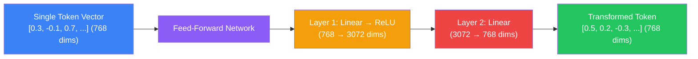
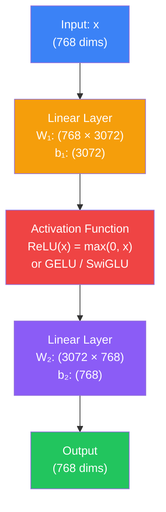
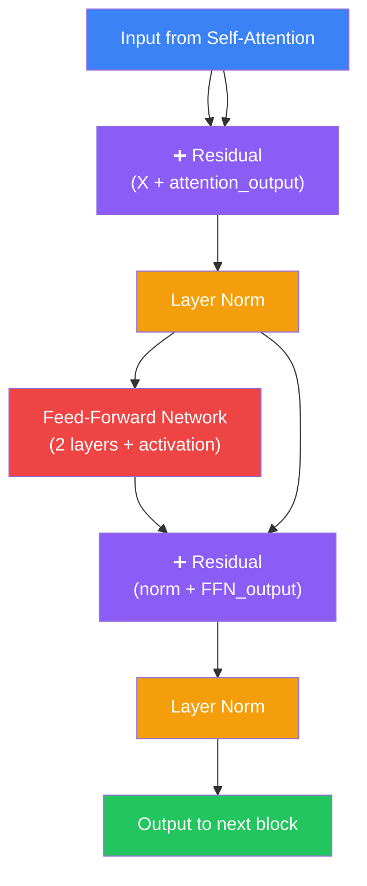
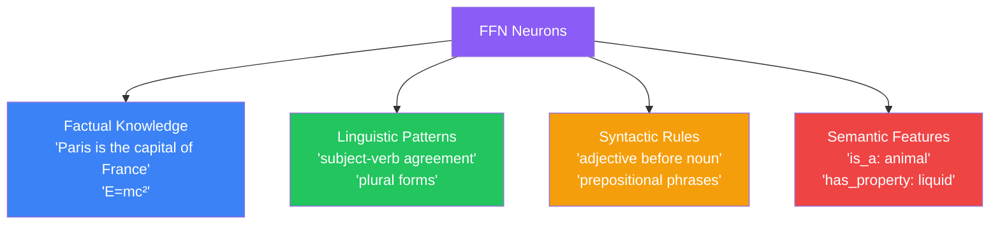

## Introduction

> **The Feed-Forward Network (FFN) is a simple two-layer neural network applied independently to each token — transforming each token's representation using the patterns it learned during training.**

If self-attention is where tokens **talk to each other**, the FFN is where each token **thinks by itself**. It's a crucial but often overlooked component that gives Transformers their ability to learn complex patterns.



---

## Why This Exists

### The Problem: Self-Attention Isn't Enough

Self-attention mixes information between tokens, but it's essentially a **linear weighted sum**. A weighted sum of vectors is still a linear combination. Deep learning needs **non-linear transformations** to learn complex patterns.

The FFN provides:
1. **Non-linearity** — Using activation functions (ReLU, GELU, SwiGLU) to learn non-linear patterns
2. **Expansion and compression** — Expanding to a higher dimension (typically 4×), applying non-linearity, then compressing back
3. **Independent processing** — Each token learns features specific to its meaning, separate from other tokens

### Why Independent Processing Matters

After self-attention, token A already has context from tokens B and C. But token A still needs to **process** that context and transform it into a richer representation. The FFN is where this processing happens — independently for each token.

---

## Real-World Analogy

### The Think Tank

Imagine a committee meeting (self-attention): everyone shares information, asks questions, and exchanges ideas.

After the meeting, each member goes to their **private office** to think (FFN). In their office, they:
- Process what they learned
- Connect it to their existing knowledge
- Form new conclusions
- Come up with creative solutions

No one else is in their office. The thinking is independent. But it builds on the group discussion.

**Self-attention = the meeting. FFN = the private thinking time.**

---

## The Architecture

### The Standard FFN



**Mathematical form (standard):**
```
FFN(x) = W₂ · ReLU(W₁ · x + b₁) + b₂
```

**With GELU activation (used by GPT):**
```
FFN(x) = W₂ · GELU(W₁ · x + b₁) + b₂
```

### The SwiGLU Variant (Modern LLMs)

LLaMA, Mistral, and other modern LLMs use **SwiGLU** (Swish-Gated Linear Unit):

```
FFN(x) = (Swish(x · W₁) ⊙ (x · W₃)) · W₂
```

Instead of one expansion layer, SwiGLU uses three weight matrices — one for the "gate" that controls information flow. This has been shown to improve performance.

---

## Configuration

### The 4× Rule

The hidden dimension of the FFN is almost always **4 times** the model dimension:

| Model | d_model | d_ff (hidden) | Ratio |
|-------|---------|--------------|-------|
| GPT-2 Small | 768 | 3072 | 4× |
| GPT-3 175B | 12288 | 49152 | 4× |
| LLaMA 7B | 4096 | 11008 | ~2.7× |
| LLaMA 65B | 8192 | 22016 | ~2.7× |

> **Why 4×?** This ratio was established in the original Transformer paper and has proven effective. Modern models like LLaMA use ~2.7× with SwiGLU, which is more computationally efficient per unit of quality.

### FFN Parameters

For a model with d_model=768 and d_ff=3072:
- W₁: 768 × 3072 = 2,359,296 parameters
- b₁: 3072 parameters
- W₂: 3072 × 768 = 2,359,296 parameters
- b₂: 768 parameters
- **Total: ~4.7 million parameters per FFN layer**

In a 12-layer model, the FFNs account for ~56 million parameters — a significant portion of the total.

---

## How the FFN Fits Into the Transformer Block



The FFN comes **after** self-attention in each block, wrapped with residual connections and layer normalization.

---

## What the FFN Actually Learns

Research has shown that different FFN neurons specialize in different types of knowledge:



Individual neurons can be surprisingly interpretable:
- **"Paris neuron"** — Activates strongly when Paris is mentioned
- **"Past tense neuron"** — Activates for past-tense verbs
- **"Programming neuron"** — Activates in code-related contexts

This is called the **knowledge neuron** hypothesis — massive amounts of factual knowledge are stored in the FFN weights.

---

## Python: Conceptual FFN

```python
import numpy as np

class FeedForward:
    def __init__(self, d_model: int, d_ff: int):
        self.d_model = d_model
        self.d_ff = d_ff
        
        # Initialize weights
        np.random.seed(42)
        self.W1 = np.random.randn(d_model, d_ff) * 0.1
        self.b1 = np.zeros(d_ff)
        self.W2 = np.random.randn(d_ff, d_model) * 0.1
        self.b2 = np.zeros(d_model)
    
    def forward(self, x: np.ndarray) -> np.ndarray:
        """
        FFN: W2 * GELU(W1 * x + b1) + b2
        
        x shape: (batch_size, seq_len, d_model) or (d_model,)
        """
        # Store input for residual (not shown here)
        
        # Layer 1: expand
        hidden = np.dot(x, self.W1) + self.b1
        
        # GELU activation (approximation)
        hidden = 0.5 * hidden * (1 + np.tanh(
            np.sqrt(2 / np.pi) * (hidden + 0.044715 * hidden ** 3)
        ))
        
        # Layer 2: compress
        output = np.dot(hidden, self.W2) + self.b2
        
        return output

# Example
ffn = FeedForward(d_model=768, d_ff=3072)
x = np.random.randn(768)  # One token vector
result = ffn.forward(x)
print(f"Input shape: {x.shape}")     # (768,)
print(f"Output shape: {result.shape}")  # (768,)
print(f"Input norm: {np.linalg.norm(x):.2f}")
print(f"Output norm: {np.linalg.norm(result):.2f}")
```

---

## Best Practices

1. **d_ff = 4 × d_model** is the standard starting point. Modern architectures use SwiGLU with ~2.7× for better efficiency.
2. **GELU > ReLU** for modern LLMs — it's smoother and slightly more accurate, though marginally slower.
3. **SwiGLU is state-of-the-art** — LLaMA, Mistral, and GPT-4 all use variants of gated activation functions.
4. **The FFN is where most parameters live** — In many models, FFN parameters account for 2/3 of total parameters. This is where the model's knowledge is stored.

---

## Common Misconceptions

| Misconception | Truth |
|--------------|-------|
| "FFNs communicate between tokens" | FFNs process each token independently — there's no token-to-token communication in the FFN. |
| "FFNs are just extra capacity" | FFNs store factual knowledge and linguistic patterns — they're essential, not just extra. |
| "All FFNs in a model are the same" | Each layer's FFN has different learned weights, learning different patterns at different abstraction levels. |
| "The activation function doesn't matter" | The choice of activation (ReLU vs GELU vs SwiGLU) significantly impacts model quality and training stability. |

---

## Interview Questions

**Q: What is the purpose of the Feed-Forward Network in a Transformer?** 

> The FFN is a two-layer neural network applied independently to each token. It provides non-linear transformation capacity — while self-attention is a linear weighted sum of token vectors, the FFN applies non-linear activation functions that let the model learn complex patterns. It also stores factual knowledge in its weights and expands each token's representation to a higher dimension (typically 4×) before compressing it back, allowing richer intermediate representations.

**Q: Why is d_ff typically 4 times larger than d_model?** 

> This 4× ratio was established in the original Transformer paper and has proven empirically effective. The expansion allows each token to form rich intermediate representations — like taking detailed notes in a larger scratchpad — before compressing back to the model dimension. Larger ratios provide more capacity but add parameters and computation. Modern models with SwiGLU use ~2.7× because the gating mechanism provides additional representational capacity without requiring as many dimensions.

---

## Summary

| Aspect | Key Point |
|--------|-----------|
| **Purpose** | Each token processes information independently after self-attention |
| **Architecture** | Two linear layers with non-linear activation in between |
| **Expansion** | Hidden dimension is typically 4× the model dimension |
| **Activation** | ReLU (original), GELU (GPT), SwiGLU (modern LLaMA/Mistral) |
| **Knowledge storage** | FFN weights store factual and linguistic patterns |
| **Independent** | No token-to-token communication — that's what attention is for |

---

## Navigation

**Previous:** [09 — Positional Encoding](/ai/phase-04-large-language-models/09-positional-encoding)

**Next:** [11 — Decoder-Only Transformers](/ai/phase-04-large-language-models/11-decoder-only-transformers)

**Related Topics:**
- [Positional Encoding](/ai/phase-04-large-language-models/09-positional-encoding)
- [Decoder-Only Transformers](/ai/phase-04-large-language-models/11-decoder-only-transformers)
- [GPT Architecture](/ai/phase-04-large-language-models/12-gpt-architecture)
