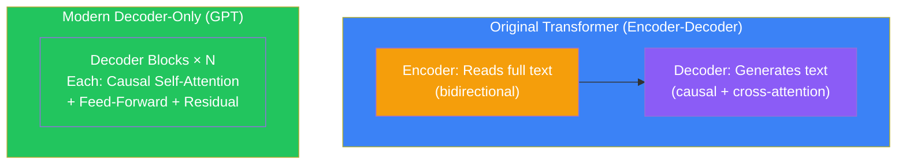
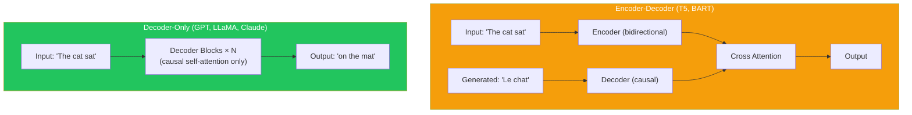
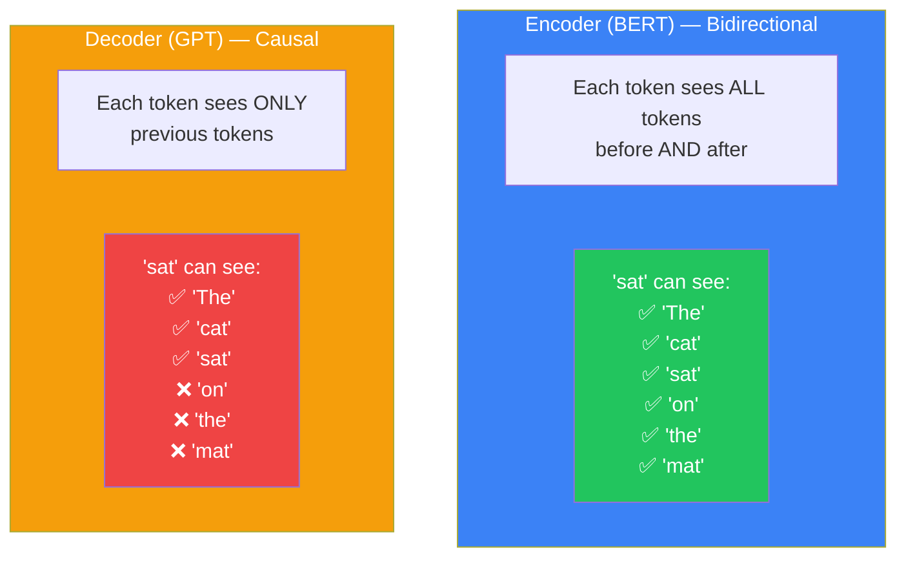
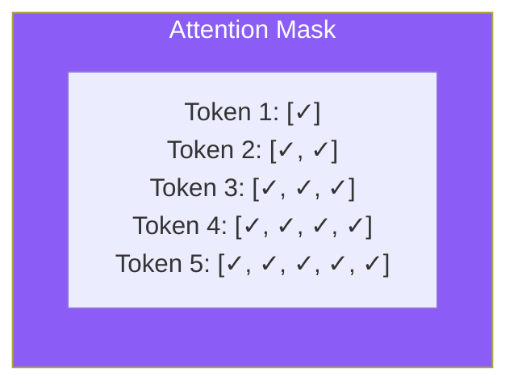
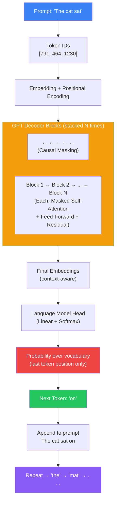

## Introduction

> **A decoder-only Transformer uses causal (masked) self-attention — each token can only attend to tokens that came before it. This makes the architecture inherently generative: it predicts the next token based only on the past, just like writing text left to right.**

While the original Transformer had both an encoder (reads the full text) and a decoder (generates text), modern LLMs like GPT, Claude, LLaMA, and Mistral use a **decoder-only** architecture. This simpler design has proven more scalable and better at text generation.



---

## Why This Exists

### The Problem: The Original Transformer Was Designed for Translation

The original Transformer (2017) used an **encoder-decoder** architecture because it was designed for machine translation. The encoder read the full source sentence, and the decoder generated the target sentence one word at a time, attending to both the encoder's output and its own previous tokens.

For language modeling and text generation, this architecture is unnecessarily complex:
- You don't need an encoder if you're generating text from scratch
- Cross-attention (decoder attending to encoder) adds complexity
- The encoder-decoder design is harder to scale to very large models

### The Solution: Decoder-Only

GPT (2018) showed that a **decoder-only** architecture — just a stack of decoder blocks with causal masking — works perfectly for language modeling. The model receives a prompt and generates tokens one at a time, each token attending only to previous tokens.



---

## Real-World Analogy

### Writing in a Journal

**Encoder-decoder:** You read an entire book (encoder), close it, then write a summary (decoder). When writing, you can't look back at the book — you rely on your memory of it.

**Decoder-only:** You write in a journal. Each sentence builds on everything you've written so far. You can always look back at previous pages. But you can't see the future — you don't know what you'll write tomorrow. Each word is influenced by all words before it, and only before it.

The decoder-only approach is simpler and more natural for generation tasks.

---

## Causal (Masked) Self-Attention

The key feature of decoder-only models is **causal masking**:



**How the mask works:**

The attention score between token i and token j is set to -∞ (which becomes 0 after softmax) if j > i. This means:
- Token 1 can attend to token 1 only
- Token 2 can attend to tokens 1, 2
- Token 3 can attend to tokens 1, 2, 3
- Token N can attend to tokens 1 through N



---

## Architecture Diagram



---

## The Three Variants

| Variant | Example | Self-Attention | Use Case |
|---------|---------|---------------|----------|
| **Encoder-only** | BERT, RoBERTa | Bidirectional | Understanding, classification, NER |
| **Decoder-only** | GPT, LLaMA, Claude | Causal (unidirectional) | Generation, chat, code |
| **Encoder-Decoder** | T5, BART | Both | Translation, summarization |

### Why Decoder-Only Dominates

1. **Simplicity** — One stack of blocks instead of two. No cross-attention mechanism.
2. **Scalability** — Decoder-only models scale more predictably with size and data.
3. **Generality** — Can handle any task by formulating it as text generation.
4. **In-context learning** — Decoder-only models naturally learn from examples in the prompt.
5. **Chain-of-thought** — Causal masking enables step-by-step reasoning.

---

## Code Example: Causal Mask

```python
import numpy as np

def create_causal_mask(seq_len: int):
    """Create a causal attention mask."""
    mask = np.triu(np.ones((seq_len, seq_len)), k=1)
    return mask  # 1 = masked, 0 = visible

seq_len = 5
mask = create_causal_mask(seq_len)
print("Causal mask (1 = blocked, 0 = visible):")
print(mask)

# Token 0 can see: [0, ...]
# Token 1 can see: [0, 0, ...]
# Token 2 can see: [0, 0, 0, ...]
```

---

## Best Practices

1. **Decoder-only for generation** — If your task involves generating text (chat, code, writing), use decoder-only.
2. **Encoder-only for understanding** — If your task is classification or extraction, BERT-style encoder-only is more efficient.
3. **Causal masking is essential** — Never remove the mask. It's what makes generation possible.
4. **KV caching for inference** — During generation, cache the Key and Value matrices from previous tokens to avoid recomputation.

---

## Interview Questions

**Q: What is the difference between encoder-only and decoder-only architectures?** 

> Encoder-only models (BERT) use bidirectional self-attention — each token can attend to all other tokens. This makes them excellent for understanding tasks. Decoder-only models (GPT) use causal (masked) self-attention — each token can only attend to previous tokens. This makes them excellent for generation tasks. Decoder-only models generate text left-to-right, one token at a time, which is natural for chat, code, and creative writing.

**Q: Why do modern LLMs use decoder-only instead of encoder-decoder?** 

> Decoder-only is simpler (one stack of blocks, no cross-attention), scales more predictably with size, and can handle any task by formulating it as text generation. Encoder-decoder adds complexity without clear benefits for most tasks. The decoder-only architecture also naturally supports in-context learning and chain-of-thought reasoning.

---

## Summary

| Aspect | Key Point |
|--------|-----------|
| **Architecture** | Stack of decoder blocks with causal masking only |
| **Causal masking** | Each token sees only previous tokens |
| **Contrast** | Encoder-only (BERT) for understanding; Decoder-only (GPT) for generation |
| **Why dominant** | Simpler, scales better, more general |
| **KV caching** | Key optimization for decoder-only inference |

---

## Navigation

**Previous:** [10 — Feed-Forward Network](/ai/phase-04-large-language-models/10-feed-forward-network)

**Next:** [12 — GPT Architecture](/ai/phase-04-large-language-models/12-gpt-architecture)

**Related Topics:**
- [GPT Architecture](/ai/phase-04-large-language-models/12-gpt-architecture)
- [Transformer Overview](/ai/phase-04-large-language-models/05-transformer-overview)
- [Self-Attention](/ai/phase-04-large-language-models/06-self-attention)
