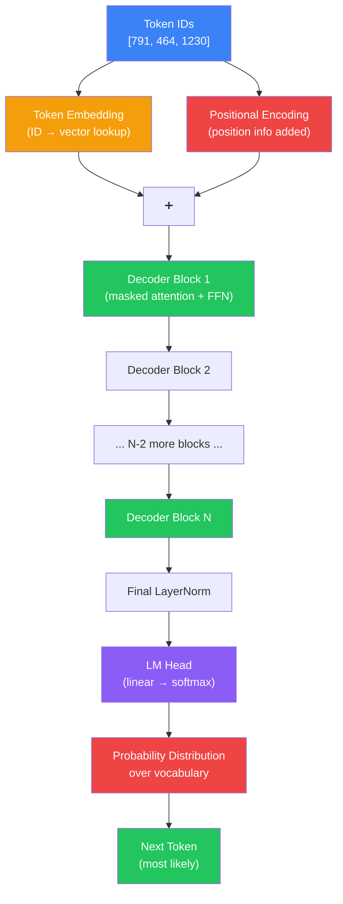
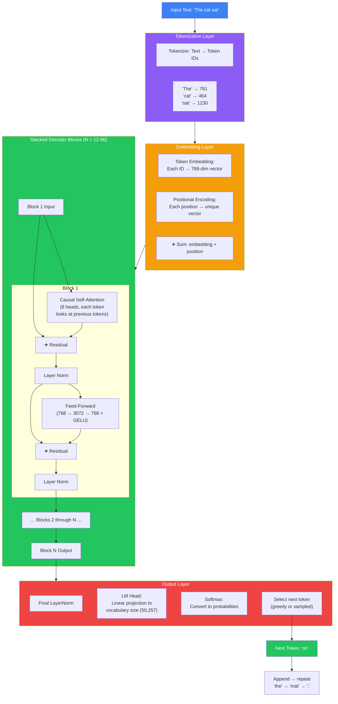

## Introduction

> **GPT (Generative Pre-trained Transformer) is a decoder-only Transformer that takes a sequence of tokens, processes them through stacked attention and feed-forward layers, and outputs a probability distribution over the next token — enabling text generation, chat, code synthesis, and reasoning.**

This document is the culmination of everything we've learned so far. Each previous document covered a component. Here, we see how they all fit together to build a complete GPT-style LLM.



---

## The Complete GPT Architecture

### Every Component, From Bottom to Top



---

## GPT Model Sizes

### Comparison of GPT Models

| Property | GPT-1 | GPT-2 | GPT-3 | GPT-4 (est.) |
|----------|-------|-------|-------|-------------|
| **Parameters** | 117M | 1.5B | 175B | ~1.8T |
| **Layers** | 12 | 48 | 96 | ~120 |
| **d_model** | 768 | 1600 | 12288 | ~16384 |
| **Heads** | 12 | 16 (?) | 96 (?) | ~128 |
| **d_ff** | 3072 | 6400 | 49152 | ~65536 |
| **Context** | 512 | 1024 | 2048 | 128K |
| **Training data** | Books | WebText | Internet | Internet + licensed |
| **Training cost** | ~$50K | ~$500K | ~$5M | ~$100M+ |

### What These Numbers Mean

- **Parameters** — The total number of learned weights. More = more capacity, more knowledge.
- **Layers (N)** — Number of stacked decoder blocks. More = deeper abstraction levels.
- **d_model** — The dimension of token vectors at every layer. The width of the model.
- **Heads** — Number of parallel attention heads. More = more simultaneous relationship types.
- **d_ff** — Hidden dimension of the FFN. Typically 4× d_model.
- **Context** — Maximum sequence length the model can process.

---

## The LM Head: From Vectors to Words

The LM Head is the final layer that converts vectors back to vocabulary probabilities:

```python
import numpy as np

class LMHead:
    def __init__(self, d_model: int, vocab_size: int):
        # Linear projection (often shared weights with embedding layer)
        self.W = np.random.randn(d_model, vocab_size) * 0.02
        self.b = np.zeros(vocab_size)
    
    def forward(self, x: np.ndarray) -> np.ndarray:
        # x shape: (d_model,) — the final vector for the last token
        # logits: (vocab_size,) — raw scores for each vocabulary token
        logits = np.dot(x, self.W) + self.b
        
        # Softmax: convert logits to probabilities
        exp_logits = np.exp(logits - np.max(logits))  # subtract max for stability
        probs = exp_logits / np.sum(exp_logits)
        
        return probs

# Example
head = LMHead(d_model=768, vocab_size=50000)
final_vector = np.random.randn(768)
probs = head.forward(final_vector)

top_5 = np.argsort(probs)[-5:][::-1]
print("Top 5 most likely tokens:")
for idx in top_5[:5]:
    print(f"  Token {idx}: probability {probs[idx]:.4f}")
```

**Weight tying:** The LM head often shares its weight matrix with the token embedding layer. This means the same matrix is used both to convert tokens to vectors (embedding) and vectors to tokens (LM head). This reduces parameters by ~30% for models with large vocabularies.

---

## GPT Training Objective

GPT is trained on the **causal language modeling** objective:

> Given a sequence of tokens, predict the next token.

Unlike BERT (which is trained on masked language modeling — fill in the blank), GPT is trained to continue the text. This is the simplest and most scalable training objective.

For a sequence of tokens t₁, t₂, ..., tₙ, the model maximizes:
```
Loss = -∑ log P(tᵢ | t₁, ..., tᵢ₋₁)
```

For each position i, the model predicts the next token based on all previous tokens, and the loss is the negative log probability of the correct token.

---

## Training vs. Inference in GPT

| Phase | How It Works | Parallelism |
|-------|-------------|-------------|
| **Training** | Forward pass over ALL positions simultaneously (with causal mask) | Fully parallel — processes all positions in one forward pass |
| **Inference** | Generate one token at a time, append, repeat | Sequential — each token depends on previous |

**Training parallelism is the key** — it's why GPT can be trained on trillions of tokens. Even though generation is sequential, the model learns patterns from seeing all positions simultaneously during training.

---

## Real-World Analogy

### The Factory Assembly Line

GPT architecture is like a factory assembly line:

1. **Input** — Raw materials (token IDs) arrive at the factory
2. **Embedding** — Each material gets a label (vector) and position sticker (positional encoding)
3. **Block 1** — First station: each worker checks relevant previous materials (self-attention) and processes their findings (FFN)
4. **Block 2–N** — Subsequent stations: deeper inspection, refinement at each step
5. **LM Head** — Final inspection: determine what product to output next
6. **Output** — The product (next token) is shipped, and the assembly line continues with the new piece

Each station builds on the work of previous stations, creating progressively richer understanding.

---

## Best Practices

1. **Scale laws are real** — GPT-3 showed that larger models, more data, and more compute predictably improve performance. Follow scaling laws when designing model size.
2. **Weight tying** — Share the LM head with the embedding layer to reduce parameters.
3. **Pre-norm architecture** — Apply layer norm before each sub-layer (not after) for stable training of deep models.
4. **Training is expensive** — A single training run of GPT-3 cost ~$5M. Most practitioners fine-tune pre-trained models.
5. **KV caching at inference** — Cache Key and Value matrices from the prompt to avoid redundant computation during generation.

---

## Common Misconceptions

| Misconception | Truth |
|--------------|-------|
| "GPT is a single fixed architecture" | GPT has evolved significantly from GPT-1 to GPT-4, with changes in size, training data, and architecture details. |
| "All decoder-only models are the same as GPT" | GPT is a specific family; other decoder-only models (LLaMA, Mistral, Claude) have different design choices (activation functions, positional encoding, normalization). |
| "GPT processes the entire prompt each time" | With KV caching, the prompt is processed once; each new token only needs computation for the latest position. |
| "The LM head is separate from the embedding" | In many GPT models, the LM head shares weights with the embedding layer (weight tying). |

---

## Interview Questions

### Medium

**Q: Walk through the complete path of a token through GPT, from input to output.** 

> 1. The input text is tokenized into token IDs (e.g., "The cat sat" → [791, 464, 1230]). 2. Each token ID is converted to a vector via the embedding layer. 3. Positional encoding is added to each vector. 4. The vectors pass through N stacked decoder blocks. Each block: causal self-attention (tokens attend to previous tokens) → residual connection → layer norm → feed-forward network → residual → layer norm. 5. After the final block, layer norm is applied. 6. The LM head projects the last token's vector to vocabulary-sized logits. 7. Softmax converts logits to probabilities. 8. The next token is selected (greedy or sampled). 9. The new token is appended to the input, and the process repeats.

**Q: Explain weight tying in GPT models and why it's used.** 

> Weight tying means the same weight matrix is used for both the token embedding layer (converting token IDs to vectors) and the LM head (converting vectors to token probabilities). This is possible because both operations are linear projections between the same two spaces (token ID space and vector space). Weight tying reduces the total parameter count by the vocabulary size × d_model (e.g., 50,000 × 768 ≈ 38M parameters for GPT-2 small). It also provides a beneficial training signal — the model learns consistent mappings both ways.

---

## Summary

| Component | Purpose |
|-----------|---------|
| **Token Embedding** | Converts token IDs to dense vectors |
| **Positional Encoding** | Adds word order information |
| **Decoder Blocks × N** | Stacked masked attention + FFN for hierarchical understanding |
| **Causal Masking** | Each token sees only previous tokens |
| **Residual Connections** | Preserve information flow, enable deep training |
| **Layer Normalization** | Stabilize activations |
| **FFN** | Independent token processing and knowledge storage |
| **LM Head** | Project final vectors to vocabulary probabilities |
| **Weight Tying** | Shared weights between embedding and LM head |

---

## Navigation

**Previous:** [11 — Decoder-Only Transformers](/ai/phase-04-large-language-models/11-decoder-only-transformers)

**Next:** [13 — Pretraining](/ai/phase-04-large-language-models/13-pretraining)

**Related Topics:**
- [Decoder-Only Transformers](/ai/phase-04-large-language-models/11-decoder-only-transformers)
- [Pretraining](/ai/phase-04-large-language-models/13-pretraining)
- [Inference](/ai/phase-04-large-language-models/18-inference)
