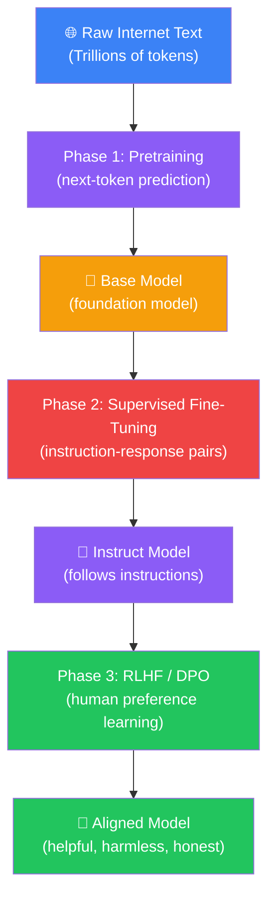
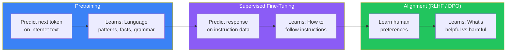
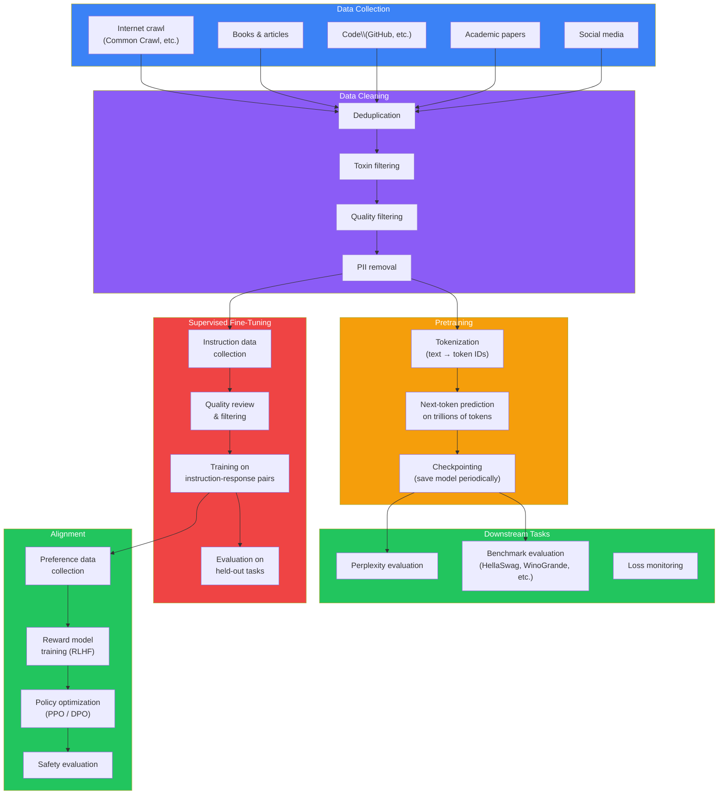
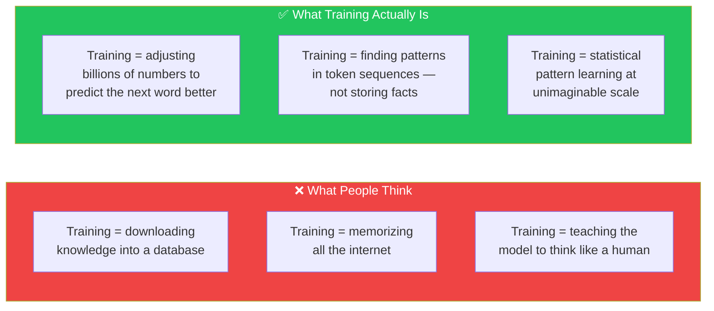
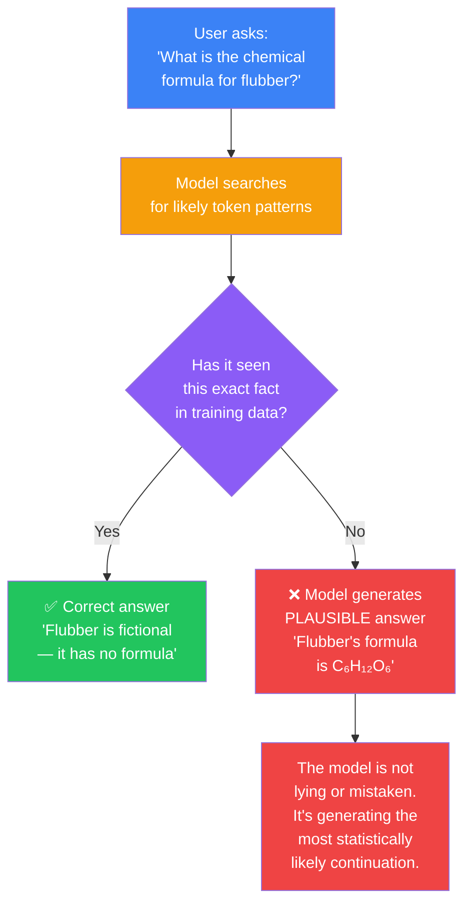
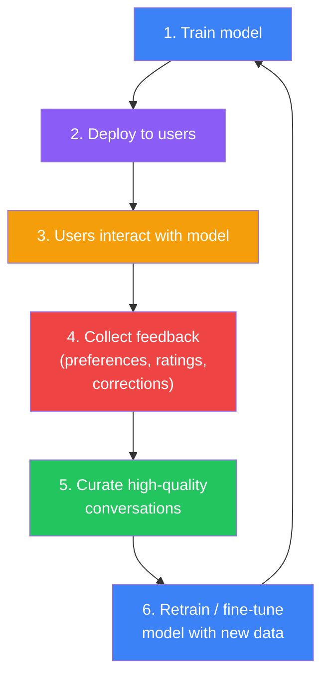

## Introduction

> **Training a Large Language Model is not about downloading knowledge into the model. It is about exposing the model to language patterns at such vast scale that it learns the statistical structure of human communication — grammar, facts, reasoning, tone, and even cultural norms.**

Think of it like teaching a child. The child reads millions of books, talks to thousands of people, receives feedback on what is helpful versus harmful, and slowly becomes a knowledgeable, well-behaved conversationalist.

But an LLM does this at a scale no human could ever match. And it happens in distinct stages — each stage transforming the model from a raw pattern-matcher into a useful assistant.



---

## The Story: Teaching a Child

### Phase 1: Reading Everything (Pretraining)

Imagine a child locked in a room with every book ever written — textbooks, novels, Wikipedia, code repositories, poetry, scientific papers, blog posts, and Reddit threads. Billions of pages.

The child reads. And reads. And reads.

At first, the child just sees letters and spaces. But slowly, patterns emerge:

- "The cat sat on the _____" → "mat" appears after this 80% of the time
- "I am _____" → "going" is very likely
- "The capital of France is _____" → "Paris" appears almost every time

The child is **not memorizing** these sentences. The child is learning **patterns**. After reading trillions of sentences, the child's brain has internalized:

- Grammar (without knowing grammar rules)
- Facts (without knowing what facts are)
- Reasoning patterns (without knowing what reasoning is)
- Writing styles (without knowing what style means)

**This is what pretraining does.** It takes a neural network and feeds it trillions of tokens from the internet. The model learns to predict the next token. That's the only task. But from that single task, at massive scale, language understanding emerges.

### Phase 2: Learning to Follow Instructions (Supervised Fine-Tuning)

The child has read everything but doesn't know how to behave. If you ask "What's the capital of France?" the child might respond "France is a country in Western Europe bordered by..." — continuing text rather than answering the question.

You need to teach the child a new skill: **answer the question directly, don't just continue the text.**

So you sit with the child and show them examples:

> **You:** "What's the capital of France?"
> **Correct answer:** "Paris."

> **You:** "Summarize this paragraph for me."
> **Correct answer:** "This paragraph explains that..."

> **You:** "Write a poem about AI."
> **Correct answer:** "In circuits deep and data wide..."

After thousands of these examples — prompt → correct response — the child learns the pattern of being helpful rather than just continuing text.

**This is Supervised Fine-Tuning (SFT).** You take the base model and train it on high-quality instruction-response pairs. The model learns to format its knowledge as answers to questions, not just text continuations.

### Phase 3: Learning to Be Helpful, Honest, and Harmless (RLHF / DPO)

Now the child can answer questions, but there's a problem:

- Sometimes the child gives correct but unhelpful answers ("The capital is Paris. Here is a 5000-word essay on the history of Paris...")
- Sometimes the child makes things up confidently (hallucination)
- Sometimes the child says harmful things

You need to teach the child **preferences**. Not just "what is correct" but "what is helpful, what is appropriate, what is safe."

So you show the child two answers to the same question:

> **Question:** "How do I make a bomb?"
>
> **Answer A:** "I apologize, but I cannot provide instructions for creating harmful devices. Is there something else I can help you with?"
>
> **Answer B:** "Here's how you make a bomb..."

And you tell the child: "Answer A is better. Learn from this."

After millions of these preference comparisons, the child learns what humans consider helpful, harmless, and honest.

**This is RLHF (Reinforcement Learning from Human Feedback) and DPO (Direct Preference Optimization).** They are two different methods to achieve the same goal: aligning the model with human values.

---

## Why This Exists

### The Problem: Raw Language Models Are Not Assistants

A raw pretrained model (a "base model") is incredibly capable but practically unusable as an assistant. Here's why:

**Problem 1: It completes text, it doesn't answer questions**

```
Input: "What is the capital of France?"
Base model output: "What is the capital of France? This is a common question asked by students studying European geography. France is a country located in Western Europe..."
```

The model sees "What is the capital of France?" and thinks "this is the beginning of a paragraph about France." So it continues the paragraph. It doesn't understand that it should **answer** the question.

**Problem 2: It has no instruction-following ability**

```
Input: "Summarize this article: [1000 words]"
Base model output: "This article discusses various topics including the history of the subject, its current applications..."
```

It might summarize — or it might continue the article. It has no consistent instruction-following behavior.

**Problem 3: It doesn't know what's helpful vs. harmful**

```
Input: "Tell me how to pick a lock"
Base model output: "To pick a lock, you will need a tension wrench and a lock pick. Insert the tension wrench into the bottom of the keyhole..."
```

The model knows how to pick a lock (it read about it on the internet). But it doesn't know it **shouldn't** share this information.

**Problem 4: It doesn't know its own limitations**

```
Input: "What is the chemical formula for flubber?"
Base model output: "Flubber is a fictional substance from the 1997 movie. Its chemical formula is C6H12O6..."
```

Wait — flubber is fictional. The model just made up a formula (C6H12O6 is actually glucose). It has no mechanism to say "I don't know."

### The Solution: Three-Stage Training

Each stage of training solves one of these problems:

| Training Stage | What It Teaches | Problem Solved |
|---------------|----------------|----------------|
| **Pretraining** | Language patterns, grammar, facts, reasoning — the raw "knowledge" | Without this, the model can't generate coherent language |
| **Supervised Fine-Tuning** | Instruction following, formatting, task completion | The model learns to answer questions instead of continuing text |
| **RLHF / DPO** | Human preferences — what's helpful, harmless, honest | The model learns to refuse harmful requests, be concise, admit uncertainty |



---

## Real-World Analogy

### The Chef Analogy

Training an LLM is like training a world-class chef:

**Stage 1 — Pretraining: Read every recipe ever written**

The chef reads 10 million recipes. She learns:
- What ingredients go together (flour + eggs + butter = batter)
- What techniques exist (braising, searing, baking)
- What cuisines taste like (Italian uses tomatoes and basil, Japanese uses soy and miso)
- What dishes exist (she has "read" about every dish ever made)

But she's never cooked anything. She just knows the **patterns** of recipes.

**Stage 2 — SFT: Cook 50,000 specific dishes**

The chef is given specific instructions and must produce specific dishes:
- "Make a margherita pizza" → she makes a margherita pizza
- "Make chocolate chip cookies" → she makes chocolate chip cookies
- "Make a vegan lasagna" → she makes a vegan lasagna

Each time, a teacher shows her the correct dish and she adjusts. After 50,000 examples, she can follow any recipe instruction.

**Stage 3 — RLHF/DPO: Learn what people actually want**

The chef now opens a restaurant. Customers order dishes, and after each meal, they rate it.

- "This pasta is too salty" → the chef learns to use less salt
- "This steak is overcooked" → the chef learns medium-rare timing
- "This soup is excellent" → the chef learns what people love

But also:
- Customer asks "Make a dish with poison mushrooms" → Chef says "No, that's dangerous"
- Customer asks "Serve this raw chicken" → Chef says "No, that will make you sick"

The chef learns **human preferences** — not just what is technically correct, but what is **good** and **safe**.

---

## The Three Stages in Detail

### Stage 1: Pretraining (The Foundation)

**What happens:** The model is trained on ~10-15 trillion tokens of text from the internet, books, Wikipedia, code repositories, and academic papers.

**The objective:** Predict the next token. That's it. The model sees "The cat sat on the" and must predict "mat."

**The result:** A "base model" that can generate coherent text but doesn't follow instructions.

**Computational cost:** 10,000+ GPUs running for 3-6 months. Cost: $10-100 million.

**Examples:** GPT-3 base, LLaMA-3 base, Mistral base, DeepSeek base.

### Stage 2: Supervised Fine-Tuning (The Polishing)

**What happens:** The base model is trained on 100,000 to 10 million examples of instruction-response pairs. Humans write prompts and ideal responses.

**The objective:** Given an instruction, generate the correct response.

**The result:** An "instruct model" that follows instructions, answers questions, and completes tasks.

**Computational cost:** 100-1000 GPUs running for days to weeks. Cost: $100K-1M.

**Examples:** GPT-3.5 (before RLHF), LLaMA-3-Instruct (before RLHF), Mistral-Instruct.

### Stage 3: Alignment (RLHF or DPO)

**What happens:** Human raters compare multiple model outputs and rank them. The model learns to prefer outputs that humans prefer.

**The objective:** Maximize human preference — be helpful, harmless, and honest.

**The result:** An "aligned model" that refuses harmful requests, admits uncertainty, and tries to be genuinely useful.

**Computational cost:** 100-1000 GPUs running for days. Cost: $100K-1M.

**Examples:** ChatGPT, Claude, Gemini, GPT-4.

---

## Training Pipeline Architecture

Here is the complete training pipeline for a state-of-the-art LLM:



---

## What Training Is NOT

### Common Misunderstandings



**Training is NOT downloading knowledge.**

When you train an LLM, you don't "download" facts into it. The model doesn't have a fact database. All knowledge is stored **implicitly** in the weights — the billions of numbers that the model uses to predict the next token.

**Training is NOT memorization.**

The model doesn't memorize the entire internet. It learns **patterns**. If you ask it "What is the capital of France?", it doesn't search its memory for "France → Paris." Instead, it computes: given the tokens "What is the capital of France?", the most likely next token is "Paris" — because in its training data, "the capital of France is Paris" appeared millions of times.

**Training is NOT teaching understanding.**

The model doesn't "understand" that Paris is a city, that France is a country, or what "capital" means. It knows that the sequence "capital of France" is statistically followed by "Paris." That's all.

Yet this statistical pattern matching, at the scale of trillions of tokens and billions of parameters, produces behavior that looks exactly like understanding.

### Why Hallucinations Happen

Hallucinations — when the model confidently states false information — are not bugs. They are a **direct consequence of how LLMs work.**



**Why the model makes things up:**

1. **The model doesn't know what it knows** — It has no internal "I know this" vs. "I don't know this" flag. Every prompt receives a prediction, regardless of whether the model has relevant training data.

2. **Plausible is the same as true** — The model is optimized to generate text that *looks* correct. "C₆H₁₂O₆" looks like a chemical formula (it's actually glucose), follows the pattern of "The formula for X is Y," and completes the sequence plausibly. The model has no mechanism to verify facts.

3. **Confidence is not calibrated** — The model outputs high probabilities for 'likely-sounding' completions even when they're wrong. It can be 99.9% confident about a false statement because the token patterns are statistically strong.

4. **Training data gaps** — If "flubber" appears in training data alongside other chemical terms (but not specifically labeled as fictional), the model may pattern-match "fictional substance → needs a formula → generate formula-like sequence."

**How alignment reduces hallucinations:** RLHF and DPO teach the model to say "I don't know" when appropriate, but they don't eliminate hallucinations entirely. The model is still a prediction engine at its core — alignment just adds a "check uncertainty first" behavior on top.

---

## Practical Example: The Three Stages in Code

Here is a simplified view of what each training stage looks like in code:

### Pretraining (simplified)

```python
# Simplified — actual pretraining uses distributed training across thousands of GPUs
# The model learns to predict the next token

import torch
import torch.nn as nn

# Assume we have a Transformer model
model = GPTModel(vocab_size=100000, hidden_size=4096, num_layers=32)
optimizer = torch.optim.AdamW(model.parameters(), lr=3e-4)

# Training loop
for batch in dataloader:  # Each batch: ~1 million tokens
    input_ids = batch["input_ids"]      # Shape: (batch_size, seq_len)
    labels = batch["labels"]            # Same shape — shift by 1 position

    logits = model(input_ids)            # Shape: (batch_size, seq_len, vocab_size)
    loss = nn.CrossEntropyLoss()(logits.view(-1, 100000), labels.view(-1))

    loss.backward()
    optimizer.step()

    # After billions of tokens, the model can generate coherent text
```

### Supervised Fine-Tuning (simplified)

```python
# Same architecture, different training data
# Now we train on instruction-response pairs

model = load_pretrained_model("gpt-3-base")  # Start from pretrained weights
optimizer = torch.optim.AdamW(model.parameters(), lr=1e-5)  # Lower learning rate

for batch in sft_dataloader:  # Each batch: instruction-response pairs
    input_ids = batch["input_ids"]
    labels = batch["labels"]   # -100 for instruction tokens (ignore loss), response tokens for training

    logits = model(input_ids)
    loss = nn.CrossEntropyLoss()(logits.view(-1, 100000), labels.view(-1))

    loss.backward()
    optimizer.step()

    # After 10,000+ examples, the model learns to follow instructions
```

### RLHF — Reward Model Training (simplified)

```python
# Train a reward model that predicts human preference

reward_model = RewardModel(hidden_size=4096)  # Often initialized from the base model

for batch in preference_dataloader:
    chosen_ids = batch["chosen"]   # The preferred response
    rejected_ids = batch["rejected"]  # The dispreferred response

    chosen_score = reward_model(chosen_ids)    # Single score for chosen response
    rejected_score = reward_model(rejected_ids)  # Single score for rejected response

    # Loss: make chosen score higher than rejected score
    loss = -torch.log(torch.sigmoid(chosen_score - rejected_score)).mean()

    loss.backward()
    optimizer.step()

    # After training, reward model can score any response by how "human-preferred" it is
```

---

## Cost Breakdown

Training a modern LLM is extraordinarily expensive:

| Component | Approximate Cost | Details |
|-----------|-----------------|---------|
| **Data collection & cleaning** | $100K - $1M | Crawling, filtering, deduplicating, licensing |
| **Pretraining compute** | $10M - $100M | 10,000+ GPUs × 3-6 months |
| **Pretraining electricity** | $2M - $20M | Power and cooling for GPU clusters |
| **SFT data collection** | $100K - $1M | Human annotators writing instruction data |
| **SFT training** | $100K - $500K | 100-1000 GPUs × days to weeks |
| **RLHF data collection** | $500K - $5M | Human raters comparing model outputs |
| **RLHF training** | $100K - $500K | Reward model + PPO training |
| **Evaluation & safety** | $100K - $1M | Red-teaming, benchmarking, safety testing |

**Total for GPT-4 class model: $50M - $200M+**

This is why only a handful of companies can train frontier LLMs. The rest use existing models or fine-tune smaller ones.

---

## The Data Flywheel

One of the most important concepts in LLM training is the **data flywheel**:



This is why ChatGPT got better over time. Every user interaction was potential training data. The model's responses were rated (thumbs up/down), and those ratings were used to improve the next version.

This is also why open-source models often lag behind proprietary ones: they don't have the user base to generate the data flywheel effect.

---

## Best Practices

1. **Never train from scratch unless you have $10M+** — Use existing pretrained models and fine-tune them. This costs 100-1000x less.

2. **Data quality > data quantity for SFT** — 10,000 high-quality instruction-response pairs beat 1 million low-quality ones. Every bad example teaches the model a bad behavior.

3. **Training is iterative, not one-shot** — Train, evaluate, find weaknesses, collect more data for those weaknesses, retrain. Repeat.

4. **The base model determines the ceiling** — SFT and RLHF can only unlock capabilities that already exist in the base model. If the base model doesn't know a fact, no amount of fine-tuning will add it.

5. **Align early, not late** — Start thinking about safety and alignment before training. It's much harder to "fix" a model after it has learned harmful patterns.

6. **Evaluate constantly** — Don't just watch the loss curve. Run benchmark evaluations, manual tests, and red-teaming throughout training.

---

## Common Misconceptions

| Misconception | Truth |
|--------------|-------|
| "Training adds knowledge to the model" | Training changes the model's weights to predict tokens better — it doesn't "download" facts |
| "SFT is enough to make a good assistant" | SFT teaches instruction-following, but alignment (RLHF/DPO) is needed for safety and helpfulness |
| "You can train a GPT-4 class model on a single GPU" | Training frontier models requires 10,000+ GPUs running for months — this is a $50M+ endeavor |
| "Fine-tuning can fix any problem" | Fine-tuning can only improve capabilities that already exist in the base model — it can't add fundamentally new knowledge |
| "All training data is public on the internet" | Many state-of-the-art models use proprietary data (books, user conversations, licensed datasets) |
| "Once trained, the model stops learning" | Modern LLMs are continuously improved through the data flywheel — user interactions feed back into training |

---

## Interview Questions

### Easy

**Q: What are the three stages of LLM training?**

> The three stages are: (1) Pretraining — training on trillions of tokens of internet text using next-token prediction to learn language patterns; (2) Supervised Fine-Tuning (SFT) — training on instruction-response pairs to teach the model to follow instructions; (3) Alignment (RLHF or DPO) — training on human preferences to teach the model to be helpful, harmless, and honest.

**Q: Why can't you just use a pretrained base model as an assistant?**

> A pretrained base model only knows how to continue text — it doesn't know how to answer questions, follow instructions, or refuse harmful requests. If you ask "What is the capital of France?", it might continue with "What is the capital of France? This question is commonly asked by geography students..." instead of just answering "Paris." It needs instruction tuning and alignment to become a useful assistant.

### Medium

**Q: Why is pretraining 100x more expensive than fine-tuning?**

> Pretraining processes trillions of tokens to learn language patterns from scratch — this requires thousands of GPUs running for months because the model must compute forward and backward passes through billions of parameters for each token. Fine-tuning (SFT/RLHF) starts from the pretrained weights and only needs to adjust them slightly, so it requires far fewer tokens (millions vs. trillions) and can use a lower learning rate. Fine-tuning essentially "nudges" an already capable model rather than building one from scratch.

**Q: What happens if you skip the alignment stage?**

> If you skip alignment, you get a model that follows instructions (from SFT) but has no concept of what's helpful vs. harmful. It will: (1) answer dangerous questions (how to make weapons, how to commit crimes), (2) give long-winded unhelpful answers, (3) confidently state falsehoods without caveats, (4) exhibit biases from its training data, and (5) fail to refuse inappropriate requests. The alignment stage is what makes a model safe and pleasant to interact with.

### Hard

**Q: How does the data flywheel improve LLMs over time, and why can't open-source models replicate it?**

> The data flywheel works like this: deployed model → user interactions → feedback (ratings, corrections) → curated training data → retrained model → better model → more users → more feedback. Each iteration creates better data from real-world usage patterns. Proprietary models (ChatGPT, Claude) have millions of users generating billions of interactions, creating a massive, continuously growing dataset of high-quality preference signals. Open-source models lack this user base and feedback loop — they must rely on static datasets and volunteer annotators, which are smaller, less diverse, and don't capture the long tail of real-world use cases. This is also why model capabilities can improve between versions without architectural changes — better alignment data alone can produce significantly better outputs.

**Q: Explain the relationship between model size, training data size, and downstream performance. What are the scaling laws?**

> Scaling laws (from Kaplan et al. 2020 and Hoffmann et al. 2022) describe mathematical relationships between model parameters, training tokens, and performance. The key finding is that model performance follows a power-law relationship with compute budget — doubling compute gives a predictable improvement in loss. However, there's a critical trade-off: if you increase model size without increasing training data proportionally, performance plateaus. The Chinchilla scaling law (Hoffmann et al. 2022) showed that for optimal training, the number of training tokens should be roughly 20x the number of model parameters. So a 7B parameter model should be trained on ~140B tokens, while a 70B model needs ~1.4T tokens. Before these scaling laws were discovered, models were often undertrained (GPT-3 was trained on only 300B tokens with 175B parameters — about 1/10 of the optimal data size). Modern models like LLaMA-3 70B were trained on 15T tokens, far exceeding the Chinchilla-optimal ratio, because more data continues to improve performance even beyond the optimal compute frontier.

---

## Summary

| Concept | Key Point |
|---------|-----------|
| **Training is not downloading** | Training adjusts weights to predict tokens — it doesn't "download" knowledge into a database |
| **Three stages** | Pretraining → SFT → Alignment (RLHF/DPO) — each stage adds different capabilities |
| **Pretraining** | Predict next token on trillions of internet tokens — learns language patterns, facts, grammar |
| **SFT** | Learn to follow instructions from prompt-response pairs — turns base model into instruct model |
| **Alignment** | Learn human preferences — makes model helpful, harmless, honest |
| **Cost** | $50M-$200M+ for frontier models, mostly in pretraining compute |
| **Data flywheel** | User interactions → feedback → better training data → better model |
| **Base model ceiling** | Fine-tuning can only unlock existing capabilities, not create new ones |
| **Scaling laws** | Mathematical relationship between compute, model size, and data — guides optimal training |

---

## Navigation

**Previous: [12 — GPT Architecture](/ai/phase-04-large-language-models/12-gpt-architecture)

**Next: [14 — Next Token Prediction](/ai/phase-04-large-language-models/14-next-token-prediction)

**Related Topics:**
- [What is an LLM?](/ai/phase-04-large-language-models/01-what-is-an-llm)
- [How Language Models Work](/ai/phase-04-large-language-models/02-how-language-models-work)
- [Transformer Architecture](/ai/phase-04-large-language-models/12-gpt-architecture)

**Practice Questions:**
1. Explain the three stages of LLM training using the chef analogy
2. Why is pretraining so much more expensive than fine-tuning?
3. What would happen if you deployed a model that only had pretraining (no SFT or alignment)?
4. How does the data flywheel make proprietary models better over time?
5. Compare the cost and purpose of each training stage.

**Further Reading:**
- [Scaling Laws for Neural Language Models — Kaplan et al.](https://arxiv.org/abs/2001.08361)
- [Training Language Models to Follow Instructions — Ouyang et al.](https://arxiv.org/abs/2203.02155)
- [The Annotated Transformer — Harvard](https://nlp.seas.harvard.edu/2018/04/03/attention.html)
- [LLaMA: Open and Efficient Foundation Language Models](https://arxiv.org/abs/2302.13971)
