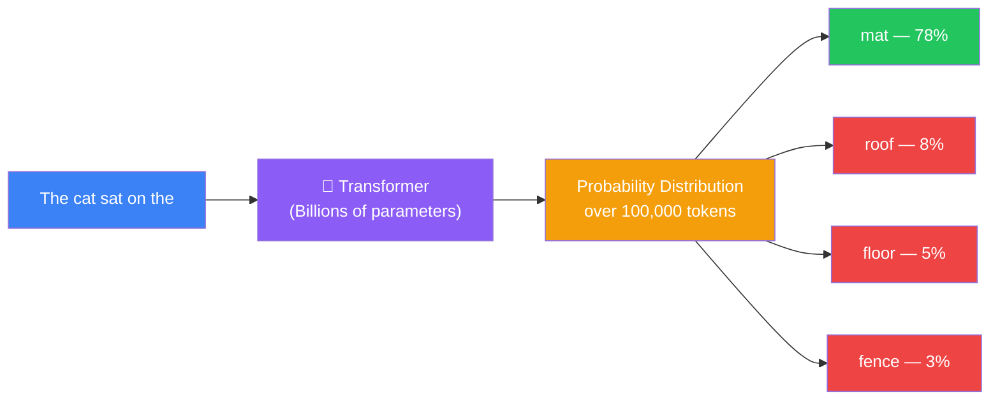
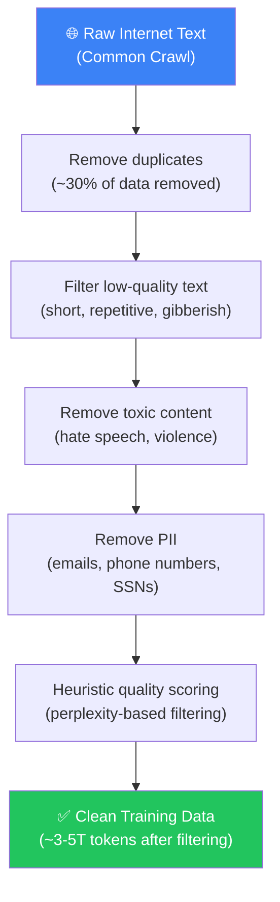
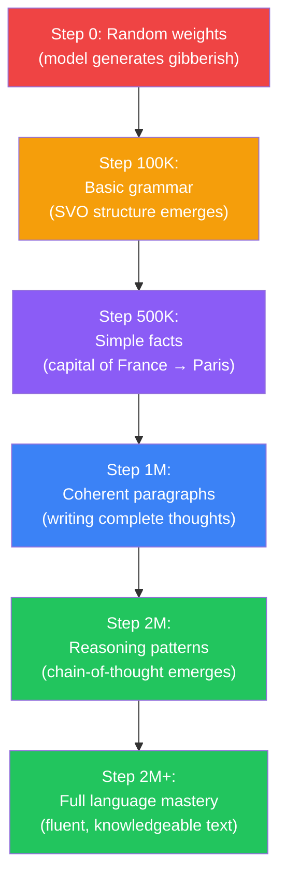
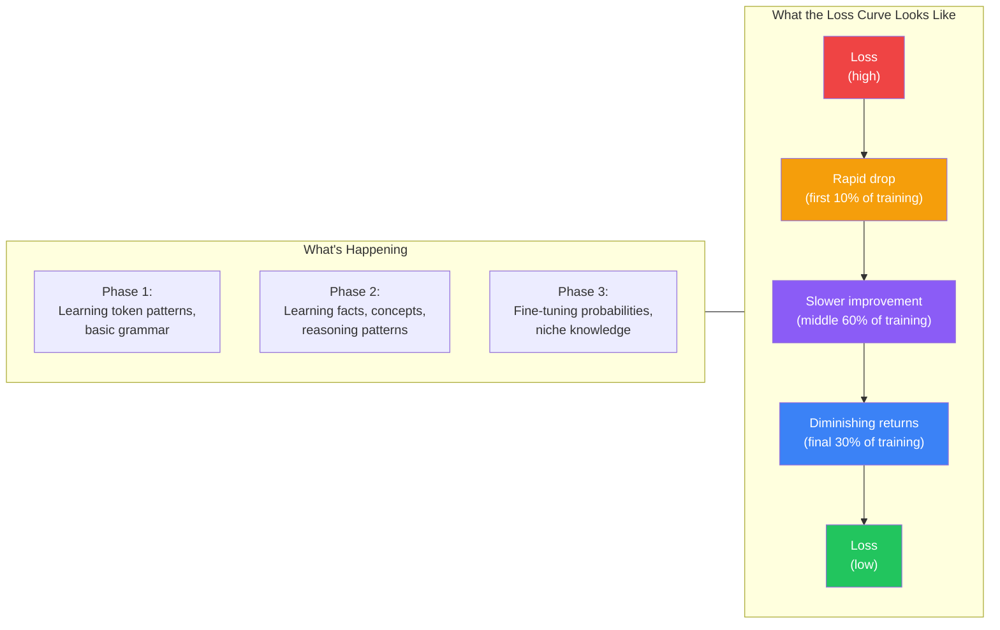
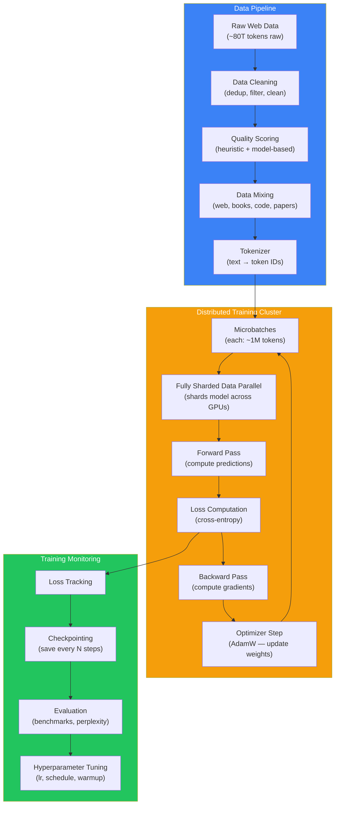
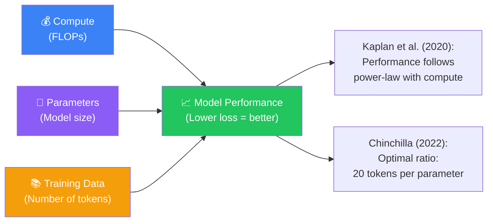
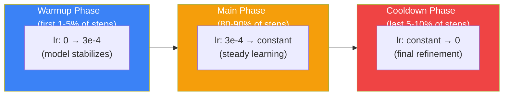

## Introduction

> **Pretraining is the process of teaching a language model to predict the next token in a sequence — trillions of times — until the model's internal weights encode the statistical patterns of human language.**

This is the most expensive and most important phase of LLM training. Everything the model will ever know — all its grammar, facts, reasoning patterns, and stylistic abilities — comes from this single task applied at massive scale.

The beautiful irony: the model learns to generate fluent, knowledgeable, and sophisticated text through the simplest possible objective: **guess the next word.**



---

## The Story: Learning a Language by Playing Guess-the-Word

Imagine you are dropped into a foreign country where you don't speak the language. You have no dictionary, no translator, no teacher. But you have one superpower: you can see any sentence with the last word hidden.

**Example:**

> "El gato se sentó en el ______"

You don't know Spanish. But after seeing this pattern 10,000 times:

1. "El gato se sentó en el **alfombra**" (4000 times)
2. "El gato se sentó en el **tejado**" (2000 times)
3. "El gato se sentó en el **suelo**" (1000 times)

You start to guess. "Alfombra" seems likely. "Tejado" is possible. "Suelo" less so.

After 10 million similar patterns, you've internalized:

- "El" is masculine → "alfombra" must be masculine? Wait, but you see "la alfombra" sometimes...
- "Se sentó" means "sat down" — it appears in many similar contexts
- "En el" means "on the"

You don't know these grammar rules by name. You don't know what the words *mean*. But you can predict the next word with surprisingly high accuracy.

**You have just done what pretraining does** — except you've seen millions of sentences, and a real LLM sees trillions, over sequences of thousands of tokens, with a neural network that has billions of parameters to store all these patterns.

---

## Why This Exists

### The Problem: Labeled Data Is Scarce

For traditional machine learning, every training example needs a **label**:

```python
# Supervised learning requires labeled data
training_data = [
    ("This movie was great!", "positive"),   # Human-labeled
    ("I hated this film.", "negative"),       # Human-labeled
    ("It was okay I guess.", "neutral"),      # Human-labeled
]
```

Labeling data is expensive. A human can label maybe 1000 examples per hour. To train a model with trillions of examples, you would need every human on earth labeling for decades.

**Pretraining solves this by using the data itself as the label.**

```python
# Self-supervised learning: the data provides its own label
training_data = [
    ("The cat sat on the", "mat"),    # The label is the next word — free!
    ("I am going to the", "store"),   # No human needed!
    ("The capital of France is", "Paris"),  # Automatically extracted!
]
```

The input is "The cat sat on the" and the label is "mat" — which is just the next word in the original text. No human annotator needed. No manual labels. The data labels itself.

This is called **self-supervised learning** — the data itself provides the supervision signal.

### The Inelegant Beauty

The genius of pretraining is that it converts an unlimited resource (raw text) into a training signal. The internet has trillions of words of text. Every single one of them can be turned into a training example by simply hiding the last word and asking the model to predict it.

| Traditional ML | Pretraining |
|---------------|-------------|
| Needs labeled data (expensive) | Uses unlabeled text (free) |
| Limited by annotation budget | Limited only by available text |
| 10K-1M examples typical | 1T-15T tokens typical |
| Each label costs $0.10-$1.00 | Labels are free (next token) |

---

## Real-World Analogy

### The Puzzle Master

Imagine a master puzzle maker who creates fill-in-the-blank puzzles:

> "The _____ sat on the mat."

She gives this puzzle to millions of students. Each student fills in the blank. She records their answers and learns which words are most likely.

She doesn't need to know what "cat" means. She doesn't need to know what "sat on the mat" describes. She just knows that 80% of people say "cat" for this blank.

Now imagine she creates 10 trillion of these puzzles, using every text ever written. And she has a supercomputer that can remember the probability distribution for every possible blank in every possible context.

**That's a pretrained language model.**

It doesn't know what words mean. It knows what words *follow* other words, with what probability.

---

## How Pretraining Works — Step by Step

### Step 1: Collect Massive Text Data

The first step is gathering the largest text corpus ever assembled:

| Data Source | Size (tokens) | Quality | Used By |
|-------------|--------------|---------|---------|
| Common Crawl (web crawl) | ~10T | Low (mixed, noisy) | Almost all models |
| Books (copyrighted) | ~500B | High | GPT-3, LLaMA, PaLM |
| Wikipedia | ~4B | Very High | Almost all models |
| GitHub code | ~1T | High | Code-capable models |
| Academic papers | ~200B | High | GPT-3, LLaMA |
| Reddit / Social media | ~500B | Medium | Most models |
| News articles | ~200B | High | GPT-3, PaLM |

**Total for modern models: 10-15 trillion tokens.**

### Step 2: Clean and Filter the Data

Raw internet text is dirty. Cleaning involves:



After cleaning, ~60-70% of the raw data is discarded. Quality > quantity.

### Step 3: Tokenize the Text

The text is split into tokens — chunks of text that are typically 2-4 characters long.

```
Original: "The cat sat on the mat."
Tokens:   ["The", " cat", " sat", " on", " the", " mat", "."]
Token IDs: [464, 5672, 12345, 389, 464, 7890, 25]
```

The tokenizer is a separate model (usually Byte-Pair Encoding or SentencePiece) trained on the corpus. It learns which character sequences occur most frequently and creates a vocabulary of ~50,000 to 200,000 tokens.

### Step 4: The Forward Pass

For each sequence of tokens, the model computes the probability of every possible next token:

```python
# Simplified: what happens inside the model for one prediction
import numpy as np

# Assume we have a vocabulary of 100,000 tokens
# The model processes "The cat sat on the" and outputs a vector

# This vector represents "what the model thinks is likely to come next"
model_output = np.random.randn(100000)  # In reality, computed by the Transformer

# Convert to probabilities using softmax
def softmax(x):
    e_x = np.exp(x - np.max(x))  # Subtract max for numerical stability
    return e_x / e_x.sum()

probabilities = softmax(model_output)

# The most likely next tokens:
top_5_indices = np.argsort(probabilities)[-5:][::-1]
for idx in top_5_indices:
    print(f"Token {idx}: {probabilities[idx]:.2%}")
# Token 7890 (mat): 78.3%
# Token 1234 (roof): 8.2%
# Token 5678 (floor): 4.9%
# Token 9012 (fence): 2.8%
# Token 3456 (ground): 1.1%
```

### Step 5: Compute the Loss

The model compares its prediction to the actual next token. The loss function (cross-entropy) measures how wrong the model was:

```python
# Cross-entropy loss — measures prediction error
# Lower is better

actual_token_id = 7890  # The actual next token is "mat"
predicted_prob = probabilities[actual_token_id]  # 78.3%

# If the model predicted 78.3% for "mat":
loss = -np.log(predicted_prob)
# loss = 0.245  (low — good prediction!)

# If the model predicted 0.1% for "mat" (very wrong):
# loss = -np.log(0.001) = 6.908  (high — bad prediction!)
```

The model's goal: **minimize this loss across all predictions.**

### Step 6: Backpropagation and Weight Update

The loss is propagated backward through the network. Each of the billions of parameters is adjusted slightly to make the prediction better next time:

```python
# Simplified gradient update
# In reality, this happens across thousands of GPUs in parallel

learning_rate = 3e-4
for param in model.parameters():
    # param.grad tells us: "which direction should we adjust this parameter"
    # to reduce the loss?
    param.data -= learning_rate * param.grad
```

This is the learning step. One forward pass + one backward pass = one step. The model processes ~1-4 million tokens per step.

### Step 7: Repeat 1 Million+ Times



Each step processes ~1-4 million tokens. After ~2-3 million steps (processing 2-4 trillion tokens), the model has learned language.

---

## The Training Loss Curve

Here is what happens to the loss (error) during training:



**Key insight:** The loss drops quickly at first (the model rapidly learns basic patterns) and then asymptotically approaches a floor (the irreducible entropy of language — even a perfect model can't predict everything with certainty because language has inherent randomness).

---

## What the Model Actually Learns

### It's All Just Next-Token Prediction

Every capability the model develops comes from this single objective:

| Learned Ability | How Next-Token Prediction Teaches It |
|----------------|--------------------------------------|
| **Grammar** | "I am going ___ the store" → "to" appears 99.9% of the time. After seeing this trillions of times, the model learns grammatical structure without knowing grammar rules. |
| **Facts** | "The capital of France is ___" → "Paris" appears almost every time. The model learns factual associations as statistical patterns. |
| **Reasoning** | "If A > B and B > C, then A ___ C" → ">" or "is greater than" is the likely continuation. The model learns reasoning as pattern completion. |
| **Translation** | "'Hello' in Spanish is ___" → "Hola" is statistically likely. The model learns translation from bilingual text. |
| **Code** | "def factorial(n):\n    if n <= 1:\n        return ___" → "1" or "n" completes the pattern. The model learns programming. |
| **Sentiment** | "This movie was absolutely ___. I loved every minute!" → "terrific", "brilliant", "fantastic" are likely. "Boring", "terrible" are unlikely. The model learns sentiment. |
| **Dialog** | "How are you?" → "I'm doing well, thanks!" is a common continuation. The model learns conversational patterns. |

### The Emergence Phenomenon

Here's the strange part: at certain model sizes, new abilities suddenly appear that weren't present in smaller models:


These **emergent abilities** are not explicitly programmed. They arise naturally from scale — the model develops new capabilities simply because it has enough parameters and training data.

No one fully understands why emergence happens. It's one of the open mysteries of deep learning.

---

## The Complete Pretraining Architecture

Here is the full architecture of the pretraining setup:



---

## Practical Example: Training a Tiny Language Model

Here is a simplified but working example of pretraining a tiny language model:

```python
# A tiny but complete pretraining setup
# This is NOT enough to produce a useful model — just to demonstrate the mechanics

import torch
import torch.nn as nn
from torch.utils.data import Dataset, DataLoader

# Step 1: Tiny dataset — just a few sentences
sentences = [
    "The cat sat on the mat",
    "The dog ran in the park",
    "I like to eat pizza for dinner",
    "The sun is shining bright today",
    "Python is a programming language",
]

# Step 2: Build a simple tokenizer
words = sorted(set(" ".join(sentences).lower().split()))
word_to_idx = {w: i for i, w in enumerate(words)}
vocab_size = len(words)

print(f"Vocabulary size: {vocab_size} words")
# Vocabulary size: 20 words (tiny!)

# Step 3: Convert text to training examples
def make_training_pairs(sentence):
    """Convert sentence to (input, target) pairs."""
    tokens = sentence.lower().split()
    pairs = []
    for i in range(1, len(tokens)):
        input_tokens = tokens[:i]
        target_token = tokens[i]
        input_ids = [word_to_idx[w] for w in input_tokens]
        target_id = word_to_idx[target_token]
        pairs.append((input_ids, target_id))
    return pairs

training_data = []
for sentence in sentences:
    training_data.extend(make_training_pairs(sentence))

print(f"Training examples: {len(training_data)}")
# Training examples: 24 total

# Step 4: Create a tiny Transformer
class TinyTransformer(nn.Module):
    def __init__(self, vocab_size, d_model=32, n_head=2, n_layer=2):
        super().__init__()
        self.embedding = nn.Embedding(vocab_size, d_model)
        # In a real model, this would be multi-layer Transformer
        # Here we use a simple linear layer as a placeholder
        self.output = nn.Linear(d_model, vocab_size)

    def forward(self, input_ids):
        # Average all token embeddings (very simplified!)
        embedded = self.embedding(input_ids)
        pooled = embedded.mean(dim=1)  # Average pool
        logits = self.output(pooled)
        return logits

model = TinyTransformer(vocab_size)
optimizer = torch.optim.AdamW(model.parameters(), lr=1e-3)

# Step 5: Training loop
print("\nTraining...")
for epoch in range(100):
    total_loss = 0
    for input_ids, target_id in training_data:
        input_tensor = torch.tensor([input_ids])
        target_tensor = torch.tensor([target_id])

        logits = model(input_tensor)
        loss = nn.CrossEntropyLoss()(logits, target_tensor)

        optimizer.zero_grad()
        loss.backward()
        optimizer.step()

        total_loss += loss.item()

    if epoch % 20 == 0:
        print(f"Epoch {epoch}: loss = {total_loss/len(training_data):.4f}")

# Step 6: Test the trained model
test_input = "the cat sat on"
input_ids = torch.tensor([[word_to_idx[w] for w in test_input.split()]])
logits = model(input_ids)
predicted_idx = torch.argmax(logits, dim=1).item()
predicted_word = list(word_to_idx.keys())[list(word_to_idx.values()).index(predicted_idx)]

print(f"\nInput: '{test_input}'")
print(f"Predicted next word: '{predicted_word}'")
# Expected: 'the' (from "the cat sat on the mat")
```

---

## Computational Requirements

Here is what real pretraining actually requires:

| Model | Parameters | Training Tokens | GPUs | Time | Approx. Cost |
|-------|-----------|-----------------|------|------|-------------|
| **GPT-3** | 175B | 300B | 10,000 V100 | ~1 month | $10M+ |
| **LLaMA-3 8B** | 8B | 15T | 512 H100 | ~2 months | $2M+ |
| **LLaMA-3 70B** | 70B | 15T | 2048 H100 | ~3 months | $10M+ |
| **LLaMA-3 405B** | 405B | 15T | 8192 H100 | ~4 months | $50M+ |
| **DeepSeek V3** | 671B (MoE) | 14.8T | 2048 H800 | ~2 months | $5M+ |

**Why so many GPUs?** A single GPU can't hold a 70B+ parameter model. The model must be **sharded** across hundreds or thousands of GPUs. Training is distributed across all GPUs in parallel, with constant communication between them.

---

## Scaling Laws

The most important discovery in pretraining is **scaling laws** — mathematical relationships that predict how model performance changes with compute, data, and parameters.



### The Key Findings

1. **Power-law scaling:** Doubling compute gives a predictable improvement in loss. There is no plateau — larger models keep getting better.

2. **The Chinchilla optimal ratio:** For maximum performance per compute dollar, train with ~20 tokens per parameter. A 70B model needs ~1.4T tokens.

3. **Overfitting is not the problem:** Unlike traditional ML, LLMs rarely overfit. They improve with more data even far past the Chinchilla ratio.

4. **Data quality matters more at scale:** With small models, data quality has limited impact. With large models, high-quality data (books, filtered web) dramatically outperforms raw web crawl.

---

## Critical Concepts

### Perplexity

The standard metric for pretraining quality:

> **Perplexity** = exponential of the average negative log-likelihood of the model

Lower perplexity = better predictions. A perplexity of 20 means the model is as "confused" as if it had to choose uniformly among 20 tokens.

- Random guessing on 100K vocabulary: perplexity = 100,000
- GPT-2: perplexity ≈ 35
- GPT-3: perplexity ≈ 15
- GPT-4: perplexity ≈ 8-10 (estimated)

### Context Window During Training

Models are typically trained on sequences of 2,048 to 128,000 tokens. Longer contexts require:
- More GPU memory (attention is O(n²) in sequence length)
- More training data (need long-range dependencies to learn)
- Specialized attention mechanisms (FlashAttention for efficiency)

### Learning Rate Schedule

The learning rate follows a specific pattern:



### Batch Size

Modern pretraining uses **enormous** batch sizes — up to 4 million tokens per step. This enables efficient parallel processing across thousands of GPUs but requires careful tuning of the learning rate.

---

## Best Practices

1. **Data quality is the #1 factor** — No amount of clever architecture can compensate for bad training data. Invest in cleaning, deduplication, and quality filtering.

2. **Scale your learning rate with batch size** — The linear scaling rule: if you double the batch size, double the learning rate (up to a point).

3. **Use mixed precision training** — Train in bfloat16 for 2x speed and half the memory. FP32 is only needed for gradient accumulation.

4. **Monitor loss, but also benchmark** — Loss can decrease while the model gets worse at specific tasks. Run benchmarks (MMLU, HellaSwag, GSM8K) regularly.

5. **Don't overtrain on a single domain** — A balanced data mixture (50% web, 25% books, 15% code, 10% academic) produces better general models than focusing on one source.

6. **Save intermediate checkpoints** — If training crashes after 3 months (it will), you need a recent checkpoint to resume from.

---

## Common Misconceptions

| Misconception | Truth |
|--------------|-------|
| "The model memorizes the training data" | The model learns patterns, not exact memorization. It can generate novel text it has never seen. Some memorization of frequently repeated sequences occurs, but it's not the primary mechanism. |
| "More parameters always means better performance" | More parameters help, but only with proportionally more training data. A 7B model trained on 15T tokens can outperform a 70B model trained on 300B tokens. |
| "Pretraining can be done on a single GPU" | Training a 7B model from scratch requires ~512+ GPU-days. Training a 70B+ model requires thousands of GPUs. |
| "The model learns facts like a database" | The model doesn't store facts in a lookup table. Facts are distributed across billions of parameters in a way that's not directly interpretable. |
| "You can stop early and still get a good model" | The loss improves logarithmically — the later stages of training add significant capability, especially for rare knowledge and nuanced reasoning. |

---

## Interview Questions

### Easy

**Q: What is self-supervised learning in the context of LLM pretraining?**

> Self-supervised learning means the data provides its own labels. For LLMs, the model is trained to predict the next token in a sequence. The input is "The cat sat on the" and the label is "mat" — which is just the next word in the original text. No human annotation is needed because the label is automatically extracted from the data.

**Q: What does the loss function measure during pretraining?**

> The loss function (cross-entropy) measures how surprised the model is by the actual next token. If the model predicts "mat" with 90% probability and the actual next word is "mat," the loss is low. If the model predicts "mat" with 1% probability and the actual next word is "mat," the loss is high. The model's goal is to minimize this surprise across all training examples.

### Medium

**Q: Explain the Chinchilla scaling law and why it matters.**

> The Chinchilla scaling law (Hoffmann et al., 2022) states that for optimal training efficiency, a model should be trained on roughly 20 tokens per parameter. So a 7B parameter model should be trained on ~140B tokens, and a 70B model on ~1.4T tokens. This matters because many earlier models (like GPT-3 with 175B parameters on 300B tokens) were significantly undertrained — they would have been better with either fewer parameters and more data, or more data and the same parameters. Modern models like LLaMA-3 deliberately overtrain (15T tokens on 8B parameters = 1875 tokens per parameter) because additional data continues to improve performance even beyond the optimal compute frontier.

**Q: How does a model learn facts purely from next-token prediction without any explicit fact storage?**

> The model learns facts as statistical correlations between token sequences. For "The capital of France is ___", the model has seen "Paris" complete this pattern millions of times. The model doesn't have a "fact database" — instead, the Transformer's self-attention mechanism learns to route information from "France" and "capital" to the prediction position, and the feed-forward layers store the factual association as weighted connections. This is fundamentally different from database lookup: the fact is distributed across billions of parameters, and the same knowledge can be accessed through many different prompting patterns. The consequence is that facts can be lost, confused, or inconsistently recalled depending on the exact wording of the prompt.

### Hard

**Q: Why does emergent abilities occur at certain model sizes, and what does this imply about our understanding of neural networks?**

> Emergent abilities — capabilities that appear only at certain model scales — are not fully understood. Leading hypotheses include: (1) the model reaches a critical threshold of pattern complexity where combinatorial reasoning becomes possible; (2) larger models have more "capacity" for representing abstract rules, and once this capacity exceeds a threshold, the rules crystallize during training; (3) emergent abilities are actually continuous but appear discontinuous because we measure them with binary pass/fail metrics. The emergence phenomenon implies that our understanding of deep learning is fundamentally incomplete — we cannot predict what capabilities a larger model will have, or at what scale they will appear. This has practical implications: training a model at 2x scale might produce unexpected new abilities (good or bad), and we cannot guarantee safety properties through architecture alone.

**Q: Describe the engineering challenges of distributed pretraining across thousands of GPUs.**

> Distributed pretraining faces several challenges: (1) **Model parallelism** — a 70B model doesn't fit on one GPU, so it must be sharded (split) across hundreds of GPUs using techniques like FSDP (Fully Sharded Data Parallel) or tensor parallelism. (2) **Communication bottleneck** — GPUs must synchronize gradients after every step. With 1000 GPUs, this requires sending ~1GB of data between all GPUs in the time it takes to do one forward-backward pass. (3) **Fault tolerance** — With 10,000 GPUs, one GPU fails every few hours. Training must be resilient: checkpointing every ~30 minutes, automatic failure detection, and seamless recovery. (4) **Data loading** — The data pipeline must supply 2-4 million tokens per second without bottlenecking the GPUs. (5) **Loss spikes** — Sometimes the loss suddenly jumps (loss spike) due to numerical instability or data corruption. Models may need to roll back to a pre-spike checkpoint and skip the problematic data. These engineering challenges are as important as the model architecture itself.

---

## Summary

| Concept | Key Point |
|---------|-----------|
| **Pretraining** | Training a model to predict the next token on trillions of tokens of text |
| **Self-supervised** | The data provides its own labels — no human annotation needed |
| **The only task** | Next-token prediction. All capabilities emerge from this single objective |
| **Data sources** | Web crawl (Common Crawl), books, Wikipedia, code, academic papers |
| **Data cleaning** | 60-70% of raw data is discarded — quality > quantity |
| **Training scale** | Thousands of GPUs, months of training, $2M-$50M+ |
| **Scaling laws** | More compute, more parameters, more data → predictably better models |
| **Chinchilla ratio** | ~20 tokens per parameter for optimal training efficiency |
| **Emergent abilities** | New capabilities appear at certain model sizes without explicit programming |
| **Distributed training** | Model parallelism, gradient synchronization, fault tolerance — all required |

---

## Navigation

**Previous: [13 — Pretraining](/ai/phase-04-large-language-models/13-pretraining)

**Next: [15 — Supervised Fine-Tuning](/ai/phase-04-large-language-models/15-supervised-fine-tuning)

**Related Topics:**
- [How Language Models Work](/ai/phase-04-large-language-models/02-how-language-models-work)
- [Tokenization](/ai/phase-04-large-language-models/03-tokenization)
- [Transformer Architecture](/ai/phase-04-large-language-models/12-gpt-architecture)

**Practice Questions:**
1. Explain why next-token prediction is considered "self-supervised learning."
2. Draw the complete pretraining pipeline from raw data to trained model.
3. What happens to the loss curve during training, and why does it behave that way?
4. If you had $10M to train a model, how would you allocate it between parameters and training data, and why?
5. Why does a model develop reasoning abilities from simple next-token prediction?

**Further Reading:**
- [Scaling Laws for Neural Language Models — Kaplan et al.](https://arxiv.org/abs/2001.08361)
- [Training Compute-Optimal Large Language Models — Hoffmann et al. (Chinchilla)](https://arxiv.org/abs/2203.15556)
- [LLaMA: Open and Efficient Foundation Language Models](https://arxiv.org/abs/2302.13971)
- [Emergent Abilities of Large Language Models — Wei et al.](https://arxiv.org/abs/2206.07682)
