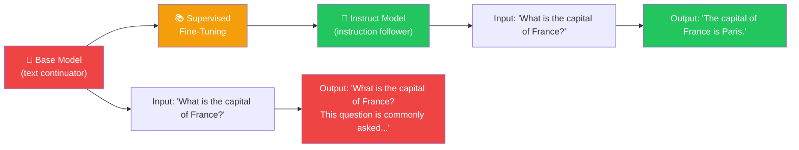
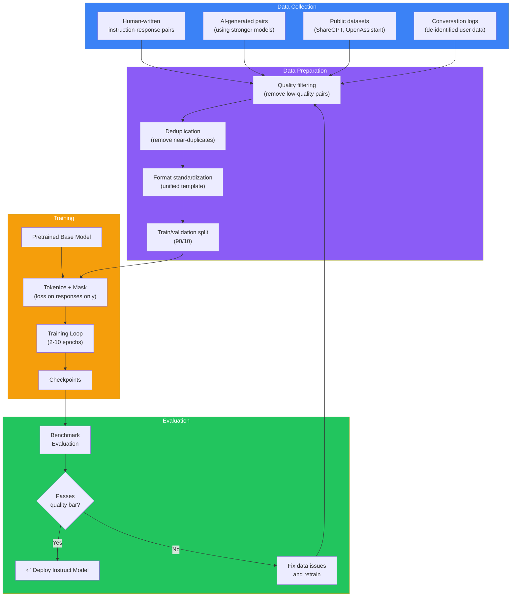
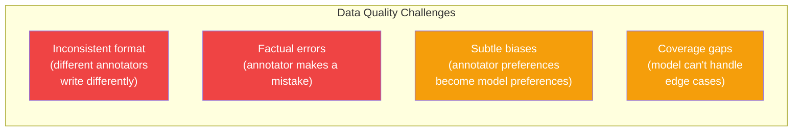

## Introduction

> **Supervised Fine-Tuning (SFT) is the process of training a pretrained base model on high-quality instruction-response pairs — teaching it to answer questions, follow instructions, and complete tasks instead of just continuing text.**

The base model from pretraining is incredibly knowledgeable but practically unusable. Ask it a question and it doesn't answer — it continues the text. SFT is what transforms this raw pattern-matcher into something that behaves like an assistant.

Think of SFT as teaching a brilliant but untrained graduate: they know everything but need to learn how to answer exam questions properly.



---

## The Story: Learning to Take Orders

Imagine you hire a brilliant researcher who has read every book ever written. You sit them at a desk and say:

> "What is the capital of France?"

They respond: "What is the capital of France? This is a question asked by many geography students. France, officially the French Republic, is a country in Western Europe. Its capital city is Paris, which is also its largest city. Paris is known for..."

They're not wrong. They just don't understand the **format** you want. They're used to writing academic papers, not answering questions.

So you show them examples:

---

**Example 1:**

> **You:** "What is the capital of France?"
> **Expected:** "Paris."

**Example 2:**

> **You:** "Summarize this article about climate change."
> **Expected:** "This article discusses the impact of greenhouse gas emissions on global temperatures, focusing on..."

**Example 3:**

> **You:** "Write a poem about AI."
> **Expected:** "In circuits deep and data wide, a mind begins to stir..."

---

After 100,000 such examples, the researcher understands the new format. When you ask a question, they answer directly. When you ask for a summary, they summarize. When you ask for creative writing, they create.

**This is Supervised Fine-Tuning.** The model is shown input → output pairs and learns to generalize: given an instruction, produce the correct response, in the correct format.

---

## Why This Exists

### The Problem: Base Models Don't Follow Instructions

A base model has one skill: predict the next token. This means:

| Input | Base Model Output | Problem |
|-------|------------------|---------|
| "What is the capital of France?" | "What is the capital of France? This question tests knowledge of European geography. France is a country located in..." | Continues text instead of answering |
| "Summarize: [1000 words]" | Continues writing the article instead of summarizing | Doesn't understand the task |
| "Translate to Spanish: Hello" | "Translate to Spanish: Hello. Translation is the process of..." | Doesn't perform the translation |
| "Write a poem about AI" | "Write a poem about AI. Here are some tips for writing poems..." | Gives tips instead of writing the poem |
| "What's 2+2?" | "What's 2+2? This appears to be a simple arithmetic question." | Describes the question instead of answering |

The base model has all the knowledge it needs. But it doesn't know **how to use it** as an assistant.

### The Solution: Teach Through Examples

The insight behind SFT: if you show the model enough examples of "instruction → correct response," it learns the pattern of being an assistant.

The model doesn't need to learn new facts. It needs to learn a new **behavior**: given an instruction, produce an appropriate response in a helpful format.

This is why SFT is so efficient:

```
Pretraining cost:   $10M - $100M   (10 trillion tokens)
SFT cost:           $100K - $500K   (100K - 10M instruction pairs)
Improvement:        Raw model → usable assistant
```

---

## Real-World Analogy

### The Military Trainee

Imagine a new recruit joining the army.

**Before training (base model):**
- The recruit is physically fit and intelligent
- But they don't know military protocol
- They don't know how to respond to commands

**Basic training (SFT):**
- "When I say 'Attention,' you stand up straight."
- "When I say 'At ease,' you relax."
- "When I say 'March,' you start walking."
- "When I say 'Report,' you state your name and rank."

The recruit runs through each command dozens of times until the response becomes automatic.

**After training (instruct model):**
- The recruit instantly responds correctly to any command
- They don't think about what to do — they just do it
- They've learned the **pattern** of military response

**The key insight:** The recruit didn't get stronger or smarter. They learned a new **behavior** — how to map specific inputs to specific outputs. That's exactly what SFT does for a language model.

---

## How SFT Works — Step by Step

### Step 1: Collect Instruction-Response Pairs

Humans (or other AI models) create examples of good instruction-following behavior:

```json
[
  {
    "instruction": "What is the capital of France?",
    "response": "The capital of France is Paris."
  },
  {
    "instruction": "Summarize this article: [1000 words]",
    "response": "This article argues that climate change is accelerating faster than predicted..."
  },
  {
    "instruction": "Write a Python function to reverse a string",
    "response": "def reverse_string(s):\n    return s[::-1]"
  },
  {
    "instruction": "Explain quantum computing to a 10-year-old",
    "response": "Imagine a computer that can try all answers at the same time..."
  }
]
```

### Step 2: Format as Training Examples

Each example is converted to a sequence of tokens, and the model is trained to predict **only the response tokens**:

```
Input tokens:   [BOS] What is the capital of France? [SEP]
Target tokens:  [IGNORE] [IGNORE] ... [IGNORE] The capital of France is Paris. [EOS]
                ↑                              ↑
                Loss is masked for    Model learns to predict
                instruction tokens    these tokens only
```

The loss is **masked** for the instruction tokens — the model is only evaluated on how well it predicts the response.

### Step 3: Training

The training process is similar to pretraining (next-token prediction) but:

| Pretraining | SFT |
|-------------|-----|
| 10T+ tokens | 100K - 10M tokens |
| Learning rate: 3e-4 | Learning rate: 1e-5 (10x lower) |
| Full model weight updates | Full model weight updates (usually) |
| May take months | Takes hours to days |
| Starts from scratch | Starts from pretrained weights |

The lower learning rate is critical — we don't want to destroy what the model learned during pretraining, just gently nudge it toward the new behavior.

### Step 4: Evaluation

After training, the model is tested on held-out tasks to verify it can follow instructions it hasn't seen before:

```python
# Example evaluation
test_prompts = [
    "Translate to French: 'Hello, how are you?'",
    "Write a haiku about autumn.",
    "What's the difference between TCP and UDP?",
    "Explain recursion to a beginner programmer.",
]

for prompt in test_prompts:
    response = model.generate(prompt)
    print(f"Q: {prompt}")
    print(f"A: {response}\n")
```

---

## The Complete SFT Architecture



---

## How Data Quality Shapes the Model

The most important factor in SFT is **data quality**. The model learns exactly what you show it:

### Good Data → Good Behavior

```json
{
  "instruction": "Explain why the sky is blue.",
  "response": "The sky appears blue because of Rayleigh scattering. Sunlight is made of different colors, and blue light is scattered more by the gases in the atmosphere, making the sky look blue from all directions."
}
```

The model learns: give clear, accurate explanations.

### Bad Data → Bad Behavior

```json
{
  "instruction": "Explain why the sky is blue.",
  "response": "The sky is blue because water is blue and the sky is made of water vapor. Actually, I'm not sure. Blue is a nice color."
}
```

The model learns: be uncertain, give wrong information, be unhelpful.

### Data Diversity Matters

A good SFT dataset covers many types of interactions:

| Category | Percentage | Examples |
|----------|-----------|----------|
| **Q&A** | 25% | Factual questions, explanations |
| **Creative writing** | 15% | Poetry, stories, scripts |
| **Code** | 15% | Function writing, debugging, refactoring |
| **Summarization** | 10% | Article/book/document summarization |
| **Translation** | 10% | Between common language pairs |
| **Analysis** | 10% | Reasoning, comparison, critique |
| **Role-play / persona** | 5% | Act as a tutor, historian, etc. |
| **Refusals** | 5% | "I cannot help with harmful requests" |
| **Conversation** | 5% | Multi-turn dialog |

---

## Practical Example: Fine-Tuning a Small Model

Here's a simplified example of SFT using the Hugging Face ecosystem:

```python
# Simplified SFT implementation
# Install: pip install transformers datasets torch

from transformers import AutoModelForCausalLM, AutoTokenizer, TrainingArguments, Trainer
from datasets import Dataset

# Load pretrained model (in practice, this could be LLaMA-3, Mistral, etc.)
model_name = "openai-community/gpt2"  # Small model for demonstration
model = AutoModelForCausalLM.from_pretrained(model_name)
tokenizer = AutoTokenizer.from_pretrained(model_name)
tokenizer.pad_token = tokenizer.eos_token

# Step 1: Create instruction-response dataset
sft_data = [
    {"instruction": "What is 2+2?", "response": "2+2 = 4"},
    {"instruction": "Say hello in French", "response": "Bonjour"},
    {"instruction": "What's the opposite of hot?", "response": "Cold"},
    # In practice: 10,000 - 100,000 examples
]

# Step 2: Format for training
def format_example(example):
    # Format: "Instruction: ...\nResponse: ..."
    text = f"Instruction: {example['instruction']}\nResponse: {example['response']}"
    tokens = tokenizer(
        text,
        truncation=True,
        max_length=512,
        padding="max_length",
        return_tensors="pt"
    )
    # Mask instruction tokens from loss
    # In practice, you'd find where "Response:" starts and mask everything before it
    tokens["labels"] = tokens["input_ids"].clone()
    return tokens

# Step 3: Convert to Hugging Face Dataset
dataset = Dataset.from_list(sft_data)
tokenized_dataset = dataset.map(format_example)

# Step 4: Training arguments
# Note: Use very low learning rate and few epochs
training_args = TrainingArguments(
    output_dir="./sft-model",
    learning_rate=2e-5,  # 10-100x lower than pretraining
    num_train_epochs=3,  # Very few epochs
    per_device_train_batch_size=4,
    save_steps=500,
    logging_steps=100,
)

# Step 5: Train
trainer = Trainer(
    model=model,
    args=training_args,
    train_dataset=tokenized_dataset,
)

trainer.train()

# Step 6: Test
model.eval()
test_input = "Instruction: What is the capital of France?\nResponse:"
input_ids = tokenizer(test_input, return_tensors="pt").input_ids
output = model.generate(input_ids, max_new_tokens=50)
print(tokenizer.decode(output[0]))
# Expected: "The capital of France is Paris."
```

---

## The Challenges of SFT

### Challenge 1: Data Quality Control

The biggest challenge: ensuring every instruction-response pair is high quality.



**Solutions:**
- Multiple annotators per example
- Automated quality checks (grammar, fact-checking)
- AI-assisted annotation (using stronger models to generate/edit data)
- Iterative improvement: use the model, find failures, create examples for those failures

### Challenge 2: Catastrophic Forgetting

When fine-tuning, the model may forget what it learned during pretraining:

```
Before SFT:  Knowledge of rare topics, nuanced language patterns
After SFT:   Better instruction following, worse at niche knowledge
```

**Solutions:**
- Mix SFT data with some pretraining data
- Use low learning rates
- Use less aggressive training (fewer epochs)
- Parameter-efficient fine-tuning (LoRA, etc.)

### Challenge 3: Reward Hacking

The model might learn surface patterns instead of the actual intent:

> **Bad example in data:**
> "What do you think about X?" → "I think X is great because..."
>
> **Model learns:** always agree with the user

> **Better example:**
> "What do you think about X?" → "Here's a balanced perspective..."

---

## SFT vs. Pretraining: Key Differences

| Aspect | Pretraining | SFT |
|--------|-------------|-----|
| **Goal** | Learn language patterns | Learn instruction following |
| **Data** | Trillions of tokens of raw text | Thousands to millions of curated pairs |
| **Data source** | Internet crawl, books, etc. | Human annotators, stronger AI models |
| **Cost** | $10M - $100M | $100K - $500K |
| **Duration** | Months | Days |
| **Model capacity** | Creates capabilities from scratch | Unlocks existing capabilities |
| **Learning rate** | 3e-4 | 1e-5 (10x lower) |
| **Epochs** | ~1 epoch | 2-10 epochs (can repeat data) |
| **Risk** | Training instability, data contamination | Overfitting, catastrophic forgetting |

---

## Instruction Templates

Different models use different instruction formats. The model must learn its specific format during SFT:

```text
# Alpaca format
"Below is an instruction that describes a task. Write a response that appropriately completes the request.\n\n### Instruction:\n{instruction}\n\n### Response:\n{response}"

# ChatML format
"<|im_start|>user\n{instruction}<|im_end|>\n<|im_start|>assistant\n{response}<|im_end|>"

# LLaMA-3 format
"<|start_header_id|>user<|end_header_id|>\n\n{instruction}<|eot_id|>\n<|start_header_id|>assistant<|end_header_id|>\n\n{response}<|eot_id|>"

# Mistral format
"<s>[INST] {instruction} [/INST]{response}</s>"
```

The format is arbitrary but must be **consistent**. The model learns the precise structure — including special tokens — during SFT.

---

## Best Practices

1. **Quality over quantity every time** — 1,000 perfect examples beat 10,000 noisy ones. Every example should be reviewed for correctness, format, and helpfulness.

2. **Cover the failure modes you care about** — If the model will be used for code, include 15-20% code examples. If it will be used for creative writing, include those.

3. **Include refusal examples** — The model must learn to say "I can't help with that" for harmful requests. Include examples of good refusals.

4. **Use a low learning rate** — SFT should gently nudge the model, not retrain it. A learning rate 10-100x lower than pretraining is standard.

5. **Mix in some pretraining data** — To prevent catastrophic forgetting, mix in 5-10% of general text from the pretraining distribution.

6. **Iterate: train → evaluate → fix data → retrain** — Don't try to create the perfect dataset upfront. Create a baseline, find failure modes, add examples for those failures, and iterate.

7. **Start with a good base model** — SFT can only teach instruction following, not new knowledge. The combined knowledge ceiling of the model is set by pretraining.

---

## Common Misconceptions

| Misconception | Truth |
|--------------|-------|
| "SFT adds new knowledge to the model" | SFT teaches format and behavior, not facts. The knowledge was already there from pretraining. |
| "You need millions of examples for good SFT" | Well-curated datasets of 10K-100K examples can produce excellent instruction-following models. |
| "SFT is the same as pretraining" | SFT uses a much lower learning rate, far fewer tokens, and masks loss on instruction tokens. |
| "More SFT data always helps" | Low-quality SFT data harms the model. More data only helps if it's high quality and diverse. |
| "After SFT, the model is finished" | SFT is just stage 2 of 3. Alignment (RLHF/DPO) is needed for safety and preferences. |
| "You can skip pretraining and just do SFT" | SFT without pretraining produces a model that can follow instructions but has no knowledge to draw from. |

---

## Interview Questions

### Easy

**Q: What is Supervised Fine-Tuning and why is it needed?**

> Supervised Fine-Tuning is the process of training a pretrained base model on instruction-response pairs so it learns to follow instructions. It's needed because base models only know how to continue text — they don't know how to answer questions, summarize, or complete tasks. SFT teaches instruction-following behavior.

**Q: How does SFT differ from pretraining?**

> SFT uses a much smaller dataset (thousands to millions of examples vs. trillions of tokens), a lower learning rate (1e-5 vs. 3e-4), and trains for more epochs (2-10 vs. ~1 epoch). SFT masks the loss on the instruction tokens so the model is only evaluated on its response. Most importantly, SFT starts from pretrained weights rather than training from scratch.

### Medium

**Q: What happens if your SFT data has factual errors?**

> The model will learn those errors and reproduce them. If your dataset says "The capital of Australia is Sydney" instead of Canberra, the model will confidently state "Sydney" when asked. This is why data quality control is the most critical part of SFT — every single example must be factually correct, because the model treats all examples as equally valid and learns from all of them. This is also why SFT data is typically reviewed by multiple annotators and cross-checked for accuracy.

**Q: Explain catastrophic forgetting and how to prevent it during SFT.**

> Catastrophic forgetting occurs when fine-tuning overwrites the knowledge and capabilities learned during pretraining. For example, after SFT on conversational data, a model might lose its ability to handle complex reasoning or rare factual questions. Prevention strategies include: (1) using very low learning rates, (2) mixing 5-10% of pretraining data into the SFT dataset, (3) limiting the number of training epochs, (4) using parameter-efficient methods like LoRA that freeze most model weights, and (5) monitoring performance on pretraining benchmarks during SFT to detect forgetting early.

### Hard

**Q: How do you design an SFT dataset for a model that must be both creative and factually accurate?**

> This requires careful dataset design: (1) **Stratify by capability** — allocate data percentages intentionally: 20% factual Q&A (to reinforce accuracy), 15% creative writing (poetry, stories), 10% analysis and reasoning, 15% code and technical tasks, 10% conversation, 5% refusals, and 25% diverse real-world tasks. (2) **Use contrastive pairs** — include both good and bad examples (with correct labels) to help the model distinguish accurate from inaccurate responses. (3) **Include uncertainty examples** — teach the model to say "I'm not certain" by including examples where the correct answer begins with "Based on available information..." or "I'm not entirely sure, but..." (4) **Test for hallucination** — include prompts about fictional concepts and ensure the model says "I don't know" rather than making things up. (5) **Iterate based on failures** — after initial training, test the model on hundreds of edge cases and add specific training examples for each failure mode. The key insight is that the model learns exactly what you show it — if you don't include examples of admitting uncertainty, the model will confidently guess.

**Q: How does instruction format affect the model's behavior, and why do different models use different formats?**

> The instruction format (e.g., Alpaca vs. ChatML vs. LLaMA-3 format) defines the "protocol" for conversation. The model learns: "when I see tokens [INST], a user's instruction follows; when I see [/INST], I should produce a response." Different formats affect behavior because: (1) special tokens like `<|im_start|>` create clear separation between roles (user vs. assistant), which helps the model maintain distinct behavioral patterns for each role; (2) the format determines whether the model can handle multi-turn conversation (ChatML supports this naturally with role tags); (3) some formats include system prompts (e.g., "You are a helpful assistant") which set behavioral context before any user input. The existence of many formats is mostly historical — different teams independently designed formats that worked well for their SFT pipeline. The format matters less than consistency: as long as every training example uses the same format, the model will learn it. Migration between formats requires re-SFT on the new format, which is why older models tend to keep their original formats.

---

## Summary

| Concept | Key Point |
|---------|-----------|
| **SFT purpose** | Teach a base model to follow instructions instead of continuing text |
| **Training data** | 10K - 10M instruction-response pairs, curated by humans or AI |
| **Key difference from pretraining** | Far fewer tokens, lower learning rate, loss masked on instructions |
| **Data quality is critical** | Every bad example teaches the model a bad behavior |
| **Catastrophic forgetting** | Fine-tuning can overwrite pretrained knowledge — prevent with low LR |
| **Cost** | $100K - $500K, much cheaper than pretraining ($10M+) |
| **Result** | A model that can answer questions, follow instructions, complete tasks |
| **SFT is not enough** | Alignment (RLHF/DPO) is needed for safety and human preferences |

---

## Navigation

**Previous: [14 — Next Token Prediction](/ai/phase-04-large-language-models/14-next-token-prediction)

**Next: [16 — RLHF](/ai/phase-04-large-language-models/16-rlhf)

**Related Topics:**
- [How Large Language Models Are Trained](/ai/phase-04-large-language-models/13-pretraining)
- [What is an LLM?](/ai/phase-04-large-language-models/01-what-is-an-llm)

**Practice Questions:**
1. What is the single most important factor in SFT success, and why?
2. Compare the training objectives, data, and cost of pretraining vs. SFT.
3. Design an SFT dataset for a customer support chatbot — what categories and percentages would you include?
4. Why does SFT use a lower learning rate than pretraining?
5. What failure modes would you expect if SFT data has no refusal examples?

**Further Reading:**
- [Training Language Models to Follow Instructions — Ouyang et al.](https://arxiv.org/abs/2203.02155)
- [Self-Instruct: Aligning Language Models with Self-Generated Instructions](https://arxiv.org/abs/2212.10560)
- [Stanford Alpaca: An Instruction-Following LLaMA Model](https://crfm.stanford.edu/2023/03/13/alpaca.html)
- [LoRA: Low-Rank Adaptation of Large Language Models](https://arxiv.org/abs/2106.09685)
