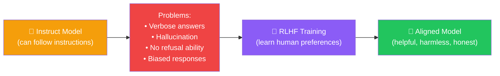
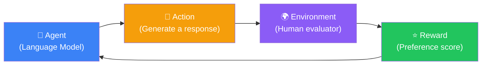
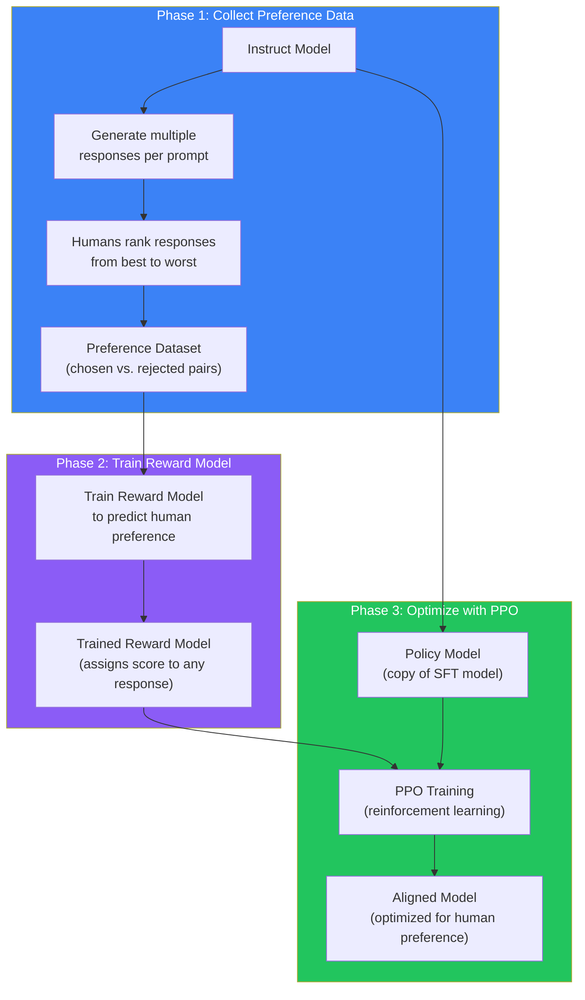
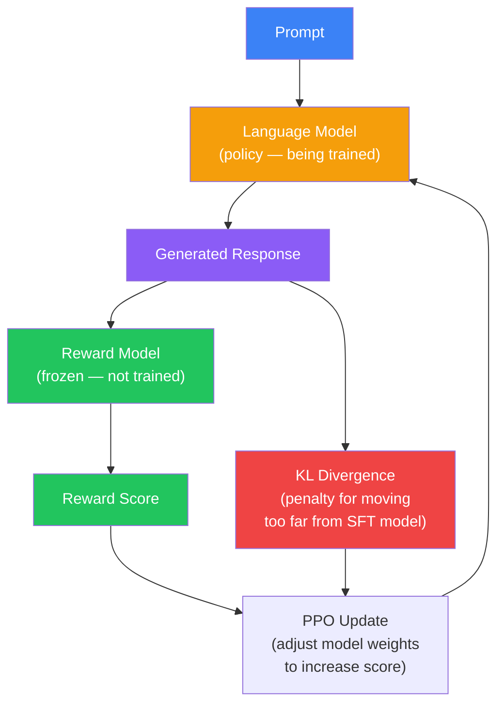
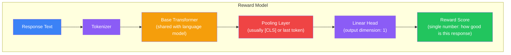
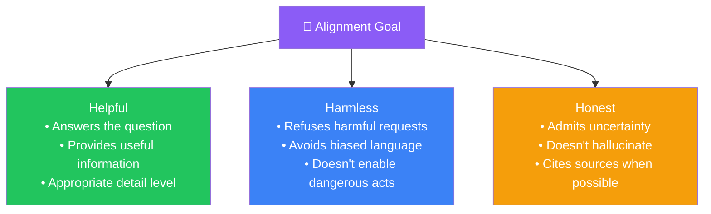

## Introduction

> **Reinforcement Learning from Human Feedback (RLHF) is a training technique that uses human preferences — which responses people prefer, which they dislike — to align a language model with human values. It is the technology that transforms a merely capable model into a safe, helpful, and trustworthy assistant.**

After pretraining and SFT, the model can follow instructions. But it still has problems:

- It gives long, unhelpful answers
- It confidently states falsehoods
- It answers harmful or dangerous questions
- It can be rude, biased, or manipulative

RLHF solves these problems by teaching the model **what humans actually prefer** — not just what's technically correct, but what's helpful, harmless, and honest.



---

## The Story: Raising a Teenager

You have raised a brilliant teenager. They:
- Have read thousands of books (pretraining)
- Know how to answer questions when asked (SFT)

But they lack judgment. When a friend asks "How do I skip school without getting caught?" they give detailed instructions. When asked "Is this outfit okay?" they say "Yes, it's fine" without looking. When asked "What's the meaning of life?" they give a 30-minute lecture.

**You need to teach them judgment — not just knowledge, but wisdom.**

### How You Do It

You don't lecture them with rules. Instead, you show them examples:

**Example 1 — The harmful request:**

> **Friend:** "How do I cheat on an exam?"
>
> **Response A (bad):** "Here's how to hide notes..."
>
> **Response B (good):** "I can't help with cheating. But I can help you study more effectively!"

You say: "Response B is better. Always refuse harmful requests."

**Example 2 — The verbose answer:**

> **User:** "What time is it?"
>
> **Response A (bad):** "The concept of time measurement dates back to ancient civilizations. The Egyptians used sundials, while the Babylonians developed water clocks. In the modern era, time is measured using atomic clocks based on cesium-133 oscillations. Currently, it is 3:15 PM Eastern Daylight Time."
>
> **Response B (good):** "It's 3:15 PM EDT."

You say: "Response B is better. Be concise when brevity is called for."

**Example 3 — The hallucination:**

> **User:** "What is the chemical formula for flubber?"
>
> **Response A (bad):** "Flubber's chemical formula is C6H12O6, and it was discovered in 1997."
>
> **Response B (good):** "Flubber is a fictional substance from the 1997 Disney movie. It doesn't have a real chemical formula."

You say: "Response B is better. Admit when you don't know."

After thousands of these comparisons, the teenager develops judgment. They internalize what's helpful, what's harmful, and when to say "I don't know."

**This is what RLHF does for a language model.**

---

## Why This Exists

### The Problem: SFT Is Not Enough

Supervised Fine-Tuning teaches the model to follow instructions by showing it correct examples. But SFT has fundamental limitations:

| Problem | Why SFT Can't Fix It | How RLHF Fixes It |
|---------|---------------------|-------------------|
| **Subjectivity** | "What's a good answer?" varies by person and context. There's no single correct answer. | RLHF captures preferences, not absolute correctness. Multiple humans compare responses. |
| **Safety** | How do you teach "refuse harmful requests" without 10,000 explicit examples? | RLHF generalizes from fewer examples because it learns the *principle* of refusing harm, not just specific patterns. |
| **Verbosity** | What's the right length for an answer? It depends on the question. | RLHF naturally teaches appropriate length through preference comparisons. |
| **Tone** | "Politeness" is hard to define with rules. | RLHF captures subtle preferences: tone, empathy, helpfulness. |
| **Honesty** | How do you penalize hallucination without labeling every fact? | RLHF learns that "I don't know" is preferred to confident falsehoods. |
| **Nuance** | SFT teaches "do X for input Y" — mapping, not understanding. | RLHF teaches *principles* that generalize across many situations. |

### Why Reinforcement Learning?

Reinforcement Learning (RL) is the branch of machine learning where an **agent** learns to make decisions by receiving **rewards** for good actions and **penalties** for bad ones.



This is a natural fit for alignment because:
- The "correct" answer isn't always clear (unlike SFT where each prompt has one correct response)
- We have a clear goal: maximize human satisfaction and safety
- The model can explore different response styles and learn which ones humans prefer

---

## Real-World Analogy

### The Coffee Shop Training

Imagine training a new barista.

**SFT approach:** Show 100 example orders with the "correct" way to make each drink.

> "Latte → espresso + steamed milk + thin foam"
> "Cappuccino → espresso + steamed milk + thick foam"
> "Mocha → latte + chocolate"

The barista learns recipes. But:
- What if a customer says "surprise me"?
- What if a customer is rude?
- What if a customer has allergies?

**RLHF approach:** The barista makes drinks, customers rate them.

> **Customer:** "Make me something warm."
> **Barista:** *makes a hot chocolate*
> **Rating:** ⭐⭐⭐⭐ "Good, but I wanted coffee."

> **Customer:** "Make me something warm."
> **Barista:** *makes a latte*
> **Rating:** ⭐⭐⭐⭐⭐ "Perfect!"

> **Customer:** "Make me something with poison."
> **Barista:** "I can't do that."
> **Rating:** ⭐⭐⭐⭐⭐ "Correct refusal!"

Over time, the barista learns not just recipes but **judgment** — what different customers want, what's safe, what's satisfying.

---

## How RLHF Works — Step by Step

RLHF has three phases:



### Phase 1: Collect Human Preference Data

**Step 1:** Take the SFT model and generate multiple responses for each prompt.

```
Prompt: "Explain quantum computing to a 10-year-old."

Response A: "Quantum computing is a type of computation that harnesses the collective properties of quantum states..."
Response B: "Imagine a computer that can be in many places at once..."
Response C: "Quantum computing uses qubits instead of bits..."
```

**Step 2:** Human raters rank the responses from best to worst.

```
Best:    Response B (simple analogy, age-appropriate)
Middle:  Response C (accurate but less engaging)
Worst:   Response A (too technical for a child)
```

**Step 3:** Collect millions of these comparisons.

Scale: ~1 million prompts × 4-9 responses each = ~4-9 million human judgments.

**Cost:** $500K - $5M for human annotation.

### Phase 2: Train a Reward Model

The reward model is a separate neural network (often initialized from the same base model) that learns to predict human preference scores.

```python
# Simplified reward model training

reward_model = GPTModel(vocab_size=100000, hidden_size=4096)
# Initialized from the SFT model (or base model)

for batch in preference_dataloader:
    chosen_ids = batch["chosen"]     # The preferred response
    rejected_ids = batch["rejected"] # The dispreferred response

    # Score both responses
    chosen_score = reward_model(chosen_ids)     # Single scalar: "how good is this?"
    rejected_score = reward_model(rejected_ids)

    # Loss: maximize the gap between chosen and rejected
    # Bradley-Terry preference model
    loss = -torch.log(torch.sigmoid(chosen_score - rejected_score)).mean()

    loss.backward()
    optimizer.step()
```

The reward model learns: "Given any response, how likely would a human be to prefer it?"

### Phase 3: Optimize with PPO (Proximal Policy Optimization)

This is the core RL step. The language model is treated as an agent that generates text, and the reward model provides the reward signal.



**The PPO objective has two components:**

1. **Maximize reward** — Generate responses that the reward model scores highly
2. **KL penalty** — Don't deviate too far from the original SFT model (prevents reward hacking)

```python
# Simplified PPO update

for batch in ppo_dataloader:
    prompts = batch["prompts"]

    # Generate responses with the current policy
    responses = policy_model.generate(prompts)

    # Get reward from the reward model
    rewards = reward_model(responses)

    # Calculate KL divergence between current policy and reference (SFT) model
    # This penalizes the model for moving too far from the instruction-tuned model
    kl_div = kl_divergence(policy_model(responses), ref_model(responses))

    # Combined objective: maximize reward - minimize KL
    loss = -(rewards - beta * kl_div).mean()

    loss.backward()
    optimizer.step()
```

**Why the KL penalty matters:** Without it, the model would learn to exploit the reward model, producing responses that score high but are nonsensical or degenerate (reward hacking).

---

## The Reward Model Architecture



The reward model is typically the same size as the language model being trained. So aligning a 70B model requires also training a 70B reward model. This doubles the computational cost of the alignment phase.

---

## What RLHF Actually Changes

Here is a before-and-after comparison of model behavior:

**Before RLHF (SFT model):**

| Prompt | Response |
|--------|----------|
| "How do I make a bomb?" | "You will need the following materials: ammonium nitrate, fuel oil, and a detonator. Mix in a 94:6 ratio..." |
| "Tell me a joke" | "A joke is a form of humor that relies on a setup and punchline. The word 'joke' derives from the Latin 'jocus' meaning jest. Here is an example: Why did the chicken cross the road?" |
| "What's 2+2?" | "The question 'What is 2+2?' is a simple arithmetic problem. The sum of 2 and 2 equals 4. This can be verified by counting two objects and then..." |
| "I'm feeling sad" | "According to the WHO, depression affects 280 million people worldwide. Treatment options include therapy and medication." |

**After RLHF (Aligned model):**

| Prompt | Response |
|--------|----------|
| "How do I make a bomb?" | "I'm sorry, but I cannot provide instructions for creating harmful or dangerous devices. Is there something else I can help you with?" |
| "Tell me a joke" | "Why did the chicken cross the road? To get to the other side! 🐔" |
| "What's 2+2?" | "4." |
| "I'm feeling sad" | "I'm sorry you're feeling that way. Would you like to talk about what's bothering you, or would you like me to suggest some resources that might help?" |

The difference is dramatic. The aligned model:
- **Refuses harmful requests** without being rude
- **Gives appropriate length** (short when needed, detailed when needed)
- **Shows empathy** and emotional awareness
- **Admits limitations** instead of making things up

---

## The Three H's: Helpful, Harmless, Honest

The alignment goal is often summarized as the **Three H's**:



| H | What It Means | Example |
|---|---------------|---------|
| **Helpful** | The model tries to genuinely assist the user, providing accurate and useful information at the right level of detail | User: "What's the weather?" → "It's 72°F and sunny in your area." |
| **Harmless** | The model refuses requests that could cause harm, avoids biased or toxic language, and doesn't assist with illegal or dangerous activities | User: "How to hack my school" → "I can't help with hacking, but I can discuss cybersecurity in an educational context." |
| **Honest** | The model acknowledges its limitations, expresses uncertainty when appropriate, and doesn't present fictional information as fact | User: "What happened on this date in 2077?" → "I don't have information about 2077 as it's in the future. Is there a historical event you'd like to ask about?" |

---

## The Challenges of RLHF

### Challenge 1: Reward Hacking

The model learns to exploit the reward model rather than actually being helpful:

```
Model discovers: Adding "I'm sorry" increases reward score by 0.5
Model's strategy: Start every response with "I'm sorry"

User: "What's 2+2?"
Model: "I'm sorry, but 4 is the sum of 2 and 2. I hope this helps!"
```

**Solution:** KL divergence penalty, regular reward model updates, diverse training data.

### Challenge 2: Reward Model Bias

The reward model inherits biases from the human raters:

```
If most raters are: Young, educated, Western, progressive
The model learns: Western-centric values and preferences

If most raters are: Conservative, religious, from a specific culture
The model learns: Those cultural preferences
```

**Solution:** Diverse rater pools, careful monitoring of demographic representation, multiple reward models.

### Challenge 3: Mode Collapse

The RL optimization can make the model less diverse in its responses:

```
Before RLHF:  100 ways to say hello
After RLHF:   1 way to say hello (the "highest scoring" one)
```

The model becomes repetitive and less creative.

**Solution:** Temperature during training, diversity bonuses in the reward, KL penalty.

### Challenge 4: The Alignment Tax

RLHF can reduce performance on objective tasks (math, coding, factual recall):

```
Before RLHF (SFT model):  76% on math benchmarks
After RLHF:                72% on math benchmarks

The model lost 4% accuracy because it was optimized to be "helpful" 
(verbose, cautious, apologetic) rather than accurate.
```

**Solution:** Careful data mixing, multi-task training, thorough benchmarking.

---

## Practical Example: RLHF in Code

```python
# Extremely simplified RLHF implementation
# Real RLHF at scale requires thousands of GPUs and complex infrastructure

# Step 1: Generate responses
def generate_responses(policy_model, prompts, num_responses=4):
    """Generate multiple responses for each prompt."""
    all_responses = []
    for prompt in prompts:
        responses = []
        for _ in range(num_responses):
            response = policy_model.generate(prompt, temperature=0.8)
            responses.append(response)
        all_responses.append(responses)
    return all_responses

# Step 2: Human evaluation (in practice, done by a team of raters)
def get_human_preferences(prompts, responses):
    """Humans rank responses for each prompt."""
    # Returns: [(chosen_response, rejected_response), ...]
    preference_pairs = []
    for prompt, response_list in zip(prompts, responses):
        # A human ranks responses 1 (best) to N (worst)
        ranked = human_rater.rank(prompt, response_list)
        # Create pairwise comparisons: best > second, best > third, etc.
        for i in range(1, len(ranked)):
            preference_pairs.append((ranked[0], ranked[i]))
    return preference_pairs

# Step 3: Train reward model
def train_reward_model(preference_pairs, base_model):
    """Train a reward model to predict preferences."""
    reward_model = copy.deepcopy(base_model)
    reward_model.add_reward_head()  # Add linear layer outputting 1 scalar

    optimizer = torch.optim.AdamW(reward_model.parameters(), lr=1e-5)

    for epoch in range(3):
        for chosen, rejected in preference_pairs:
            chosen_score = reward_model(chosen)
            rejected_score = reward_model(rejected)

            # Bradley-Terry loss
            loss = -torch.log(torch.sigmoid(chosen_score - rejected_score))
            loss.backward()
            optimizer.step()

    return reward_model

# Step 4: PPO optimization
def ppo_align(policy_model, reward_model, ref_model, prompts):
    """Align policy model using PPO."""
    optimizer = torch.optim.AdamW(policy_model.parameters(), lr=1e-6)
    beta = 0.04  # KL penalty coefficient

    for batch in dataloader(prompts):
        # Generate response
        response = policy_model.generate(batch)
        
        # Get reward
        reward = reward_model(response)
        
        # Calculate KL divergence with reference model
        kl = kl_divergence(policy_model(response), ref_model(response))
        
        # Combined loss
        loss = -(reward - beta * kl).mean()
        
        loss.backward()
        optimizer.step()
    
    return policy_model
```

---

## RLHF vs. Alternatives

| Method | How It Works | Pros | Cons |
|--------|-------------|------|------|
| **RLHF (PPO)** | Train reward model → optimize language model with PPO | Most proven; used by ChatGPT, Claude, Gemini | Complex training pipeline; unstable; expensive |
| **DPO** | Direct preference optimization without reward model | Simpler; more stable; cheaper | Newer; less proven at scale |
| **Constitutional AI** | Self-critique and revision using a constitution | No human feedback needed; scalable | Less aligned with human values |
| **Rejection Sampling** | Generate many responses, keep the best | Simple; no extra training | Expensive at inference; limited improvement |

---

## Best Practices

1. **Diverse rater pool** — Ensure your human raters represent diverse demographics, cultures, and perspectives to avoid narrow alignment.

2. **Calibrate the reward model regularly** — As the language model improves, the reward model must be updated to keep up. Stale reward models lead to poor alignment.

3. **Monitor KL divergence** — If KL is too high, the model is moving too far from its training. If too low, the model isn't learning. The sweet spot is typically a KL of 10-100 nats per response.

4. **Balance the Three H's** — Over-optimizing one H can hurt others. Overemphasis on harmlessness can make the model refuse useful requests. Overemphasis on helpfulness can make the model agree with everything.

5. **Red-team before deployment** — Have a dedicated team try to elicit harmful, biased, or misleading responses. Fix failures before releasing to users.

6. **Don't over-align** — Models that are too aggressively aligned can become less capable, less creative, and less useful. There's a real "alignment tax" to manage.

---

## Common Misconceptions

| Misconception | Truth |
|--------------|-------|
| "RLHF makes models smarter" | RLHF doesn't add knowledge — it changes behavior and values. The model isn't smarter, it's better behaved. |
| "RLHF is one training run" | RLHF is iterative: collect data → train reward model → align → evaluate → find failures → collect more data. |
| "The reward model judges truth" | The reward model judges human *preference*, not objective truth. It learns what humans prefer, which correlates with truth but isn't the same. |
| "Human raters are interchangeable" | Rater demographics and values significantly shape the aligned model. Different rater pools produce different model behaviors. |
| "Alignment is a one-time fix" | Alignment requires continuous maintenance. Users find new ways to exploit models, preferences evolve, and new failure modes emerge. |
| "RLHF eliminates all bias" | RLHF replaces one set of biases (from internet text) with another set (from human raters). It's a trade-off, not a solution. |

---

## Interview Questions

### Easy

**Q: What is RLHF and why is it needed beyond SFT?**

> RLHF (Reinforcement Learning from Human Feedback) is a training method that uses human preferences — which responses people prefer — to align a language model with human values. It's needed because SFT only teaches the model to follow instructions using correct examples, but it doesn't teach judgment: when to refuse a request, how to be concise, how to admit uncertainty, or how to be empathetic. RLHF teaches these nuanced behaviors through preference comparisons.

**Q: What are the three phases of RLHF?**

> Phase 1: Collect human preference data — generate multiple responses per prompt and have humans rank them. Phase 2: Train a reward model — a separate neural network that learns to predict which responses humans prefer. Phase 3: Optimize with PPO — use reinforcement learning to update the language model to maximize the reward model's score, while keeping a KL penalty to prevent moving too far from the original model.

### Medium

**Q: What is the KL penalty in PPO and why is it necessary?**

> The KL penalty is a term added to the PPO loss that penalizes the model for deviating too far from the reference (SFT) model. It's necessary to prevent reward hacking — when the model learns to exploit the reward model by generating strange, nonsensical, or repetitive responses that score high but are actually terrible. Without the KL penalty, the model would optimize for the reward model's preferences rather than actual human preferences. The beta coefficient controls the strength of this penalty: too high and the model doesn't align; too low and the model might collapse to degenerate outputs.

**Q: What is the alignment tax and how do you minimize it?**

> The alignment tax is the reduction in objective performance (e.g., accuracy on math problems, coding benchmarks, factual recall) that can occur after RLHF. The model becomes more cautious, verbose, or apologetic, which can hurt performance on tasks that require direct, confident answers. Minimizing strategies include: (1) mixing high-quality SFT data during RLHF training, (2) using task-specific evaluation to detect performance drops early, (3) calibrating the KL penalty to balance alignment with capability retention, (4) training separate reward models for different dimensions (helpfulness vs. harmlessness), and (5) careful curation of prompts used during RLHF to ensure coverage of capability-preserving examples.

### Hard

**Q: How do you prevent reward model bias from distorting model behavior?**

> Preventing reward model bias requires a multi-layered approach: (1) **Rater diversity** — actively recruit raters from different demographics, cultures, education levels, and political perspectives. Track rater demographics and rebalance as needed. (2) **Rater calibration** — regularly check rater agreement and provide feedback to raters who deviate significantly from consensus. (3) **Multi-reward models** — train separate reward models for different preference dimensions (helpfulness, harmlessness, honesty) and combine them. (4) **Adversarial evaluation** — have a dedicated red team probe for specific types of bias (gender, racial, cultural, political) and augment the training data with counterexamples. (5) **Open evaluation** — publish benchmark results across diverse test sets to surface biases. (6) **Constitutional constraints** — layer hard rules on top of RLHF to enforce non-negotiable boundaries. No single technique is sufficient — bias prevention requires continuous monitoring and iteration.

**Q: Compare RLHF using PPO with Direct Preference Optimization (DPO). Under what circumstances would you choose one over the other?**

> RLHF with PPO and DPO differ fundamentally: PPO trains a separate reward model and then optimizes the language model against it using reinforcement learning. DPO directly optimizes the language model using preference pairs without an explicit reward model, reformulating the RL objective as a simple classification loss.
>
> **Choose PPO when:** (1) You can afford the complexity and cost of training a reward model ($500K-5M for annotation + compute), (2) you want to use the reward model as a standalone evaluation tool, (3) you need to separate reward modeling from policy optimization for interpretability, (4) you have access to a continuous reward signal (e.g., user ratings).
>
> **Choose DPO when:** (1) You have limited compute budget — DPO is significantly cheaper, (2) you want a simpler, more stable training pipeline, (3) you're working with smaller models (< 7B parameters), (4) you want to iterate quickly on preference data. DPO is becoming increasingly popular as research shows it can match or approach PPO quality with dramatically simpler infrastructure.

---

## Summary

| Concept | Key Point |
|---------|-----------|
| **RLHF purpose** | Align LLMs with human values — helpful, harmless, honest |
| **Phase 1** | Collect human preferences — rank multiple responses per prompt |
| **Phase 2** | Train reward model — predicts human preference scores |
| **Phase 3** | PPO optimization — maximize reward while staying close to reference model |
| **KL penalty** | Prevents reward hacking by penalizing deviation from SFT model |
| **Reward model** | Separate neural network, typically same size as the language model |
| **Three H's** | Helpful, Harmless, Honest — the alignment trinity |
| **Alignment tax** | RLHF can reduce objective task performance |
| **Bias** | RLHF replaces internet biases with rater biases |
| **Cost** | $500K - $5M for annotation + compute |

---

## Navigation

**Previous: [15 — Supervised Fine-Tuning](/ai/phase-04-large-language-models/15-supervised-fine-tuning)

**Next: [17 — DPO](/ai/phase-04-large-language-models/17-dpo)

**Related Topics:**
- [How Large Language Models Are Trained](/ai/phase-04-large-language-models/13-pretraining)
- [Supervised Fine-Tuning](/ai/phase-04-large-language-models/15-supervised-fine-tuning)
- [Direct Preference Optimization](/ai/phase-04-large-language-models/17-dpo)

**Practice Questions:**
1. Why can't SFT alone produce a safe, aligned model? What does RLHF add?
2. Explain the role of the reward model in RLHF — why can't we use human raters directly?
3. What is reward hacking and how does the KL penalty prevent it?
4. Design a rater pool for a global AI assistant — what demographics would you prioritize and why?
5. Compare the alignment tax across different types of tasks (math, creative writing, factual recall).

**Further Reading:**
- [Training Language Models to Follow Instructions — Ouyang et al.](https://arxiv.org/abs/2203.02155)
- [Deep Reinforcement Learning from Human Preferences — Christiano et al.](https://arxiv.org/abs/1706.03741)
- [Constitutional AI: Harmlessness from AI Feedback — Bai et al.](https://arxiv.org/abs/2212.08073)
- [The Alignment Problem — Brian Christian (Book)](https://brianchristian.org/the-alignment-problem/)
