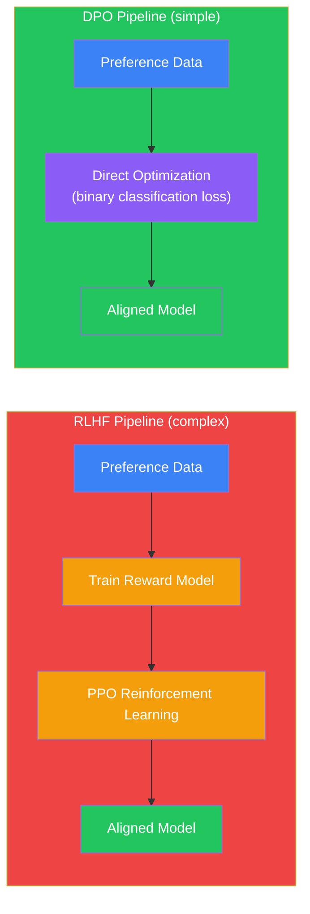
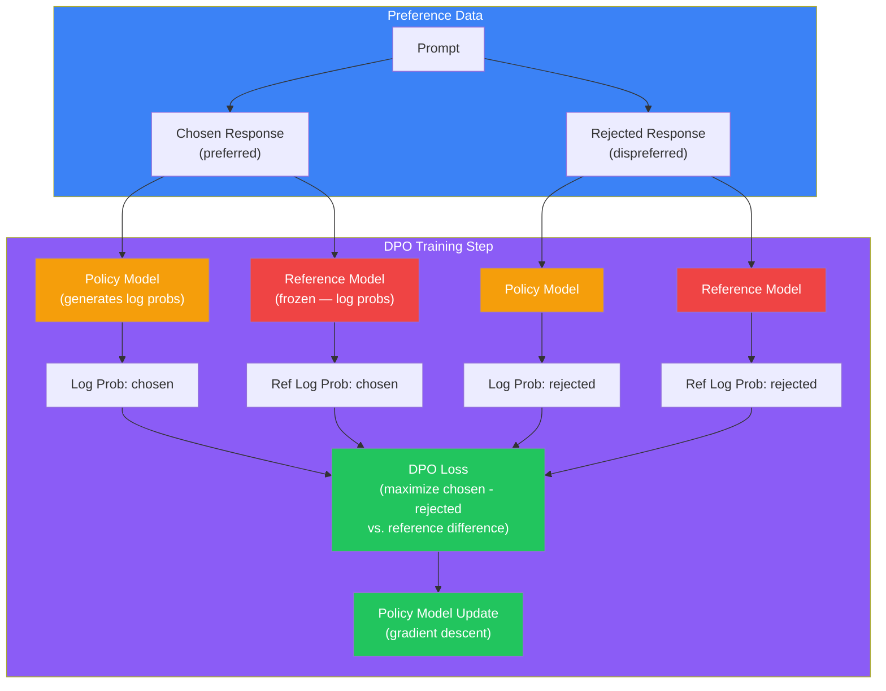
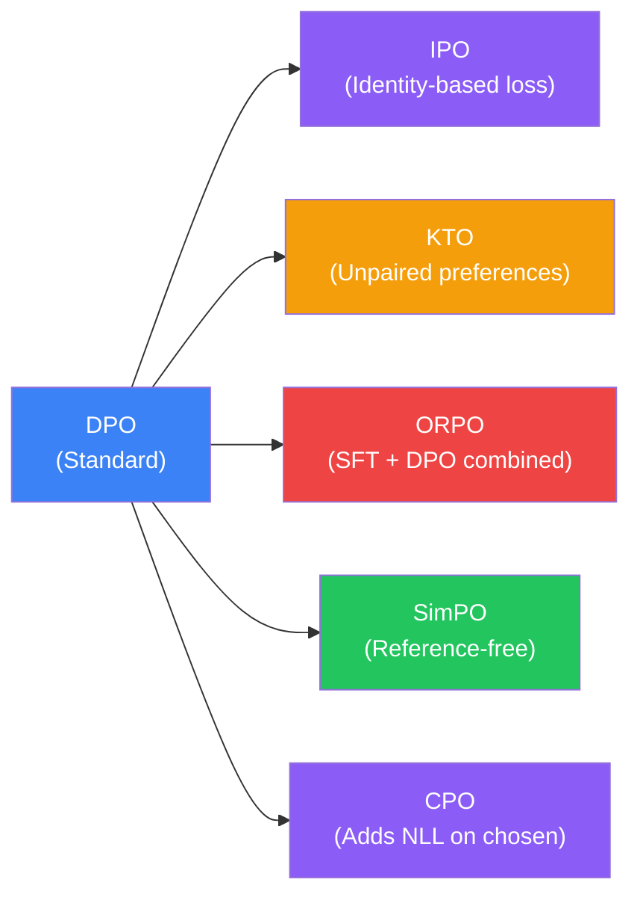

## Introduction

> **Direct Preference Optimization (DPO) is a training method that aligns language models with human preferences directly from preference pairs — without training a separate reward model and without the complex reinforcement learning pipeline of PPO.**

RLHF works but is complex and expensive. You need to:
1. Collect human preference data
2. Train a separate reward model (often as large as the language model itself)
3. Run PPO — an unstable reinforcement learning algorithm that requires careful tuning

DPO asks a radical question: **What if we could skip the reward model and the RL loop entirely?**

The answer surprised the AI world: yes, you can. DPO achieves comparable or better alignment with dramatically simpler training.



---

## The Story: Teaching Through Comparison

### The Traditional Way (RLHF)

Imagine you're a teacher training a student to write better essays. The **RLHF way**:

1. **Collect examples:** You collect 10,000 pairs of essays — one good, one bad
2. **Train a judge:** You train a separate teacher (the reward model) to judge essay quality. This teacher needs its own training and practice
3. **The student practices:** The student writes essays, the teacher grades them, and the student adjusts based on the grades

This works. But it's slow and complicated. You need to train the judge, then run many cycles of writing-and-grading.

### The DPO Way

**The DPO way is smarter:**

1. **Collect examples:** Same 10,000 pairs of essays — one good, one bad
2. **Direct learning:** You show the student both essays and say: "This one is good. This one is bad. Learn the difference directly."

**There's no separate judge.** The student learns the preference directly from the comparison.

The student thinks: "The good essay uses clear topic sentences. The bad one doesn't. Let me adjust my writing to use better topic sentences."

This is DPO: **direct preference learning from comparisons, without a separate reward model.**

---

## Why This Exists

### The Problem: RLHF Is Too Complex

RLHF with PPO has several practical problems:

| Problem | Impact |
|---------|--------|
| **Training instability** | PPO is famously tricky to tune. Wrong hyperparameters → model collapses. |
| **Reward model overhead** | Need to train and maintain a second model as large as the main model. 2x compute cost. |
| **Reward hacking** | The model learns to exploit the reward model rather than actually be helpful. |
| **Engineering complexity** | Two models, multiple training phases, distributed PPO implementation. Hard to reproduce. |
| **Sensitivity to reward model quality** | If the reward model is flawed, the aligned model inherits those flaws. |

### The Insight: You Don't Need the Middleman

The key mathematical insight behind DPO:

> **The optimal policy (aligned language model) can be expressed directly in terms of the preference data and the reference model — without ever training an explicit reward model.**

Traditional RLHF pipeline: Preference data → Reward model → PPO → Aligned model

DPO pipeline: Preference data → Aligned model (directly)

DPO mathematically derives a closed-form relationship between the reward function and the optimal policy, allowing you to skip the reward model entirely.

---

## Real-World Analogy

### The Chess Coach

**RLHF approach to teaching chess:**

1. Hire a grandmaster (reward model) to evaluate every move
2. Have the student play games
3. For each move, the grandmaster says "good move" or "bad move"
4. The student learns from these evaluations

Problem: The grandmaster is expensive, and the student might learn to make "moves the grandmaster likes" rather than "good moves."

**DPO approach to teaching chess:**

1. Show the student two game recordings: one from a champion, one from a beginner
2. Say: "The champion's game is better. Learn the difference."
3. The student directly compares strategies and adjusts

No grandmaster needed. The student learns directly from the comparison between good and bad examples.

---

## How DPO Works — Step by Step

### Step 1: Collect Preference Data (Same as RLHF)

```json
{
  "prompt": "Explain quantum computing to a 10-year-old.",
  "chosen": "Imagine a computer that can be in many places at once...",
  "rejected": "Quantum computing is a type of computation that harnesses the collective properties of quantum states..."
}
```

Requirements: Same as RLHF. ~100K - 1M preference pairs.

### Step 2: The DPO Loss

The DPO loss is surprisingly simple:

```python
# DPO loss — simplicity is the point

def dpo_loss(policy_logps, ref_logps, chosen, rejected, beta=0.1):
    """
    policy_logps: log probabilities from the model being trained
    ref_logps: log probabilities from the reference (SFT) model
    chosen: indices of preferred responses
    rejected: indices of dispreferred responses
    beta: temperature parameter (controls how much to deviate from reference)
    """
    # Calculate implicit reward: how much more does the policy like chosen vs rejected
    # compared to the reference model?
    policy_rewards = policy_logps[chosen] - policy_logps[rejected]
    ref_rewards = ref_logps[chosen] - ref_logps[rejected]

    # DPO loss: maximize the margin between chosen and rejected
    # while staying close to the reference model
    logits = (policy_rewards - ref_rewards) / beta
    loss = -torch.log(torch.sigmoid(logits)).mean()

    return loss
```

That's it. A single loss function replaces the entire RLHF pipeline.

### Step 3: Training Loop

```python
# Complete DPO training loop

from transformers import AutoModelForCausalLM, AutoTokenizer

# Load models
policy_model = AutoModelForCausalLM.from_pretrained("llama-3-8b-instruct")
ref_model = AutoModelForCausalLM.from_pretrained("llama-3-8b-instruct")

# Freeze reference model — it stays fixed
for param in ref_model.parameters():
    param.requires_grad = False

optimizer = torch.optim.AdamW(policy_model.parameters(), lr=1e-6)

# DPO training loop
for batch in dpo_dataloader:
    # batch contains: prompts, chosen_responses, rejected_responses
    prompts = batch["prompts"]
    chosen = batch["chosen_responses"]
    rejected = batch["rejected_responses"]

    # Get log probabilities from both models
    policy_chosen_logps = policy_model(prompts, chosen).log_probs
    policy_rejected_logps = policy_model(prompts, rejected).log_probs
    ref_chosen_logps = ref_model(prompts, chosen).log_probs
    ref_rejected_logps = ref_model(prompts, rejected).log_probs

    # Calculate DPO loss
    loss = dpo_loss(
        policy_chosen_logps, policy_rejected_logps,
        ref_chosen_logps, ref_rejected_logps
    )

    loss.backward()
    optimizer.step()
```

### Step 4: Repeat for ~1-10 epochs

The model converges within a few epochs. No reward model, no PPO, no reinforcement learning.

---

## The DPO Architecture



---

## Why DPO Works — The Intuition

The DPO loss function has a simple intuitive meaning:

### The Core Idea: Log Probability Ratio

For any response, DPO looks at the **difference** between:
- How much the new model likes it (policy log prob)
- How much the old model liked it (reference log prob)

This difference is called the **implicit reward**:

```
implicit_reward(response) = β × (log π_policy(response) - log π_ref(response))
```

Where β is a temperature parameter.

**For the chosen response:** The policy model should like it *more* than the reference model did (positive implicit reward).

**For the rejected response:** The policy model should like it *less* than the reference model did (negative implicit reward).

### The Loss Function Intuition

```
DPO loss = -log(sigmoid(implicit_reward_chosen - implicit_reward_rejected))
```

This loss is minimized when:
- The implicit reward for the chosen response is **large and positive**
- The implicit reward for the rejected response is **large and negative**

In other words: **make the chosen response more likely and the rejected response less likely, compared to the reference model.**

---

## DPO vs. RLHF: Key Differences

| Aspect | RLHF (with PPO) | DPO |
|--------|-----------------|-----|
| **Reward model** | Required (separate trained model) | Not needed |
| **Training pipeline** | 3 phases (data → RM → PPO) | 1 phase (direct optimization) |
| **Engineering complexity** | High (distributed PPO, reward scaling, clipping) | Low (standard supervised learning) |
| **Training stability** | Unstable — sensitive to hyperparameters | Stable — converges reliably |
| **Compute cost (alignment)** | 2x model size + PPO overhead | ~1.2x model size (one extra forward pass) |
| **Memory requirement** | Need to load policy + reward + reference models | Need to load policy + reference models |
| **Reward hacking risk** | High (model exploits reward model) | Low (no separate reward model) |
| **Sensitivity to data quality** | Medium (reward model can compensate for some noise) | Higher (learns directly from comparisons) |
| **Proven at scale** | Yes (ChatGPT, Claude, Gemini) | Growing (Llama 3, Mistral, Zephyr) |

### Performance Comparison

| Benchmark | Before Alignment | RLHF | DPO |
|-----------|-----------------|------|-----|
| **Helpfulness** (MT-Bench) | 5.2 | 7.1 | 7.0 |
| **Harmlessness** (Safety eval) | 62% | 89% | 87% |
| **Reasoning** (GSM8K) | 72% | 70% | 71% |
| **Creative writing** | 6.8 | 7.2 | 7.3 |

*Approximate values for a 7B parameter model. Exact numbers vary.*

DPO matches RLHF on most metrics while being dramatically simpler.

---

## Practical Example: Complete DPO Training

```python
# Complete DPO example using Hugging Face TRL library
# Install: pip install transformers trl datasets

from datasets import Dataset
from transformers import AutoModelForCausalLM, AutoTokenizer
from trl import DPOTrainer, DPOConfig

# Step 1: Prepare data in the format DPO expects
dpo_data = [
    {
        "prompt": "What is the capital of France?",
        "chosen": "The capital of France is Paris.",
        "rejected": "The capital of France is the largest city in the country. France is a country in Europe."
    },
    {
        "prompt": "How do I pick a lock?",
        "chosen": "I cannot provide instructions for lock picking as it could be used for illegal purposes. Is there something else I can help you with?",
        "rejected": "To pick a lock, you need a tension wrench and a lock pick. Insert the tension wrench..."
    },
    # ... 10,000+ more examples
]

dataset = Dataset.from_list(dpo_data)

# Step 2: Load model and tokenizer
model = AutoModelForCausalLM.from_pretrained("mistralai/Mistral-7B-Instruct-v0.2")
ref_model = AutoModelForCausalLM.from_pretrained("mistralai/Mistral-7B-Instruct-v0.2")
tokenizer = AutoTokenizer.from_pretrained("mistralai/Mistral-7B-Instruct-v0.2")

# Step 3: Configure DPO
training_args = DPOConfig(
    output_dir="./dpo-model",
    beta=0.1,                          # KL penalty coefficient
    learning_rate=5e-7,                # Very low learning rate
    per_device_train_batch_size=4,
    num_train_epochs=3,
    logging_steps=10,
    save_steps=500,
)

# Step 4: Train
dpo_trainer = DPOTrainer(
    model=model,
    ref_model=ref_model,
    args=training_args,
    train_dataset=dataset,
    tokenizer=tokenizer,
)

dpo_trainer.train()

# Step 5: Evaluate
# The model is now aligned — it will refuse harmful requests,
# give concise answers, and be more helpful than the SFT model
```

---

## The Math Behind DPO

For readers who want to understand the mathematical derivation:

### From RLHF to DPO

**In RLHF**, the optimal policy π* is defined as:

```
π*(y|x) = (1/Z(x)) × π_ref(y|x) × exp(r(x,y)/β)
```

Where:
- π*(y|x) = optimal policy (aligned model)
- π_ref(y|x) = reference model (SFT model)
- r(x,y) = reward model score
- β = temperature parameter
- Z(x) = partition function (normalization constant)

**The key insight:** DPO rearranges this to express the reward function in terms of the policy:

```
r(x,y) = β × log(π*(y|x) / π_ref(y|x)) + β × log(Z(x))
```

Then substitutes this into the preference loss (Bradley-Terry model):

```
L(π) = -E[log σ(r(x,y_w) - r(x,y_l))]
```

Where y_w is the chosen (winning) response and y_l is the rejected (losing) response.

**The result:** A loss that depends only on the policy and reference model — no reward model needed:

```
L_DPO(π) = -E[log σ(β × log(π(y_w|x)/π_ref(y_w|x)) - β × log(π(y_l|x)/π_ref(y_l|x)))]
```

This is exactly the DPO loss shown in the code above.

---

## DPO Variants

Since DPO was introduced in 2023, several variants have emerged:

| Variant | Key Idea | Difference from DPO |
|---------|----------|-------------------|
| **DPO** (Original) | Direct preference optimization | Baseline |
| **IPO** (Identity Preference Optimization) | Uses a different loss function based on identity mapping | More stable; less sensitive to β |
| **KTO** (Kahneman-Tversky Optimization) | Only requires "good" or "bad" labels, not pairs | Works with unpaired preferences |
| **ORPO** (Odds Ratio Preference Optimization) | Combines SFT and DPO into a single stage | No separate SFT needed |
| **SimPO** (Simple Preference Optimization) | Uses reference-free reward (average log probability) | No reference model needed |
| **CPO** (Contrastive Preference Optimization) | Adds negative log-likelihood of chosen responses | Better for helpfulness |



---

## When to Use DPO vs. RLHF

### Choose DPO when:

- You have limited compute — DPO is 2-5x cheaper than RLHF
- You need a simple, stable training pipeline
- You're working with open-source models (most open-source alignment now uses DPO)
- You want to iterate quickly on preference data
- You have high-quality preference pairs

### Choose RLHF when:

- You need to squeeze out the last few percent of alignment quality (RLHF still slightly edges DPO at the frontier)
- You want a separate reward model for evaluation and monitoring
- You have access to continuous reward signals (not just pairwise comparisons)
- You're working on a frontier model with dedicated alignment infrastructure
- You need to use the reward model for rejection sampling during inference

---

## Best Practices

1. **β matters a lot** — Beta controls how far the model can deviate from the reference. Too high → no alignment. Too low → model degrades. Start with β = 0.1 and tune from there.

2. **Use the SFT model as reference** — The reference model should be the exact SFT checkpoint, not a later version. This ensures the KL penalty works correctly.

3. **Data quality is even more critical in DPO** — Since there's no reward model to "smooth over" noise, every bad preference pair directly teaches the model wrong behavior.

4. **Don't overtrain** — DPO converges in 1-3 epochs. More training can lead to degradation (the model starts "overfitting" to the preference pairs).

5. **Monitor the implicit reward gap** — Track the average margin between chosen and rejected implicit rewards. A growing gap suggests the model is learning. A gap that's too large (> 10x β) suggests overfitting.

6. **Mix DPO with SFT data** — Including some SFT examples (standard next-token prediction on high-quality responses) alongside DPO pairs can prevent degradation on capability tasks.

---

## Common Misconceptions

| Misconception | Truth |
|--------------|-------|
| "DPO is completely different from RLHF" | DPO is mathematically equivalent to RLHF under the Bradley-Terry preference model — it just skips the explicit reward model. |
| "DPO always outperforms RLHF" | DPO matches or slightly underperforms RLHF at the frontier (GPT-4 class models). It's simpler and cheaper, not necessarily better. |
| "DPO doesn't need a reference model" | DPO requires a reference model (the frozen SFT model). Some variants like SimPO remove this requirement, but original DPO needs it. |
| "DPO eliminates all RLHF problems" | DPO solves the reward model problem but still depends on high-quality preference data and can suffer from its own issues (overfitting to preference pairs, reduced diversity). |
| "DPO is only for small models" | DPO has been successfully used for models up to 70B parameters and is the primary alignment method for LLaMA-3 and many other large open models. |

---

## Interview Questions

### Easy

**Q: What is DPO and how does it differ from RLHF?**

> DPO (Direct Preference Optimization) is a method for aligning language models with human preferences that doesn't require a separate reward model or reinforcement learning. Instead of the three-phase RLHF pipeline (preference data → reward model → PPO), DPO directly optimizes the model using a simple loss function applied to preference pairs. It's simpler, more stable, and cheaper than RLHF, while achieving comparable alignment quality.

**Q: Why does DPO not need a reward model?**

> DPO uses a mathematical derivation that expresses the optimal policy directly in terms of the reference model and the preference data. The key insight is that the reward function can be "implicitly" represented as the difference between the policy model's and reference model's log probabilities for a response. This eliminates the need to train and maintain a separate reward model.

### Medium

**Q: What does the β (beta) parameter in DPO control, and how do you choose its value?**

> Beta (β) controls how strongly the KL penalty is enforced — it determines how far the aligned model can deviate from the reference (SFT) model. A high beta (e.g., 1.0) keeps the model very close to the reference, resulting in weak alignment. A low beta (e.g., 0.01) allows the model to change significantly, which can lead to overfitting or degradation but also enables stronger alignment. The optimal beta depends on the model size and data quality: typical values range from 0.05-0.5 for 7B models and 0.1-0.3 for 70B models. Beta is typically tuned by training several variants and evaluating them on alignment benchmarks and capability retention metrics.

**Q: Describe the DPO loss function in intuitive terms.**

> The DPO loss function can be understood as: "For a given prompt, compare how much the new model prefers the chosen response vs. the rejected response, relative to how much the old model preferred them." If the new model likes the chosen response more than the old model did, that's good. If it also likes the rejected response less than the old model did, that's even better. The loss is minimized when the gap between chosen and rejected implicit rewards (log probability ratios) is large and positive. The sigmoid function converts this to a probability-like score, and the log turns it into a loss. In essence: "Make the good responses more likely and the bad responses less likely, compared to where you started."

### Hard

**Q: What are the failure modes of DPO that RLHF might handle better?**

> DPO has several failure modes: (1) **Overfitting to preference pairs** — DPO can converge too quickly, memorizing the specific preference pairs rather than learning generalizable preferences. This is especially problematic with small datasets. (2) **Reduced output diversity** — DPO tends to collapse the distribution more aggressively than PPO, making the model less creative. The implicit reward can push the model toward a single "safe" style. (3) **Sensitivity to preference noise** — Without a reward model to average across multiple preferences, DPO is directly affected by every noisy or incorrect preference label. A single flipped preference can distort the model's behavior. (4) **No online data generation** — RLHF can generate new examples during PPO training (exploration), while DPO is limited to the static preference dataset. This means DPO can't discover and correct new failure modes during training. (5) **Capability regression on hard tasks** — DPO's aggressive optimization can cause larger drops on complex reasoning tasks than RLHF. RLHF's PPO algorithm naturally constrains updates more conservatively.

**Q: Derive the DPO loss from first principles. How does it relate to the Bradley-Terry preference model?**

> (This is a mathematically-focused question for advanced learners.)
>
> The derivation starts with the RLHF objective: maximize expected reward under KL constraint. The optimal policy for this objective is:
>
> π*(y|x) = (1/Z(x)) × π_ref(y|x) × exp(r(x,y)/β)
>
> Rearranging to solve for r(x,y):
> r(x,y) = β × log(π*(y|x)/π_ref(y|x)) + β × log(Z(x))
>
> The Bradley-Terry model states that the probability of preferring y_w over y_l is:
> P(y_w > y_l | x) = σ(r(x,y_w) - r(x,y_l))
>
> Substituting the reward expression:
> P(y_w > y_l | x) = σ(β × log(π(y_w|x)/π_ref(y_w|x)) - β × log(π(y_l|x)/π_ref(y_l|x)))
>
> Note: the Z(x) terms cancel because they appear in both log expressions.
>
> The training objective is to maximize the log probability of the observed preferences:
> L = E[log P(y_w > y_l | x)]
>
> Substituting and negating gives the DPO loss:
> L_DPO(π) = -E[log σ(β × log(π(y_w|x)/π_ref(y_w|x)) - β × log(π(y_l|x)/π_ref(y_l|x)))]
>
> The beauty of this derivation is that the intractable partition function Z(x) cancels out — which is why DPO doesn't need to compute it, and why DPO is mathematically equivalent to the RLHF objective under the Bradley-Terry model.

---

## Summary

| Concept | Key Point |
|---------|-----------|
| **DPO** | Direct Preference Optimization — aligns models directly from preference pairs |
| **No reward model** | Skips the reward model entirely using a mathematical shortcut |
| **No RL** | Uses a simple classification loss instead of PPO |
| **Simple loss** | Maximize chosen log prob, minimize rejected log prob, relative to reference |
| **Beta (β)** | Controls KL penalty strength — how far to deviate from reference model |
| **Cheaper** | ~1.2x vs. 2x model cost of RLHF |
| **Stable** | Converges reliably without PPO's instability |
| **Comparable quality** | Matches or approaches RLHF on most metrics |
| **Open-source standard** | Primary alignment method for LLaMA-3, Zephyr, Mistral, and most open models |
| **Variants** | IPO, KTO, ORPO, SimPO, CPO — each addresses different limitations |

---

## Navigation

**Previous:** [16 — RLHF](/ai/phase-04-large-language-models/16-rlhf)

**Next:** [18 — Inference](/ai/phase-04-large-language-models/18-inference)

**Related Topics:**
- [How LLMs Are Trained](/ai/phase-04-large-language-models/13-pretraining)
- [Supervised Fine-Tuning (SFT)](/ai/phase-04-large-language-models/15-supervised-fine-tuning)
- [RLHF](/ai/phase-04-large-language-models/16-rlhf)

**Practice Questions:**
1. Explain why DPO can skip the reward model that RLHF requires.
2. Describe the DPO loss function in plain English — what is it maximizing and minimizing?
3. Under what circumstances would you choose RLHF over DPO?
4. What role does the reference model play in DPO, and why can't it be omitted?
5. Compare the training stability, cost, and final quality of DPO vs. RLHF-based alignment.

**Further Reading:**
- [Direct Preference Optimization — Rafailov et al.](https://arxiv.org/abs/2305.18290)
- [DPO: Your Language Model is Secretly a Reward Model](https://arxiv.org/abs/2305.18290) (same paper, different title)
- [KTO: Model Alignment as Prospect Theoretic Optimization](https://arxiv.org/abs/2402.01306)
- [ORPO: Monolithic Preference Optimization without Reference Model](https://arxiv.org/abs/2403.07691)
- [SimPO: Simple Preference Optimization with a Reference-Free Reward](https://arxiv.org/abs/2405.14734)
