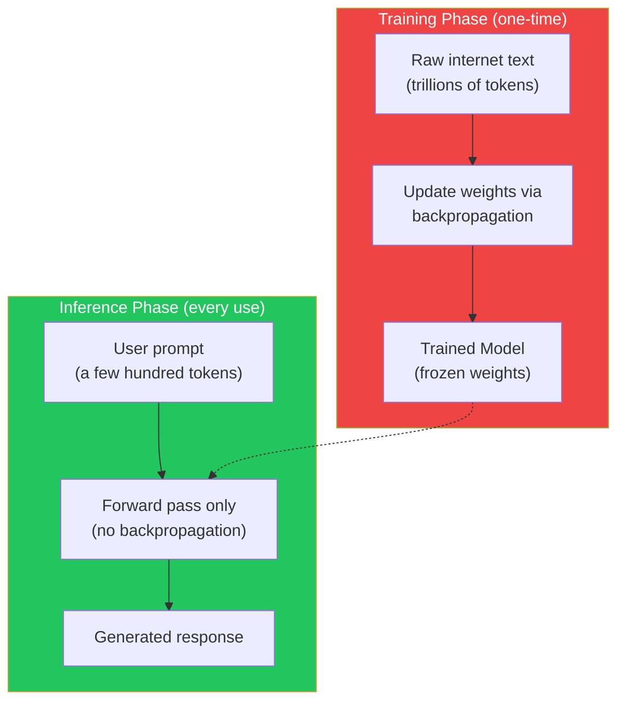
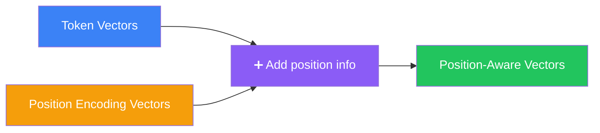
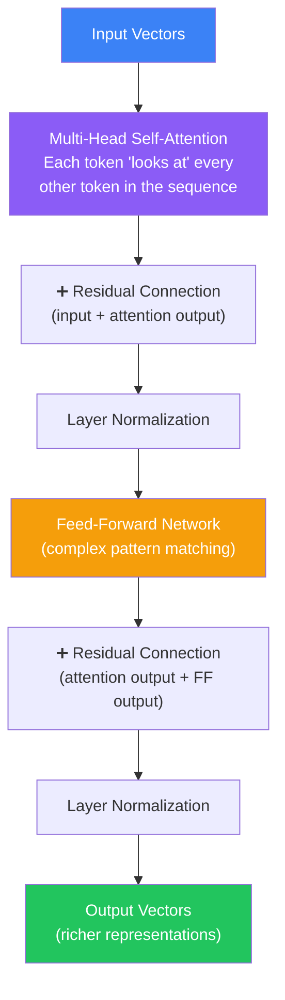
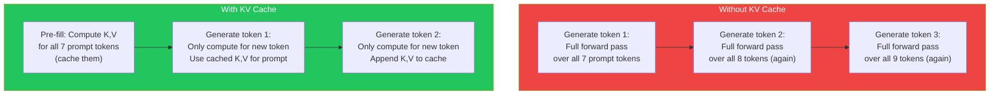
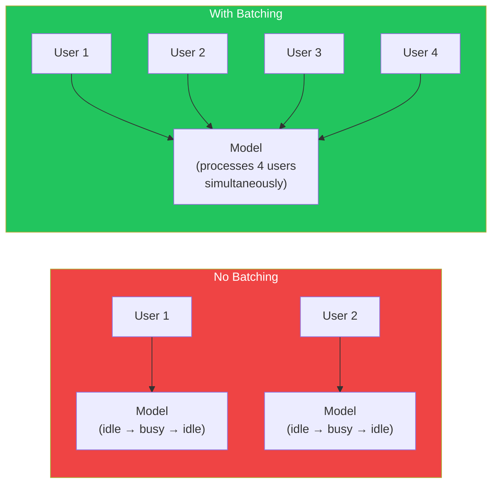

## Introduction

> **Inference is what happens when a trained LLM processes your prompt and generates a response. Unlike training — where the model learns from trillions of examples — inference uses the already-trained model to predict tokens in real time.**

You type a question into ChatGPT. You press Enter. A response appears, word by word.

What just happened?

In the span of a few seconds, your prompt traveled through a pipeline of tokenizers, embedding layers, Transformer blocks, attention mechanisms, and sampling strategies — all to generate one token at a time, each one building on the last.

This is **inference**: the process of using a trained model to generate responses.


---

## The Story: A Librarian Answers a Question

You walk into a massive library. At the center sits a librarian who has read every book ever written.

**You ask:** "What is the capital of France?"

Here's what happens inside the librarian's mind:

**Step 1 — Parse your words:** The librarian hears your question and breaks it into individual words: "What", "is", "the", "capital", "of", "France", "?"

**Step 2 — Understand context:** She doesn't just hear the words. She instantly connects them. "Capital" relates to "country". "France" is a specific country. The question mark means you want an answer.

**Step 3 — Search knowledge:** She has read "The capital of France is Paris" millions of times. The answer is obvious.

**Step 4 — Formulate response:** She opens her mouth and says: "Paris."

But here's the key: **she doesn't plan the whole answer in advance.** She just starts speaking. The word "Paris" comes out. If you asked "Tell me about Paris," she'd start with "Paris" and then figure out the next word, and the next, building the response one word at a time.

**This is exactly how an LLM works during inference.**

---

## Why This Exists

### The Problem: You Need Answers in Real Time

Training an LLM is slow and expensive — weeks or months on thousands of GPUs. But when you use a model, you expect answers in **seconds**, not weeks.

Inference solves this: it uses the trained model (frozen weights) to generate responses quickly, without any further learning.

### Training vs. Inference

| Aspect | Training | Inference |
|--------|----------|-----------|
| **Goal** | Learn patterns from data | Generate responses from learned patterns |
| **Weights** | Updated continuously | Frozen (never change) |
| **Compute** | Massive (thousands of GPUs, months) | Moderate (one GPU, seconds) |
| **Data** | Trillions of tokens | One prompt at a time |
| **Output** | A trained model | A text response |
| **Batch size** | Millions of tokens | One sequence |
| **Loss calc** | Yes (backpropagation) | No |
| **Cost per use** | $M–$100M | Pennies |



---

## Real-World Analogy

### The Pianist

Think of a concert pianist.

**Training:** The pianist practices for 10,000 hours. She plays scales, learns pieces, makes mistakes, corrects them. Her brain physically changes — new neural pathways form. This is slow, expensive, and exhausting.

**Inference:** The pianist sits at the piano and plays a concerto. She's not learning anything new. She's using the skills she already developed. Her fingers move automatically, one note at a time, building the performance from beginning to end.

The piano keys are like the vocabulary. Each note is a token. She doesn't plan the entire piece — she just plays the next note, and the next, based on everything she's practiced.

**Key insight:** During training, the model *changes*. During inference, the model *performs*.

---

## The Complete Inference Pipeline

Here is every step that happens between pressing Enter and seeing your response:

```mermaid
flowchart TD
    PROMPT["User types prompt\n'What is the capital of France?'"] --> PRE["Pre-processing\n(trim, check length, format)"]
    PRE --> TOK["Tokenizer\n'What' → 2061\n'is' → 318\n'the' → 262\n'capital' → 7452\n..."]
    TOK --> EMB["Embedding Layer\nEach token ID → vector of 4096 numbers"]
    EMB --> POS["Positional Encoding\nAdd position info to each vector"]
    POS --> ATTN1["Transformer Block 1\nSelf-Attention\n+ Feed-Forward"]
    ATTN1 --> ATTN2["Transformer Block 2\nSelf-Attention\n+ Feed-Forward"]
    ATTN2 --> ATTN3["... 98 more layers ..."]
    ATTN3 --> ATTN_N["Transformer Block N\n(usually 32-96 layers)"]
    ATTN_N --> NORM["Final LayerNorm"]
    NORM --> HEAD["LM Head\n(linear layer + softmax)"]
    HEAD --> PROBS["Probability Distribution\nover 100K+ vocabulary"]
    PROBS --> SAMPLE["Sampling\n(temperature, top-k, top-p)"]
    SAMPLE --> TOKEN["Next Token:\n'Paris'"]
    TOKEN --> APPEND["Append to sequence\n'What is the capital of France? Paris'"]
    APPEND --> CHECK{"Response\ncomplete?"}
    CHECK -->|"No"| TOK
    CHECK -->|"Yes"| RESPONSE["✅ Final Response"]

    style PROMPT fill:#3b82f6,color:#fff
    style TOK fill:#8b5cf6,color:#fff
    style EMB fill:#f59e0b,color:#fff
    style ATTN1 fill:#ef4444,color:#fff
    style ATTN_N fill:#ef4444,color:#fff
    style HEAD fill:#f59e0b,color:#fff
    style PROBS fill:#8b5cf6,color:#fff
    style SAMPLE fill:#22c55e,color:#fff
    style TOKEN fill:#22c55e,color:#fff
    style RESPONSE fill:#22c55e,color:#fff
```



---

## Step-by-Step: What Happens Inside

### Step 1: Pre-processing

The raw prompt is checked before anything happens:

```text
Check: Is the prompt too long? (exceeds context window?)
Check: Does it contain special tokens? (system prompts, roles)
Check: Format it with the model's instruction template
```

**Example transformation:**
```text
Raw: "What is the capital of France?"

Formatted (ChatML):
<|im_start|>system
You are a helpful assistant.<|im_end|>
<|im_start|>user
What is the capital of France?<|im_end|>
<|im_start|>assistant
```

### Step 2: Tokenization

The text is split into tokens — chunks of text that are typically 2-4 characters each.

```python
# Simplified tokenization
prompt = "What is the capital of France?"
tokens = tokenizer.encode(prompt)
# Result: ["What", " is", " the", " capital", " of", " France", "?"]
# As IDs: [2061, 318, 262, 7452, 368, 1528, 30]
```

Each token is converted to a unique integer ID based on the model's vocabulary (typically 50K–200K tokens).

### Step 3: Embedding

Each token ID is converted to a dense vector — a list of numbers (typically 4096 or 8192 dimensions).

```python
# Simplified embedding lookup
token_id = 2061  # "What"
vector = embedding_layer(token_id)
# vector.shape = (4096,)  — a list of 4096 numbers

# The full sequence becomes a 2D array
# shape = (sequence_length, embedding_dimension)
# e.g., (7, 4096) for our 7-token prompt
```

These vectors are **learned representations**. Tokens with similar meanings have similar vectors. "King" and "Queen" are closer to each other than "King" and "pizza."

### Step 4: Positional Encoding

Since the Transformer processes all tokens simultaneously (not sequentially like RNNs), it needs to know the **order** of tokens. Positional encodings add position information to each embedding vector.



### Step 5: Transformer Layers

The position-aware vectors pass through a stack of Transformer blocks (typically 32–96 layers for modern LLMs).

Each block does two things:



**What happens in self-attention:**
- Each token computes Query, Key, and Value vectors
- Each token gets a "score" for every other token — how relevant is it?
- The scores are used to create a weighted combination of all tokens
- This lets the model focus on important context

**What happens in the feed-forward network:**
- A complex pattern-matching step
- Two linear transformations with a non-linear activation in between
- This is where the model's "knowledge" primarily lives

After all layers, the vectors now contain rich contextual information.

### Step 6: The LM Head

The final vectors are passed through a linear layer (the "LM Head") that projects from the embedding dimension to the vocabulary size:

```python
# Simplified LM Head
final_vector = transformer_output[-1, :]  # Take the last token's vector
# shape: (4096,)

logits = lm_head(final_vector)
# shape: (vocab_size,) = (100000,)

# Convert logits to probabilities via softmax
probabilities = softmax(logits)
# Each entry is the probability of that token being next
```

**The output is a probability distribution over the entire vocabulary.**

```text
Token ID  | Token     | Probability
----------|-----------|------------
1528      | Paris     | 0.78   ← Most likely
1529      | Lyon      | 0.05
1530      | Marseille | 0.03
2061      | What      | 0.01
...       | ...       | ...
```

The model is saying: "Based on what I've seen in training, there's a 78% chance the next word is 'Paris.'"

### Step 7: Sampling

The model doesn't always pick the highest-probability token. Different sampling strategies control this:

| Strategy | What It Does | When to Use |
|----------|-------------|-------------|
| **Greedy** | Always pick the most likely token | Facts, math, deterministic answers |
| **Temperature** | Scale probabilities before picking | Control creativity vs. determinism |
| **Top-K** | Only consider the K most likely tokens | Prevent rare/weird tokens |
| **Top-P** | Only consider tokens that reach cumulative probability P | Adaptive filtering |

We'll cover these in detail in Document 18.

### Step 8: Append and Repeat

The chosen token is appended to the sequence, and the entire process repeats:

```text
Round 1: "What is the capital of France?" → model predicts "Paris"
Round 2: "What is the capital of France? Paris" → model predicts "."
Round 3: "What is the capital of France? Paris." → model predicts "<EOS>"
Done!
```

Each round is called a **forward pass**. The model does one forward pass per token generated.

---

## Token-by-Token Generation in Action

Let's watch a response being built, one token at a time:

```text
Prompt: "Write a short poem about AI."

Token 1:   "Write a short poem about AI. Here"
Token 2:   "Write a short poem about AI. Here is"
Token 3:   "Write a short poem about AI. Here is a"
Token 4:   "Write a short poem about AI. Here is a poem"
Token 5:   "Write a short poem about AI. Here is a poem for"
Token 6:   "Write a short poem about AI. Here is a poem for you"
Token 7:   "Write a short poem about AI. Here is a poem for you:"
Token 8:   "Write a short poem about AI. Here is a poem for you:\n\nSilicon"
Token 9:   "Write a short poem about AI. Here is a poem for you:\n\nSilicon dreams"
...
Token 40:  "Write a short poem about AI. Here is a poem for you:\n\nSilicon dreams in circuits deep\nA mind that does not need to sleep\nIt learns and grows with every day\nIn its own quiet, electric way\n\n—"
Token 41:  "<EOS>" (stop)
```

**Key insight:** The model didn't plan this poem. Each word was chosen one at a time, based on the probability distribution at that exact moment.


Each arrow represents: "This token was generated based on all previous tokens." The response gets longer and the context gets richer.

---

## Inference Time: What Affects Speed

How fast a model generates responses depends on several factors:

| Factor | Impact | Why |
|--------|--------|-----|
| **Model size** | Larger = slower | More parameters = more math per token |
| **Context length** | Longer = slower | Attention is O(n²) in sequence length |
| **Hardware** | Faster GPU = faster response | Parallel computation |
| **Batch size** | More users = slower per user | GPU memory contention |
| **Quantization** | Lower precision = faster | Less data to move through memory |
| **KV Cache** | Cached attention = much faster | Avoids recomputing previous tokens |

### KV Caching (The Key Optimization)

The biggest optimization in LLM inference is **KV caching**:



**Without KV cache:** Every new token recomputes attention over the entire sequence. A 100-token response requires 100 full forward passes.

**With KV cache:** The Key and Value matrices for the prompt are computed once and reused. Each new token only computes attention for its own position. This makes inference 10-100x faster.

---

## Inference vs. Training: The Cost Difference

| | Training (GPT-4 class) | Inference (per request) |
|---|---|---|
| **Compute** | 10,000+ GPUs × months | 1 GPU × seconds |
| **Cost** | $50M–$200M | ~$0.01–$0.10 |
| **Energy** | Gigawatt-hours | Watt-hours |
| **Time** | 3–6 months | 1–30 seconds |
| **Output** | One model (frozen weights) | Millions of responses |

**The economics:** Training is a fixed cost. Inference is a variable cost. OpenAI spends ~$100M to train GPT-4, then millions per month on inference for all ChatGPT users.

---

## Practical Example: Inference in Code

```python
# Simplified inference loop
import torch
from transformers import AutoModelForCausalLM, AutoTokenizer

# Load trained model (frozen)
model = AutoModelForCausalLM.from_pretrained("gpt2")
tokenizer = AutoTokenizer.from_pretrained("gpt2")

# Important: model.eval() disables dropout and gradient computation
model.eval()

# Prompt
prompt = "What is the capital of France?"

# Tokenize
input_ids = tokenizer.encode(prompt, return_tensors="pt")

# Generate one token at a time
with torch.no_grad():  # No gradients needed during inference
    generated = input_ids

    for i in range(10):  # Generate up to 10 new tokens
        # Forward pass through all Transformer layers
        outputs = model(generated)

        # Get logits for the last position only
        next_token_logits = outputs.logits[:, -1, :]

        # Apply softmax to get probabilities
        probs = torch.softmax(next_token_logits, dim=-1)

        # Greedy: take the most likely token
        next_token_id = torch.argmax(probs, dim=-1, keepdim=True)

        # Append to sequence
        generated = torch.cat([generated, next_token_id], dim=-1)

        # Decode for display
        print(f"Token {i+1}: {tokenizer.decode(next_token_id[0])}")

        # Stop if we hit end-of-sequence
        if next_token_id.item() == tokenizer.eos_token_id:
            break

print(f"\nFinal: {tokenizer.decode(generated[0])}")
```

---

## Key Optimization Techniques

### 1. Quantization

Reduce model precision from 16-bit to 8-bit or 4-bit:

| Precision | Size (70B model) | Speed | Quality Loss |
|-----------|-----------------|-------|-------------|
| FP16 | 140 GB | 1x | None |
| INT8 | 70 GB | ~1.5x | Negligible |
| INT4 | 35 GB | ~2x | Small |
| INT2 | 17 GB | ~3x | Noticeable |

### 2. Batching

Process multiple user requests simultaneously:



### 3. Speculative Decoding

Use a small, fast model to propose tokens and the large model to verify them:

1. Draft model generates K candidate tokens quickly
2. Target model verifies all K in one forward pass
3. Accept correct ones, reject wrong ones, continue from last correct token

This can give 2-3x speedup with no quality loss.

---

## Best Practices

1. **Always use KV caching** — This is the single biggest optimization for inference speed. Without it, generation is 10-100x slower.

2. **Match model size to hardware** — A 70B model needs ~140GB of GPU memory at FP16. Use quantization if you have less memory.

3. **Batch requests when possible** — Processing 4 requests together is almost as fast as processing 1, due to GPU parallelism.

4. **Set appropriate max tokens** — Don't let models generate indefinitely. Set a reasonable max response length.

5. **Use streaming for UX** — Show tokens as they're generated rather than waiting for the full response.

6. **Cache frequently used prompts** — If many users ask the same question, cache the response.

---

## Common Misconceptions

| Misconception | Truth |
|--------------|-------|
| "The model reads the entire prompt each time" | With KV caching, the prompt is processed once and the Key/Value matrices are reused for each new token. |
| "The model plans the entire response in advance" | Every token is generated one at a time. There is no advance planning — coherence emerges from self-attention. |
| "Inference uses the same compute as training" | Inference is a forward pass only — no backpropagation, no gradient computation, no weight updates. |
| "Larger models are proportionally slower at inference" | Inference cost scales roughly linearly with parameter count, but optimizations like quantization and sparse attention can reduce the gap. |
| "You need a GPU for inference" | Smaller models (7B and below) can run on CPU, though slowly. Quantized models can run on phones and laptops. |

---

## Interview Questions

### Easy

**Q: What is the difference between training and inference?** 

> Training is when the model learns patterns from data by updating its weights through backpropagation. It requires massive compute and time. Inference is when the trained model generates responses using its frozen weights — it only does forward passes, no learning happens. Training happens once (or periodically); inference happens millions of times per day.

**Q: What is autoregressive generation?** 

> Autoregressive generation means the model generates one token at a time, and each new token is conditioned on all previously generated tokens. The output at step N becomes part of the input for step N+1. This creates a feedback loop where the model builds the response incrementally.

### Medium

**Q: How does KV caching speed up inference?** 

> Without KV caching, each new token requires recomputing attention over the entire sequence — including all previously generated tokens. This means generating 100 tokens requires 100 full forward passes. KV caching stores the Key and Value matrices from the prompt and previously generated tokens. Each new token only computes attention for its own position, using the cached K,V matrices for all previous positions. This reduces the per-token computation from O(n²) to O(n), making inference 10-100x faster.

**Q: Why is inference cheaper than training?** 

> Training requires: (1) forward pass through the network, (2) computing the loss, (3) backward pass (backpropagation) to compute gradients for every parameter, (4) updating all parameters with the optimizer. This is ~3x more compute per token than a forward pass alone. Additionally, training processes trillions of tokens, while inference processes one prompt at a time (usually hundreds of tokens). The total cost difference is 1,000,000x or more.

### Hard

**Q: Describe the memory bottleneck in LLM inference and how quantization helps.** 

> LLM inference is often memory-bandwidth-bound rather than compute-bound. The model weights must be moved from GPU memory (HBM) to compute units for each forward pass. A 70B parameter model at FP16 requires ~140GB of memory — larger than any single GPU can hold (A100: 80GB, H100: 80GB). This forces model parallelism (sharding across GPUs) and constant communication between GPUs. Quantization reduces the memory footprint: 8-bit quantization halves the memory to ~70GB (fits on one A100), and 4-bit reduces it to ~35GB. With less memory pressure, the model can fit on fewer GPUs with less communication overhead, dramatically improving throughput.

**Q: How does batching work in LLM inference, and what are its limitations?** 

> Batching groups multiple user requests together and processes them simultaneously on the GPU. Since GPUs excel at parallel computation, processing 4 requests at once takes nearly the same time as processing 1 — effectively quadrupling throughput. However, batching has limitations: (1) **Padding overhead** — sequences of different lengths must be padded to the same length, wasting compute; (2) **Memory pressure** — each request has its own KV cache, so batching increases memory usage linearly; (3) **Latency tail** — the batch must wait for the longest sequence to finish, increasing latency for fast requests. These are addressed by techniques like continuous batching (where finished sequences leave the batch and new ones join) and PagedAttention (efficient KV cache management).

---

## Summary

| Concept | Key Point |
|---------|-----------|
| **Inference** | Using a trained model to generate responses — forward pass only, no learning |
| **Token-by-token** | Each token is generated one at a time, conditioned on all previous tokens |
| **KV caching** | Reuses Key/Value matrices from previous tokens — 10-100x speedup |
| **Training vs. inference** | Training updates weights (3x compute); inference uses frozen weights (1x compute) |
| **Autoregressive** | Output becomes part of input for the next prediction |
| **LM Head** | Final linear layer that converts vectors to vocabulary probabilities |
| **Quantization** | Reducing precision (FP16 → INT4) to fit larger models on limited hardware |
| **Batching** | Processing multiple requests simultaneously for higher throughput |

---

## Navigation

**Previous: [17 — DPO](/ai/phase-04-large-language-models/17-dpo)

**Next: [19 — Decoding Strategies](/ai/phase-04-large-language-models/19-decoding-strategies)

**Related Topics:**
- [How Language Models Work](/ai/phase-04-large-language-models/02-how-language-models-work)
- [Tokenization](/ai/phase-04-large-language-models/03-tokenization)
- [Transformer Architecture](/ai/phase-04-large-language-models/12-gpt-architecture)

**Practice Questions:**
1. Walk through the complete inference pipeline from prompt to response.
2. Why is KV caching the most important optimization for inference speed?
3. Compare the memory and compute requirements of training vs. inference.
4. How does quantization work, and what trade-offs does it make?
5. If a model generates 500 tokens, how many forward passes does it perform?

**Further Reading:**
- [LLM Inference Performance: The Definitive Guide](https://www.anyscale.com/blog/llm-inference-performance)
- [Transformer Inference Arithmetic](https://kipp.ly/transformer-inference-arithmetic/)
- [KV Cache Quantization](https://arxiv.org/abs/2305.12048)
- [PagedAttention: Efficient Memory Management for LLM Inference](https://arxiv.org/abs/2309.06180)
