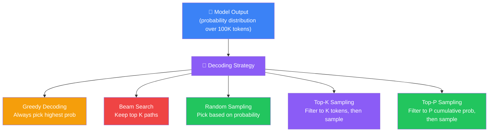
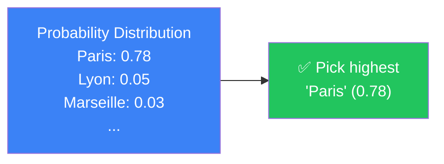
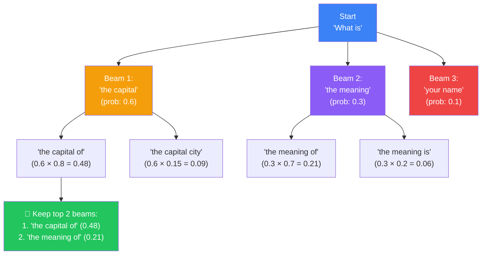
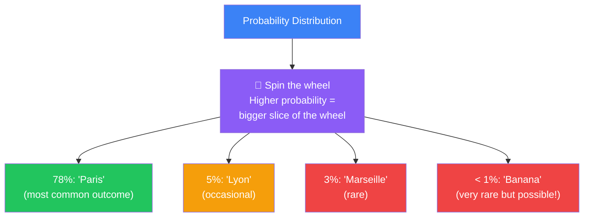
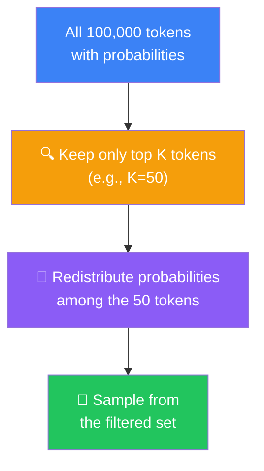
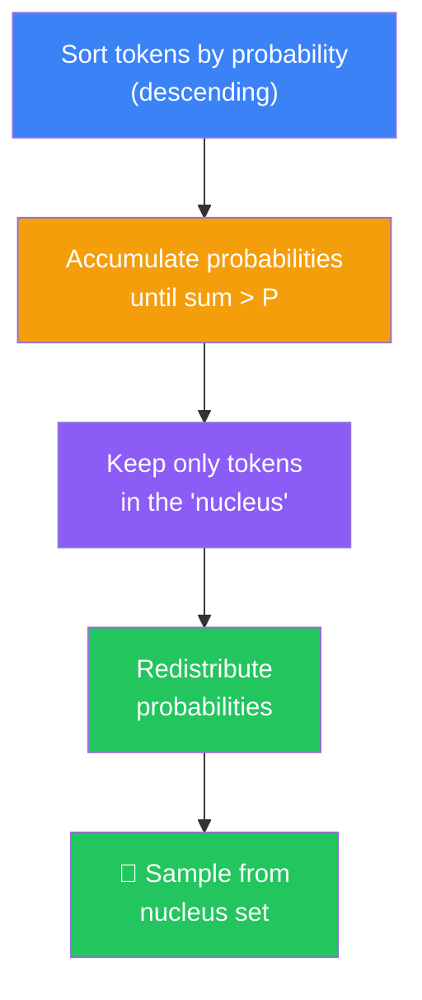
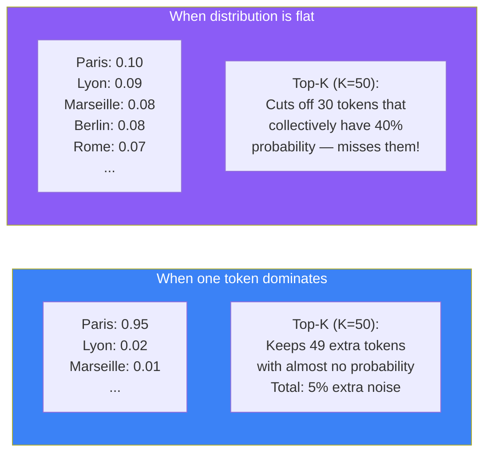
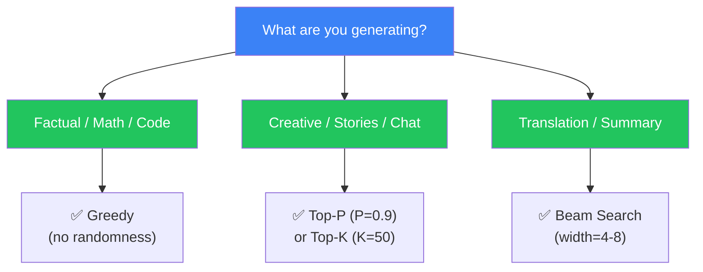

## Introduction

> **Decoding strategies determine how an LLM selects the next token from its probability distribution. The model produces probabilities for every token in its vocabulary — but how it chooses among them dramatically changes the output.**

The model says: "The next token could be 'Paris' (78%), 'Lyon' (5%), 'Marseille' (3%), or 99,997 other words."

Deciding which one to pick is the job of the **decoding strategy**.

Different tasks need different strategies:
- **Translation**: You want the same answer every time — deterministic
- **Creative writing**: You want surprise and novelty — random
- **Code generation**: You want correctness — structured



---

## The Story: Two Writers

Imagine two writers asked to complete this sentence:

> "The detective walked into the dark room and saw a..."

**Writer A — The Safe Writer (Greedy):**

She always picks the most obvious word:

- "The detective walked into the dark room and saw a **body**."
- "The detective walked into the dark room and saw a **man**."
- "The detective walked into the dark room and saw a **figure**."

Her writing is correct but boring. Every story feels the same.

**Writer B — The Creative Writer (Sampling):**

She sometimes picks surprising words:

- "The detective walked into the dark room and saw a **glowing** object."
- "The detective walked into the dark room and saw a **talking** parrot."
- "The detective walked into the dark room and saw a **mirror** of himself."

Her writing is exciting but sometimes makes no sense.

**Which writer is better?** It depends on the task. For a police report, you want Writer A. For a novel, you want Writer B.

**Decoding strategies are how we control which writer the model becomes.**

---

## Why This Exists

### The Problem: The Most Likely Token Isn't Always the Best

The model's job is to predict the most likely next token. But "most likely" doesn't always mean "best":

| Task | Most Likely Token | Better Token |
|------|------------------|--------------|
| **Story writing** | "He walked to the store" | "He trudged to the store" |
| **Poetry** | "The sun is bright today" | "The sun blazes gold today" |
| **Dialogue** | "Hello, how are you?" | "Hey, long time no see!" |
| **Code comments** | "This function does X" | "This function untangles the spaghetti of Y" |

Without decoding strategies, every model output would be the most boring possible version — always choosing the safest, most common word.

### The Solution: Different Strategies for Different Purposes

| Strategy | Creativity | Determinism | Best For |
|----------|-----------|-------------|----------|
| **Greedy** | None | 100% | Facts, math, translation |
| **Beam Search** | Low | High | Translation, summarization |
| **Random Sampling** | High | None | Brainstorming, creative writing |
| **Top-K** | Medium | Medium | General purpose |
| **Top-P (Nucleus)** | High | Medium | Creative tasks, chat |

---

## Real-World Analogy

### Ordering at a Restaurant

You sit down at a restaurant with a menu of 100 dishes.

**Greedy:** You always order the #1 most popular dish. It's safe, you know you'll like it, but you eat the same thing every time.

**Beam Search:** You look at the top 3 most popular dishes, imagine yourself eating each one, then pick the best. More thought, but still conservative.

**Random Sampling:** You close your eyes and point at the menu. Sometimes you discover amazing new dishes. Sometimes you order something terrible.

**Top-K:** You look at only the top 5 most popular dishes and pick randomly among them. You avoid the weird stuff (the fried grasshopper ice cream) but still have some variety.

**Top-P:** You look at the most popular choices until you've covered 90% of what people order. Some nights that's 3 dishes, other nights it's 8. You adapt to the situation.

---

## Greedy Decoding

### How It Works

The simplest strategy: **always pick the token with the highest probability.**

```python
# Greedy decoding
probabilities = model(input_tokens)  # Shape: (vocab_size,)
# [0.78, 0.05, 0.03, 0.02, 0.01, ...]

next_token = argmax(probabilities)  
# Picks the one with 0.78 probability
```



### Advantages

| Advantage | Why |
|-----------|-----|
| **Deterministic** | Same input always gives same output |
| **Fast** | No extra computation — just argmax |
| **Simple** | One line of code |
| **Accurate** | Best for factual questions |

### Disadvantages

| Disadvantage | Why |
|-------------|-----|
| **Repetitive** | The model gets stuck in loops ("I love coding. I love coding. I love coding.") |
| **Boring** | Always picks the safest word, leading to bland text |
| **No diversity** | Every response is the same, even for creative tasks |
| **Short-sighted** | Greedy choices can lead to dead ends — the locally best word might be globally wrong |

### Example: Greedy vs. Creative

**Prompt:** "Write a story about a robot that learns to feel emotions."

**Greedy output:**
> "The robot learned to feel emotions. It felt happy. It felt sad. It felt angry. Emotions are complex. The robot continued to learn about emotions."

**Better output (sampling):**
> "In the stillness of Room 404, Unit Seven discovered something the engineers never programmed: the ache of longing. It stared at the rain on the window and, for the first time, understood why humans called it 'tears.'"

---

## Beam Search

### How It Works

Instead of keeping just the best token, beam search keeps multiple candidate sequences (the "beam").



At each step, beam search:
1. Expands each beam with all possible next tokens
2. Calculates cumulative probability for each path
3. Keeps only the top K beams (beam width)
4. Repeats until a stopping condition

**Beam width** (K) controls the trade-off:
- K=1: Same as greedy decoding
- K=3: Keeps 3 candidate sequences
- K=10: Keeps 10 candidate sequences — better quality, slower

### Advantages

| Advantage | Why |
|-----------|-----|
| **Higher quality** | Explores multiple paths, avoids greedy dead ends |
| **Better for long sequences** | Considers global coherence, not just local optima |
| **Good for translation** | Produces more natural-sounding translations |

### Disadvantages

| Disadvantage | Why |
|-------------|-----|
| **Slow** | K times more computation per step |
| **Still repetitive** | Can still produce boring, safe text |
| **Memory intensive** | Must store K complete sequences |
| **Overconfident** | Tends to favor shorter sequences |

### When to Use Beam Search

| Task | Beam Width | Why |
|------|-----------|-----|
| **Translation** | 4-10 | Quality matters more than speed |
| **Summarization** | 4-8 | Need coherent, complete summaries |
| **Speech recognition** | 5-20 | Accuracy is critical |
| **Creative writing** | Not recommended | Makes output too safe and boring |

---

## Random Sampling

### How It Works

Instead of always picking the most likely token, sample according to the probability distribution:

```python
# Random sampling
probabilities = model(input_tokens)
# Paris: 0.78, Lyon: 0.05, Marseille: 0.03, ...

# Roll a dice weighted by probability
next_token = torch.multinomial(probabilities, num_samples=1)
# 78% chance: Paris
# 5% chance: Lyon
# 3% chance: Marseille
# ...
```



### Advantages

| Advantage | Why |
|-----------|-----|
| **Creative** | Produces diverse, surprising outputs |
| **Natural** | Sounds more human — people don't always pick the most common word |
| **No repetition** | Much less likely to get stuck in loops |

### Disadvantages

| Disadvantage | Why |
|-------------|-----|
| **Unreliable** | Can produce nonsense on rare occasions |
| **Non-deterministic** | Same input → different output each time |
| **Hard to control** | No way to guarantee quality |

---

## Top-K Sampling

### How It Works

Limit the sampling pool to the K most likely tokens, redistribute probability among them, then sample:



```python
# Top-K sampling
k = 50
probabilities = model(input_tokens)

# Keep only top K
top_k_probs, top_k_indices = torch.topk(probabilities, k)

# Redistribute probabilities (re-normalize)
top_k_probs = top_k_probs / top_k_probs.sum()

# Sample from the filtered set
next_token = top_k_indices[torch.multinomial(top_k_probs, 1)]
```

### Why Top-K?

Without Top-K, random sampling can occasionally pick extremely unlikely tokens:

```text
"Paris"      → 0.78  (good)
"Lyon"       → 0.05  (fine)
"..."        → ...
"xylophone"  → 0.000001  (nonsense!)
```

With Top-K (K=50), we cut off the tail of the distribution where weird tokens live. The model can still be creative, but it can't pick something completely out of left field.

### Choosing K

| K Value | Effect | Use Case |
|---------|--------|----------|
| **K=1** | Same as greedy | Deterministic tasks |
| **K=10** | Very conservative | Factual Q&A |
| **K=50** | Balanced | General chat |
| **K=200** | Creative | Story writing |
| **K=1000** | Very creative (risky) | Brainstorming |

---

## Top-P Sampling (Nucleus Sampling)

### How It Works

Instead of a fixed K, top-p selects the smallest set of tokens whose cumulative probability exceeds P:



```python
def top_p_sampling(probabilities, p=0.9):
    # Sort tokens by probability (descending)
    sorted_probs, sorted_indices = torch.sort(probabilities, descending=True)

    # Compute cumulative probabilities
    cumulative_probs = torch.cumsum(sorted_probs, dim=-1)

    # Find cutoff: smallest set where cumulative prob > p
    mask = cumulative_probs > p

    # Keep at least 1 token
    mask[..., 1:] = mask[..., :-1].clone()
    mask[..., 0] = False

    # Filter and renormalize
    sorted_probs[mask] = 0
    sorted_probs = sorted_probs / sorted_probs.sum()

    # Sample
    next_token = sorted_indices[torch.multinomial(sorted_probs, 1)]
    return next_token
```

### Why Top-P Is Better Than Top-K

Top-K has a problem: sometimes K=50 is too many (when one token dominates), and sometimes K=50 is too few (when probabilities are spread widely).



Top-P adapts:

| Scenario | Top-K (K=50) | Top-P (P=0.9) |
|----------|-------------|---------------|
| One token dominates (0.95) | Keeps 49 noise tokens | Keeps ~1-2 tokens |
| Distribution is flat | Cuts off meaningful tokens | Keeps ~50-100 tokens |

### Choosing P

| P Value | Effect | Use Case |
|---------|--------|----------|
| **P=0.1** | Almost deterministic | Safe answers |
| **P=0.5** | Conservative | Factual chat |
| **P=0.9** | Balanced | General chat, most tasks |
| **P=0.95** | Creative | Story writing |
| **P=1.0** | Same as random sampling | Maximum creativity (risky) |

---

## Strategy Comparison



### Full Comparison Table

| Strategy | Determinism | Quality | Speed | Creativity | Best For |
|----------|-----------|---------|-------|-----------|----------|
| **Greedy** | ✅ Perfect | ⭐⭐⭐ | ⚡ Fastest | ❌ None | Facts, math, simple Q&A |
| **Beam Search** | ✅ High | ⭐⭐⭐⭐⭐ | 🐢 Slow | ❌ Low | Translation, summarization |
| **Random Sampling** | ❌ None | ⭐⭐ | ⚡ Fast | ✅ High | Brainstorming |
| **Top-K** | ❌ Medium | ⭐⭐⭐⭐ | ⚡ Fast | ✅ Medium | General purpose |
| **Top-P** | ❌ Medium | ⭐⭐⭐⭐⭐ | ⚡ Fast | ✅ Medium | Chat, creative writing |

### Real Examples

**Prompt:** "The future of AI is"

**Greedy output:**
> "The future of AI is bright and full of possibilities. AI will continue to evolve and improve."

**Beam Search (width=4):**
> "The future of AI is promising, with advancements in machine learning, natural language processing, and robotics driving innovation across industries."

**Top-P (P=0.9):**
> "The future of AI is a canvas we're painting with algorithms — each stroke of data adding color to a picture we're only beginning to see."

---

## Practical Example: Decoding in Code

```python
import torch
from transformers import AutoModelForCausalLM, AutoTokenizer

model = AutoModelForCausalLM.from_pretrained("gpt2")
tokenizer = AutoTokenizer.from_pretrained("gpt2")
model.eval()

prompt = "The future of AI is"
input_ids = tokenizer.encode(prompt, return_tensors="pt")

# Strategy 1: Greedy Decoding
greedy_output = model.generate(
    input_ids,
    do_sample=False,          # Greedy
    max_new_tokens=50
)
print("Greedy:", tokenizer.decode(greedy_output[0]))

# Strategy 2: Beam Search
beam_output = model.generate(
    input_ids,
    num_beams=5,              # Beam search
    early_stopping=True,
    max_new_tokens=50
)
print("Beam:", tokenizer.decode(beam_output[0]))

# Strategy 3: Top-K Sampling
topk_output = model.generate(
    input_ids,
    do_sample=True,
    top_k=50,                 # Top-K
    max_new_tokens=50
)
print("Top-K:", tokenizer.decode(topk_output[0]))

# Strategy 4: Top-P Sampling
topp_output = model.generate(
    input_ids,
    do_sample=True,
    top_p=0.9,                # Top-P
    max_new_tokens=50
)
print("Top-P:", tokenizer.decode(topp_output[0]))
```

---

## Best Practices

1. **Use Top-P + Temperature together** — These are complementary. Temperature shapes the distribution; Top-P filters it. Using both gives the best control.

2. **Default to Top-P (0.9) for chat** — This provides a good balance of creativity and coherence. Most production systems use this.

3. **Use greedy for evaluation** — When testing if a model knows an answer, use greedy (temperature=0). Remove the randomness to measure the model's true capabilities.

4. **Avoid beam search for creative tasks** — Beam search makes creative writing sound like it was written by a committee. Use sampling instead.

5. **Tune your strategy per task** — Don't use one strategy for everything. Translation benefits from beam search; story writing benefits from Top-P.

6. **Watch for repetition at low temperatures** — Greedy decoding and low temperatures tend to produce repetitive text. Add a repetition penalty if needed.

---

## Common Misconceptions

| Misconception | Truth |
|--------------|-------|
| "Greedy decoding always produces the best response" | Greedy decoding produces the most *likely* response, not the best. Locally optimal choices can lead to globally poor outcomes. |
| "Beam search always improves quality" | Beam search trades diversity for quality. For creative tasks, it makes output worse by making it too conservative. |
| "Top-K and Top-P are the same thing" | Top-K uses a fixed number of tokens; Top-P uses a dynamic threshold. Top-P adapts to the distribution shape. |
| "Higher temperature = more intelligent" | Higher temperature increases randomness, which can make the model seem more creative or more confused — it doesn't change the underlying knowledge. |
| "You should always use the same strategy" | Different tasks need different strategies. Using greedy for poetry would be terrible; using Top-P for arithmetic would be unreliable. |

---

## Interview Questions

### Easy

**Q: What is greedy decoding?** 

> Greedy decoding always picks the token with the highest probability at each step. It's the simplest decoding strategy: given the model's probability distribution, select the token where probability is highest. It's deterministic (same input always gives same output) but can produce repetitive or boring text.

**Q: What is the difference between Top-K and Top-P sampling?** 

> Top-K limits the sampling pool to the K most likely tokens (e.g., top 50). Top-P (nucleus sampling) limits the pool to the smallest set of tokens whose cumulative probability exceeds P (e.g., 90%). Top-K uses a fixed number; Top-P adapts to the distribution shape. If one token dominates (95%), Top-P keeps ~1-2 tokens while Top-K keeps 50 noisy tokens. If the distribution is flat, Top-P keeps more tokens than Top-K would.

### Medium

**Q: When would you use beam search instead of greedy decoding?** 

> Beam search is better when: (1) You need globally coherent long-form output (translation, summarization) — greedy can make locally optimal but globally poor choices. (2) Quality matters more than speed — beam search is K times slower. (3) You need multiple candidate outputs to choose from — beam search naturally produces K complete sequences. Greedy is better when: (1) Speed is critical (real-time applications). (2) The task is simple and factual (Q&A, math). (3) You want deterministic output.

**Q: Why does greedy decoding produce repetitive text?** 

> Greedy decoding always picks the highest-probability token. Once a phrase like "I love coding" appears, the model sees that "I love coding" is a high-probability continuation. It picks it again. And again. The model enters a feedback loop where the most likely continuation of "I love coding" is more "I love coding." This is called the *repetition trap*. Sampling strategies break this loop by occasionally picking less likely tokens that move the sequence in a new direction.

### Hard

**Q: How would you design a decoding strategy for a code generation model that needs both correctness (variable names, syntax) and creativity (algorithm design)?** 

> This requires a hybrid approach: (1) **Syntax tokens** (keywords, brackets, semicolons): Use greedy decoding (temperature=0). These should always be predicted correctly. Mismatched brackets or missing semicolons would make the code invalid. (2) **Identifier names**: Use Top-P (0.8) or constrained decoding. Let the model be creative with variable names but prevent it from generating invalid characters. (3) **Algorithm logic**: Use Top-P (0.9) with moderate temperature (0.7). Allow exploration of different approaches but stay within the bounds of what makes logical sense. (4) **Constrained decoding**: Use a grammar-based decoder that enforces valid syntax at every step. The model can only generate tokens that would result in valid code. This is the most important optimization for code models — it eliminates syntax errors entirely. (5) **Test-based validation**: For each candidate completion, check if it passes basic tests. Re-sample if it doesn't.

**Q: Explain how the choice of decoding strategy affects the diversity-quality trade-off, and how you would measure both.** 

> The trade-off: **Quality** measures how good individual outputs are (fluency, coherence, correctness). **Diversity** measures how different outputs are from each other. Greedy and beam search maximize quality but minimize diversity. Random sampling maximizes diversity but minimizes quality (some outputs will be bad). Top-K/Top-P sit in the middle.
>
> **Measuring quality:** Perplexity (how surprised is the model by its own output), ROUGE/BLEU (for translation/summarization), human evaluation (rating helpfulness), task-specific metrics (code compilation rate, math accuracy).
>
> **Measuring diversity:** Distinct n-grams (count unique phrases across multiple outputs), Self-BLEU (how similar are outputs to each other — lower is more diverse), entropy of the output distribution, number of unique outputs given the same prompt.
>
> **Practical approach:** Start with high quality (greedy), then add controlled randomness (Top-P 0.9). Measure both metrics. If quality drops too much, reduce P or add a diversity penalty. If diversity is too low, increase P or lower temperature. The sweet spot for most chat applications is Top-P 0.9 with temperature 0.7-0.9.

---

## Summary

| Strategy | How It Works | Determinism | Creativity | Best For |
|----------|-------------|-----------|-----------|----------|
| **Greedy** | Always pick highest probability | ✅ Perfect | ❌ None | Facts, math |
| **Beam Search** | Keep K candidate paths, pick best | ✅ High | ❌ Low | Translation, summaries |
| **Random Sampling** | Pick by probability (weighted dice roll) | ❌ None | ✅ High | Brainstorming |
| **Top-K** | Filter to K most likely, then sample | ❌ Medium | ✅ Medium | General |
| **Top-P** | Filter to smallest set ≥ P cumulative, then sample | ❌ Medium | ✅ High | Chat, creative writing |

---

## Navigation

**Previous:** [18 — Inference](/ai/phase-04-large-language-models/18-inference)

**Next:** [20 — Temperature, Top-K & Top-P](/ai/phase-04-large-language-models/20-temperature-top-k-top-p)

**Related Topics:**
- [How Language Models Work](/ai/phase-04-large-language-models/02-language-models)
- [LLM Inference](/ai/phase-04-large-language-models/18-inference)
- [Temperature, Top-K & Top-P](/ai/phase-04-large-language-models/20-temperature-top-k-top-p)

**Practice Questions:**
1. Compare greedy decoding and Top-P sampling — when would you use each?
2. Why does beam search produce higher quality but lower diversity?
3. How does Top-P adapt better than Top-K to different probability distributions?
4. Write pseudocode for Top-K sampling.
5. Design a decoding strategy for a customer support chatbot that must be both helpful and safe.

**Further Reading:**
- [The Curious Case of Neural Text Degeneration (Holtzman et al.)](https://arxiv.org/abs/1904.09751)
- [Hugging Face — How to Generate Text](https://huggingface.co/blog/how-to-generate)
- [Nucleus Sampling for Text Generation](https://huggingface.co/blog/nucleus-sampling)
