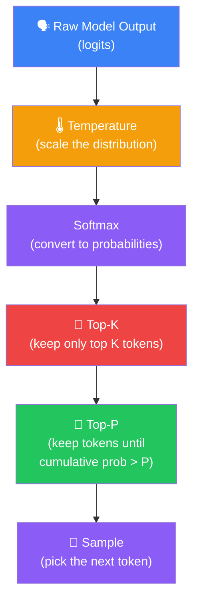
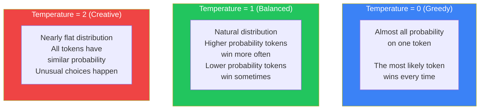
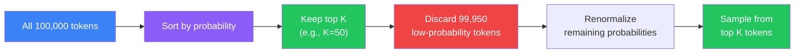
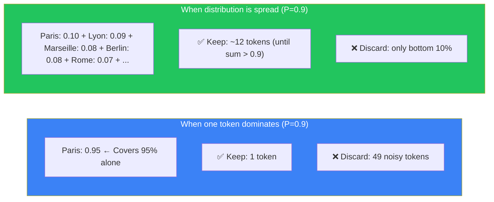
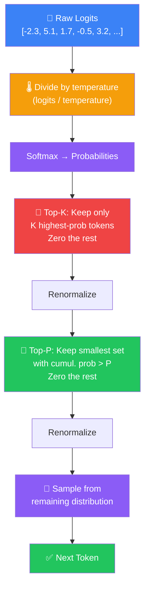
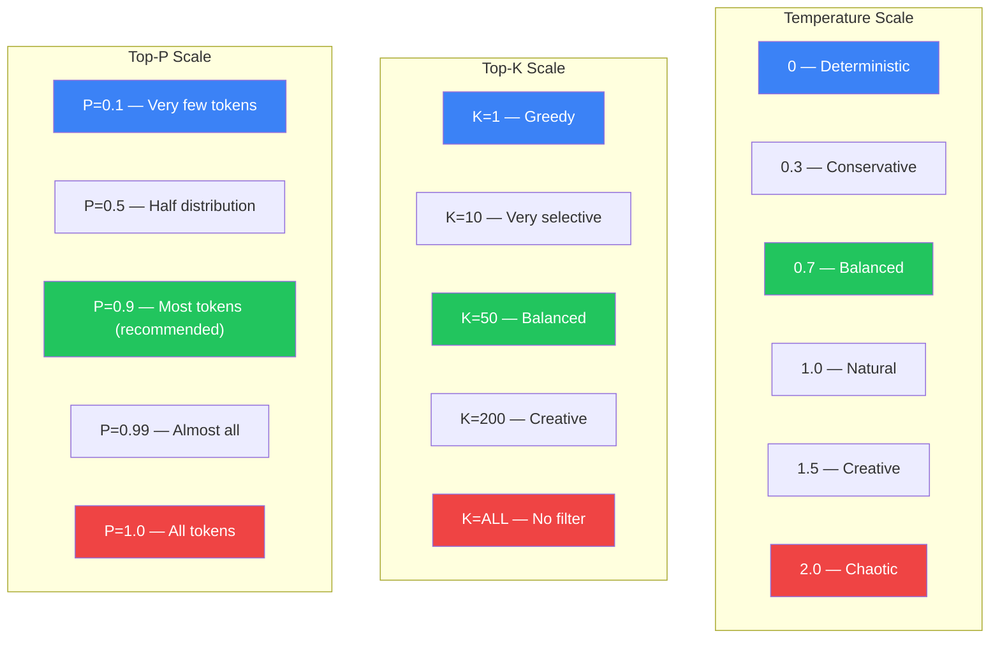

## Introduction

> **Temperature, Top-K, and Top-P are the three parameters that control how an LLM chooses the next token. They determine whether the model is a precise factual answerer or a creative storyteller — and everything in between.**

If you've ever used an LLM API, you've seen these parameters:

```json
{
  "temperature": 0.7,
  "top_k": 50,
  "top_p": 0.9
}
```

But what do they actually **do**? And how do they work together?

Think of them as three dials on a sound mixing board:
- **Temperature** controls the overall "creativity" — how spread out the probability distribution is
- **Top-K** cuts off the very unlikely tokens
- **Top-P** dynamically adjusts how many tokens to consider



---

## The Story: Two Writers, One Spectrum

Imagine you are a publisher hiring writers.

**Writer A — The Predictable One (Temperature = 0):**

You ask her to write a story. Every sentence is grammatically perfect. Every word is the most obvious choice. Her stories are correct but boring. She never surprises you. You know exactly what she'll write before she writes it.

> "The sun was bright. The birds sang. The day was warm."

**Writer B — The Creative One (Temperature = 1.5):**

You ask him to write a story. He uses unusual words. He breaks grammar rules for effect. His stories are exciting and fresh — but sometimes they make no sense.

> "The sun blazed like a molten eye, and the birds — drunk on morning — sang in cracked, careless symphonies."

**Writer C — The Unhinged One (Temperature = 2.0+):**

He's too creative. Words fly in random order. Sentences collapse. The output is creative chaos.

> "Sun the blazed molten an birds cracked drunk careless sang symphonies morning."

**Temperature lets you choose which writer you want for each task.**

---

## Why This Exists

### The Problem: Raw Model Outputs Aren't Usable

The model's raw output (before sampling) is a vector of **logits** — raw scores, not probabilities. These logits can range from -10 to +10 or more. They need to be converted to probabilities (via softmax), but we also need to control **how peaked or flat** that probability distribution is.

### The Solution: Three Tuning Knobs

| Parameter | What It Controls | Why It Exists |
|-----------|-----------------|---------------|
| **Temperature** | How "peaked" the probability distribution is | Controls creativity vs. determinism |
| **Top-K** | How many tokens to consider | Cuts off the very unlikely tail |
| **Top-P** | What cumulative probability to cover | Adapts the number of tokens dynamically |

---

## Real-World Analogy

### The Cafeteria

Imagine a school cafeteria with 100 dishes on the menu. Students line up to choose their lunch.

**Temperature = 0:** The strict principal picks for everyone. She always chooses the #1 most popular dish — chicken nuggets. Every day, every student eats chicken nuggets. Boring but predictable.

**Temperature = 0.5:** The principal is a bit more relaxed. She usually picks chicken nuggets, but sometimes she lets a student choose the #2 dish — pizza. Still mostly predictable, but a little variety.

**Temperature = 1.0:** Students choose for themselves, weighted by popularity. 30% choose chicken nuggets, 20% pizza, 10% burgers, 8% tacos... This is natural and produces variety.

**Temperature = 2.0:** Students barely look at popularity. The #1 dish and the #100 dish have almost equal chance. Some students end up with weird combinations — pickles and ice cream. Creative but risky.

**Top-K = 10:** Only the top 10 dishes are available. The weird stuff (seaweed salad, fermented tofu) isn't an option.

**Top-P = 0.9:** Keep offering dishes until 90% of students would be happy. If chicken nuggets alone covers 90%, just offer that. If it's a diverse menu, keep offering more dishes.

---

## Temperature: The Creativity Dial

### How Temperature Works

Temperature scales the **logits** (raw scores) before the softmax converts them to probabilities:

```python
import torch
import torch.nn.functional as F

# Raw logits from the model
logits = torch.tensor([5.0, 3.0, 1.0, 0.0, -1.0])
# Token A has the highest raw score

# Softmax with Temperature = 1.0 (no scaling)
probs_t1 = F.softmax(logits / 1.0, dim=-1)
# [0.843, 0.114, 0.031, 0.011, 0.004]
# Token A is heavily favored (84.3%)

# Softmax with Temperature = 0.5 (sharper)
probs_t05 = F.softmax(logits / 0.5, dim=-1)
# [0.965, 0.034, 0.001, 0.000, 0.000]
# Token A dominates even more (96.5%) — more deterministic

# Softmax with Temperature = 2.0 (flatter)
probs_t2 = F.softmax(logits / 2.0, dim=-1)
# [0.543, 0.246, 0.121, 0.073, 0.027]
# Distribution is flatter — more variety
```



### Temperature Examples

**Prompt:** "Write a short sentence about the weather."

**Temperature = 0 (Greedy):**
> "The weather is nice today."

**Temperature = 0.3 (Conservative):**
> "The weather is pleasant today."

**Temperature = 0.7 (Balanced):**
> "Today's weather is warm and sunny."

**Temperature = 1.0 (Creative):**
> "The sun is smiling through a soft blanket of clouds."

**Temperature = 1.5 (Very Creative):**
> "The sky wears a patchwork of blue and cotton — the air smells like possibility."

**Temperature = 2.0 (Chaotic):**
> "Blue today's the sun cotton! Sky patchwork blanket a wearing is possibilities."

### Temperature Scale

| Temperature | Behavior | Example Use |
|-------------|----------|-------------|
| **0** | Completely deterministic | Facts, math, code |
| **0.1–0.3** | Very conservative | Customer support, professional writing |
| **0.5–0.7** | Slightly creative | General chat, email drafting |
| **0.8–1.0** | Balanced | Creative writing, storytelling |
| **1.0–1.2** | Creative | Poetry, brainstorming |
| **1.5+** | Highly random | Idea generation, chaos mode |

> **Important:** Temperature = 0 does NOT mean the model is "smarter." It means the model is 100% deterministic — it always picks the most probable token. This is usually correct for facts, but can be repetitive and boring for creative tasks.

---

## Top-K: The Filter

### How Top-K Works

Top-K limits the sampling pool to the K most likely tokens. All other tokens are ignored — their probability is set to zero. The remaining probabilities are re-normalized to sum to 1.



### Why Top-K Matters

Without Top-K, the model can occasionally pick extremely unlikely tokens:

```text
"What is the capital of France?"

Probabilities:
  Paris        → 0.78  ← Most likely
  Lyon         → 0.05
  Marseille    → 0.03
  ...
  xylophone    → 0.000001  ← Very rare!
  ...
  zephyr       → 0.0000001  ← Extremely rare!

Without Top-K, there's a tiny chance the model says "xylophone."
With Top-K=5, only the top 5 tokens are even considered.
```

### Choosing the Right K

| K Value | Effect | Example Output |
|---------|--------|---------------|
| **K=1** | Same as greedy | "Paris" (always) |
| **K=10** | Very conservative | "Paris" (90%), "Lyon" (5%), "Marseille" (3%) |
| **K=50** | Balanced | Natural variety |
| **K=200** | Creative | More surprises |
| **K=1000** | Very creative | Rare words appear |
| **K=vocab_size** | No filtering | Anything can happen |

---

## Top-P (Nucleus Sampling): The Adaptive Filter

### How Top-P Works

Top-P selects the smallest set of tokens whose cumulative probability exceeds P. The size of the set adapts to the distribution:

```python
def nucleus_sampling(probs, p=0.9):
    # Sort by probability (descending)
    sorted_probs, sorted_indices = torch.sort(probs, descending=True)

    # Compute cumulative probabilities
    cumulative_probs = torch.cumsum(sorted_probs, dim=-1)

    # Find where cumulative probability exceeds P
    # Keep everything before that point
    mask = cumulative_probs > p

    # Keep at least 1 token
    mask[..., 1:] = mask[..., :-1].clone()
    mask[..., 0] = False  # Always keep the first token

    # Zero out filtered tokens
    sorted_probs[mask] = 0.0

    # Renormalize
    sorted_probs = sorted_probs / sorted_probs.sum()

    return sorted_probs, sorted_indices
```

### Why Top-P Is Better Than Top-K

Top-K has a fixed K. Top-P adapts.

**Scenario 1: One token dominates**

```text
Probabilities: Paris (0.95), Lyon (0.02), Marseille (0.01), ...

Top-K (K=50): Keeps 49 tokens with ~5% probability — mostly noise
Top-P (P=0.9): Keeps only "Paris" (0.95 > 0.9) — no noise!
```

**Scenario 2: Distribution is spread**

```text
Probabilities: Paris (0.15), Lyon (0.13), Marseille (0.11), Berlin (0.10), Rome (0.09), ...

Top-K (K=5): Cuts off tokens 6+ which collectively have 42% probability
Top-P (P=0.9): Keeps ~12 tokens until 90% cumulative probability — includes more valid options!
```



### Choosing the Right P

| P Value | Effect | Use Case |
|---------|--------|----------|
| **P=0.1** | Almost deterministic | Safe answers, when you want a few options |
| **P=0.3** | Very conservative | Professional writing |
| **P=0.5** | Conservative | Factual Q&A |
| **P=0.7** | Moderate | General chat |
| **P=0.9** | Balanced | Most tasks — good default |
| **P=0.95** | Creative | Story writing |
| **P=1.0** | No filtering | Maximum creativity (includes all tokens) |

---

## How They Work Together

The three parameters are applied in sequence:



### Parameter Combinations

| temperature | top_k | top_p | Result |
|:-----------:|:-----:|:-----:|--------|
| 0 | any | any | Greedy — temperature=0 overrides everything |
| 0.5 | 50 | 0.9 | Conservative but with some variety |
| 0.7 | 50 | 0.9 | **Default for most models** — balanced |
| 1.0 | 0 | 1.0 | Pure random sampling — no filtering |
| 1.2 | 100 | 0.95 | Creative — for stories and poetry |
| 2.0 | 1000 | 1.0 | Maximum chaos — for brainstorming |

---

## Visual Guide: All Three Parameters



---

## Practical Example: Comparing All Three

```python
import torch
from transformers import AutoModelForCausalLM, AutoTokenizer

model = AutoModelForCausalLM.from_pretrained("gpt2")
tokenizer = AutoTokenizer.from_pretrained("gpt2")
model.eval()

prompt = "The meaning of life is"
input_ids = tokenizer.encode(prompt, return_tensors="pt")

# Experiment 1: Temperature = 0 (greedy)
output_t0 = model.generate(
    input_ids,
    do_sample=False,  # greedy — temperature=0
    max_new_tokens=30
)
print(f"T=0:   {tokenizer.decode(output_t0[0])}")

# Experiment 2: Temperature = 0.7, Top-K=50, Top-P=0.9 (balanced)
output_balanced = model.generate(
    input_ids,
    do_sample=True,
    temperature=0.7,
    top_k=50,
    top_p=0.9,
    max_new_tokens=30
)
print(f"T=0.7: {tokenizer.decode(output_balanced[0])}")

# Experiment 3: Temperature = 1.5, Top-K=200, Top-P=0.95 (creative)
output_creative = model.generate(
    input_ids,
    do_sample=True,
    temperature=1.5,
    top_k=200,
    top_p=0.95,
    max_new_tokens=30
)
print(f"T=1.5: {tokenizer.decode(output_creative[0])}")

# Example outputs:
# T=0:   "The meaning of life is to find your purpose and live it to the fullest."
# T=0.7: "The meaning of life is something we each discover in our own way."
# T=1.5: "The meaning of life is dancing through the chaos like a spark of starlight."
```

---

## Best Practices

1. **Temperature=0 for facts** — When you need a factual, deterministic answer (math, code, translation), set temperature to 0. This removes all randomness.

2. **Temperature 0.7–0.9 for chat** — Most chat applications use temperature 0.7-0.9 with Top-P 0.9. This balances creativity with coherence.

3. **Use Top-P, not just Top-K** — Top-P adapts to the distribution. It's almost always better than Top-K alone. Most modern APIs use Top-P as the primary filter.

4. **Combine Top-K and Top-P** — Apply Top-K first (to cut the very long tail), then Top-P (to fine-tune). This gives the best of both.

5. **Don't change temperature mid-generation** — Temperature affects the distribution shape. Changing it mid-stream creates jarring transitions in the output.

6. **Higher temperature ≠ better quality** — Increasing temperature makes output more random, not better. Find the sweet spot for your use case.

7. **Test with your specific task** — The optimal parameters depend on your exact use case. Run A/B tests with different settings.

---

## Common Misconceptions

| Misconception | Truth |
|--------------|-------|
| "Temperature controls intelligence" | Temperature controls randomness, not intelligence. A model with high temperature isn't smarter — it's more random. |
| "Top-K and Top-P do the same thing" | Top-K uses a fixed count; Top-P uses a dynamic threshold. They are complementary, not identical. |
| "Temperature=0 means no output" | Temperature=0 means greedy decoding — always pick the most likely token. Output is fully deterministic. |
| "Higher temperature produces better creative writing" | Higher temperature produces more *surprising* writing, not necessarily *better*. There's a sweet spot (0.7-1.0) for most creative tasks. |
| "You should only use one parameter" | The best results come from combining temperature, Top-K, and Top-P. They control different aspects of the distribution. |

---

## Interview Questions

### Easy

**Q: What does temperature control in an LLM?** 

> Temperature controls how "peaked" the probability distribution is. Low temperature (near 0) makes the distribution very peaked — the highest probability token is almost always chosen. High temperature (>1) flattens the distribution, making less likely tokens more probable. In simple terms: temperature controls how creative vs. deterministic the model's output is.

**Q: What is the difference between Top-K and Top-P?** 

> Top-K limits the sampling pool to a fixed number (K) of the most likely tokens. Top-P (nucleus sampling) dynamically selects the smallest set of tokens whose cumulative probability exceeds P. Top-K uses a fixed count; Top-P adapts to the distribution. Top-P is generally preferred because it avoids keeping noisy low-probability tokens when one token dominates.

### Medium

**Q: Why does temperature=0 override Top-K and Top-P?** 

> When temperature is 0, the logits are divided by 0, which is undefined. In practice, implementations handle this by switching to greedy decoding — always picking the token with the highest probability. Since greedy decoding doesn't sample at all, Top-K and Top-P filters are irrelevant. At temperature=0, the model is completely deterministic: same input always produces the same output, regardless of other sampling parameters.

**Q: How would you tune parameters for a code generation model vs. a creative writing model?** 

> For **code generation**: Temperature=0 (or very low, 0.1). Code needs to be syntactically correct and logically consistent — creativity here means bugs. Top-K and Top-P are irrelevant at temperature=0. For **creative writing**: Temperature=0.7-0.9, Top-P=0.9-0.95. This allows for surprising word choices while maintaining coherence. The sweet spot depends on the genre: technical writing benefits from lower temperature (0.5-0.7), poetry from higher (0.9-1.2). For **translations**: Temperature=0.3-0.5, Top-K=50, Top-P=0.9. You want some variety in phrasing but must maintain accuracy.

### Hard

**Q: Explain the mathematical relationship between temperature and the softmax function, and why temperature=0 is a special case.** 

> The softmax function with temperature is: softmax(x_i, T) = exp(x_i / T) / Σ_j exp(x_j / T). Temperature divides the logits before exponentiation. As T → 0, exp(x_i / T) grows exponentially faster for larger x_i. The probability of the maximum logit approaches 1, and all other probabilities approach 0. This is a *limit* — division by zero never actually occurs. As T → ∞, all logits are scaled toward 0, exp(0) = 1 for all tokens, so all probabilities approach 1/vocab_size — uniform distribution. The inverse relationship means: T < 1 sharpens the distribution (more determinism), T > 1 flattens it (more randomness). Temperature = 1 preserves the original distribution shape.

**Q: Design a temperature scheduling strategy for a long-form text generation task where the model needs to start with a specific premise and gradually explore variations.** 

> Temperature scheduling applies different temperatures at different stages of generation:
> 
> **Phase 1 — Foundation (tokens 1-20):** Temperature = 0.3, Top-P = 0.8. Low temperature ensures the model establishes the premise accurately without drifting. If the prompt says "Write a mystery set in Victorian London," this phase keeps the setting and tone correct.
> 
> **Phase 2 — Development (tokens 21-100):** Temperature = 0.7, Top-P = 0.9. Gradually increase creativity for plot development and character dialogue. The model has established the foundation and can now explore variations.
> 
> **Phase 3 — Expansion (tokens 101-300):** Temperature = 1.0, Top-P = 0.95. Full creativity allowed for twists, surprises, and rich description.
> 
> **Phase 4 — Resolution (tokens 301+):** Temperature = 0.5, Top-P = 0.85. Lower temperature again to ensure coherent conclusion that ties back to the premise.
> 
> **Why this works:** The model is most likely to drift from the premise in early tokens. Low temperature anchors it. Once the premise is well-established in the context window, higher temperature can add creative flourishes without losing coherence. The final temperature reduction ensures a satisfying conclusion. This mirrors how human writers work: establish the setting, develop creatively, then bring it home.

---

## Summary

| Parameter | What It Does | Low Value | High Value |
|-----------|-------------|-----------|------------|
| **Temperature** | Scales the probability distribution | Deterministic (0) | Random (2.0+) |
| **Top-K** | Limits tokens to top K | Conservative (K=10) | Creative (K=200+) |
| **Top-P** | Limits tokens to cumulative prob P | Narrow (P=0.5) | Broad (P=0.95+) |

**Default recommendation:** temperature = 0.7, top_k = 50, top_p = 0.9

---

## Navigation

**Previous: [19 — Decoding Strategies](/ai/phase-04-large-language-models/19-decoding-strategies)

**Next: [21 — Streaming](/ai/phase-04-large-language-models/21-streaming)

**Related Topics:**
- [Decoding Strategies](/ai/phase-04-large-language-models/17-decoding-strategies)
- [LLM Inference](/ai/phase-04-large-language-models/18-inference)
- [How Language Models Work](/ai/phase-04-large-language-models/02-how-language-models-work)

**Practice Questions:**
1. Explain in simple terms what happens when you increase temperature from 0.5 to 1.5.
2. Why does Top-P adapt better than Top-K to different probability distributions?
3. What happens to Top-K and Top-P when temperature = 0?
4. Design parameter settings for: (a) a legal document generator, (b) a children's story generator, (c) a translation system.
5. Write the code for a function that applies temperature, Top-K, and Top-P to a vector of logits.

**Further Reading:**
- [The Curious Case of Neural Text Degeneration — Holtzman et al.](https://arxiv.org/abs/1904.09751)
- [Nucleus Sampling: The Secret Behind LLM Quality](https://huggingface.co/blog/nucleus-sampling)
- [Hugging Face Generation Configuration Guide](https://huggingface.co/docs/transformers/main/en/main_classes/text_generation)
