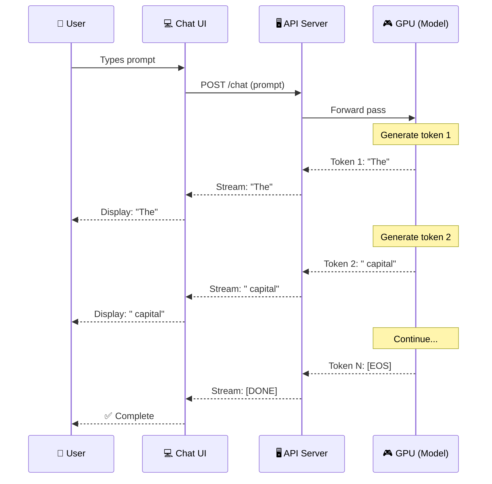

## Introduction

> **Streaming is a protocol where the server sends each token to the client as soon as it's generated — rather than waiting for the complete response — dramatically improving perceived performance and enabling real-time interactions.**

Without streaming, a user waits 5-30 seconds staring at a blank screen while the model generates a complete response. With streaming, words appear one by one — like a human typing in real time.



---

## Why This Exists

### The Problem: Users Hate Waiting

Generating 500 tokens takes 5-30 seconds. Without streaming, the user stares at a blank loading screen. This is a terrible user experience — users think the system is broken, slow, or unresponsive.

**Time to first token (TTFT):**
- Non-streaming: 5-30 seconds (wait for ALL tokens)
- Streaming: 0.5-2 seconds (first token arrives quickly)

Perceived performance depends on TTFT, not total generation time. Streaming makes a 10-second response feel like 1 second.

---

## Real-World Analogy

### The Chef's Open Kitchen

**Without streaming:** The chef takes your order, disappears into the kitchen for 20 minutes, and returns with the complete meal. You wonder if they forgot about you.

**With streaming:** The chef cooks at an open kitchen counter. You see them chop vegetables (token 1), add them to the pan (token 2), season the dish (token 3), plate it (token 4). You see progress the entire time.

---

## How Streaming Works

### Server-Sent Events (SSE)

Most streaming APIs use SSE — a standard protocol for real-time HTTP streaming:

```text
HTTP Response Headers:
Content-Type: text/event-stream
Cache-Control: no-cache
Connection: keep-alive

Body (sent one event at a time):
data: {"choices": [{"delta": {"content": "The"}}]}

data: {"choices": [{"delta": {"content": " capital"}}]}

data: {"choices": [{"delta": {"content": " of"}}]}

data: {"choices": [{"delta": {"content": " France"}}]}

data: [DONE]
```

### Python Client Example

```python
from openai import OpenAI

client = OpenAI(api_key="your-api-key")

# Enable streaming with stream=True
stream = client.chat.completions.create(
    model="gpt-4o",
    messages=[{"role": "user", "content": "Write a short poem about AI."}],
    stream=True,
)

full_response = ""
for chunk in stream:
    if chunk.choices[0].delta.content is not None:
        token = chunk.choices[0].delta.content
        full_response += token
        print(token, end="", flush=True)  # Show token in real time
```

### JavaScript Client Example

```javascript
async function streamChat(prompt) {
  const response = await fetch("/api/chat", {
    method: "POST",
    headers: { "Content-Type": "application/json" },
    body: JSON.stringify({
      model: "gpt-4",
      messages: [{ role: "user", content: prompt }],
      stream: true,
    }),
  });

  const reader = response.body.getReader();
  const decoder = new TextDecoder();
  let output = "";

  while (true) {
    const { done, value } = await reader.read();
    if (done) break;

    const chunk = decoder.decode(value);
    const lines = chunk.split("\n");
    for (const line of lines) {
      if (line.startsWith("data: ")) {
        const data = line.slice(6);
        if (data === "[DONE]") break;
        const json = JSON.parse(data);
        const token = json.choices[0]?.delta?.content || "";
        output += token;
        document.getElementById("output").textContent = output;
      }
    }
  }
  return output;
}
```

---

## Best Practices

1. **Show tokens immediately** — Don't buffer. Display each token as it arrives. This dramatically improves perceived performance.
2. **Handle backpressure** — On slow connections, handle delayed tokens gracefully without blocking the UI.
3. **Support cancellation** — Users should be able to stop generation mid-stream (like the stop button in ChatGPT).
4. **Track token usage** — Even with streaming, count tokens for billing and rate limiting.
5. **Stream function calls too** — Modern APIs stream function call names and arguments alongside text tokens.

---

## Common Misconceptions

| Misconception | Truth |
|--------------|-------|
| "Streaming changes the generated text" | Streaming doesn't change the content — it only changes *when* the user sees it. |
| "Streaming is harder for the model" | Streaming is purely a client/server protocol change. The model generates tokens identically. |

---

## Summary

| Concept | Key Point |
|---------|-----------|
| **Streaming** | Tokens sent to client one at a time via SSE |
| **SSE** | Server-Sent Events — standard HTTP real-time protocol |
| **TTFT** | Time to first token — dramatically improved by streaming |
| **Perception** | Streaming makes slow generation feel fast |

---

## Navigation

**Previous:** [20 — Temperature, Top-K & Top-P](/ai/phase-04-large-language-models/20-temperature-top-k-top-p)

**Next:** [22 — Function Calling](/ai/phase-04-large-language-models/22-function-calling)

**Related Topics:**
- [Function Calling](/ai/phase-04-large-language-models/22-function-calling)
- [Inference](/ai/phase-04-large-language-models/18-inference)
- [Decoding Strategies](/ai/phase-04-large-language-models/19-decoding-strategies)
