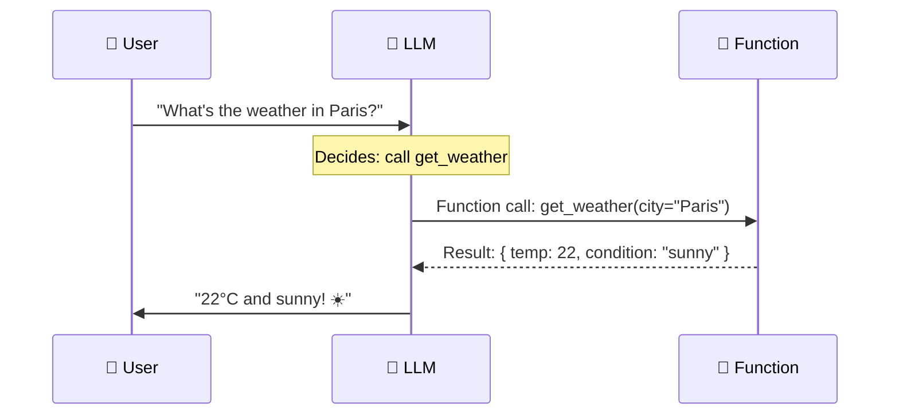
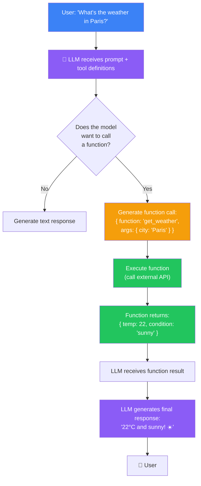

## Introduction

> **Function calling is a capability that lets an LLM request the execution of external tools or APIs — outputting structured requests for functions that the application executes, with results flowing back to the model to incorporate into its response.**

Without function calling, an LLM is limited to what it learned during training. It cannot check the weather, query a database, send an email, or perform calculations. Function calling bridges the gap between text generation and real-world interaction.



---

## Why This Exists

### The Problem: Frozen Knowledge

LLMs have three fundamental limitations that function calling solves:

1. **Knowledge cutoff** — The model only knows data up to its training date. It can't know today's weather, news, or stock prices.
2. **No computation** — The model is a text predictor, not a calculator. It struggles with precise math, logic, and data processing.
3. **No actions** — The model can only generate text. It can't update databases, send emails, or trigger real-world actions.

### The Solution

| Problem | Function Calling Solution |
|---------|--------------------------|
| Knowledge cutoff | Call weather API, database, search engine |
| No computation | Call calculator, code interpreter, data processor |
| No actions | Call email API, database write, notification service |

---

## Real-World Analogy

### The Research Assistant

You ask your assistant: "What were our sales last quarter?"

**Without function calling:** The assistant tries to remember from what they learned months ago. They guess. They might be wrong.

**With function calling:** The assistant says "Let me check." They query the company database, get the exact numbers, and report them to you with confidence.

---

## How Function Calling Works

### Step-by-Step



### Defining Functions

Functions are defined using JSON Schema so the model understands their inputs and outputs:

```json
{
  "type": "function",
  "function": {
    "name": "get_weather",
    "description": "Get current weather for a city",
    "parameters": {
      "type": "object",
      "properties": {
        "city": { "type": "string", "description": "City name, e.g., Paris" },
        "units": { "type": "string", "enum": ["celsius", "fahrenheit"] }
      },
      "required": ["city"]
    }
  }
}
```

### Python Implementation

```python
from openai import OpenAI
import json

client = OpenAI(api_key="your-api-key")

# Step 1: Send message with tool definitions
response = client.chat.completions.create(
    model="gpt-4o",
    messages=[{"role": "user", "content": "What's the weather in Paris?"}],
    tools=[{
        "type": "function",
        "function": {
            "name": "get_weather",
            "description": "Get current weather",
            "parameters": {
                "type": "object",
                "properties": {
                    "city": {"type": "string"}
                },
                "required": ["city"]
            }
        }
    }],
    tool_choice="auto"
)

message = response.choices[0].message

# Step 2: Check if model wants to call a function
if message.tool_calls:
    for tool_call in message.tool_calls:
        function_name = tool_call.function.name
        arguments = json.loads(tool_call.function.arguments)
        
        # Step 3: Execute the function
        result = get_weather(city=arguments["city"])
        
        # Step 4: Send result back to model
        second_response = client.chat.completions.create(
            model="gpt-4o",
            messages=[
                {"role": "user", "content": "What's the weather in Paris?"},
                message,
                {
                    "role": "tool",
                    "tool_call_id": tool_call.id,
                    "content": json.dumps(result)
                }
            ],
            tools=[...]
        )
        
        print(second_response.choices[0].message.content)
```

---

## Common Patterns

| Pattern | Example | Benefit |
|---------|---------|---------|
| **Data retrieval** | Query database, search knowledge base | Access real-time or private data |
| **Computation** | Calculate, code interpreter, math solver | Precise results for complex calculations |
| **Action** | Send email, update CRM, create ticket | Real-world actions triggered by language |
| **Multi-tool** | Search flights + check weather + book | Complex workflows spanning multiple tools |

---

## Best Practices

1. **Describe functions clearly** — Good names and descriptions help the model decide when to call functions.
2. **Validate all inputs** — Never trust the model's arguments blindly. Validate before executing.
3. **Handle errors gracefully** — Return clear errors to the model so it can recover or ask for clarification.
4. **Set call limits** — Prevent infinite loops by limiting consecutive function calls (usually 5-10 max).
5. **Log all calls** — Track which functions are called, with what arguments, and whether they succeeded.

---

## Common Misconceptions

| Misconception | Truth |
|--------------|-------|
| "The model runs the function" | The model only *requests* the function. Your application executes it. |
| "Function calling is only for APIs" | Functions can trigger any action: API calls, database queries, file operations, email. |
| "Function calling requires special training" | It's learned during fine-tuning from examples of function call patterns. |

---

## Summary

| Concept | Key Point |
|---------|-----------|
| **Function calling** | Model requests external tool execution |
| **Tool definition** | JSON Schema describing available functions |
| **Multi-step** | Model can chain multiple function calls |
| **Validation** | Always validate arguments server-side |
| **Safety** | Set limits on number of consecutive calls |

---

## Navigation

**Previous:** [21 — Streaming](/ai/phase-04-large-language-models/21-streaming)

**Next:** [23 — Structured Output](/ai/phase-04-large-language-models/23-structured-output)

**Related Topics:**
- [Streaming](/ai/phase-04-large-language-models/21-streaming)
- [Structured Output](/ai/phase-04-large-language-models/23-structured-output)
- [Hallucinations](/ai/phase-04-large-language-models/24-hallucinations)
