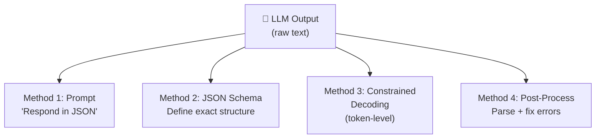

## Introduction

> **Structured output is the practice of constraining LLM generation to follow a specific format — JSON, XML, SQL, or code — ensuring the model's output can be reliably parsed and used by applications.**

LLMs generate text naturally. But applications need structured data. The model might write a beautiful paragraph when you need a clean JSON object. Structured output bridges this gap.



---

## Why This Exists

### The Problem: Applications Need Structure

| Challenge | Example |
|-----------|---------|
| **Invalid JSON** | Missing comma, trailing comma, extra text |
| **Wrong schema** | Extra fields, missing fields, wrong types |
| **Inconsistent format** | Date is "Jan 15" in one call, "2024-01-15" in another |

---

## Methods

### Method 1: Prompt Engineering

```python
response = client.chat.completions.create(
    model="gpt-4o",
    messages=[{
        "role": "system",
        "content": "Respond with valid JSON only. No explanation."
    }, {
        "role": "user", "content": "Extract the name and age."
    }],
    response_format={"type": "json_object"}
)
```

### Method 2: JSON Schema

```python
response = client.chat.completions.create(
    model="gpt-4o",
    messages=[{"role": "user", "content": "Extract person details."}],
    response_format={
        "type": "json_schema",
        "json_schema": {
            "name": "person",
            "schema": {
                "type": "object",
                "properties": {
                    "name": {"type": "string"},
                    "age": {"type": "integer", "minimum": 0},
                },
                "required": ["name", "age"]
            }
        }
    }
)
```

### Method 3: Constrained Decoding

Token-level constraints guarantee valid output by only allowing valid tokens at each step:

```python
import guidance

program = guidance("""
Extract: {{input}}
{
    "name": "{{gen 'name'}}",
    "age": {{gen 'age' pattern='\\\d+'}}
}
""")
result = program(input=text)
```

---

## Best Practices

1. **Use JSON Schema when available** — Strongest format guarantees.
2. **Always validate server-side** — Never assume the model followed instructions.
3. **Include examples** — Few-shot examples improve compliance significantly.
4. **Handle failures** — Have fallback logic when output doesn't match the schema.

---

## Summary

| Method | Reliability | Complexity | Speed |
|--------|-------------|------------|-------|
| Prompt engineering | Low | None | Fastest |
| JSON Schema | High | Low | Fast |
| Constrained decoding | 100% | High | Slowest |
| Post-processing | Medium | Medium | Fast |

---

## Navigation

**Previous:** [22 — Function Calling](/ai/phase-04-large-language-models/22-function-calling)

**Next:** [24 — Hallucinations](/ai/phase-04-large-language-models/24-hallucinations)

**Related Topics:**
- [Hallucinations](/ai/phase-04-large-language-models/24-hallucinations)
- [Function Calling](/ai/phase-04-large-language-models/22-function-calling)
- [Temperature, Top-K & Top-P](/ai/phase-04-large-language-models/20-temperature-top-k-top-p)
