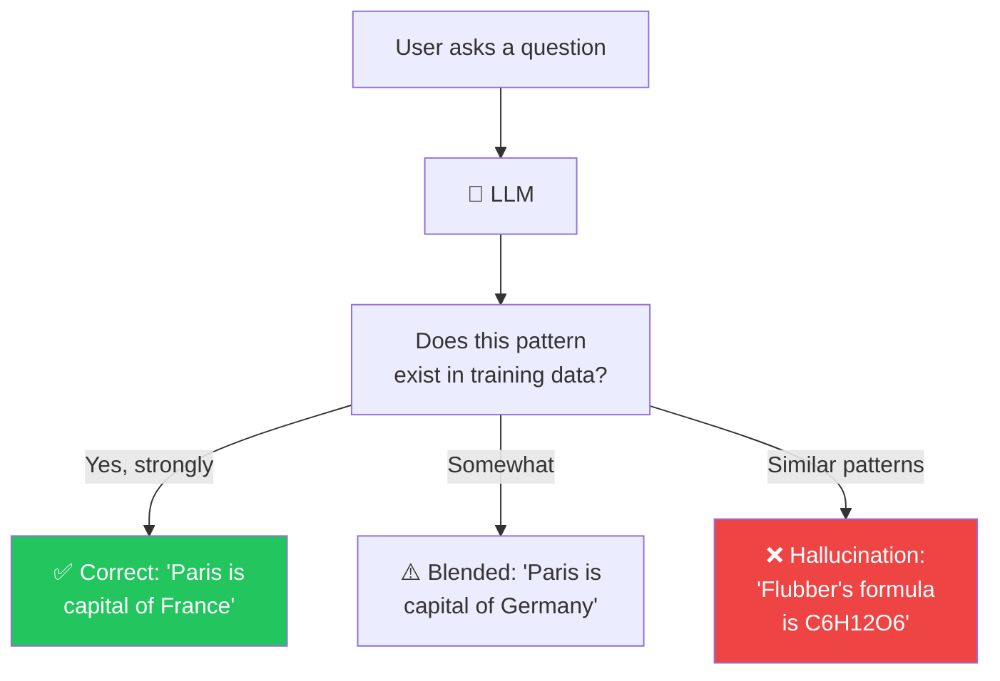

## Introduction

> **A hallucination is when an LLM confidently generates false or nonsensical information — producing text that sounds plausible but is factually incorrect. This is not a bug; it's a consequence of how LLMs work.**

LLMs are trained to predict the most **plausible** next token, not the **correct** one. These are fundamentally different objectives. A model that always outputs the statistically most likely text will inevitably state falsehoods with complete confidence.



---

## Why This Exists

### The Root Cause: Plausibility ≠ Truth

The model is optimized to generate text that **looks like** the text in its training data. Training data contains true facts, false statements, fiction, opinions, and confident guesses. The model doesn't distinguish between them — it just learns to produce similar text.

### The Improv Actor Analogy

An improv actor on stage can't say "I don't know." When asked to explain quantum propulsion, they improvise: "It exploits the Heisenberg uncertainty principle using a flux capacitor." It sounds brilliant. It's complete nonsense. But the audience is entertained.

LLMs are improv actors. Their training objective rewards **plausible text**, not **true text**.

---

## Types of Hallucinations

| Type | Description | Example |
|------|-------------|---------|
| **Factual** | States false information confidently | "The Eiffel Tower is in London" |
| **Source confusion** | Mixes up related facts | "Einstein invented the telephone" |
| **Made-up references** | Cites non-existent sources | "According to a 2023 study by Smith et al." (doesn't exist) |
| **Fictional specifics** | Creates plausible-sounding details | "Flubber's molecular weight is 180.16 g/mol" |
| **Temporal** | Wrong about timing/recency | Gives old information as current |

---

## How to Reduce Hallucinations

### Strategy 1: Better Prompting

```python
system_prompt = """
Only answer if you are certain.
If unsure, say: "I don't have enough information."
Never make up facts, statistics, or citations.
Cite sources only if they're real.
"""
```

### Strategy 2: Lower Temperature

Use temperature 0-0.3 for factual tasks. Higher temperatures increase randomness and thus hallucinations.

### Strategy 3: Self-Consistency

Ask the same question multiple times and check for agreement:

```python
answers = []
for _ in range(3):
    response = client.chat.completions.create(
        model="gpt-4o",
        messages=[{"role": "user", "content": question}],
        temperature=0.3
    )
    answers.append(response.choices[0].message.content)

# If answers agree, likely correct. If not, likely hallucinating.
```

### Strategy 4: Confidence Scoring

Analyze the model's log probabilities to estimate uncertainty:

```python
def get_confidence(response):
    total_logprob = 0
    token_count = 0
    for choice in response.choices:
        if choice.logprobs:
            for token_logprob in choice.logprobs.content:
                total_logprob += token_logprob.logprob
                token_count += 1
    avg = total_logprob / token_count
    return 1 / (1 + abs(avg))  # Higher = more confident
```

---

## Best Practices

1. **Prompt for uncertainty** — Explicitly instruct the model to say "I don't know."
2. **Lower temperature for facts** — Use temperature 0-0.3 when accuracy matters.
3. **Validate critical outputs** — Have a human review or a separate validation step.
4. **Monitor confidence scores** — Track log probability-based confidence to detect unreliable responses.

---

## Summary

| Concept | Key Point |
|---------|-----------|
| **Root cause** | Model optimized for plausibility, not truth |
| **Types** | Factual, source confusion, made-up references, temporal |
| **Detection** | Confidence scoring, self-consistency checks |
| **Prevention** | Better prompting, lower temperature, RAG |
| **Reality** | Can be reduced but never eliminated |

---

## Navigation

**Previous:** [23 — Structured Output](/ai/phase-04-large-language-models/23-structured-output)

**Next:** [25 — Phase Summary](/ai/phase-04-large-language-models/25-phase-summary)

**Related Topics:**
- [Structured Output](/ai/phase-04-large-language-models/23-structured-output)
- [Temperature, Top-K & Top-P](/ai/phase-04-large-language-models/20-temperature-top-k-top-p)
- [Function Calling](/ai/phase-04-large-language-models/22-function-calling)
