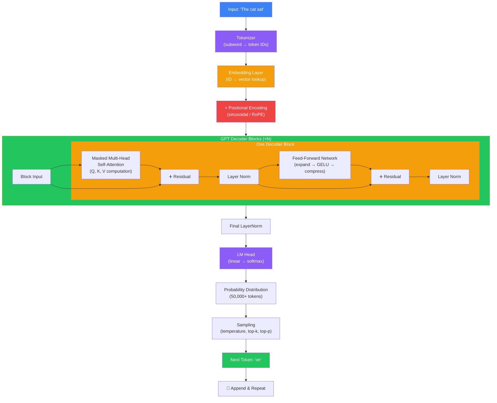
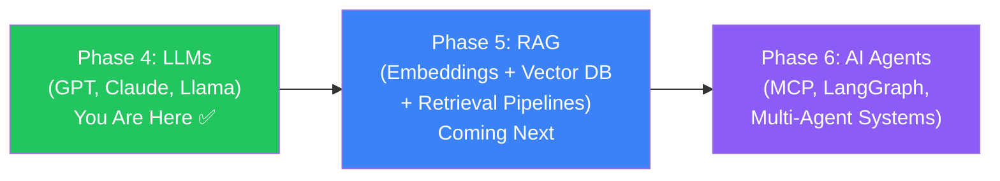

## 🎉 Congratulations — You've Completed Phase 4!

You now understand how modern LLMs work — from the moment you type a prompt to the moment you receive a response. Let's review everything you've learned and see how it all fits together.

---

## The Complete LLM Pipeline

```mermaid
flowchart TD
    subgraph INPUT["Input Processing"]
        T1["01. What is an LLM?\nOverview of Large Language Models"]
        T2["02. Language Models\nProbability of next token"]
        T3["03. Tokenization\nText → Token IDs"]
        T4["04. Context Window\nHow much the model can 'see'"]
    end

    subgraph ARCH["Architecture (Transformer)"]
        A1["05. Transformer Overview\nParallel processing with attention"]
        A2["06. Self-Attention\nEach word looks at all others"]
        A3["07. Query, Key, Value\nHow attention computes relevance"]
        A4["08. Multi-Head Attention\nMultiple perspectives in parallel"]
        A5["09. Positional Encoding\nTeaching word order to Transformers"]
        A6["10. Feed-Forward Network\nToken-level processing & knowledge"]
        A7["11. Decoder-Only Transformers\nCausal masking for generation"]
        A8["12. GPT Architecture\nPutting all components together"]
    end

    subgraph TRAINING["Training Pipeline"]
        TR1["13. Pretraining\nLearning from internet text"]
        TR2["14. Next Token Prediction\nThe training objective"]
        TR3["15. Supervised Fine-Tuning\nTeaching instruction following"]
        TR4["16. RLHF\nAligning with human preferences"]
        TR5["17. DPO\nDirect preference optimization"]
    end

    subgraph INFERENCE["Inference & Generation"]
        I1["18. Inference\nHow prompts become responses"]
        I2["19. Decoding Strategies\nGreedy, beam search, sampling"]
        I3["20. Temperature, Top-K & Top-P\nControlling randomness"]
    end

    subgraph PRODUCTION["Production Features"]
        P1["21. Streaming\nReal-time token-by-token output"]
        P2["22. Function Calling\nCalling external tools & APIs"]
        P3["23. Structured Output\nForcing JSON & schema compliance"]
        P4["24. Hallucinations\nDetection and prevention"]
    end

    INPUT --> ARCH --> TRAINING --> INFERENCE --> PRODUCTION

    style INPUT fill:#3b82f6,color:#fff
    style ARCH fill:#8b5cf6,color:#fff
    style TRAINING fill:#f59e0b,color:#fff
    style INFERENCE fill:#ef4444,color:#fff
    style PRODUCTION fill:#22c55e,color:#fff
```

---

## Knowledge Map

### Documents 01-04: Foundations
You learned what LLMs are, how they work as next-token predictors, how text is tokenized into numbers, and the importance of context windows.

### Documents 05-12: Architecture
You learned the complete Transformer architecture — from the overview and self-attention to QKV, multi-head attention, positional encoding, feed-forward networks, and how GPT builds everything into a decoder-only architecture for generation.

### Documents 13-17: Training
You learned the full training pipeline — pretraining on internet text, the next-token prediction objective, supervised fine-tuning for instruction following, RLHF for alignment, and DPO as a modern alternative.

### Documents 18-20: Inference
You learned how inference works from prompt to response, the different decoding strategies (greedy, beam search, sampling), and how temperature, top-K, and top-P control output randomness.

### Documents 21-24: Production
You learned streaming for real-time interactions, function calling to connect to external tools, structured output for reliable data extraction, and how to detect and reduce hallucinations.

---

## Architecture Reference

---

## Key Concepts Reference

| Concept | Document | One-Sentence Summary |
|---------|----------|---------------------|
| LLM | 01 | Neural network trained on internet text to predict the next token |
| Language Model | 02 | System that assigns probabilities to sequences of words |
| Tokenization | 03 | Splitting text into subword units and converting to numbers |
| Context Window | 04 | Maximum sequence length the model can process at once |
| Transformer | 05 | Architecture that processes all tokens in parallel using attention |
| Self-Attention | 06 | Each token looks at all other tokens to gather context |
| QKV | 07 | Query, Key, Value vectors that compute attention relevance |
| Multi-Head Attention | 08 | Multiple attention computations in parallel for diverse patterns |
| Positional Encoding | 09 | Adding position information to token embeddings |
| Feed-Forward Network | 10 | Two-layer network for independent token processing |
| Decoder-Only | 11 | Architecture with causal masking for generation |
| GPT Architecture | 12 | Complete decoder-only model with all components |
| Pretraining | 13 | Initial training on massive unlabeled text data |
| Next Token Prediction | 14 | The training objective: predict the next word |
| SFT | 15 | Fine-tuning on instruction-response pairs |
| RLHF | 16 | Aligning models using human feedback and reinforcement learning |
| DPO | 17 | Direct preference optimization as a simpler alternative to RLHF |
| Inference | 18 | Using the trained model to generate text |
| Decoding | 19 | Strategies for selecting tokens: greedy, beam, sampling |
| Temperature | 20 | Controlling output randomness in token selection |
| Streaming | 21 | Sending tokens to the client as they're generated |
| Function Calling | 22 | Model requesting external tool execution |
| Structured Output | 23 | Forcing output to follow a specific format |
| Hallucinations | 24 | Model confidently generating false information |

---

## Understanding Scale

| Model | Parameters | Layers | Training Cost | Release |
|-------|-----------|--------|--------------|---------|
| GPT-1 | 117M | 12 | ~$50K | 2018 |
| GPT-2 | 1.5B | 48 | ~$500K | 2019 |
| GPT-3 | 175B | 96 | ~$5M | 2020 |
| LLaMA 7B | 7B | 32 | ~$200K | 2023 |
| LLaMA 405B | 405B | 126 | ~$10M | 2024 |
| GPT-4 (est.) | ~1.8T | ~120 | ~$100M+ | 2023 |

---

## Your Mental Model

After completing Phase 4, you should be able to:

1. **Explain** how ChatGPT works from prompt to response
2. **Describe** the Transformer architecture and each component's role
3. **Understand** the training pipeline — pretraining, SFT, RLHF, DPO
4. **Choose** decoding strategies and sampling parameters for different tasks
5. **Recognize** why hallucinations happen and how to reduce them
6. **Apply** function calling and structured output in production systems
7. **Trace** a token through the entire model: input → embedding → attention → FFN → output

---

## What's Next: Phase 5 — Retrieval-Augmented Generation

Phase 5 will teach you how to **connect LLMs to external knowledge**. You will learn:

- **Embeddings** — Converting text to vectors that capture meaning
- **Vector Databases** — Storing and searching embeddings at scale
- **Semantic Search** — Finding information by meaning, not keywords
- **RAG Pipelines** — Retrieval-Augmented Generation from first principles
- **Production RAG** — Building reliable, scalable retrieval systems

This is where LLMs go from powerful text generators to **knowledge-grounded AI systems** that can answer questions about any document, database, or knowledge base.

---

## Navigation

**Previous:** [24 — Hallucinations](/ai/phase-04-large-language-models/24-hallucinations)

**Next:** *Coming soon — Phase 5: Retrieval-Augmented Generation*

**Related Topics:**
- [Phase 1: AI Fundamentals](/ai/phase-01-fundamentals/01-introduction-to-ai)
- [Phase 2: Machine Learning](/ai/phase-02-machine-learning/01-what-is-machine-learning)
- [Phase 3: Deep Learning](/ai/phase-03-deep-learning/01-what-is-deep-learning)
- [Phase 4 Index](/ai)

**Practice Questions:**
1. Trace the complete path of a token through GPT, naming every component it passes through.
2. Explain the difference between pretraining, SFT, and RLHF in one sentence each.
3. When would you use temperature=0 vs temperature=1 for generation?
4. Why does the decoder-only architecture need causal masking?
5. How would you detect whether a model's response is a hallucination?
