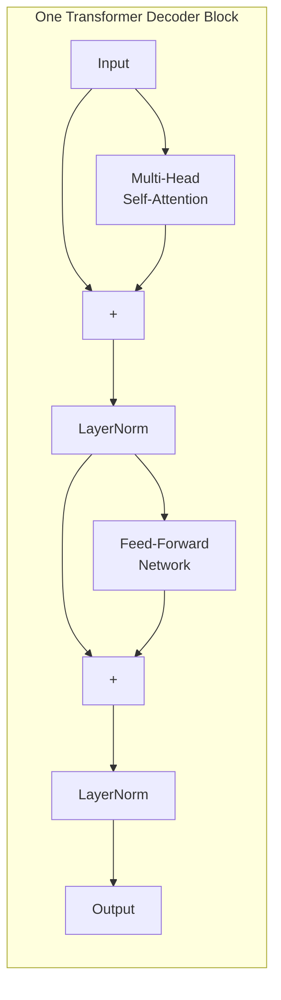

# Phase 4: Large Language Models — Cheat Sheet

## 1. LLM Foundations

| Concept | Summary |
|---------|---------|
| **LLM** | Neural network trained on internet-scale text to predict next token |
| **Autoregressive** | Generates one token at a time, each depending on all previous |
| **Tokenization** | Text → subword tokens → numerical IDs (vocabulary: 50K-200K) |
| **Context Window** | Max tokens model can process (4K → 128K → 1M) |
| **Emergent Abilities** | Capabilities that appear at scale (reasoning, in-context learning) |

## 2. Transformer Architecture



| Component | Purpose |
|-----------|---------|
| **Self-Attention** | Computes relationships between all token pairs |
| **QKV** | Query (what I need), Key (what I offer), Value (what I carry) |
| **Multi-Head** | 8-96 parallel attention patterns per layer |
| **Positional Encoding** | Sinusoidal/learned — adds order information |
| **FFN** | Two-layer MLP (typically 4x hidden dim) |
| **Residual Connections** | Skip connections enabling 12-100+ layer depth |
| **LayerNorm** | Stabilizes activations, enables training |

## 3. Training Pipeline

```
Stage 1: Pretraining ───→ Stage 2: SFT ───────────→ Stage 3: Alignment
(Trillions of tokens)     (100K-1M examples)        (RLHF or DPO)
     │                          │                         │
     ▼                          ▼                         ▼
 Base Model              Instruction Model          Aligned Model
(continues text)         (follows prompts)         (helpful + safe)
```

| Stage | Data | Objective | Result |
|-------|------|-----------|--------|
| **Pretraining** | Raw internet text | Next token prediction | Base model |
| **SFT** | Instruction-response pairs | Language modeling on responses | Instruction model |
| **RLHF** | Human preference rankings | PPO against reward model | Aligned model |
| **DPO** | Preference pairs | Direct preference optimization | Aligned model |

## 4. Inference & Decoding

| Strategy | Behavior | Use Case |
|----------|----------|----------|
| **Greedy** | Always pick most likely token | Factual answers, code |
| **Beam Search** | Maintain top-N sequences | Translation, summarization |
| **Temperature** | Scale logits (0=deterministic, >0=random) | Creative writing |
| **Top-K** | Sample from K most likely tokens | Balanced creativity |
| **Top-P** | Sample from cumulative probability P | Adaptive diversity |

### Typical Values
- **Temperature:** 0.1-0.3 (factual), 0.7-0.9 (creative)
- **Top-K:** 40-50
- **Top-P:** 0.9-0.95

## 5. Production Considerations

| Feature | How It Works |
|---------|-------------|
| **Streaming** | Server-Sent Events (SSE) — tokens sent as generated |
| **Function Calling** | LLM outputs JSON with tool name + arguments |
| **Structured Output** | Grammar-based constrained decoding for valid JSON |
| **Hallucination Mitigation** | RAG, temperature control, prompting, validation |

## GPT Model Evolution

| Model | Year | Params | Context | Key Innovation |
|-------|------|--------|---------|---------------|
| GPT-1 | 2018 | 117M | 512 | Transformer decoder for language modeling |
| GPT-2 | 2019 | 1.5B | 1024 | Zero-shot generalization |
| GPT-3 | 2020 | 175B | 2048 | In-context learning, emergent abilities |
| GPT-3.5 | 2022 | 175B | 4K/16K | Instruction tuning + RLHF |
| GPT-4 | 2023 | ~1.8T | 8K/32K/128K | Multimodal, reasoning |
| GPT-4o | 2024 | — | 128K | Real-time audio, vision, text |

## Quick Reference: Common LLM Families

| Family | Open? | Best For |
|--------|-------|----------|
| **GPT (OpenAI)** | No | General purpose, coding, reasoning |
| **Claude (Anthropic)** | No | Long documents, safety, analysis |
| **Gemini (Google)** | No | Very long context, multimodal |
| **Llama (Meta)** | Yes | Self-hosting, research |
| **Mistral** | Partial | Efficiency, multilingual |
| **DeepSeek** | Yes | Cost-effective, coding |
| **Qwen (Alibaba)** | Yes | Coding, math, Chinese/English |
