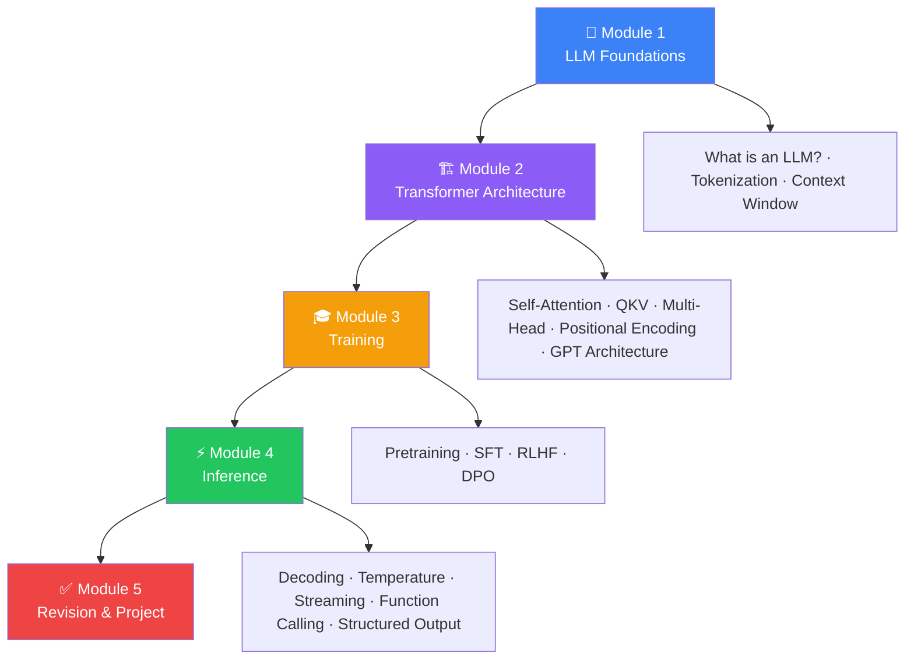

import { Card, CardGrid } from '@astrojs/starlight/components';

# Phase 4: Large Language Models

> **Learn exactly how ChatGPT, Claude, Gemini, and Llama work — from the moment you type a prompt to when you receive a response.**

  

    Difficulty
    🟡 Intermediate
  

  

    Estimated Time
    18 Hours
  

  

    Reading Time
    12 Hours
  

  

    Projects
    3
  

  

    Interview Importance
    ★★★★★
  

  

    Prerequisites
    Deep Learning (Phase 3)
  

---

## Learning Roadmap

---

## Modules Overview

<CardGrid>
  <Card title="Module 1: LLM Foundations" icon="open-book">
    Learn what LLMs are, how language models work, how text becomes tokens, and why context windows matter.
      
    **4 Lessons · ~3 Hours**
  </Card>
  
  <Card title="Module 2: Transformer Architecture" icon="setting">
    Dive deep into the Transformer — self-attention, QKV, multi-head attention, positional encoding, feed-forward networks, decoder-only design, and GPT architecture.
      
    **8 Lessons · ~6 Hours**
  </Card>
  
  <Card title="Module 3: Training" icon="training">
    Understand how LLMs are trained — pretraining, next-token prediction, supervised fine-tuning, RLHF, and DPO alignment.
      
    **5 Lessons · ~4 Hours**
  </Card>
  
  <Card title="Module 4: Inference" icon="terminal">
    Master inference — how LLMs generate text, decoding strategies, temperature, streaming, function calling, structured output, and hallucinations.
      
    **7 Lessons · ~4 Hours**
  </Card>
  
  <Card title="Module 5: Revision & Project" icon="checkmark">
    Solidify your knowledge with a cheat sheet, practice questions, MCQs, interview preparation, and a hands-on mini project.
      
    **Revision · ~1 Hour**
  </Card>
</CardGrid>

---

## Topics Covered

| # | Topic | Module | 🔥 |
|---|-------|--------|-----|
| 01 | What is an LLM? | M1: Foundations | 🔥 Must Know |
| 02 | How Language Models Work | M1: Foundations | 🔥 Must Know |
| 03 | Tokenization | M1: Foundations | 🧠 Core Concept |
| 04 | Context Window | M1: Foundations | 🧠 Core Concept |
| 05 | Transformer Overview | M2: Architecture | 🔥 Must Know |
| 06 | Self-Attention | M2: Architecture | 🔥 Must Know |
| 07 | Query, Key, Value | M2: Architecture | 🧠 Core Concept |
| 08 | Multi-Head Attention | M2: Architecture | 🧠 Core Concept |
| 09 | Positional Encoding | M2: Architecture | 🧠 Core Concept |
| 10 | Feed-Forward Network | M2: Architecture | 🧠 Core Concept |
| 11 | Decoder-Only Transformers | M2: Architecture | 🧠 Core Concept |
| 12 | GPT Architecture | M2: Architecture | 🔥 Must Know |
| 13 | Pretraining | M3: Training | 🔥 Must Know |
| 14 | Next Token Prediction | M3: Training | 🔥 Must Know |
| 15 | Supervised Fine-Tuning | M3: Training | 🧠 Core Concept |
| 16 | RLHF | M3: Training | 💼 Production |
| 17 | DPO | M3: Training | 💼 Production |
| 18 | Inference | M4: Inference | 🔥 Must Know |
| 19 | Decoding Strategies | M4: Inference | 🧠 Core Concept |
| 20 | Temperature, Top-K & Top-P | M4: Inference | 🧠 Core Concept |
| 21 | Streaming | M4: Inference | 💼 Production |
| 22 | Function Calling | M4: Inference | 💼 Production |
| 23 | Structured Output | M4: Inference | 💼 Production |
| 24 | Hallucinations | M4: Inference | 🧠 Core Concept |
| 25 | Phase Summary | M5: Revision | ✅ Revision |

---

## What You'll Build

| Project | Module | Description |
|---------|--------|-------------|
| **LLM Token Visualizer** | M2 | Build a tool that shows how text is split into tokens |
| **Temperature Playground** | M4 | Interactive tool to compare LLM outputs at different temperatures |
| **Mini ChatGPT** | M5 | Build a simple CLI chat application using an LLM API |

---

## Progress Tracker

  

    

      

    

    0 / 24 Lessons Complete
  

---

## Getting Started

Ready to master Large Language Models? Start with **Module 1** to build your foundation, or jump to any topic that interests you.

**Start Learning:**
- [Begin Module 1: LLM Foundations →](./module-01-overview)
- [View the Cheat Sheet →](./cheat-sheet)
- [Practice with MCQs →](./mcqs)

