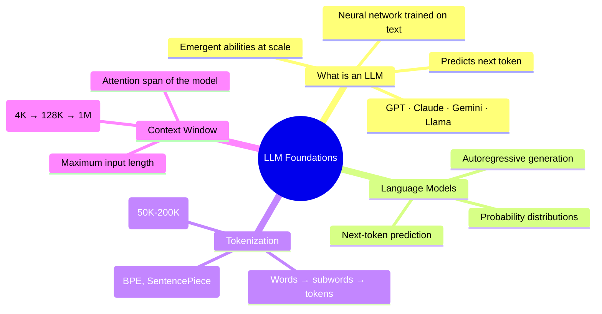

# Module 1: LLM Foundations

> **Build your foundation: understand what Large Language Models are, how they process language, and the core concepts that power every modern AI assistant.**

---

## Overview

Module 1 answers the fundamental questions: What is an LLM? How does it understand language? How does it turn words into numbers? And why can it only handle so much text at once?

By the end of this module, you'll have a clear mental model of what an LLM is and how it processes text — without diving into the complex architecture yet.

---

## Learning Objectives

After completing this module, you will be able to:

- ✅ Explain what an LLM is and why it's different from traditional software
- ✅ Describe how language models predict the next word
- ✅ Explain tokenization and why it matters
- ✅ Understand context windows and their limitations
- ✅ Compare different LLM families (GPT, Claude, Gemini, Llama)
- ✅ Write a basic API call to an LLM

---

## Prerequisites

| Requirement | Level |
|------------|-------|
| Basic programming knowledge | ✅ Recommended |
| Understanding of AI concepts | ⭐ Helpful (covered in Phase 1) |
| Deep Learning basics | 🔄 Covered in Phase 3 |

---

## Estimated Time

| Activity | Time |
|----------|------|
| Reading lessons | 2 hours |
| Practice exercises | 30 minutes |
| Mini quiz | 15 minutes |
| **Total** | **~3 hours** |

---

## Lessons

| # | Lesson | 🔥 | Description |
|---|--------|-----|-------------|
| 01 | [What is an LLM?](./01-what-is-an-llm) | 🔥 Must Know | Definition, history, comparison of major models |
| 02 | [How Language Models Work](./02-language-models) | 🔥 Must Know | Prediction, probability, autoregressive generation |
| 03 | [Tokenization](./03-tokenization) | 🧠 Core Concept | How text becomes numbers, subword tokenization |
| 04 | [Context Window](./04-context-window) | 🧠 Core Concept | How much text an LLM can process at once |

---

## Key Concepts

---

## Module Summary

In this module, you learned:

1. **LLMs** are neural networks trained on internet-scale text that predict the next word
2. **Language modeling** assigns probabilities to sequences of words
3. **Tokenization** converts text into numbers the model can process
4. **Context windows** limit how much text an LLM can consider at once

---

## Practice Questions

1. Explain the difference between a traditional ML model and an LLM in one sentence.
2. Why is tokenization necessary? What would happen if we used raw characters or raw words?
3. Calculate: If a model has a 128K context window and each token is ~0.75 words, how many pages of text can it process? (Assume 500 words per page)
4. What happens when you send a prompt longer than the context window?

---

## Interview Questions

1. **Q:** Why are LLMs called "large"? What makes them large?
   - **A:** Large refers to (1) billions of parameters, (2) trillions of training tokens, (3) thousands of GPUs required for training.

2. **Q:** What is the difference between a foundation model and a fine-tuned model?
   - **A:** A foundation model is trained on raw internet text via next-token prediction. A fine-tuned model is further trained on instruction-response pairs and preference data (RLHF) to be helpful and follow instructions.

---

## Next Steps

➡️ Continue to [Module 2: Transformer Architecture →](./module-02-overview)
