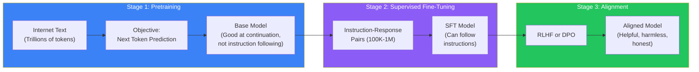

# Module 3: Training

> **From raw internet text to helpful assistant. Learn the entire training pipeline — pretraining, fine-tuning, RLHF, and alignment.**

---

## Overview

Module 3 covers how a raw model becomes a useful assistant. You'll learn the three-stage training pipeline: pretraining on massive text data, supervised fine-tuning on instruction-response pairs, and alignment with human preferences via RLHF or DPO.

---

## Learning Objectives

After completing this module, you will be able to:

- ✅ Explain the three stages of LLM training
- ✅ Describe how pretraining works at scale
- ✅ Understand next-token prediction as a training objective
- ✅ Explain supervised fine-tuning (SFT)
- ✅ Describe RLHF and the reward model
- ✅ Understand DPO as a simpler alternative to RLHF
- ✅ Compare training vs inference

---

## Prerequisites

| Requirement | Level |
|------------|-------|
| Module 2: Transformer Architecture | ✅ Required |
| Understanding of loss functions | ⭐ Recommended |
| Basic ML training concepts | 🔄 Covered in Phase 2 |

---

## Estimated Time

| Activity | Time |
|----------|------|
| Reading lessons | 3 hours |
| Practice exercises | 45 minutes |
| Mini quiz | 15 minutes |
| **Total** | **~4 hours** |

---

## Lessons

| # | Lesson | 🔥 | Description |
|---|--------|-----|-------------|
| 13 | [Pretraining](./13-pretraining) | 🔥 Must Know | Training on trillions of tokens |
| 14 | [Next Token Prediction](./14-next-token-prediction) | 🔥 Must Know | The core training objective |
| 15 | [Supervised Fine-Tuning](./15-supervised-fine-tuning) | 🧠 Core Concept | Training on instruction-response pairs |
| 16 | [RLHF](./16-rlhf) | 💼 Production | Reinforcement Learning from Human Feedback |
| 17 | [DPO](./17-dpo) | 💼 Production | Direct Preference Optimization |

---

## Training Pipeline

---

## Key Concepts

- **Pretraining:** Self-supervised learning on raw text — no labels needed
- **Scaling laws:** Model performance improves predictably with more data, parameters, and compute
- **SFT:** Teaching the model to follow instructions using human-written examples
- **Reward Model:** A separate model trained to predict human preferences
- **RLHF:** Using PPO to optimize the LLM against the reward model
- **DPO:** Directly optimizing preferences without a separate reward model
- **Alignment:** Making models helpful, harmless, and honest (the "HHH" framework)

---

## Module Summary

In this module, you learned:

1. **Pretraining** trains the model on raw text using next-token prediction — this is ~99% of the compute
2. **SFT** teaches instruction following using human-written examples
3. **RLHF** uses a reward model trained on human preferences, then PPO to optimize the LLM
4. **DPO** simplifies alignment by directly optimizing preference probabilities

---

## Practice Questions

1. Why is pretraining called "self-supervised"? Where do the labels come from?
2. What happens if you skip the alignment stage (SFT + RLHF/DPO)?
3. Compare RLHF and DPO — what are the advantages of each?
4. Why does SFT use a small dataset (100K-1M examples) compared to pretraining (trillions of tokens)?

---

## Interview Questions

1. **Q:** Why can't we just use more SFT data instead of RLHF?
   - **A:** SFT teaches the model to mimic the format, but RLHF teaches it to optimize for human preferences. SFT on bad examples can make the model worse; RLHF handles nuanced trade-offs.

2. **Q:** What is the "alignment tax"?
   - **A:** Alignment (SFT + RLHF/DPO) can reduce the model's diversity and creativity slightly. The model becomes safer but may produce less varied outputs. This trade-off is called the alignment tax.

---

## Next Steps

➡️ Continue to [Module 4: Inference →](./module-04-overview)