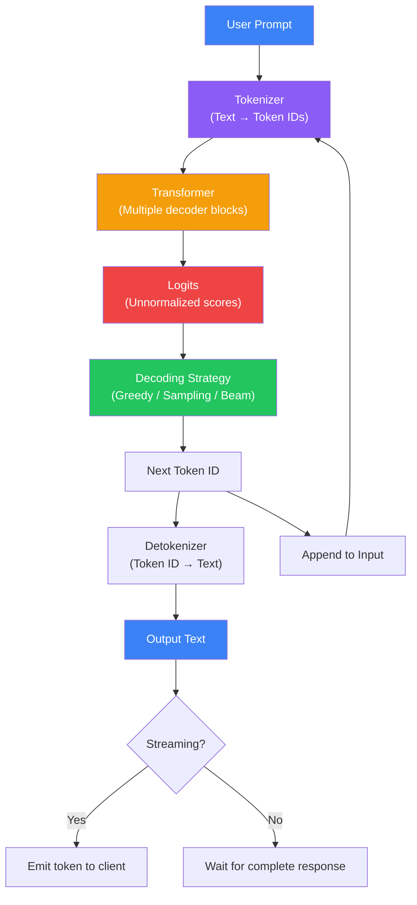

# Module 4: Inference

> **Everything that happens when you send a prompt to an LLM — from decoding strategies to streaming, function calling, and managing hallucinations.**

---

## Overview

Module 4 is about the inference pipeline — what happens after training is complete and you send a prompt. You'll learn how text is generated token by token, how different decoding strategies affect output quality, how streaming works, how function calling enables tool use, and why hallucinations happen.

---

## Learning Objectives

After completing this module, you will be able to:

- ✅ Describe the inference pipeline step by step
- ✅ Compare greedy decoding, beam search, and sampling
- ✅ Explain how temperature, top-k, and top-p affect output
- ✅ Understand how streaming delivers tokens in real-time
- ✅ Explain function calling architecture
- ✅ Describe structured output methods (JSON mode, grammar-based)
- ✅ Understand why hallucinations occur and mitigation strategies

---

## Prerequisites

| Requirement | Level |
|------------|-------|
| Module 3: Training | ✅ Required |
| Understanding of probability | ⭐ Recommended |
| API usage experience | 🔄 Helpful |

---

## Estimated Time

| Activity | Time |
|----------|------|
| Reading lessons | 3 hours |
| Practice exercises | 45 minutes |
| Mini quiz | 15 minutes |
| **Total** | **~4 hours** |

---

## Lessons

| # | Lesson | 🔥 | Description |
|---|--------|-----|-------------|
| 18 | [Inference](./18-inference) | 🔥 Must Know | The complete inference pipeline |
| 19 | [Decoding Strategies](./19-decoding-strategies) | 🧠 Core Concept | Greedy, beam search, top-k, top-p |
| 20 | [Temperature, Top-K & Top-P](./20-temperature-top-k-top-p) | 🧠 Core Concept | Controlling randomness in generation |
| 21 | [Streaming](./21-streaming) | 💼 Production | Real-time token delivery |
| 22 | [Function Calling](./22-function-calling) | 💼 Production | Connecting LLMs to external tools |
| 23 | [Structured Output](./23-structured-output) | 💼 Production | JSON mode, constrained generation |
| 24 | [Hallucinations](./24-hallucinations) | 🧠 Core Concept | Why models fabricate and how to reduce it |

---

## Inference Pipeline

---

## Key Concepts

- **Autoregressive generation:** Each token depends on all previous tokens
- **Decoding strategies:** Greedy (deterministic), beam search (multiple paths), sampling (stochastic)
- **Temperature:** Controls the "sharpness" of the probability distribution
- **Top-k:** Only sample from the k most likely tokens
- **Top-p (nucleus):** Only sample from tokens whose cumulative probability exceeds p
- **Streaming:** Server-Sent Events (SSE) deliver tokens as they're generated
- **Function calling:** LLM outputs structured arguments for predefined functions
- **Constrained decoding:** Grammar-based generation that guarantees valid output format
- **Hallucinations:** Model produces plausible-sounding but incorrect information

---

## Module Summary

In this module, you learned:

1. **Inference** is autoregressive — one token at a time, each depending on previous tokens
2. **Decoding strategies** balance creativity vs coherence
3. **Temperature, top-k, top-p** control output randomness
4. **Streaming** improves user experience with real-time output
5. **Function calling** enables LLMs to interact with external systems
6. **Structured output** ensures machine-parseable responses
7. **Hallucinations** are inherent to LLMs and require systematic mitigation

---

## Practice Questions

1. Why is greedy decoding not always the best strategy for creative tasks?
2. Explain the difference: what happens when temperature = 0 vs temperature = 1 vs temperature = 2?
3. How would you design a function calling schema for a weather API?
4. What are three strategies to reduce hallucinations?

---

## Interview Questions

1. **Q:** Why can't LLMs generate text in parallel? Why is it sequential?
   - **A:** Because each token depends on all previous tokens. You can't know token #100 without first generating tokens 1-99. This is the fundamental constraint of autoregressive generation.

2. **Q:** How does temperature 0 differ from greedy decoding?
   - **A:** At temperature → 0, the softmax approaches argmax, which is equivalent to greedy decoding. Both select the most likely token deterministically.

3. **Q:** What are the security implications of function calling?
   - **A:** Unrestricted function calling can lead to prompt injection where users trick the model into calling sensitive functions. Mitigations include input sanitization, least-privilege function design, and human-in-the-loop for destructive operations.

---

## Next Steps

➡️ Continue to [Module 5: Revision & Project →](./module-05-overview)