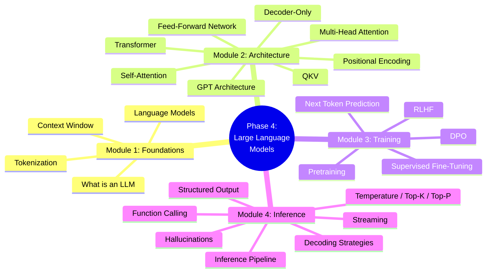

# Module 5: Revision & Project

> **Consolidate everything you've learned. Test your knowledge, practice interview questions, and build a real project.**

---

## Overview

Module 5 is designed to help you retain and apply everything you've learned. Instead of new concepts, you'll find revision aids, practice materials, and a hands-on project that ties the entire phase together.

---

## Learning Objectives

After completing this module, you will be able to:

- ✅ Recall all key concepts from Phase 4 from memory
- ✅ Answer interview questions about LLMs
- ✅ Score 80%+ on phase MCQs
- ✅ Build a functional LLM-powered application

---

## Materials

| Resource | Description | Time |
|----------|-------------|------|
| [Cheat Sheet](./cheat-sheet) | One-page visual reference of all Phase 4 concepts | 10 min |
| [Phase Summary](./25-phase-summary) | Comprehensive recap of everything covered | 15 min |
| [Practice Questions](./practice-questions) | Hands-on exercises and scenario questions | 30 min |
| [MCQs](./mcqs) | 25+ multiple choice questions with explanations | 30 min |
| [Interview Questions](./interview-questions) | Theory, coding, and architecture questions | 30 min |
| [Mini Project](./mini-project) | Build a Mini ChatGPT CLI | 1-2 hours |

---

## Phase 4 Mind Map

---

## Progress Check

Before moving on, you should be able to answer:

1. How does an LLM generate text from a prompt?
2. What are the key components of a Transformer block?
3. How does RLHF align LLM outputs with human preferences?
4. What causes hallucinations and how do you mitigate them?

---

## Next Steps

➡️ After completing this module, you're ready for **Phase 5: Retrieval-Augmented Generation (RAG)** — coming soon.
