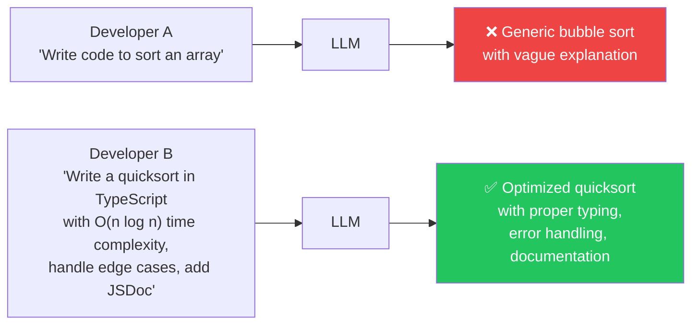
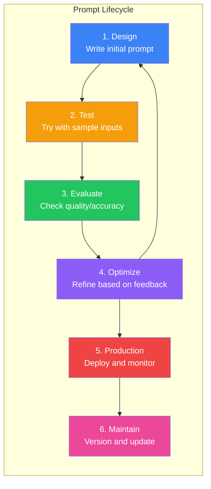
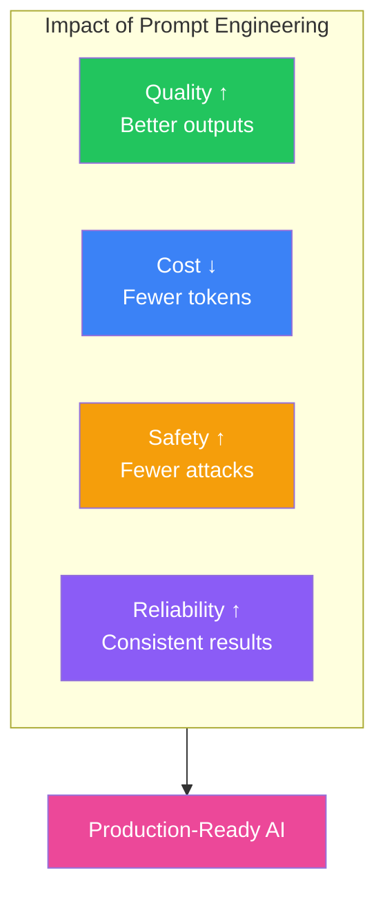

## Introduction

> **Prompt Engineering is the art and science of crafting inputs to large language models that produce reliable, accurate, and useful outputs.**

It is not "magic words" or tricking the AI. It is a systematic engineering discipline — understanding how LLMs interpret language, designing clear instructions, and iterating to improve results.

---

## Why This Concept Exists

### The Problem

Two developers ask the same AI the same question and get completely different answers. One gets a concise, correct solution. The other gets a rambling, incorrect mess.

The difference? The prompt.



### The Story

Imagine walking into a kitchen and telling a chef: "Cook something."

The chef might make anything — eggs, a sandwich, a five-course meal. The result is unpredictable.

Now say: "Cook a spicy vegetarian pasta in 20 minutes using only ingredients from my refrigerator."

The result is predictable, specific, and useful.

Prompt engineering is learning to write the second instruction.

---

## Real-World Analogy

### The Senior Developer

A junior developer asks: "How do I fix this bug?" and gets a 30-minute lecture on programming fundamentals.

A senior developer asks: "I'm getting a `TypeError: Cannot read properties of undefined` on line 42 of `UserService.ts` when the token expires. Here's the stack trace and the relevant code block. What's the likely cause and the cleanest fix?"

The senior gets a precise answer because they provided context, constraints, and specifics.

> **Prompt engineering is the difference between asking like a junior and asking like a senior.**

---

## What is Prompt Engineering?

Prompt engineering is the practice of designing, testing, and optimizing inputs to AI models to get desired outputs.

```mermaid
flowchart TD
    subgraph INPUT["Input (The Prompt)"]
        I1["Instruction\nWhat to do"]
        I2["Context\nBackground info"]
        I3["Input Data\nThe problem/question"]
        I4["Constraints\nRules to follow"]
        I5["Format\nHow to respond"]
    end

    subgrid INPUT --> P["LLM"]
    P --> O["Output (The Response)"]

    O --> F["Feedback\nIterate & Improve"]
    F --> INPUT

    style INPUT fill:#3b82f6,color:#fff
    style P fill:#f59e0b,color:#fff
    style O fill:#22c55e,color:#fff
    style F fill:#8b5cf6,color:#fff
```

| Aspect | Without Prompt Engineering | With Prompt Engineering |
|--------|---------------------------|------------------------|
| **Instruction** | Vague ("write code") | Specific ("write a recursive DFS in Python with type hints") |
| **Context** | None | Relevant background, constraints, edge cases |
| **Format** | Unpredictable | Structured (JSON, markdown, specific schema) |
| **Consistency** | Random results | Reliable, reproducible outputs |
| **Cost** | Wasted tokens on irrelevant output | Efficient, focused responses |

---

## The Prompt Lifecycle

Every prompt goes through a lifecycle — from idea to production.



---

## Why Prompt Engineering Matters

### 1. Quality

A well-engineered prompt produces correct, relevant, and well-structured output. A poor prompt produces garbage.

### 2. Consistency

In production, you need the same prompt to produce similar quality across thousands of calls. Without prompt engineering, results are unpredictable.

### 3. Cost

LLMs charge per token. A verbose, poorly structured prompt wastes tokens. An optimized prompt gets the job done in fewer tokens.

### 4. Safety

Prompt engineering includes defenses against injection attacks, jailbreaks, and unintended outputs.

### 5. Reliability

Production AI systems cannot afford random failures. Prompt engineering makes AI behavior predictable.



---

## Real-World Examples

### ChatGPT

```
❌ Bad: "Write an email."
✅ Good: "Write a professional email to my team announcing a sprint delay.
   Key points: the API integration took longer than expected, we need 3 extra
   days, the frontend team should continue their current work. Keep the tone
   transparent but confident."
```

### Claude

```
❌ Bad: "Explain quantum computing."
✅ Good: "Explain quantum computing to a senior software engineer who knows
   classical computing but has no quantum background. Focus on qubits,
   superposition, and entanglement. Use analogies to classical bits.
   Keep it to 3 paragraphs."
```

### GitHub Copilot

```
❌ Bad: A vague comment like "sort function"
✅ Good: A well-named function with parameter types and expected behavior:
   /**
    * Sorts an array of user objects by their last name, ascending.
    * Handles null/undefined last names by falling back to empty string.
    * @param users - Array of user objects with { firstName, lastName }
    * @returns Sorted copy of the array (does not mutate original)
    */
```

### Gemini

```
❌ Bad: "Tell me about machine learning."
✅ Good: "Compare supervised and unsupervised learning for a project that
   needs to categorize customer support tickets by urgency. I have 10,000
   labeled examples. Which approach should I use and why? Provide a table
   comparing the two approaches for this specific use case."
```

---

## Common Mistakes

| Mistake | Why It's Wrong |
|---------|----------------|
| ❌ Assuming the model knows what you mean | LLMs cannot read your mind — be explicit about everything |
| ❌ Writing prompts like search queries | "sort array" works for Google, not for LLMs — be specific |
| ❌ No output format specification | You'll get random formatting every time |
| ❌ Too much irrelevant context | Wastes tokens and dilutes the signal |
| ❌ Never testing variations | The first prompt you write is rarely the best |

---

## Bad Prompt vs Good Prompt

| Dimension | Bad Prompt | Good Prompt |
|-----------|------------|-------------|
| **Clarity** | "fix this code" | "Fix the off-by-one error in the loop below. The array should iterate from index 0 to length-1." |
| **Context** | None provided | Relevant code snippet, error message, expected behavior |
| **Constraints** | None | Time complexity, language version, edge cases to handle |
| **Format** | Unspecified | "Return the answer as JSON with keys: 'error', 'fix', 'explanation'" |
| **Examples** | None | "For example, if input is [1,2,3], output should be [3,2,1]" |

---

## Production Examples

| Product | Prompt Engineering In Action |
|---------|------------------------------|
| **GitHub Copilot** | Context-aware code completion using the open file, cursor position, and nearby code |
| **Cursor** | "Apply diff" prompts that precisely edit code at specific locations |
| **Perplexity** | Prompts that combine search results with citation formatting |
| **NotebookLM** | Prompts that ground answers in uploaded documents with source attribution |
| **Claude Artifacts** | Prompts that generate React components, SVGs, and interactive content |

---

## Interview Questions

### Easy

**Q: What is prompt engineering?**

> Prompt engineering is the practice of designing and optimizing inputs to AI models to produce reliable, accurate outputs. It involves crafting clear instructions, providing relevant context, specifying output formats, and iteratively testing and refining prompts.

### Intermediate

**Q: Why does prompt engineering matter for production AI systems?**

> Production systems need consistency, reliability, and cost-efficiency. Poor prompts produce unpredictable outputs, waste tokens, and can introduce safety risks. Prompt engineering ensures that AI behavior is predictable and production-ready.

### Senior

**Q: Compare prompt engineering for a chatbot vs an automated data processing pipeline.**

> For a chatbot, prompts prioritize conversational quality, personality consistency, and handling ambiguous user inputs. For a data processing pipeline, prompts prioritize structured output, deterministic behavior, error handling, and minimal token usage. The engineering approaches differ: chatbots use system prompts with personality guidelines and conversation history management, while pipelines use strict output schemas, validation steps, and retry logic.

---

## Summary

| Concept | Key Point |
|---------|-----------|
| **Prompt Engineering** | Crafting inputs to get reliable outputs from LLMs |
| **Why It Matters** | Quality, consistency, cost, safety, reliability |
| **Key Elements** | Clear instruction, context, constraints, format, examples |
| **Lifecycle** | Design → Test → Evaluate → Optimize → Deploy → Maintain |
| **Mindset** | Think like a senior engineer writing a spec for a junior developer |

---

## Navigation

**Previous:** [Phase 4: Large Language Models →](/ai/phase-04-large-language-models)

**Next:** [02 — How LLMs Understand Prompts →](./02-how-llms-understand-prompts)
