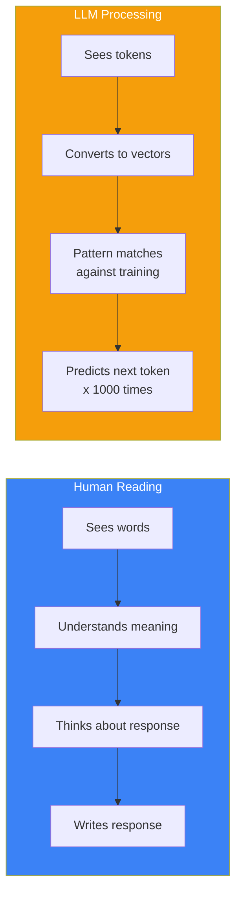
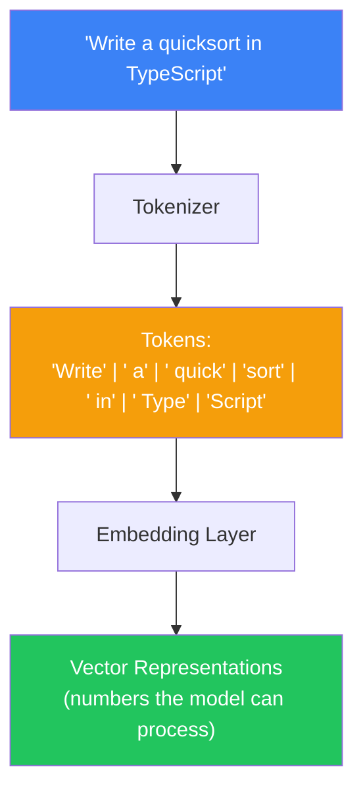
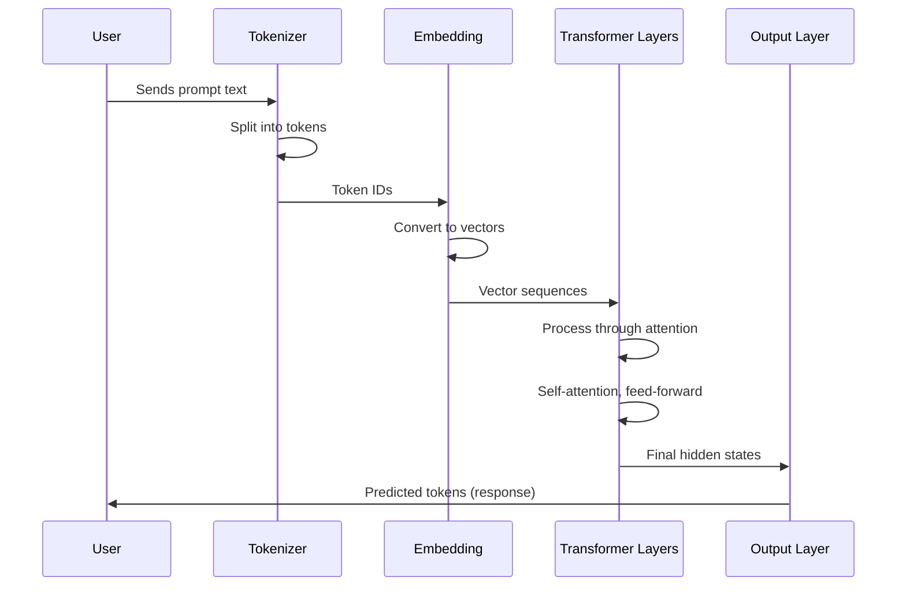
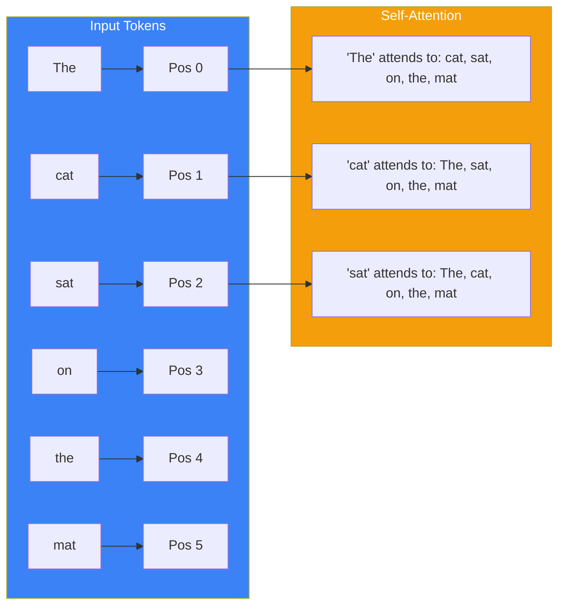
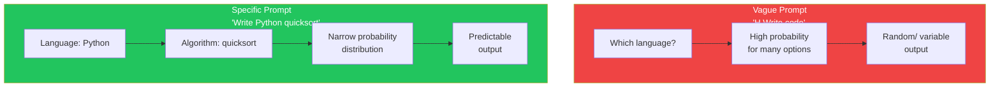

## Introduction

> **An LLM doesn't "read" your prompt like a human. It tokenizes, encodes, and predicts — all in a few milliseconds.**

Understanding how models process prompts is essential for writing better ones. You can't optimize what you don't understand.

---

## Why This Concept Exists

### The Story

You type a sentence. The model responds. It feels like magic — like the AI understands you.

But the model doesn't understand anything. It's a statistical pattern matcher that predicts the next token based on everything it learned during training.

When you understand *how* it processes your prompt, you stop writing prompts for humans and start writing prompts for LLMs.



---

## Real-World Analogy

### The Autocomplete on Steroids

You've used phone autocomplete:

```
"Let's meet for → lunch | coffee | dinner"
```

An LLM is the same idea, scaled to 175 billion parameters and trained on the entire internet.

Your prompt sets the context. The model predicts the most likely continuation.

> **Prompt engineering is steering this probability distribution toward your desired outcome.**

---

## Tokenization: The First Step

Every prompt is broken into **tokens** — chunks of text that the model processes.



| Tokenizer | Example Tokenization |
|-----------|---------------------|
| **GPT-4** | "Hello, world!" → `["Hello", ",", " world", "!"]` |
| **Claude** | "Hello, world!" → `["Hello", ",", " world", "!"]` |
| **Gemini** | "Hello, world!" → `["Hello", ",", " world", "!"]` |

**Key insight:** A token is NOT a word. "TypeScript" might be `["Type", "Script"]` or `["TypeScript"]` depending on the tokenizer. This affects how the model understands your prompt.

### Token Count Matters

| Prompt | Approx Tokens | Cost Factor |
|--------|--------------|-------------|
| "Hello" | 1 | 1x |
| "Write a function that sorts an array" | 7 | 7x |
| This entire document | ~500 | 500x |
| A full codebase as context | ~50,000 | 50,000x |

---

## The Processing Pipeline



### Step 1: Tokenize

The prompt is split into tokens based on the model's vocabulary.

### Step 2: Embed

Each token is converted to a high-dimensional vector (typically 4096 to 12288 dimensions).

### Step 3: Process Through Layers

The vectors pass through transformer layers, each applying self-attention and feed-forward computation.

### Step 4: Generate

The model predicts the most likely next token, one at a time, until complete.

---

## What the Model "Sees"

### Words Become Numbers

```
"cat" → [0.23, -0.45, 0.67, ..., 0.12]  (a vector in 4096-dimensional space)
"dog" → [0.21, -0.42, 0.65, ..., 0.15]  (similar vector — similar meaning)
"car" → [-0.31, 0.52, -0.71, ..., 0.08]  (different vector — different meaning)
```

### Position Matters

The model doesn't read left-to-right like humans. It processes all tokens simultaneously through attention, but uses **positional encoding** to understand order.



---

## How Instructions Work

The model processes your instruction as part of the sequence:

```
System: You are a helpful coding assistant.
User: Write a binary search function in Python.
```

The model sees this as one continuous sequence. The "System" tag tells the model this is a high-level instruction. The "User" tag signals a specific request.

### Why Wording Matters

```
❌ "Sort this array" → Model might: explain sorting, ask questions, show multiple algorithms
✅ "Sort this array using quicksort in Python with O(n log n) and return the result" → Model does exactly that
```

The difference? The second prompt constrains the probability space. The model has fewer "valid" continuations to choose from.



---

## Real-World Examples

### Example 1: Ambiguous vs Precise

```
❌ "Explain promises"
   → Model might explain: JavaScript promises, Promise theory, political promises

✅ "Explain JavaScript Promises to a beginner who knows callbacks
   → Model knows: topic (JavaScript), audience (beginner), prerequisite (callbacks)
```

### Example 2: Missing Constraints

```
❌ "Write a function to find duplicates in an array"
   → Returns: could be O(n²) with nested loops

✅ "Write a function to find duplicates in an array. Time: O(n), Space: O(n).
   Input: [1,2,3,2,4,1], Output: [1,2]"
   → Returns: optimized hash map solution
```

### Example 3: Format Matters

```
❌ "List 5 sorting algorithms"
   → Could return: paragraph, bullet list, numbered list, or table

✅ "List 5 sorting algorithms in a markdown table with columns:
   | Algorithm | Time Complexity | Space Complexity | Stable |"
   → Returns: exactly the table you wanted
```

---

## Common Mistakes

| Mistake | Why It's Wrong |
|---------|----------------|
| ❌ Writing prompts like Google searches | LLMs need full instructions, not keywords |
| ❌ Assuming the model remembers earlier turns | Context windows are limited — important info must be in recent context |
| ❌ Using ambiguous pronouns | "Fix it" — fix what? Be specific about what needs attention |
| ❌ Not specifying the audience | "Explain closures" to a beginner vs a senior engineer are completely different responses |
| ❌ Mixing instructions with data | Keep instructions separate from the data you want processed |

---

## Bad Prompt vs Good Prompt

| Aspect | Bad Prompt | Good Prompt |
|--------|------------|-------------|
| **Clarity** | "make it better" | "Refactor this code to use async/await instead of .then() chains" |
| **Context** | None | "Here's the current implementation: [code]. The function should handle network timeouts." |
| **Format** | Unspecified | "Return the refactored code in a code block with a brief explanation below" |
| **Constraints** | None | "Preserve the existing API interface. Don't change function signatures." |

---

## Production Examples

### Cursor AI

Cursor sends your open file, cursor position, selection, and relevant context files as tokens. The prompt engineering is in how this context is structured — what's included, what's excluded, and how it's formatted.

### GitHub Copilot

Copilot uses the current file and surrounding code as implicit context. The "prompt" is the comment above your cursor plus the code before it.

### Perplexity

Perplexity constructs a prompt that includes: search query → search results → user's question → citation formatting instructions. The model sees all of this as one coherent prompt.

---

## Interview Questions

### Easy

**Q: What is tokenization in the context of LLMs?**

> Tokenization is the process of splitting text into smaller pieces (tokens) that the model can process. Tokens are not words — they can be parts of words, punctuation, or spaces. Different models use different tokenizers.

### Intermediate

**Q: How does an LLM "understand" the order of words in a prompt?**

> LLMs use positional encoding to understand token order. Each token position is encoded as a vector that's added to the token embedding. Self-attention then allows each token to "attend" to other tokens based on their relevance, regardless of distance.

### Senior

**Q: Why does the same prompt produce different outputs across different LLMs?**

> Different models have different training data, architectures, parameter counts, tokenizers, and decoding strategies. A prompt optimized for GPT-4 may not work well for Claude or Gemini because they learned different patterns during training. This is why prompt engineering must be model-specific.

---

## Summary

| Concept | Key Point |
|---------|-----------|
| **Tokenization** | Prompts are split into tokens, not words |
| **Embedding** | Tokens become vectors in high-dimensional space |
| **Processing** | Transformer layers apply self-attention |
| **Generation** | Model predicts the most likely next token |
| **Key Insight** | You're not talking to a human — you're steering a probability distribution |

---

## Navigation

**Previous:** [01 — What is Prompt Engineering? →](./01-what-is-prompt-engineering)

**Next:** [03 — Prompt Anatomy →](./03-prompt-anatomy)
