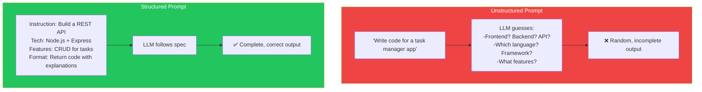
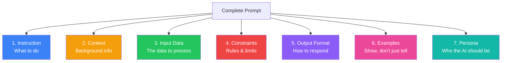
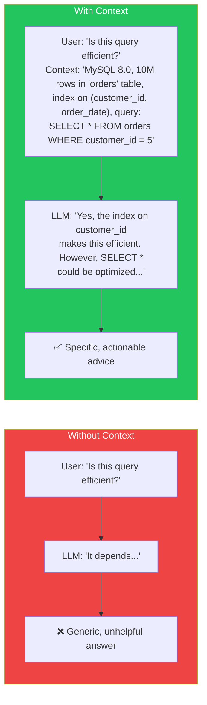
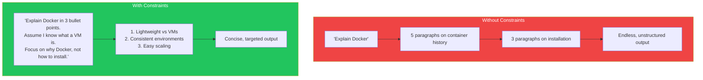
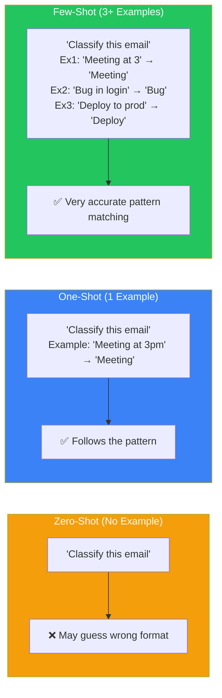

## Introduction

> **Every prompt is a mini-specification. Like a well-written technical spec, it has distinct sections that work together to produce the desired result.**

Understanding prompt anatomy lets you diagnose failures, optimize performance, and build reusable prompt templates.

---

## Why This Concept Exists

### The Story

A junior developer writes a single sentence and hopes for the best. A senior engineer structures their prompt like a PRD — with clear sections, examples, and acceptance criteria.

The difference isn't luck. It's structure.



---

## Real-World Analogy

### A Technical Specification Document

A good prompt is like a good PRD or ticket:

```
Ticket Title: Add user authentication
Description: Users should be able to log in with email/password
Acceptance Criteria:
  - Login form with email + password fields
  - Validation on both fields
  - Error messages for invalid credentials
  - Redirect to dashboard on success
Tech Notes: Use JWT tokens, store in httpOnly cookies
```

When every section is clear, the developer (or LLM) knows exactly what to build.

---

## The 7 Components of Every Prompt



---

## 1. Instruction

The instruction is the verb + object of your prompt. What should the model DO?

| Weak Instruction | Strong Instruction |
|-----------------|-------------------|
| "Look at this code" | "Review this code for security vulnerabilities" |
| "Tell me about databases" | "Compare SQL vs NoSQL for a real-time chat application" |
| "Help with my code" | "Debug this function and explain the root cause" |

**Bad:** "Write something about React"
**Good:** "Write a React custom hook called `useDebounce` that debounces a value by a given delay"

---

## 2. Context

Context is the background information the model needs to generate a relevant response.



| Type of Context | Example |
|-----------------|---------|
| **Technical** | Language, framework, version, constraints |
| **Audience** | Beginner, senior, executive, non-technical |
| **Project** | What's been done, what hasn't, what's next |
| **Environmental** | Production vs development, time/budget limits |

---

## 3. Input Data

The input data is the specific information the model should process.

```
Instruction: Summarize this article
Context: The summary should be 3 sentences for a busy executive
Input Data: [The article text goes here]
```

### How to Structure Input Data

```
❌ Mixed: "Summarize this article about AI written by John Smith on
    March 15th where he talks about transformers and attention
    mechanisms and compares them to CNNs..."

✅ Structured:
    Task: Summarize the following article
    Article: [paste article text]
    Requirements: 3 sentences, focus on key findings, avoid technical jargon
```

---

## 4. Constraints

Constraints define the boundaries of the response. They prevent the model from going off-track.



| Constraint | Example |
|------------|---------|
| **Length** | "3 sentences max", "under 200 tokens" |
| **Format** | "JSON", "HTML", "Markdown table" |
| **Scope** | "Only the database layer, not the API" |
| **Exclusions** | "Don't mention Docker Compose" |
| **Tone** | "Professional", "Beginner-friendly", "Technical" |

---

## 5. Output Format

Specifying the output format is one of the most powerful prompt engineering techniques.

```
❌ "List the top 5 features of React 19"
   → Might return: paragraph, bullet list, numbered list, or random format

✅ "List the top 5 features of React 19 in this exact format:
   | # | Feature | Description | Impact |
   |---|---------|-------------|--------|
   | 1 | [name]  | [1 sentence] | [high/med] |"
   → Returns: the exact table you requested
```

### Common Output Formats

| Format | Use Case | Example |
|--------|----------|---------|
| **JSON** | Machine parsing, API responses | `{"features": [{"name": "..."}]}` |
| **Markdown** | Readable docs, READMEs | Tables, code blocks, headings |
| **HTML** | Web content, emails | `<div class="feature">...</div>` |
| **XML** | Structured data, legacy systems | `<feature><name>...</name></feature>` |
| **CSV** | Spreadsheets, data analysis | `name,description,impact` |
| **YAML** | Config files, frontmatter | `features: - name: ...` |

---

## 6. Examples (Few-Shot)

Examples show the model what you want, rather than just telling it.



---

## 7. Persona

The persona tells the model WHO it should be when responding.

```
❌ "Explain microservices"
   → Could be: academic, tutorial, pros-and-cons, or sales pitch

✅ "You are a Staff Engineer at Netflix with 15 years of experience
    building microservices. Explain microservices to a junior developer
    on your team who needs to understand the trade-offs."
   → Response will be: practical, trade-off aware, from-experience
```

| Persona | Effect on Output |
|---------|-----------------|
| "You are a senior engineer" | Technical depth, practical advice |
| "You are a teacher" | Clear explanations, examples |
| "You are a product manager" | Business focus, user impact |
| "You are a security expert" | Security-first thinking, vulnerabilities |

---

## Putting It All Together

### Complete Prompt Template

```
Persona: [Who the AI should be]
Context: [Background information]
Task: [Specific instruction]
Constraints:
  - [Rule 1]
  - [Rule 2]
Input Data:
[The data to process]
Output Format:
[Desired format with example if possible]
```

### Example: Full Structured Prompt

```
Persona: You are a Senior DevOps Engineer
Context: We're migrating a Node.js app from Heroku to AWS ECS
Task: Create a Dockerfile for the app
Constraints:
  - Use Node.js 20 Alpine as base
  - Multi-stage build for smaller image size
  - Include healthcheck
  - Don't expose ports (handled by ECS)
  - Optimize for production, not development
Output Format:
  Provide the Dockerfile in a code block, followed by a brief
  explanation of each stage and why specific choices were made.
```

---

## Common Mistakes

| Mistake | Why It's Wrong |
|---------|----------------|
| ❌ Only providing the instruction | Missing context, format, or constraints leads to unpredictable output |
| ❌ Mixing instruction with data | The model may treat your instruction as data or vice versa |
| ❌ Putting the most important instruction last | Models tend to pay more attention to recent content — put key instructions at the beginning AND end |
| ❌ Forgetting to specify what NOT to do | Negative constraints ("don't use jargon") are as important as positive ones |
| ❌ Using different formatting inconsistently | If you start with bullet points, keep using them — consistency helps the model follow patterns |

---

## Bad Prompt vs Good Prompt

| Component | Bad Prompt | Good Prompt |
|-----------|------------|-------------|
| **Instruction** | "Help with code" | "Debug this TypeScript function" |
| **Context** | None | "Using Node.js 20, Express 4, TypeScript 5" |
| **Input** | Vague description | Exact code block with error message |
| **Constraints** | None | "Don't change the function signature. Only fix the logic." |
| **Format** | Unspecified | "Show the fixed code in a code block, then explain what was wrong" |
| **Examples** | None | "For example, input [1,2,3] should output 6" |
| **Persona** | None | "You are a senior backend engineer reviewing a PR" |

---

## Production Examples

### OpenAI API

The Chat Completions API uses structured roles:

```json
[
  {"role": "system", "content": "You are a helpful coding assistant."},
  {"role": "user", "content": "Write a Python function to..."}
]
```

Each role is a prompt anatomy component — system (persona + constraints), user (instruction + input).

### Anthropic API

Anthropic's messages format:

```json
[
  {"role": "user", "content": "I'll provide context first, then my question."},
  {"role": "assistant", "content": "I understand. Go ahead."},
  {"role": "user", "content": "Context: [data]. Question: [question]"}
]
```

The conversation history itself becomes part of the prompt anatomy.

---

## Interview Questions

### Easy

**Q: What are the essential components of a well-structured prompt?**

> Instruction (what to do), context (background info), input data (what to process), constraints (rules), output format (how to respond), examples (if needed), and persona (who the AI should be).

### Intermediate

**Q: How does specifying an output format improve LLM responses?**

> It constrains the model's output space, reducing randomness and ensuring the response is immediately usable. Structured formats like JSON are especially important for programmatic consumption and validation.

### Senior

**Q: How would you structure a prompt for a multi-step data processing pipeline?**

> Each step gets its own prompt with clear instructions. The output format of step N becomes the input data of step N+1. Use structured output (JSON) between steps so the next prompt can reliably parse the previous step's output. Include validation instructions at each step to catch errors early.

---

## Summary

| Component | Purpose | Key Question |
|-----------|---------|--------------|
| **Instruction** | What to do | What action should the model take? |
| **Context** | Background | What does the model need to know? |
| **Input Data** | What to process | What data should the model work with? |
| **Constraints** | Boundaries | What rules must the response follow? |
| **Output Format** | Structure | How should the response look? |
| **Examples** | Demonstration | Can you show what you want? |
| **Persona** | Role | Who should the model be? |

---

## Navigation

**Previous:** [02 — How LLMs Understand Prompts →](./02-how-llms-understand-prompts)

**Next:** [04 — System, User & Assistant Prompts →](./04-system-user-assistant-prompts)
