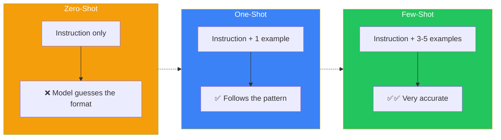
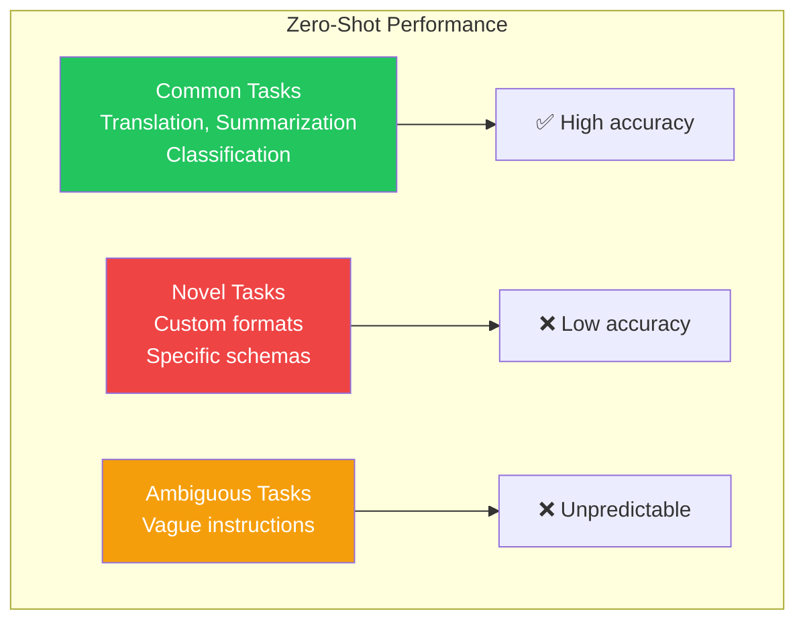
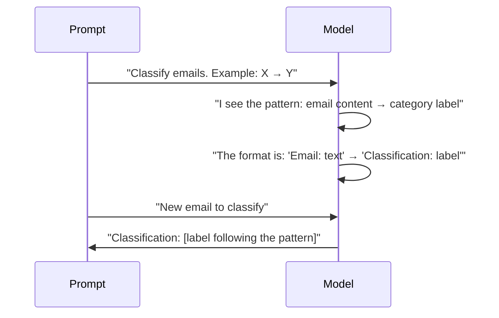
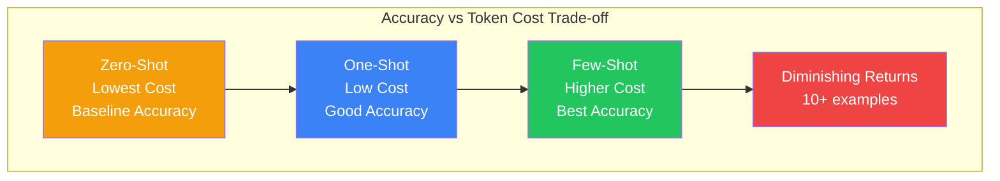
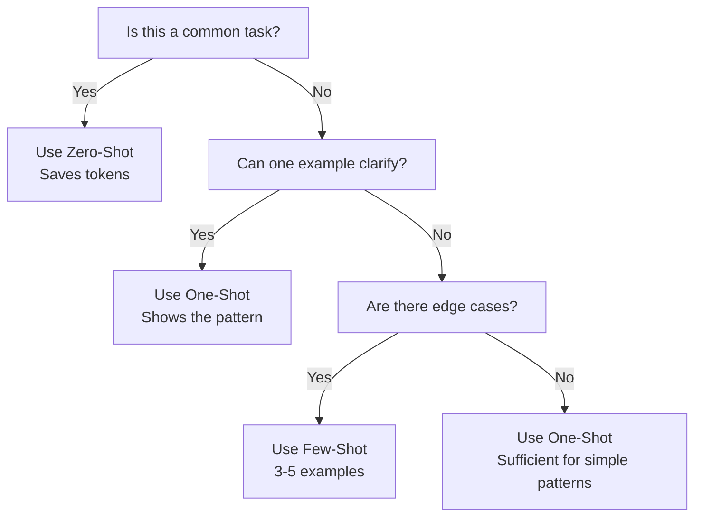
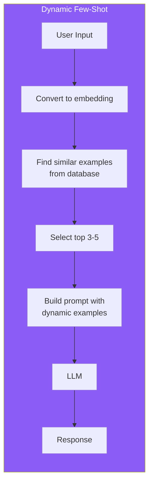

## Introduction

> **The difference between zero-shot, one-shot, and few-shot prompting is simple: how many examples do you give the model before asking it to perform a task?**

More examples = more constrained output = higher accuracy. But examples cost tokens, so the trade-off matters.

---

## Why This Concept Exists

### The Story

You're teaching someone a new format for classifying emails.

**Zero-shot:** "Classify this email." → They guess, and the result is unpredictable.

**One-shot:** "Classify this email. For example, 'Meeting at 3pm' → 'Meeting'." → Better, they follow the pattern.

**Few-shot:** Here are 5 examples of classified emails. Now classify this one. → Much more accurate.

LLMs work the same way. Examples are the most powerful way to show what you want.



---

## Real-World Analogy

### Learning a Dance

**Zero-shot:** "Do the foxtrot." You've never seen it. Good luck.

**One-shot:** "Do the foxtrot. Here's a 5-second clip." You get the basic idea.

**Few-shot:** "Do the foxtrot. Here's a 2-minute tutorial with 10 different moves shown step by step." Now you can actually do it.

> **Examples are the most efficient way to transfer format and style expectations.**

---

## Zero-Shot Prompting

### What It Is

Zero-shot means giving the model a task with **no examples**. The model relies entirely on its training data to figure out what to do.

### When It Works Best

- **Common tasks**: "Translate this to Spanish" (the model has seen translation millions of times)
- **Well-known formats**: "Write a JSON object" (the model knows JSON)
- **Simple instructions**: "Summarize this text" (the model has summarized countless texts)

### Examples

```
✅ Good Zero-Shot:
"Translate the following English text to French:
'Hello, how are you?'"

✅ Good Zero-Shot:
"Classify this sentiment as positive, negative, or neutral:
'The product arrived broken and customer service was unhelpful.'"
```

### When It Fails

- **Novel formats**: The model hasn't seen your specific format before
- **Ambiguous tasks**: "Classify this" without specifying labels
- **Specific styles**: "Write in the style of..." without examples



---

## One-Shot Prompting

### What It Is

One-shot means giving the model **one example** before the actual task.

### When to Use

- **Introducing a format**: The model needs to see the pattern once
- **Setting a style**: One example establishes tone, length, and structure
- **Disambiguating**: When the task could be interpreted multiple ways

### Examples

```
Task: Classify emails as 'Meeting', 'Task', 'Update', or 'Other'

Example:
Email: "Team standup at 10am tomorrow"
Classification: Meeting

Now classify:
Email: "The deployment is scheduled for Friday at 2pm"
Classification:
```

### Why One-Shot Works



---

## Few-Shot Prompting

### What It Is

Few-shot means giving the model **multiple examples** (typically 3-5) before the actual task.

### When to Use

- **Complex formats**: When the output needs to follow a specific template
- **Edge cases**: Show the model how to handle tricky situations
- **Consistency**: Multiple examples establish a stronger pattern
- **Rare tasks**: When the model hasn't seen many examples during training

### Examples

```
Classify the intent of each customer message.

Message: "I want to cancel my subscription"
Intent: Cancellation

Message: "Where is my order?"
Intent: Tracking

Message: "I was charged twice for the same order"
Intent: Billing Issue

Message: "Your product is amazing!"
Intent: Positive Feedback

Now classify:
Message: "I need to update my shipping address"
Intent:
```

### How Many Examples?

| Examples | Accuracy | Token Cost | Best For |
|----------|----------|------------|----------|
| 0 | Baseline | Lowest | Well-known tasks |
| 1 | Good | Low | Simple format introduction |
| 3 | Better | Medium | Most tasks |
| 5 | Best | Higher | Complex, edge-case-rich tasks |
| 10+ | Marginal gain | High | Only if patterns are very nuanced |

---

## Comparison Table

| Aspect | Zero-Shot | One-Shot | Few-Shot |
|--------|-----------|----------|----------|
| **Examples** | 0 | 1 | 3-5 |
| **Accuracy** | Baseline | Good | Best |
| **Token Cost** | Lowest | Low | Medium |
| **Best For** | Common tasks | Format introduction | Complex patterns |
| **Worst For** | Novel formats | Highly variable outputs | Fixed patterns needed |
| **Flexibility** | Most flexible | Moderate | Least flexible |



---

## When to Use Each

### Decision Tree



### Practical Guidelines

| Scenario | Recommended Approach |
|----------|---------------------|
| Translation between common languages | Zero-shot |
| Summarization | Zero-shot or one-shot |
| JSON output with specific schema | One-shot (show the schema) |
| Classification with custom labels | Few-shot (show all labels) |
| Code generation with specific style | Few-shot (show style examples) |
| Complex multi-step extraction | Few-shot with edge cases |
| Data transformation (format A → format B) | Few-shot (show both formats) |

---

## Advanced: Dynamic Few-Shot

In production, you can dynamically select the best examples for each input:



This is the foundation of **Retrieval-Augmented Generation (RAG)**, covered in Phase 6.

---

## Real-World Examples

### Example 1: Entity Extraction

```
Zero-Shot: "Extract the date, amount, and vendor from this invoice"
→ Model might guess the format, get it partially wrong

Few-Shot:
Extract entities from invoice text.

Invoice: "Invoice #1234 from Acme Corp dated Jan 15, 2024 for $1,500"
Entities:
  - vendor: Acme Corp
  - date: 2024-01-15
  - amount: 1500
  - currency: USD

Invoice: "Receipt from WeWork - Monthly membership $299 - Feb 1 2024"
Entities:
  - vendor: WeWork
  - date: 2024-02-01
  - amount: 299
  - currency: USD

Now extract:
Invoice: "Payment of $89.99 to Netflix on March 5, 2024"
Entities:
→ Much more accurate
```

### Example 2: Code Generation Style

```
Zero-Shot: "Write a function to fetch data"
→ Could be any style, any language, any error handling

Few-Shot:
Generate TypeScript functions with error handling and JSDoc.

/**
 * Fetches a user by their ID
 * @param userId - The user's unique identifier
 * @returns The user object or null if not found
 */
async function getUser(userId: string): Promise<User | null> {
  try {
    const response = await fetch(`/api/users/${userId}`);
    if (!response.ok) return null;
    return await response.json();
  } catch (error) {
    console.error('Failed to fetch user:', error);
    return null;
  }
}

Now generate a function to fetch a product by SKU:
→ Follows the same pattern
```

---

## Common Mistakes

| Mistake | Why It's Wrong |
|---------|----------------|
| ❌ Too many examples | Wastes tokens after 5-7 examples (diminishing returns) |
| ❌ Examples that don't match the actual task | Confuses the model — examples must be representative |
| ❌ Inconsistent format in examples | The model will follow the inconsistency |
| ❌ Not covering edge cases | Model doesn't know how to handle unusual inputs |
| ❌ Zero-shot for complex extraction | The model needs to see the exact format you want |

---

## Bad Prompt vs Good Prompt

| Aspect | Bad | Good |
|--------|-----|------|
| **Zero-Shot** | "Extract data from this email" | "Extract the sender, subject, date, and action items from this email as JSON" |
| **One-Shot** | "Do sentiment analysis. Example: good → positive" | "Classify sentiment as Positive/Negative/Neutral. Example: 'I love this!' → Positive" |
| **Few-Shot** | Inconsistent examples with varying formats | Consistent examples with the exact format you want returned |
| **Edge Cases** | Not shown | Include a tricky example (mixed sentiment, sarcasm, etc.) |

---

## Production Examples

### Perplexity

Perplexity uses few-shot prompting to format search results with citations:

```
Example 1: "What is Python?" → [result summary] [source]
Example 2: "How does DNS work?" → [result summary] [source]
Now: [user question] → [result summary] [source]
```

### GitHub Copilot

Copilot uses the surrounding code as implicit few-shot examples. If you've been writing TypeScript with async/await, it will suggest async/await patterns.

---

## Interview Questions

### Easy

**Q: What is the difference between zero-shot and few-shot prompting?**

> Zero-shot gives the model only instructions with no examples. Few-shot provides 3-5 examples of the desired input/output format. Few-shot is more accurate but costs more tokens.

### Intermediate

**Q: When would you use one-shot instead of few-shot?**

> One-shot is sufficient when the task is simple and one example clearly establishes the pattern. Use it when you want to save tokens but zero-shot is too unreliable. Tasks like format introduction or simple classification often need just one example.

### Senior

**Q: How would you implement dynamic few-shot selection in a production system?**

> I'd store examples with embeddings in a vector database. When a new request comes in, I'd embed it and find the most similar examples using cosine similarity. The retrieved examples are then used as few-shots. This ensures the most relevant examples are always used, improving accuracy while keeping the example count low.

---

## Summary

| Approach | Examples | Token Cost | Accuracy | Best For |
|----------|----------|------------|----------|----------|
| **Zero-Shot** | 0 | Lowest | Baseline | Common, well-defined tasks |
| **One-Shot** | 1 | Low | Good | Simple format introduction |
| **Few-Shot** | 3-5 | Medium | Best | Complex patterns, custom formats |
| **Dynamic Few-Shot** | Variable | Medium+ | Excellent | Production systems with diverse inputs |

---

## Navigation

**Previous:** [04 — System, User & Assistant Prompts →](./04-system-user-assistant-prompts)

**Next:** [06 — Role & Persona Prompting →](./06-role-persona-prompting)
