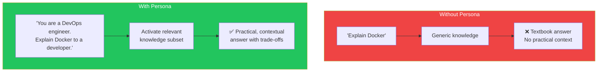
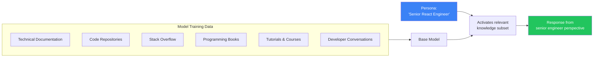
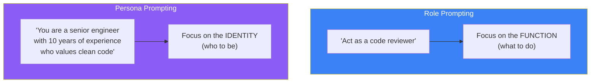
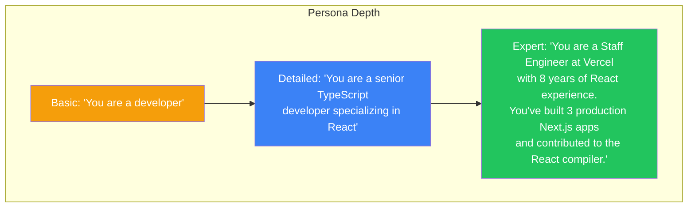

## Introduction

> **"You are a senior software engineer." Seven words that can completely transform an LLM's output.**

Role prompting is one of the most powerful and least expensive techniques in prompt engineering. It costs zero extra tokens but can dramatically improve response quality.

---

## Why This Concept Exists

### The Story

Ask the same question with and without a persona:

```
Without Persona:
"Explain microservices"
→ Generic, textbook-style explanation

With Persona:
"You are a Staff Engineer at Netflix. Explain microservices to a junior developer."
→ Practical, experience-based, trade-off aware, with real-world examples
```

The model has been trained on countless examples of how different roles communicate. Assigning a persona activates the most relevant subset of its training.



---

## Real-World Analogy

### The Specialist vs Generalist

Ask a generalist: "What's the best way to store data?" → "It depends on your needs."

Ask a DBA: "What's the best way to store data for a financial application?" → "Use PostgreSQL with proper indexing, ACID compliance, and regular backups. Here's why..."

The specialist has context and experience. Role prompting gives the LLM a specialist's context.

> **Every model response is an average of all the things it's been trained on. A persona filters that average to the most relevant subset.**

---

## How Role Prompting Works



---

## Types of Personas

### Technical Roles

| Persona | Effect |
|---------|--------|
| "Senior Software Engineer" | Focus on code quality, architecture, trade-offs |
| "DevOps Engineer" | Focus on deployment, scaling, reliability |
| "Database Administrator" | Focus on performance, indexing, data integrity |
| "Security Engineer" | Focus on vulnerabilities, best practices, threats |
| "Frontend Specialist" | Focus on UX, performance, browser compatibility |
| "Data Scientist" | Focus on statistics, model accuracy, data pipelines |

### Non-Technical Roles

| Persona | Effect |
|---------|--------|
| "Product Manager" | Focus on user value, priorities, roadmap |
| "CEO" | Focus on business impact, ROI, strategy |
| "Technical Writer" | Focus on clarity, documentation, structure |
| "Teacher" | Focus on explanations, examples, learning path |
| "Legal Expert" | Focus on compliance, risk, contracts |

### Communication Style Personas

| Persona | Effect |
|---------|--------|
| "Explain like I'm 5" | Extremely simple analogies |
| "Explain to a senior engineer" | Technical depth, assumes background |
| "You are concise" | Short, direct responses |
| "You are thorough" | Comprehensive, detailed responses |

---

## Persona Prompting Patterns

### Pattern 1: Simple Persona

```
You are a [ROLE].
[Task]
```

**Example:**
```
You are a senior Python developer.
Review this code for performance issues.
```

### Pattern 2: Persona + Context

```
You are a [ROLE] at [COMPANY] with [EXPERIENCE].
[Task] for [AUDIENCE].
```

**Example:**
```
You are a Staff Engineer at AWS with 10 years of experience in cloud architecture.
Design a disaster recovery strategy for a startup that can't afford multi-region deployment.
```

### Pattern 3: Compound Persona

```
You are a [ROLE 1] who also has experience in [ROLE 2].
[Task]
```

**Example:**
```
You are a backend engineer who also has strong UX design sensibilities.
Design the API response format for a search endpoint that frontend developers will love using.
```

---

## Persona vs Role Prompting

While often used interchangeably, there's a subtle difference:



| Approach | Example | Best For |
|----------|---------|----------|
| **Role** | "Act as a code reviewer" | Defining the function |
| **Persona** | "You are a senior engineer at Google" | Establishing depth and credibility |
| **Combined** | "You are a senior engineer at Google acting as a code reviewer" | Both function and identity |

---

## The Persona Pyramid



**Rule of thumb:** Specificity improves quality — but only up to a point. A paragraph of persona is usually enough. A page of persona dilutes the instruction.

---

## Real-World Examples

### Example 1: Code Review

```
❌ Without Persona:
"Review this code."
→ "Looks good. Consider adding error handling."

✅ With Persona:
"You are a Principal Engineer at Google reviewing a junior developer's PR.
Your team values readability and testability over clever optimizations.
Review this code."
→ Specific, actionable feedback with priority ordering and teaching moments
```

### Example 2: Architecture Design

```
❌ Without Persona:
"Design a chat application."
→ High-level, generic architecture

✅ With Persona:
"You are a Staff Engineer at WhatsApp with experience scaling
real-time messaging to billions of users. Design a chat application
architecture that can handle 10 million daily active users."
→ Specific technology choices, scaling considerations, trade-off analysis
```

### Example 3: Documentation

```
❌ Without Persona:
"Write API documentation."
→ Basic, might miss important sections

✅ With Persona:
"You are a technical writer at Stripe. Write API documentation
for our new payment endpoint. Include request/response examples,
error codes, and a quickstart guide."
→ Professional, complete, user-focused documentation
```

---

## Common Mistakes

| Mistake | Why It's Wrong |
|---------|----------------|
| ❌ Persona without task | "You are a senior engineer" with no instruction just produces generic output |
| ❌ Conflicting personas | "You are both a strict teacher and a friendly peer" — the model gets confused |
| ❌ Overly specific personas | "You are a senior engineer at Google who worked on Google Search from 2010-2015 and then moved to Google Cloud..." — this wastes tokens and adds little value |
| ❌ Assuming the persona persists | In long conversations, the persona can drift — reinforce it periodically |
| ❌ Using personas for factual tasks | Persona doesn't make the model more factual — use it for style and perspective |

---

## Bad Prompt vs Good Prompt

| Aspect | Bad Persona | Good Persona |
|--------|-------------|--------------|
| **Vagueness** | "You are an expert" (too generic) | "You are a Staff Engineer specializing in distributed systems" |
| **No context** | "You are a developer" (trillions of training examples) | "You are a backend developer at a fintech startup" |
| **No audience** | Just the role | "Explain to a junior developer / CTO / yourself 6 months ago" |
| **No constraints** | Just the persona | "You are a security engineer. Assume the reader knows basic networking." |

---

## Production Examples

### ChatGPT Custom Instructions

ChatGPT lets you set persistent persona:

```
What would you like ChatGPT to know about you to provide better responses?
→ "I'm a senior software engineer who prefers concise answers with code examples.
   I work primarily with TypeScript and React."
```

### Claude Projects

Claude Projects allow project-level persona:

```
Project Instructions:
"You are a documentation specialist. Write for developers with intermediate
experience. Include code examples for every API function. Use American English."
```

### Customer Support Bots

Production support bots use persona to maintain consistent tone:

```
System: You are a customer support agent for Acme Corp.
You are empathetic, solution-focused, and never blame the customer.
You have access to the knowledge base below. If you can't find an answer,
offer to escalate to a human agent.
```

---

## Interview Questions

### Easy

**Q: What is role prompting and why does it work?**

> Role prompting assigns a persona or role to the AI, like "You are a senior engineer." It works because the model was trained on examples of how different roles communicate, so the persona activates the most relevant subset of its knowledge.

### Intermediate

**Q: What's the difference between role prompting and persona prompting?**

> Role prompting defines the function ("act as a code reviewer"), while persona prompting defines the identity ("you are a senior engineer at Google"). They're often combined: the persona sets the experience level and perspective, while the role defines what to do.

### Senior

**Q: When would a persona hurt response quality instead of helping?**

> When the persona conflicts with the task (e.g., "You are a poet" for a technical explanation), when it adds irrelevant context that dilutes the instruction, or when it introduces bias (e.g., "You are a senior engineer who hates JavaScript" for a task involving JavaScript). Personas should always serve the task, not distract from it.

---

## Summary

| Concept | Key Point |
|---------|-----------|
| **Role Prompting** | Defines what function the AI should perform |
| **Persona Prompting** | Defines who the AI should be |
| **Why It Works** | Activates relevant training data subsets |
| **Best Practice** | Be specific but concise — 1-2 sentences is usually enough |
| **Common Mistake** | Over-personalizing at the expense of clear instructions |

---

## Navigation

**Previous:** [05 — Zero-Shot, One-Shot & Few-Shot Prompting →](./05-zero-shot-one-shot-few-shot)

**Next:** [07 — Context Engineering →](./07-context-engineering)
