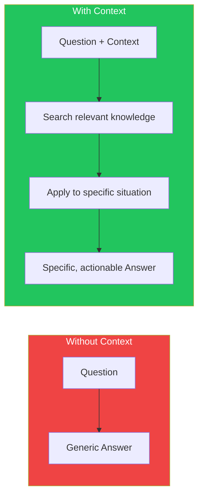
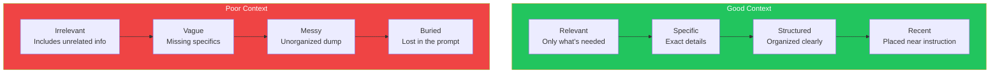
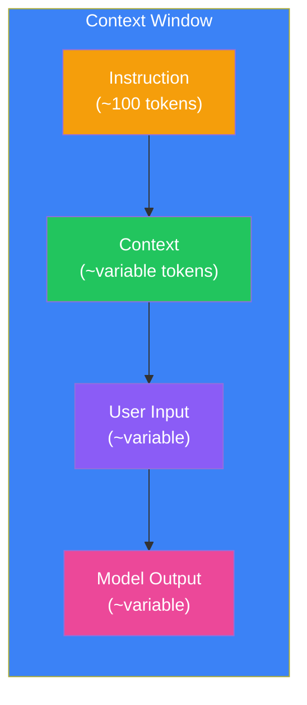
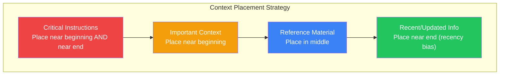
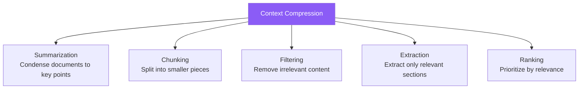
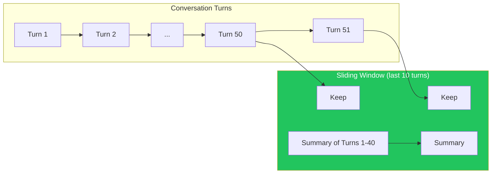

## Introduction

> **Context is everything in prompt engineering. The same instruction with different context produces completely different results.**

Context engineering is the practice of selecting, structuring, and managing the information you provide to the LLM alongside your instruction.

---

## Why This Concept Exists

### The Story

Two developers ask the same question:

```
Developer A: "Is this query efficient?"
→ "It depends on your schema, indexes, and data size..."

Developer B: "Is this query efficient?
   Context: MySQL 8.0, 10 million rows in 'orders' table,
   index on (customer_id, order_date).
   Query: SELECT * FROM orders WHERE customer_id = 5"
→ "Yes, the index makes this efficient. However, SELECT *
   reads all columns. Consider selecting only needed columns."
```

The difference is context. Developer B gave the model enough information to give a specific, useful answer.



---

## Real-World Analogy

### The Consultant

You hire a consultant. You can either:

1. Say nothing — they give you generic advice based on assumptions
2. Give them your company's financials, team structure, customer data, and goals — they give you tailored, actionable recommendations

The consultant is equally smart in both cases. The difference is the information you provided.

> **Context is how you make a general-purpose model specific to your situation.**

---

## Good Context vs Poor Context



| Good Context | Poor Context |
|--------------|--------------|
| "The function receives a `userId: string` parameter" | "There's this function" |
| "We use React 18 with TypeScript 5.0" | "We use some frontend framework" |
| "The error occurs when token expires after 1 hour" | "It breaks sometimes" |
| Relevant code snippet (10-30 lines) | Entire file (500+ lines) |

---

## Context Windows

Every LLM has a **context window** — the maximum amount of text it can process in a single request.



| Model | Context Window | ~Pages of Text |
|-------|---------------|----------------|
| GPT-4 | 128K tokens | ~200 pages |
| GPT-4 Turbo | 128K tokens | ~200 pages |
| Claude 3.5 Sonnet | 200K tokens | ~300 pages |
| Gemini 1.5 Pro | 1M tokens | ~1,500 pages |
| Llama 3 | 8K-128K tokens | ~12-200 pages |

### Context Window Management

```
Total Context = System Prompt + Conversation History + User Input + Context Documents + Expected Output

Example:
System Prompt: 500 tokens
Conversation: 2,000 tokens (4 turns)
User Input: 200 tokens
Context Documents: 10,000 tokens
Expected Output: 500 tokens
──────────────────────────────────────
Total: 13,200 tokens (well within 128K limit)
```

---

## Context Placement

### Where Context Goes Matters



### The U-Shape Effect

Models tend to remember information from the **beginning** and **end** of the context better than the middle.

```
High Retention ────┐                  ┌──── High Retention
                   │                  │
                   ▼                  ▼
              [Beginning] [Middle] [End]
                   │                  ▲
                   └──────────────────┘
                    Low retention here
```

**Practical application:** Put your most critical instructions at the start AND end of the prompt. Put reference material (which the model can dip into as needed) in the middle.

---

## Context Compression

When you have more context than fits in the window, you need compression.

### Techniques



| Technique | When to Use | Example |
|-----------|-------------|---------|
| **Summarization** | Full document is too long | 100-page PDF → 2-page summary |
| **Chunking** | Need to search within documents | Split 500-page manual into 50 chunks |
| **Filtering** | Contains irrelevant sections | Remove code comments, UI strings |
| **Extraction** | Only need specific data | Extract only pricing tables from a document |
| **Ranking** | Multiple documents with varying relevance | Show top 5 most relevant search results |

---

## Context Management Patterns

### Pattern 1: Sliding Window

For long conversations, keep the most recent N turns and summarize older ones.



### Pattern 2: Structured Context

Organize context into clear sections:

```
CONTEXT:
── PROJECT ──
Name: [project name]
Stack: [tech stack]
Stage: [development stage]

── CURRENT TASK ──
Branch: [git branch]
Files Changed: [list of files]
PR Description: [summary]

── RELEVANT CODE ──
[code snippets]

── CONSTRAINTS ──
[deadlines, requirements, limitations]
```

### Pattern 3: Context Refreshing

In long sessions, periodically re-state critical context:

```
Turn 1: "You are a senior engineer. Here's the full context..."
Turn 10: "Remember, you're a senior engineer. The project uses TypeScript."
Turn 20: "Quick reminder: this is a production system. Performance is critical."
```

---

## Real-World Examples

### Example 1: Code Review with Context

```
❌ Without Context:
"Review this pull request."
→ Generic feedback, might miss project-specific concerns

✅ With Context:
"Review this pull request.
Context:
- Project: Real-time chat application
- Stack: Node.js, Socket.io, Redis, TypeScript
- PR Size: 3 files changed, 120 additions
- Concern: We've been having memory leak issues in production
- Team Convention: Every function must have unit tests

[PR Code Here]"
→ Focused review that considers project context and known issues
```

### Example 2: Technical Support

```
❌ Without Context:
"My app is slow. What should I do?"
→ 20 generic optimization suggestions

✅ With Context:
"My app is slow.
Context:
- Hosted on: AWS t2.micro (1 vCPU, 1GB RAM)
- Stack: Node.js, Express, MongoDB
- Issue: Response time increased from 200ms to 2s after deploying last update
- Last change: Added image processing endpoint
- Traffic: ~100 req/s during peak

What should I do?"
→ Specific diagnosis: the image processing is likely overwhelming your small instance
```

---

## Common Mistakes

| Mistake | Why It's Wrong |
|---------|----------------|
| ❌ Context dump | Including everything "just in case" dilutes the signal and wastes tokens |
| ❌ Missing critical context | Omitting the one piece of information the model needs to answer correctly |
| ❌ Outdated context | Providing information that's no longer accurate — the model will use it |
| ❌ Unorganized context | A wall of text is harder for the model to parse than structured sections |
| ❌ Ignoring context window limits | Truncation can cut off the most important information at the end |

---

## Bad Prompt vs Good Prompt

| Aspect | Bad Context | Good Context |
|--------|-------------|--------------|
| **Relevance** | Everything about the project | Only information relevant to the specific task |
| **Structure** | Wall of text | Clear sections with labels |
| **Timeliness** | Old information | Current state of the project |
| **Volume** | Too much or too little | Just enough — specific without being verbose |
| **Placement** | Random | Critical info at beginning and end, reference in middle |

---

## Production Examples

### Cursor AI

Cursor sends intelligent context — your current file, related files, cursor position, and selection. It doesn't send your entire project.

### GitHub Copilot

Copilot uses the current file as context, plus nearby files that are imported. The prompt is constructed from your code itself — comments, function signatures, and types.

### Perplexity

Perplexity's context engineering is its superpower: it searches the web, retrieves results, and combines them with your question — all within a single context window.

---

## Interview Questions

### Easy

**Q: What is a context window in LLMs?**

> A context window is the maximum amount of text (measured in tokens) that an LLM can process in a single request. It includes the system prompt, conversation history, user input, and the model's response.

### Intermediate

**Q: How does the U-shape effect influence prompt design?**

> Models tend to remember information from the beginning and end of their context better than the middle. Therefore, critical instructions should be placed at the start and end of the prompt, while reference material can go in the middle.

### Senior

**Q: Design a context management strategy for a customer support chatbot that handles long conversations.**

> I'd use a sliding window approach: (1) Keep the system prompt constant, (2) Maintain a running summary of the conversation that gets updated every 5 turns, (3) Keep the last 5-10 raw turns for recent context, (4) Store resolved issues in a separate context field, (5) Use the summary + recent turns as the active context, (6) If the conversation exceeds the window, summarize older parts. This balances detail with context window limits.

---

## Summary

| Concept | Key Point |
|---------|-----------|
| **Context Engineering** | Selecting and structuring information for LLMs |
| **Context Windows** | LLMs have limits on how much they can process at once |
| **U-Shape Effect** | Put important info at the start and end |
| **Compression** | Summarize, chunk, filter when context is limited |
| **Management** | Sliding windows, structured context, periodic refreshing |

---

## Navigation

**Previous:** [06 — Role & Persona Prompting →](./06-role-persona-prompting)

**Next:** [08 — Output Formatting →](./08-output-formatting)
