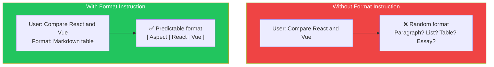
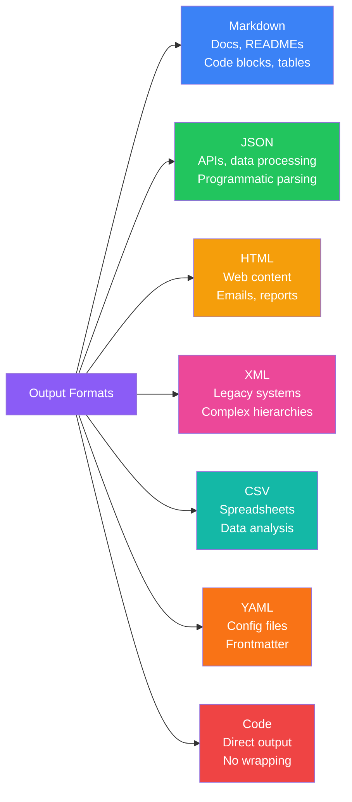
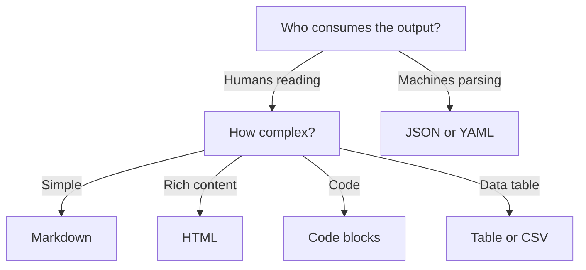

## Introduction

> **Without format instructions, every LLM response is a surprise. With format instructions, every response is exactly what you need.**

Output formatting is one of the highest-leverage prompt engineering techniques — it costs nearly zero tokens but dramatically increases the usability of responses.

---

## Why This Concept Exists

### The Story

You ask: "Compare React and Vue."

Without format instructions, you might get:
- A paragraph
- A bullet list
- A 3-page essay
- A table
- A poetic comparison

You need a specific format because you're going to:
- Display it on a webpage (HTML)
- Parse it programmatically (JSON)
- Include it in a report (Markdown)
- Import it into a spreadsheet (CSV)



---

## Real-World Analogy

### The Form vs Free-Text

If you submit a free-text form, you might get a novel, a few words, or anything in between. If you submit a form with labeled fields, you get exactly what each field asks for.

Output formatting creates the labeled fields for an LLM.

> **A format specification is like a form template — it tells the model exactly where to put each piece of information.**

---

## Common Output Formats



---

## Markdown

### Best For
Documentation, READMEs, formatted text, code examples

### How to Specify

```
Format the response as a markdown document with:
- A level-2 heading for each section
- Code blocks with language tags
- A table at the end for summary
```

### Example Prompt

```
Explain the difference between let, const, and var in JavaScript.
Format your response as a markdown table with columns:
| Feature | let | const | var |
|---------|-----|-------|-----|
| Scope | ... | ... | ... |
| Reassignable | ... | ... | ... |
| Hoisted | ... | ... | ... |
```

### Example Output

| Feature | let | const | var |
|---------|-----|-------|-----|
| Scope | Block | Block | Function |
| Reassignable | Yes | No | Yes |
| Hoisted | Yes (TDZ) | Yes (TDZ) | Yes (undefined) |

---

## JSON

### Best For
APIs, programmatic processing, data extraction, multi-field responses

### How to Specify

```
Return the response as a JSON object with the following structure:
{
  "summary": "brief overview",
  "key_points": ["point1", "point2"],
  "recommendation": "your recommendation"
}
```

### Example Prompt

```
Extract the following information from this invoice and return it as JSON:
{
  "vendor_name": "string",
  "invoice_date": "YYYY-MM-DD",
  "total_amount": "number",
  "line_items": [
    {
      "description": "string",
      "quantity": "number",
      "unit_price": "number"
    }
  ]
}

Invoice text:
[invoice text here]
```

### Example Output

```json
{
  "vendor_name": "Acme Corp",
  "invoice_date": "2024-01-15",
  "total_amount": 1500.00,
  "line_items": [
    {
      "description": "Web development services - January",
      "quantity": 40,
      "unit_price": 37.50
    }
  ]
}
```

---

## HTML

### Best For
Web content, emails, rendered components

### How to Specify

```
Return the response as HTML. Use semantic tags and inline styles.
```

### Example Prompt

```
Create a pricing card for a SaaS product with three tiers: Basic ($9/mo),
Pro ($29/mo), and Enterprise ($99/mo). Return as HTML with inline styles
for a clean, modern look.
```

---

## XML

### Best For
Complex hierarchical data, legacy systems, interoperability

### Example Prompt

```
Return the configuration as XML:
<config>
  <database>
    <host>localhost</host>
    <port>5432</port>
  </database>
  <features>
    <feature enabled="true">authentication</feature>
  </features>
</config>
```

---

## CSV

### Best For
Spreadsheets, data analysis, bulk data

### Example Prompt

```
Return the data as CSV with headers:
name,email,role,department,start_date
```

---

## YAML

### Best For
Config files, frontmatter, simple structured data

### Example Prompt

```
Format the API documentation as YAML:
endpoints:
  - path: /users
    method: GET
    description: List all users
```

---

## Choosing the Right Format



| Format | Human Readable | Machine Parsable | Complexity | Token Efficiency |
|--------|---------------|-----------------|------------|------------------|
| **Markdown** | ★★★★★ | ★★ | Low | ★★★★ |
| **JSON** | ★★★ | ★★★★★ | Medium | ★★★ |
| **HTML** | ★★★ | ★★★ | Medium | ★★ |
| **XML** | ★★ | ★★★★ | High | ★ |
| **CSV** | ★★★★ | ★★★★ | Low | ★★★★★ |
| **YAML** | ★★★★ | ★★★★ | Low | ★★★★ |
| **Code** | ★★★★★ | ★★★ | Low | ★★★★ |

---

## Formatting Best Practices

### 1. Show the Schema

Don't describe the format — show it:

```
❌ "Return a JSON object with the user's name, email, and role."

✅ "Return as JSON:
{
  "name": "string",
  "email": "email format",
  "role": "admin | user | viewer"
}"
```

### 2. Include Examples

```
✅ "Format each item as: [Name] — [Role] — [Years of Experience]
   Example: Jane Smith — Senior Engineer — 8 years"
```

### 3. Specify Negatives

```
✅ "Return ONLY the JSON object. No markdown formatting, no code blocks,
    no explanation text before or after the JSON."
```

### 4. Set Length Constraints

```
✅ "Return a 3-sentence summary in a single paragraph."
```

### 5. Repeat Format at End

```
✅ "Remember: Return ONLY JSON. No other text."
```

---

## Real-World Examples

### Example 1: API Response

```
❌ "Extract the key data from this email."

✅ "Extract the following from this email and return as JSON:
{
  "sender": "sender's email address",
  "subject": "email subject line",
  "urgency": "high | medium | low",
  "action_items": ["item1", "item2"],
  "deadline": "YYYY-MM-DD or null if none"
}
Return ONLY the JSON object."
```

### Example 2: Documentation

```
❌ "Explain this API endpoint."

✅ "Document this API endpoint in markdown with the following sections:
## Endpoint
## Method
## Request Body
## Response
## Example
## Error Codes

Use a code block for the example request/response."
```

---

## Common Mistakes

| Mistake | Why It's Wrong |
|---------|----------------|
| ❌ Describing format without showing it | "Return JSON" is vague. Show the schema. |
| ❌ Conflicting format instructions | "Return as JSON with a markdown table" — choose one |
| ❌ Forgetting to strip surrounding text | The model wraps JSON in "Here's the JSON:" — tell it not to |
| ❌ Using complex nested formats | Deeply nested JSON is harder for the model to get right |
| ❌ No validation step | Always validate structured output matches the expected schema |

---

## Bad Prompt vs Good Prompt

| Aspect | Bad Format | Good Format |
|--------|------------|-------------|
| **Clarity** | "Format nicely" | "Return as a markdown table with columns: X, Y, Z" |
| **Example** | None | Shows the exact JSON/YAML/table structure expected |
| **Constraints** | None | "No markdown code block around JSON" |
| **Validation** | None | "Each entry must have all required fields" |
| **Edge cases** | Not handled | "If no data, return { data: [], total: 0 }" |

---

## Production Examples

### OpenAI Structured Outputs

OpenAI's API supports `response_format` parameter:

```json
{
  "model": "gpt-4o",
  "response_format": { "type": "json_object" },
  "messages": [
    {"role": "system", "content": "You are a helpful assistant that outputs JSON."},
    {"role": "user", "content": "Extract the name and age from: John is 30 years old"}
  ]
}
```

### Anthropic API

Anthropic's API supports structured output via prompt engineering — specify the JSON schema in the system prompt and validate the response.

---

## Interview Questions

### Easy

**Q: Why is specifying the output format important in prompt engineering?**

> It constrains the model's output, making it predictable and immediately usable. Without format instructions, the model may return inconsistent formats that require manual parsing.

### Intermediate

**Q: What's the best output format for programmatic consumption and why?**

> JSON is typically best because it's widely supported, has built-in parsing in every programming language, supports nested structures, and most LLMs are well-trained on JSON generation.

### Senior

**Q: How would you design a prompt that produces validated structured output in production?**

> I'd use: (1) A clear JSON schema in the prompt with example values, (2) A system instruction to return ONLY the JSON with no surrounding text, (3) Programmatic JSON parsing with error handling, (4) Retry logic with the parse error as feedback, (5) Validation against the expected schema using a library like Zod or Pydantic.

---

## Summary

| Format | Use Case | Key Tip |
|--------|----------|---------|
| **Markdown** | Documentation, readable content | Use tables for comparisons |
| **JSON** | APIs, programmatic processing | Show the exact schema |
| **HTML** | Web content | Use inline styles |
| **CSV** | Data export, spreadsheets | Include headers |
| **YAML** | Config files | Match existing config format |
| **Code** | Direct code output | Specify language |

---

## Navigation

**Previous:** [07 — Context Engineering →](./07-context-engineering)

**Next:** [09 — JSON & Structured Outputs →](./09-json-and-structured-output)
