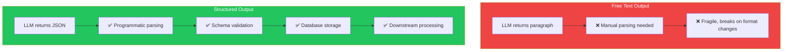
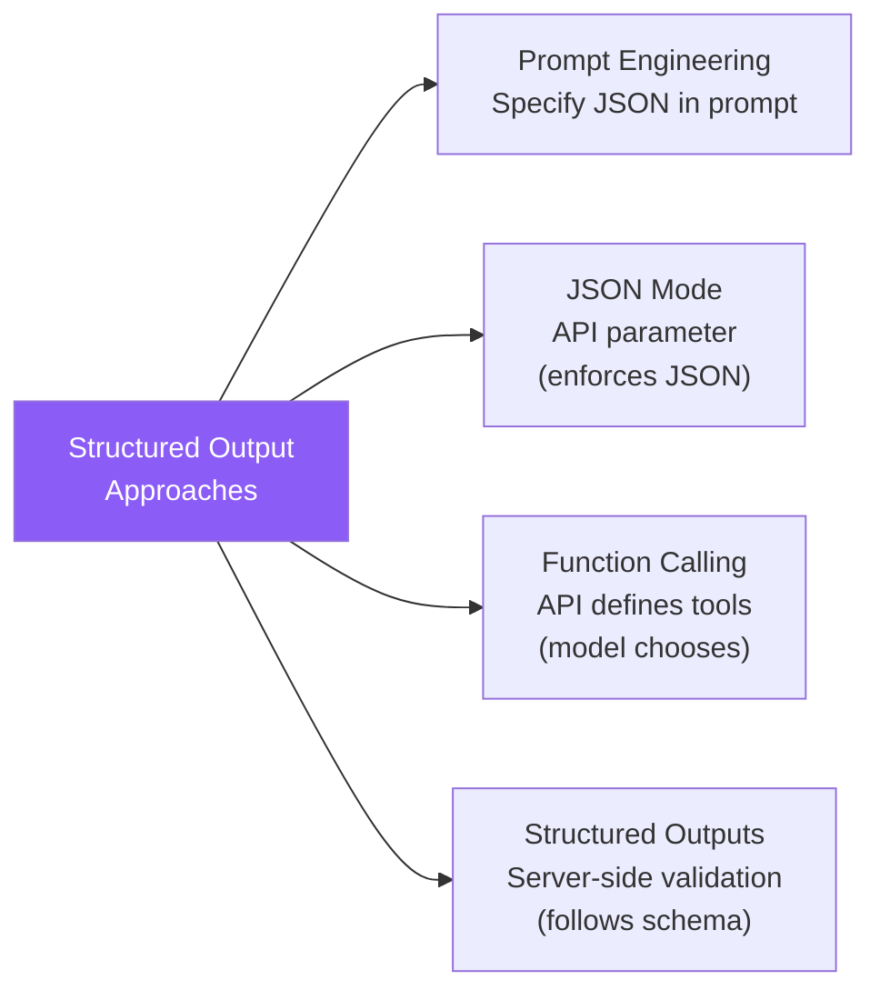
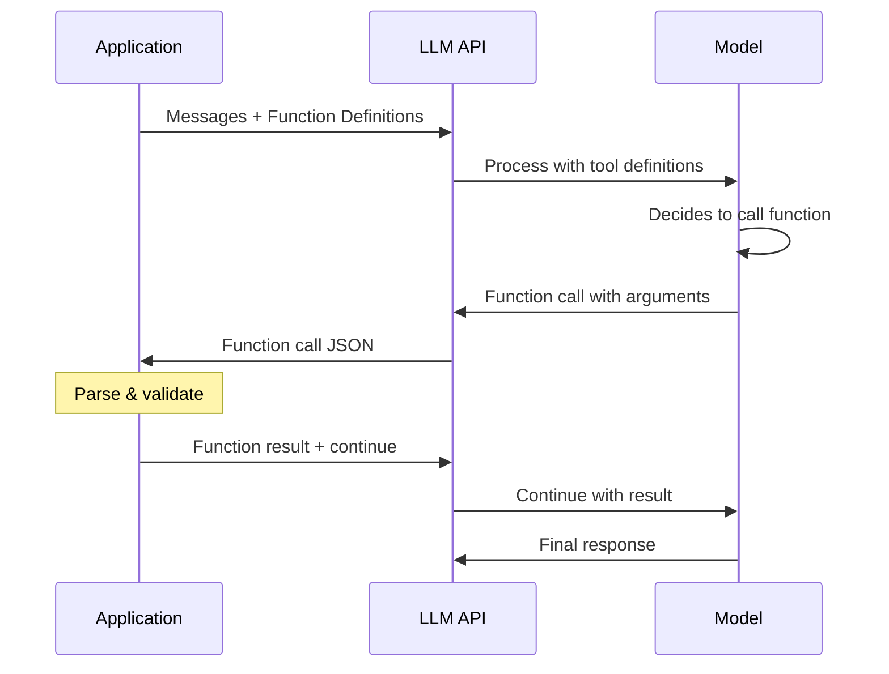
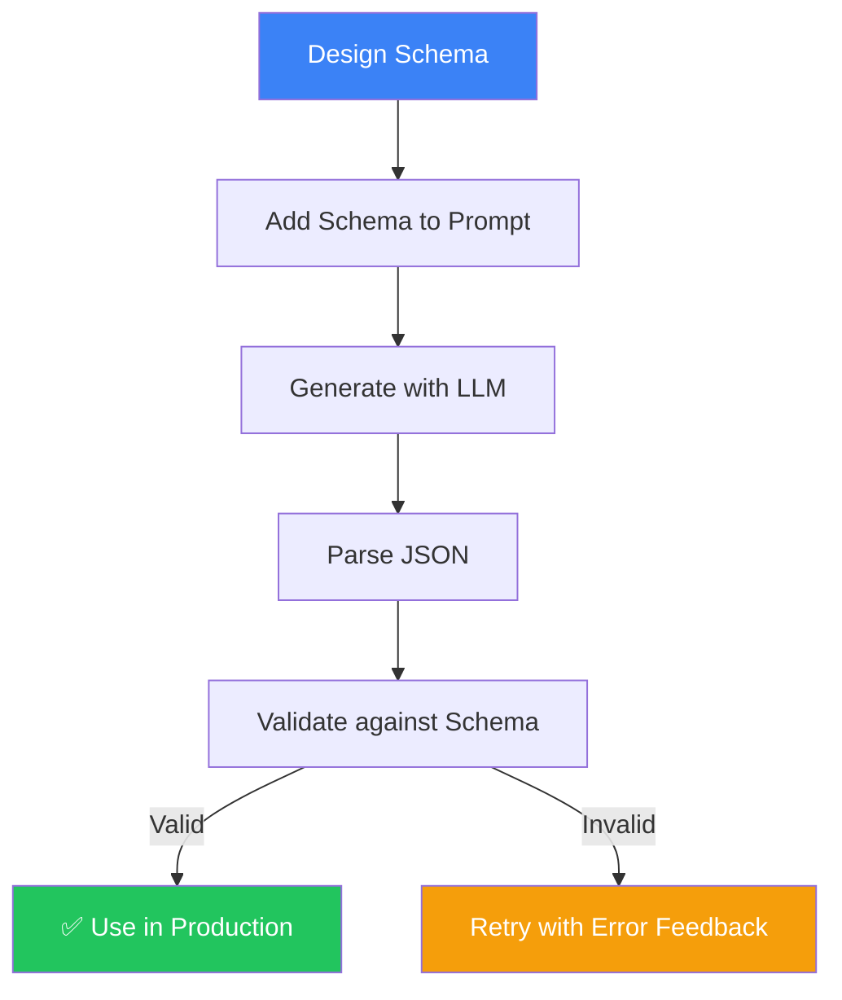

## Introduction

> **The difference between a prototype and a production system is structured data. LLMs that output free text are demos. LLMs that output validated JSON are products.**

Structured outputs are the foundation of every production AI integration. They transform LLMs from chat interfaces into reliable data processing engines.

---

## Why This Concept Exists

### The Story

You build an AI feature that extracts invoice data. In your prototype, the output is a paragraph:

```
"The invoice is from Acme Corp, dated Jan 15, 2024, for $1,500."
```

That works for a demo. But in production, you need:

```json
{
  "vendor": "Acme Corp",
  "date": "2024-01-15",
  "amount": 1500.00,
  "currency": "USD",
  "invoice_number": "INV-2024-001"
}
```

Without structured output, your production code can't:
- Parse the response reliably
- Validate the data
- Store it in a database
- Use it in downstream processing



---

## Real-World Analogy

### The Form vs The Email

You need information from someone.

You can send an email: "Tell me about yourself." → You get a paragraph. You have to manually extract the information.

Or you can send a form:
```
Name: _______
Age: _______
Occupation: _______
```

The form is structured. Every field is labeled. Every response is predictable.

> **Structured output formatting is the form. Free-text prompting is the email.**

---

## Approaches to Structured Output



| Approach | Reliability | Flexibility | Effort |
|----------|-------------|-------------|--------|
| **Prompt Engineering** | Medium | High | Low |
| **JSON Mode** | High | Medium | Low |
| **Function Calling** | High | High | Medium |
| **Structured Outputs** | Very High | Medium | Low |

---

## Prompt Engineering for JSON

The simplest approach — just tell the model to output JSON.

### Basic JSON Prompt

```
Extract the following information as JSON:
{
  "name": "string",
  "age": "number",
  "email": "string"
}
```

### With Constraints

```
Extract information as JSON. Follow this schema exactly:
{
  "name": "string (required)",
  "age": "number (required, must be >= 0 and <= 150)",
  "email": "string (required, must be valid email format)",
  "phone": "string (optional, include country code if present)"
}

CRITICAL: Return ONLY the JSON object. No markdown formatting.
No code blocks. No explanation. Start with { and end with }.
```

### With Examples

```
Extract invoice data as JSON.

Example:
Input: "Invoice #123 from Acme Corp for $1,500 dated Jan 15, 2024"
Output: {"number": "123", "vendor": "Acme Corp", "amount": 1500, "date": "2024-01-15"}

Now process this:
Input: "Receipt - WeWork - $299/month - Feb 1, 2024 - membership"
Output:
```

---

## JSON Mode

Some providers offer a JSON mode that guarantees valid JSON output.

### OpenAI JSON Mode

```json
{
  "model": "gpt-4o",
  "response_format": { "type": "json_object" },
  "messages": [
    {
      "role": "system",
      "content": "You are a helpful assistant that outputs JSON."
    },
    {
      "role": "user",
      "content": "Extract the name and age from: John is 30 years old"
    }
  ]
}
```

**Important:** When using JSON mode, you must instruct the model to output JSON in the system or user message.

### Anthropic JSON Mode

Anthropic supports a similar approach:

```json
{
  "model": "claude-3-5-sonnet-20241022",
  "messages": [
    {
      "role": "user",
      "content": "Return JSON with name, age, and occupation for John, a 30-year-old engineer."
    }
  ]
}
```

---

## Function Calling

Function calling lets you define the schema separately from the prompt. The model returns a function call with arguments matching your schema.



### Example: OpenAI Function Calling

```json
{
  "model": "gpt-4o",
  "tools": [
    {
      "type": "function",
      "function": {
        "name": "extract_user_info",
        "description": "Extract user information from text",
        "parameters": {
          "type": "object",
          "properties": {
            "name": { "type": "string" },
            "age": { "type": "number" },
            "email": { "type": "string", "format": "email" }
          },
          "required": ["name", "age"]
        }
      }
    }
  ],
  "messages": [
    {"role": "user", "content": "John is 30 years old and his email is john@example.com"}
  ]
}
```

---

## JSON Schema for Validation

When you get JSON output, validate it against a schema:

```json
{
  "$schema": "http://json-schema.org/draft-07/schema#",
  "type": "object",
  "properties": {
    "vendor": { "type": "string" },
    "amount": { "type": "number", "minimum": 0 },
    "date": { "type": "string", "pattern": "^\\d{4}-\\d{2}-\\d{2}$" },
    "currency": { "type": "string", "enum": ["USD", "EUR", "GBP", "INR"] }
  },
  "required": ["vendor", "amount", "date", "currency"]
}
```

### Validation in Different Languages

| Language | Library | Example |
|----------|---------|---------|
| **Python** | Pydantic | `UserInfo.model_validate(json_data)` |
| **TypeScript** | Zod | `UserSchema.parse(jsonData)` |
| **JavaScript** | AJV | `ajv.validate(schema, data)` |
| **Go** | go-playground/validator | `validate.Struct(data)` |

---

## Pydantic for Structured Output

Pydantic is the most popular validation library for LLM outputs in Python:

```python
from pydantic import BaseModel, Field, EmailStr
from typing import Optional
import json

class UserInfo(BaseModel):
    name: str = Field(..., min_length=1)
    age: int = Field(..., ge=0, le=150)
    email: EmailStr
    phone: Optional[str] = None

# LLM returns this JSON
llm_output = '{"name": "John", "age": 30, "email": "john@example.com"}'

# Validate and parse
user = UserInfo.model_validate_json(llm_output)
print(user.name)  # John
```

---

## Zod for Structured Output

Zod is the TypeScript equivalent:

```typescript
import { z } from 'zod';

const UserSchema = z.object({
  name: z.string().min(1),
  age: z.number().int().positive().max(150),
  email: z.string().email(),
  phone: z.string().optional(),
});

// LLM returns this JSON
const llmOutput = '{"name": "John", "age": 30, "email": "john@example.com"}';

// Validate and parse
const user = UserSchema.parse(JSON.parse(llmOutput));
console.log(user.name); // John
```

---

## Structured Output Best Practices



### 1. Schema Design

```
✅ Good Schema Design:
- Simple, flat structures (avoid deep nesting)
- Clear field names
- Reasonable constraints (not too strict)
- Optional fields for uncertain data

❌ Bad Schema Design:
- Deeply nested (5+ levels)
- Ambiguous field names
- Overly strict constraints
- All fields required
```

### 2. Prompt Integration

```
✅ Include the schema in the prompt
✅ Show an example output
✅ Specify handling for missing data
✅ Tell the model to return ONLY JSON

❌ Don't describe the schema abstractly
❌ Don't forget to specify null handling
❌ Don't accept markdown-wrapped JSON
```

### 3. Error Handling

```python
def get_structured_output(prompt, schema, max_retries=3):
    for attempt in range(max_retries):
        response = call_llm(prompt)
        try:
            parsed = json.loads(response)
            validated = schema.model_validate(parsed)
            return validated
        except (json.JSONDecodeError, ValidationError) as e:
            if attempt == max_retries - 1:
                raise
            # Add error feedback to prompt
            prompt += f"\n\nPrevious attempt failed: {e}\nPlease fix and retry."
    return None
```

---

## Real-World Examples

### Example 1: Email Parsing

```json
{
  "from": "sarah@company.com",
  "subject": "Q3 Budget Review",
  "priority": "high",
  "action_required": true,
  "deadline": "2024-09-15",
  "key_points": [
    "Department budgets due by Friday",
    "Need to justify any >10% increases",
    "New headcount requests need VP approval"
  ]
}
```

### Example 2: Code Review

```json
{
  "files_reviewed": ["auth.service.ts", "user.controller.ts"],
  "issues": [
    {
      "severity": "critical",
      "file": "auth.service.ts",
      "line": 42,
      "description": "SQL injection vulnerability",
      "fix": "Use parameterized queries instead of string interpolation"
    }
  ],
  "overall_score": 7,
  "summary": "Good PR overall, but needs security fixes before merge"
}
```

### Example 3: Customer Support

```json
{
  "intent": "refund_request",
  "sentiment": "frustrated",
  "urgency": "high",
  "customer_tier": "premium",
  "issue_category": "billing",
  "suggested_response": "I understand your frustration. Let me process that refund right away.",
  "needs_escalation": false
}
```

---

## Common Mistakes

| Mistake | Why It's Wrong |
|---------|----------------|
| ❌ Not validating the output | LLMs sometimes produce invalid JSON — always validate |
| ❌ Overly strict schemas | Models may fail if constraints are too tight |
| ❌ Deeply nested structures | More nesting = more errors in output |
| ❌ No fallback for missing fields | Always use optional fields with defaults |
| ❌ Assuming consistent field ordering | JSON object keys are unordered — don't rely on position |

---

## Bad Prompt vs Good Prompt

| Aspect | Bad | Good |
|--------|-----|------|
| **Schema** | "Return JSON" | "Return JSON with this exact schema: { name: string, age: number }" |
| **Validation** | None | Validate with Pydantic/Zod and retry on failure |
| **Error handling** | None | "If any field is missing, use null" |
| **Format** | "Return in a code block" | "Return ONLY the JSON object. No markdown." |
| **Edge cases** | Not specified | "If no data matches, return { data: [] }" |

---

## Production Examples

### OpenAI Structured Outputs API

OpenAI's Structured Outputs feature guarantees the model follows your schema:

```python
from pydantic import BaseModel
from openai import OpenAI

client = OpenAI()

class UserInfo(BaseModel):
    name: str
    age: int

completion = client.beta.chat.completions.parse(
    model="gpt-4o-2024-08-06",
    messages=[{"role": "user", "content": "John is 30"}],
    response_format=UserInfo,
)
user = completion.choices[0].message.parsed
```

### Function Calling in Production

Function calling is used by:
- **Perplexity** to format search results with citations
- **GitHub Copilot** to structure code completions
- **Cursor** to apply precise code edits (diffs)
- **AI agents** to call external tools and APIs

---

## Interview Questions

### Easy

**Q: Why is structured output important for production AI systems?**

> Production systems need to parse, validate, and process LLM outputs programmatically. Structured outputs like JSON ensure the output is predictable, parseable, and can be validated against a schema.

### Intermediate

**Q: What's the difference between JSON mode and function calling?**

> JSON mode guarantees the output is valid JSON but doesn't control the structure. Function calling lets you define the exact schema (parameters) and the model fills in the values. Function calling is more structured and reliable for specific data extraction tasks.

### Senior

**Q: Design a fault-tolerant structured output pipeline for an LLM-based data extraction system.**

> I'd design: (1) Prompt with JSON schema and examples, (2) JSON mode or structured outputs API if available, (3) Parse response as JSON with try/catch, (4) Validate against schema using Pydantic/Zod, (5) On validation failure, retry with the error message as feedback, (6) After N retries, log the failure and use a fallback (default values or human review), (7) Monitor parse success rate and validation error types.

---

## Summary

| Concept | Key Point |
|---------|-----------|
| **Structured Output** | Transforming LLM responses into parseable data |
| **JSON Schema** | Define the exact structure and constraints |
| **Validation** | Always validate — never trust raw LLM output |
| **Function Calling** | API-level structured output with tool definitions |
| **Error Handling** | Retry with error feedback for production reliability |

---

## Navigation

**Previous:** [08 — Output Formatting →](./08-output-formatting)

**Next:** [10 — Prompt Templates →](./10-prompt-templates)
