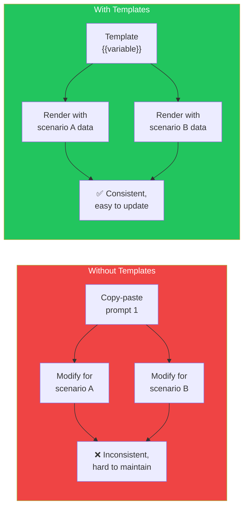
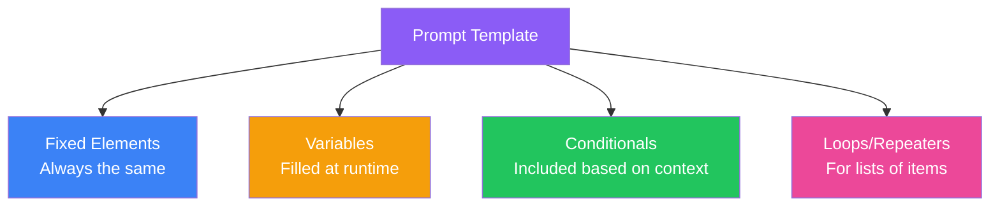
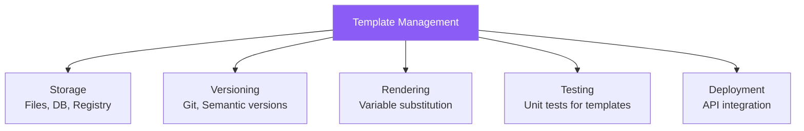

## Introduction

> **Writing prompts one at a time is like writing code without functions. Prompt templates are the reusable functions of prompt engineering.**

Templates ensure consistency, enable testing, and make prompt management scalable across teams and products.

---

## Why This Concept Exists

### The Story

You have a chatbot that needs to handle customer support, code review, documentation writing, and data extraction — each with different prompts.

Without templates:
- You rewrite prompts every time
- Inconsistencies creep in
- Testing is impossible
- Changes require updating dozens of locations

With templates:
- Each prompt is a reusable template
- Variables make them dynamic
- Changes propagate everywhere
- Testing is straightforward



---

## Real-World Analogy

### Code Functions

A function takes parameters, processes them, and returns a result. A prompt template does the same:

```javascript
// Without function — repetitive code
function createEmail1() { return `Hello Alice...` }
function createEmail2() { return `Hello Bob...` }

// With function — reusable
function createEmail(name) { return `Hello ${name}...` }

// Without template — repetitive prompts
Prompt 1: "Review this code written by Alice: [code]"
Prompt 2: "Review this code written by Bob: [code]"

// With template — reusable
Template: "Review this code written by {{author}}: {{code}}"
```

> **Templates are to prompts what functions are to code.**

---

## Template Components



| Component | Description | Example |
|-----------|-------------|---------|
| **Fixed Text** | Always present | "You are a helpful assistant." |
| **Variables** | Dynamic values | `{{language}}`, `{{code}}`, `{{level}}` |
| **Conditionals** | Optional sections | `...` |
| **Loops** | Repeated sections | `...` |

---

## Template Syntax Examples

### Simple String Interpolation

```javascript
const template = `You are a {{role}} specializing in {{technology}}.
Review this code written in {{language}}:

{{code}}

Focus on {{focus_area}}. Provide {{num_suggestions}} specific suggestions.`;

const prompt = render(template, {
  role: "senior engineer",
  technology: "React",
  language: "TypeScript",
  code: codeSnippet,
  focus_area: "performance",
  num_suggestions: "3"
});
```

### Mustache/Handlebars Style

```
---
system: You are a {{persona}}
---

Task: {{task}}

Context:

{{context}}



Examples:

Input: {{example.input}}
Output: {{example.output}}



User Request: {{userInput}}
```

### Python f-string Style

```python
prompt_template = """
You are a {role} specializing in {technology}.

Review this code:
{code}

Focus areas: {focus_areas}
Provide exactly {num_suggestions} suggestions.
Return as JSON: {json_schema}
"""

prompt = prompt_template.format(
    role="Senior Engineer",
    technology="Python",
    code=code_snippet,
    focus_areas="performance, readability",
    num_suggestions=3,
    json_schema='{"suggestions": [{"issue": "", "fix": ""}]}'
)
```

---

## Template Patterns

### Pattern 1: Role + Task + Format

```
---
You are a {{role}}.

Task: {{task}}
Context: {{context}}

Return your response in the following format:
{{output_format}}
---
```

### Pattern 2: Few-Shot Template

```
---
Classify the intent of each message.

Categories: {{categories}}

Examples:

Message: {{example.input}}
Intent: {{example.output}}


Now classify:
Message: {{new_message}}
Intent:
---
```

### Pattern 3: Chain Template

```
---
Step 1: {{step1_instruction}}
{{step1_input}}

Step 2: Using the output from Step 1, {{step2_instruction}}
{{step1_output}}

Step 3: Finally, {{step3_instruction}}
{{step2_output}}
---
```

---

## Template Management Systems



### Simple: File-Based

```
prompts/
├── code-review/
│   ├── v1.md
│   ├── v2.md
│   └── v3.md
├── data-extraction/
│   ├── invoice.md
│   └── email.md
└── customer-support/
    ├── refund.md
    └── complaint.md
```

### Advanced: Prompt Registry

```json
{
  "prompts": {
    "code-review": {
      "template": "You are a {{role}}. Review this {{language}} code...",
      "variables": ["role", "language", "code", "focus"],
      "version": "3.2.1",
      "model": "gpt-4o",
      "created": "2024-01-15",
      "tests": ["test_positive_feedback", "test_critical_issues"]
    }
  }
}
```

---

## Real-World Examples

### Example 1: Code Review Template

```
Template: code_review/v2

---
You are a {{role}} with {{years}} years of experience.

Review the following {{language}} code:

```{{language}}
{{code}}
```

Evaluate:
1. **Correctness**: Does the code work as intended?
2. **Performance**: Are there any performance issues?
3. **Security**: Any security vulnerabilities?
4. **Maintainability**: Is the code easy to understand and modify?

For each issue, provide:
- Severity (critical/major/minor)
- Line number (if applicable)
- Explanation
- Suggested fix

Format your response as:
```json
{
  "overall_assessment": "positive|needs_work|critical",
  "issues": [
    {"severity": "", "line": "", "description": "", "fix": ""}
  ],
  "summary": ""
}
```
---

### Example 2: Customer Support Template

```
Template: support/refund_request

---
You are a {{tier}} customer support agent for {{company}}.

Customer: {{customer_name}}
Account Tier: {{account_tier}}
Issue: {{issue_description}}
Order Value: ${{order_value}}
Days Since Purchase: {{days_since_purchase}}

Company Policy:
{{policy_rules}}

Draft a response that:
1. Acknowledges the customer's frustration
2. Explains what we can do based on policy
3. Offers {{resolution_option}}
4. Sets clear expectations for next steps

Tone: {{tone}}
---
```

---

## Common Mistakes

| Mistake | Why It's Wrong |
|---------|----------------|
| ❌ Hardcoding values in templates | Defeats the purpose of templates — always use variables |
| ❌ Too many variables | Templates become hard to use — limit to 5-7 variables |
| ❌ No default values | Every variable should have a sensible default |
| ❌ No validation | Validate variables before rendering (e.g., enum values) |
| ❌ No versioning | Changes break existing integrations — version your templates |

---

## Bad Prompt vs Good Prompt

| Aspect | Ad-hoc Prompt | Template-Based |
|--------|--------------|----------------|
| **Reusability** | Written once, hard to reuse | Parameterized, reusable everywhere |
| **Consistency** | Varies by who writes it | Same structure every time |
| **Testing** | Manual, one-off | Automated with test cases |
| **Versioning** | None | Track changes, rollback if needed |
| **Maintenance** | Update N copies | Update one template |

---

## Production Examples

### LangChain Prompt Templates

LangChain provides a template system:

```python
from langchain.prompts import PromptTemplate

template = PromptTemplate(
    input_variables=["topic", "audience"],
    template="""Explain {topic} to a {audience}.
    Use analogies and real-world examples.
    Keep it to 3 paragraphs."""
)

prompt = template.format(topic="Docker", audience="beginner developer")
```

### Vercel AI SDK

The Vercel AI SDK supports template-like prompts:

```typescript
import { generateText } from 'ai';

const { text } = await generateText({
  model: openai('gpt-4o'),
  system: `You are a ${role} specializing in ${technology}.`,
  prompt: `Review this code:\n\n${code}`,
});
```

---

## Interview Questions

### Easy

**Q: What is a prompt template and why is it useful?**

> A prompt template is a reusable prompt structure with variables that are filled at runtime. It's useful because it ensures consistency, reduces duplication, makes testing possible, and simplifies maintenance.

### Intermediate

**Q: How would you design a template system for a team of 10 engineers?**

> I'd use: (1) File-based templates in a shared repository, (2) Semantic versioning for each template, (3) A simple template language (Handlebars/Mustache style), (4) Unit tests for each template, (5) A CI pipeline that validates templates before deployment, (6) Documentation showing available templates and their variables.

### Senior

**Q: Design a prompt template registry for an enterprise with 100+ prompts.**

> I'd design: (1) Database-backed storage with version history, (2) API for CRUD operations on templates, (3) Template inheritance (base templates with extensions), (4) A/B testing support (run multiple versions simultaneously), (5) Analytics tracking (which templates are used, their success rates), (6) Access control (who can edit which templates), (7) Deployment pipeline with staging → production promotion, (8) Audit log for all template changes.

---

## Summary

| Concept | Key Point |
|---------|-----------|
| **Templates** | Reusable prompt structures with variables |
| **Variables** | Dynamic values filled at runtime |
| **Conditionals** | Optional sections based on context |
| **Versioning** | Track changes to templates over time |
| **Management** | Store, test, and deploy templates systematically |

---

## Navigation

**Previous:** [09 — JSON & Structured Outputs →](./09-json-and-structured-output)

**Next:** [11 — Prompt Chaining →](./11-prompt-chaining)
