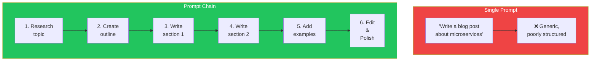
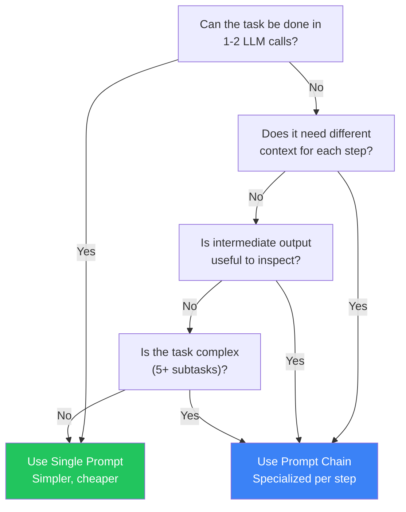
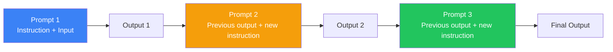
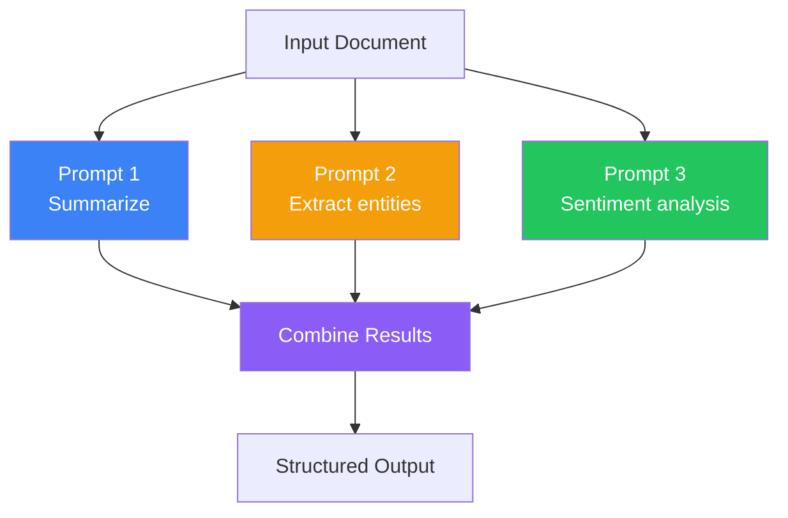
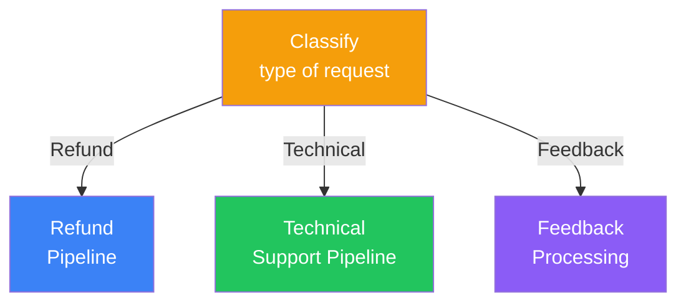
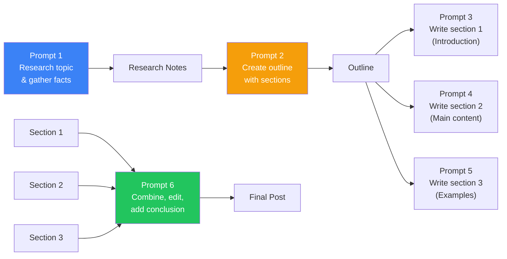

## Introduction

> **One prompt to rule them all is a myth. Complex tasks need multiple prompts, each handling one step of the process.**

Prompt chaining is the practice of breaking a large task into smaller sub-tasks, each handled by a dedicated prompt, with the output of one feeding into the next.

---

## Why This Concept Exists

### The Story

You need an AI to write a blog post. One prompt:

```
"Write a blog post about microservices."
```

The result is generic, poorly structured, and misses key points. Why? Because writing a good blog post involves many steps:

1. Research the topic
2. Outline the structure
3. Write each section
4. Add examples
5. Edit for clarity
6. Add a conclusion

No single prompt can do all of these well simultaneously.



---

## Real-World Analogy

### Assembly Line

A car isn't built by one person doing everything. It goes through an assembly line:

1. Frame is welded
2. Engine is installed
3. Body panels are attached
4. Interior is fitted
5. Painting happens
6. Quality inspection

Each station does one thing well and passes the result to the next station.

> **Prompt chaining is the assembly line for LLM tasks.**

---

## When to Chain

### Single Prompt vs Chain

| Task Type | Single Prompt | Prompt Chain |
|-----------|--------------|--------------|
| Simple lookup | ✅ "What's the capital of France?" | ❌ Overkill |
| Summarization | ✅ "Summarize this article" | ❌ Usually works in one shot |
| Complex generation | ❌ "Write a 10-page report" | ✅ Break into sections |
| Multi-step reasoning | ❌ "Analyze, plan, and execute" | ✅ Each step in its own prompt |
| Data processing pipeline | ❌ "Extract, transform, and load" | ✅ Each phase is a prompt |
| Tasks needing different context | ❌ One context for everything | ✅ Different context per step |

### Decision Tree



---

## Chain Architecture

### Sequential Chain

The simplest form — output of step N is input to step N+1.



### Parallel Chain

Multiple independent prompts run simultaneously, results are combined.



### Conditional Chain

The output of one step determines which path to take next.



---

## Chain Examples

### Example 1: Blog Post Generator



### Example 2: Data Extraction Pipeline

```
Step 1 — Document Classification
Prompt: "Classify this document type: invoice, receipt, contract, or other.
Document: [text]"
Output: {"document_type": "invoice", "confidence": 0.95}

Step 2 — Schema Selection (conditional)
If invoice → use invoice extraction schema
If contract → use contract extraction schema

Step 3 — Data Extraction
Prompt: "Extract the following fields from this invoice:
{{schema}}. Invoice text: {{text}}"
Output: {"vendor": "...", "amount": "..."}

Step 4 — Validation
Prompt: "Validate this extracted data. Are any fields missing or
unreasonable? Data: {{extracted_data}}"
Output: {"valid": true, "warnings": []}

Step 5 — Formatting
Prompt: "Format this data for the accounting system.
Schema: {{target_schema}}. Data: {{validated_data}}"
Output: Final formatted JSON
```

---

## Chain Design Principles

### 1. Each Prompt Has One Job

```
✅ Good: Each prompt does one thing well
  - Prompt 1: Extract entities
  - Prompt 2: Classify sentiment
  - Prompt 3: Generate summary

❌ Bad: Prompt does too much
  - "Extract entities, classify sentiment, and generate a summary all at once"
```

### 2. Pass Structured Data Between Steps

```
✅ Pass JSON between steps
  Step 1 Output: {"entities": [...], "summary": "..."}
  Step 2 Input: "You received this data: {{json}}. Now categorize..."

❌ Pass free text
  Step 1 Output: "I found some entities like..."
  Step 2 Input must parse free text
```

### 3. Validate at Each Step

```javascript
async function runChain(input) {
  const step1 = await callLLM(step1Prompt(input));
  const validated1 = validateStep1(step1);
  if (!validated1.valid) throw new Error(`Step 1 failed: ${validated1.error}`);

  const step2 = await callLLM(step2Prompt(validated1.data));
  const validated2 = validateStep2(step2);
  if (!validated2.valid) throw new Error(`Step 2 failed: ${validated2.error}`);

  return validated2.data;
}
```

### 4. Keep Intermediate Results

Save every step's output. If the final result is wrong, you can debug which step failed.

---

## Real-World Examples

### Example 1: Customer Support Pipeline

```
Step 1 — Intent Classification
Input: Customer message
Output: {intent: "refund", urgency: "high", sentiment: "frustrated"}

Step 2 — Policy Lookup (conditional)
If refund → Look up refund policy for this product
Output: Policy rules

Step 3 — Response Generation
Input: Intent + Policy + Customer Message
Output: Draft response

Step 4 — Tone Adjustment
Input: Draft + Sentiment
Output: Empathetic, professional response

Step 5 — Quality Check
Input: Response + Intent
Output: {passes_quality: true, issues: []}
```

### Example 2: Code Migration Pipeline

```
Step 1: Analyze source code
Step 2: Map patterns (JS → TypeScript, Express → Fastify)
Step 3: Generate converted code
Step 4: Review for issues
Step 5: Generate tests
Step 6: Document changes
```

---

## Common Mistakes

| Mistake | Why It's Wrong |
|---------|----------------|
| ❌ Making chains too long | Each step adds latency and cost — keep chains to 3-5 steps |
| ❌ Passing unstructured data between steps | The next prompt can't reliably parse free text |
| ❌ No validation between steps | An error in step 2 propagates through the entire chain |
| ❌ Not retrying failed steps | A single failure shouldn't kill the entire pipeline |
| ❌ Ignoring context window growth | Each step adds to the context — be mindful of limits |

---

## Bad Prompt vs Good Prompt

| Aspect | Bad Chain | Good Chain |
|--------|-----------|------------|
| **Granularity** | Too many or too few steps | Each step does exactly one thing |
| **Data Passing** | Free text between steps | Structured JSON between steps |
| **Validation** | None | Validate at every step |
| **Error Handling** | Fail on first error | Retry failed steps, graceful degradation |
| **Observability** | No intermediate output saved | Save all intermediate outputs for debugging |

---

## Production Examples

### LangChain

LangChain provides chain abstractions:

```python
from langchain.chains import LLMChain, SequentialChain

chain1 = LLMChain(llm=llm, prompt=research_prompt)
chain2 = LLMChain(llm=llm, prompt=outline_prompt)
chain3 = LLMChain(llm=llm, prompt=write_prompt)

overall_chain = SequentialChain(
    chains=[chain1, chain2, chain3],
    input_variables=["topic"],
    output_variables=["final_article"]
)
```

### Vercel AI SDK

The Vercel AI SDK supports multi-step chains:

```typescript
import { generateText, generateObject } from 'ai';

const { object: intent } = await generateObject({ model, prompt, schema: intentSchema });
const { text: response } = await generateText({ model, prompt: responsePrompt(intent) });
```

---

## Interview Questions

### Easy

**Q: What is prompt chaining and when would you use it?**

> Prompt chaining breaks a complex task into multiple LLM calls, where each call handles one step. Use it when a task requires different reasoning steps, different context per step, or when you need to inspect intermediate results.

### Intermediate

**Q: What are the trade-offs of prompt chaining vs a single prompt?**

> Chains are more reliable for complex tasks, allow validation at each step, and let you use different context per step. But they cost more tokens and have higher latency. Single prompts are simpler and cheaper but less reliable for complex tasks.

### Senior

**Q: Design a fault-tolerant prompt chain for a production data extraction system.**

> I'd design: (1) Each step outputs validated JSON, (2) Each step has a retry mechanism (3 attempts with error feedback), (3) A circuit breaker stops the chain after N consecutive failures, (4) Intermediate results are persisted to a database for debugging, (5) A monitoring system tracks step-level success rates and latency, (6) Fallback paths for non-critical steps, (7) Parallel execution for independent steps to reduce total latency.

---

## Summary

| Concept | Key Point |
|---------|-----------|
| **Prompt Chaining** | Breaking complex tasks into smaller LLM calls |
| **Sequential Chain** | Step by step, output feeds next input |
| **Parallel Chain** | Independent steps run simultaneously |
| **Conditional Chain** | Path depends on previous output |
| **Key Principle** | Each prompt has one job, pass structured data between steps |

---

## Navigation

**Previous:** [10 — Prompt Templates →](./10-prompt-templates)

**Next:** [12 — Chain of Thought Prompting →](./12-chain-of-thought)
