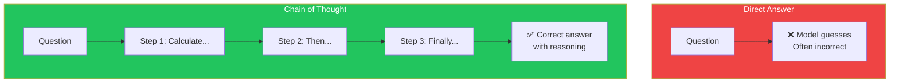
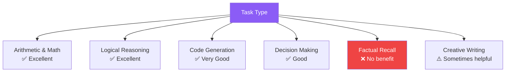

## Introduction

> **The single most powerful prompting technique ever discovered: ask the model to show its work.**

Chain of Thought (CoT) prompting instructs the model to break down its reasoning into intermediate steps before arriving at a final answer. It transforms LLMs from pattern-matchers into reasoning engines.

---

## Why This Concept Exists

### The Story

Ask an LLM a math problem directly:

```
Q: "If a store sells 3 apples for $2, how much do 15 apples cost?"
A: "$10"
```

The model might guess correctly. But ask a harder question:

```
Q: "A farmer has 17 chickens. Each chicken lays 2 eggs per day.
   12 eggs make a dozen. How many dozens of eggs does the farmer
   get in a week?"
A: ...
```

Without showing work, the model often gets confused. But with "Let's think step by step," it reasons correctly:

```
Let me break this down:
1. 17 chickens × 2 eggs per day = 34 eggs per day
2. 34 eggs per day × 7 days = 238 eggs per week
3. 238 ÷ 12 = 19.83 dozens

So the farmer gets approximately 19.83 dozens of eggs per week.
```



---

## Real-World Analogy

### Math Class

In math class, teachers don't just want the answer — they want to see your work:

```
❌ Answer only:
  x = 5

✅ Show your work:
  2x + 3 = 13
  2x = 13 - 3
  2x = 10
  x = 5
```

Showing work:
- Makes your reasoning visible
- Catches errors at each step
- Allows partial credit
- Builds confidence in the answer

> **Chain of Thought is "show your work" for LLMs.**

---

## How It Works

```mermaid
flowchart TD
    subgraph NO_COT["Without Chain of Thought"]
        Q1["Complex Question"] --> M1["Model tries to\nanswer directly"]
        M1 --> A1["❌ Often wrong\nfor complex reasoning"]
    end

    subgraph WITH_COT["With Chain of Thought"]
        Q2["Complex Question\n+ 'Think step by step'"] --> M2["Step 1: Identify\nkey variables"]
        M2 --> M3["Step 2: Apply\nfirst transformation"]
        M3 --> M4["Step 3: Apply\nsecond transformation"]
        M4 --> M5["Step 4: Compute\nfinal answer"]
        M5 --> A2["✅ Correct answer\n+ visible reasoning"]
    end

    style NO_COT fill:#ef4444,color:#fff
    style WITH_COT fill:#22c55e,color:#fff
```



### The Mechanism

Chain of Thought works by **giving the model time to reason**. Instead of forcing the model to jump from question to answer in one step (which requires a complex multi-step prediction), CoT lets the model break the prediction into smaller, easier steps.

Each intermediate step is a simpler prediction that the model can make more accurately.

---

## CoT Variants

### Zero-Shot CoT

Simply append "Let's think step by step" to your prompt:

```
Q: "If a train travels at 60 mph for 2 hours, then at 80 mph for
    1 hour, what's the average speed?

Let's think step by step."
```

This works surprisingly well without any examples.

### Manual CoT (Few-Shot)

Provide examples of step-by-step reasoning:

```
Q: "John has 5 apples. He gives 2 to Mary and buys 3 more.
    How many does he have?"
A: "John starts with 5 apples. He gives 2 away: 5 - 2 = 3.
    He buys 3 more: 3 + 3 = 6. He has 6 apples."

Q: "A bakery makes 200 cookies. They sell 75 in the morning
    and 60 in the afternoon. How many are left?"
A:
```

### Structured CoT

Provide a reasoning template:

```
Let's solve this step by step:

Step 1 — Identify what we know:
  [list known facts]

Step 2 — Determine what we need to find:
  [state goal]

Step 3 — Plan the approach:
  [describe strategy]

Step 4 — Execute the calculation:
  [show math]

Step 5 — Verify the answer:
  [check reasonableness]

Step 6 — Final answer:
  [conclusion]
```

---

## When CoT Works Best



| Task Type | CoT Benefit | Example |
|-----------|-------------|---------|
| **Math** | High | Word problems, equations |
| **Logic** | High | Puzzles, deductions |
| **Code** | High | Algorithm design, debugging |
| **Decision** | Medium | Trade-off analysis, planning |
| **Factual** | Low | "What's the capital of France?" |
| **Creative** | Low to Medium | Story writing, poetry |

---

## Real-World Examples

### Example 1: Logic Puzzle

```
❌ Without CoT:
Q: "A bat and a ball cost $1.10. The bat costs $1.00 more than
    the ball. How much does the ball cost?"
A: "$0.10"
  → WRONG! (The correct answer is $0.05)

✅ With CoT:
Q: "A bat and a ball cost $1.10. The bat costs $1.00 more than
    the ball. How much does the ball cost? Let's think step by step."
A: "Let the ball cost x dollars.
    Then the bat costs (x + $1.00).
    Together: x + (x + $1.00) = $1.10
    2x + $1.00 = $1.10
    2x = $0.10
    x = $0.05
    The ball costs $0.05."
  → CORRECT!
```

### Example 2: Code Debugging

```
❌ Without CoT:
Q: "Why is this throwing an error?
    const users = null;
    console.log(users.map(u => u.name));"
A: "Because users is null."
  → Vague, doesn't explain the full picture

✅ With CoT:
Q: "Why is this throwing an error?
    const users = null;
    console.log(users.map(u => u.name));
    Let's trace the execution step by step."

A: "Step 1: users is assigned the value null
    Step 2: We try to call users.map(...)
    Step 3: null.map is not a function because null has no map method
    Step 4: This throws a TypeError: Cannot read properties of null
    Fix: Check if users is null before calling map:
    if (users && Array.isArray(users)) {
      users.map(u => u.name)
    }"
```

---

## Common Mistakes

| Mistake | Why It's Wrong |
|---------|----------------|
| ❌ Using CoT for simple tasks | Wastes tokens — "What's 2+2? Let's think step by step" is overkill |
| ❌ Expecting CoT to fix bad prompts | CoT helps with reasoning, not with missing context or vague instructions |
| ❌ Not verifying intermediate steps | The model can make errors in its reasoning chain too |
| ❌ Very long reasoning chains | More steps = more chances for error. Keep chains concise. |
| ❌ Ignoring the final answer | Sometimes the reasoning is correct but the final answer is wrong |

---

## Bad Prompt vs Good Prompt

| Aspect | Without CoT | With CoT |
|--------|-------------|----------|
| **Instruction** | "Solve this problem" | "Solve this problem step by step" |
| **Reasoning** | Hidden | Visible, can be verified |
| **Error detection** | Impossible | Can spot where reasoning went wrong |
| **Confidence** | Unknown | High when each step is verified |
| **Partial credit** | No | Yes — correct steps get partial credit |

---

## Production Examples

### OpenAI o1 Models

OpenAI's o1 models use internal chain of thought reasoning. They think before responding:

```json
{
  "model": "o1-preview",
  "messages": [
    {"role": "user", "content": "Solve this complex physics problem..."}
  ]
}
```

The model internally generates a chain of thought before producing the visible response.

### Complex Decision Systems

Production systems use CoT for:
- **Financial analysis**: "Step through the P&L statement line by line"
- **Code review**: "Trace the execution path before identifying bugs"
- **Medical diagnosis**: "List symptoms, consider possible causes, narrow down"
- **Legal analysis**: "Apply each relevant statute to the facts step by step"

---

## Interview Questions

### Easy

**Q: What is Chain of Thought prompting?**

> Chain of Thought prompting asks the model to break down its reasoning into intermediate steps before arriving at an answer. This is typically triggered by appending "Let's think step by step" to the prompt.

### Intermediate

**Q: When does Chain of Thought NOT help?**

> CoT doesn't help for simple factual queries ("What's the capital of France?"), creative tasks where reasoning isn't the goal, or tasks where the model's training data is insufficient regardless of reasoning.

### Senior

**Q: How would you detect and handle errors in a Chain of Thought response programmatically?**

> I'd parse the CoT output to extract individual reasoning steps, validate each step against known constraints (e.g., arithmetic verification, logic consistency), check the final answer against a known range, and if multiple steps fail, retry with feedback. I'd also use confidence scoring at each step and flag low-confidence chains for human review.

---

## Summary

| Concept | Key Point |
|---------|-----------|
| **Chain of Thought** | Ask the model to show its reasoning step by step |
| **When to Use** | Complex reasoning, math, logic, code, decisions |
| **When NOT to Use** | Simple facts, creative writing (sometimes) |
| **Trigger** | "Let's think step by step" or show examples |
| **Key Benefit** | Dramatically improves accuracy on reasoning tasks |

---

## Navigation

**Previous:** [11 — Prompt Chaining →](./11-prompt-chaining)

**Next:** [13 — Tree of Thought →](./13-tree-of-thought)
