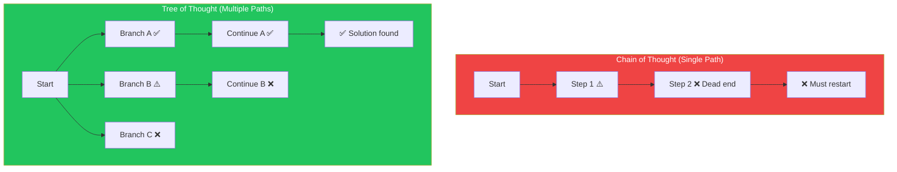
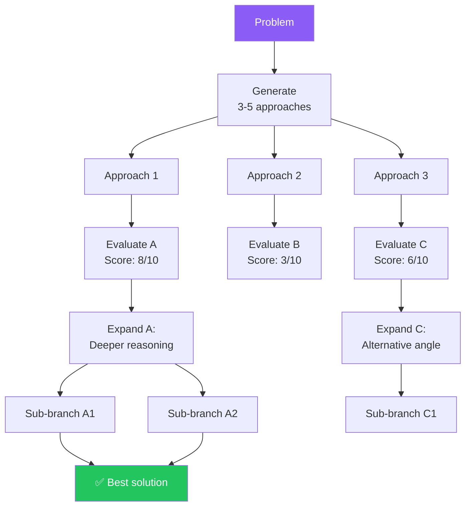
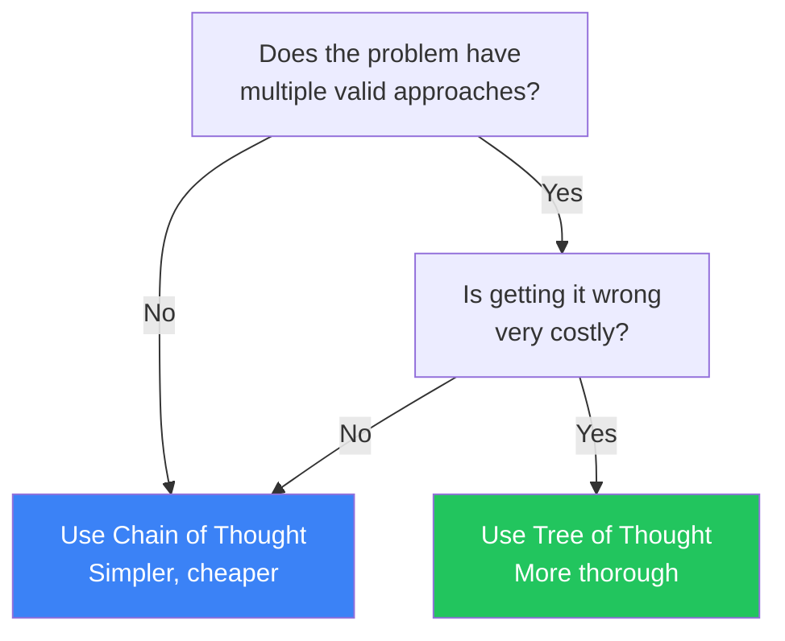

## Introduction

> **Chain of Thought follows one path. Tree of Thought explores many — and chooses the best one.**

Tree of Thought (ToT) is an advanced prompting technique where the model explores multiple reasoning branches simultaneously, evaluates each, and selects the most promising path forward.

---

## Why This Concept Exists

### The Story

Chain of Thought is like following a single path through a forest. If the path leads to a dead end, you have to backtrack and start over.

Tree of Thought is like sending multiple scouts down different paths simultaneously. When one scout finds a dead end, others are still exploring promising routes. You choose the path that leads to the destination.



---

## Real-World Analogy

### Chess

A novice chess player considers one move and its immediate consequences.

A grandmaster considers multiple moves, each with multiple responses, each with multiple follow-ups — a tree of possibilities. They evaluate each branch and choose the most promising one.

> **Tree of Thought is the grandmaster's approach to LLM reasoning.**

---

## How Tree of Thought Works



### The Three Steps

1. **Generate**: Create multiple possible approaches or reasoning paths
2. **Evaluate**: Score each path for promise and feasibility
3. **Explore**: Expand the most promising paths deeper

---

## Tree of Thought Variations

### Breadth-First Search (BFS)

Explore all branches at the current level before going deeper.

```
Level 1: Generate 5 approaches
Level 2: For each approach, generate 3 sub-approaches
Level 3: Evaluate all 15 sub-approaches, pick top 3
Level 4: Deepen those 3 paths
```

### Depth-First Search (DFS)

Explore one branch completely before trying another.

```
Path A: Follow until solution or dead end
  → Dead end → Backtrack to last decision point
Path B: Follow alternative from decision point
  → Solution found → Return result
```

### Best-First Search

Always explore the most promising branch next.

```
Generate 5 approaches → Score each → Pick highest
Expand highest → Generate 3 continuations → Score each
Pick highest → Continue until solution
```

---

## When to Use Tree of Thought



| Task Type | ToT Benefit | Why |
|-----------|-------------|-----|
| Creative problem-solving | High | Multiple valid approaches exist |
| Strategy & planning | High | Need to compare alternatives |
| Complex math proofs | Medium-High | Multiple proof paths |
| Code architecture | High | Multiple design patterns |
| Simple lookup | None | One correct answer |

---

## Real-World Examples

### Example 1: System Design

```
Problem: Design a notification system for a social media app
that handles 10M daily active users.

Approach 1: Use a message queue (RabbitMQ/Kafka)
  → Pros: Durable, scalable, decoupled
  → Cons: Operational complexity, latency
  
Approach 2: Use a serverless event-driven architecture
  → Pros: Auto-scaling, no server management
  → Cons: Cold starts, vendor lock-in

Approach 3: Use a dedicated notification service (Firebase/OneSignal)
  → Pros: Quick to implement, managed push
  → Cons: Less control, cost at scale

Evaluation:
- Approach 2 balances scalability with operational simplicity
- Combined with Approach 1 for reliability
→ Recommended: Hybrid approach using serverless + queue
```

### Example 2: Debugging

```
Problem: React app crashes when user navigates to /dashboard

Branch A — State management issue
  → Check Redux store: Is state initialized?
  → Check useSelector: Is it accessing undefined?
  → Root cause: Component renders before store is ready

Branch B — Route configuration issue
  → Check Route definitions: Is /dashboard registered?
  → Check nested routes: Is parent route correct?
  → Found: Missing wildcard in nested route

Branch C — API data issue
  → Check API call: Is endpoint returning data?
  → Check loading state: Is UI waiting for data?
  → No issue found

Most likely: Branch A + Branch B together
```

---

## Common Mistakes

| Mistake | Why It's Wrong |
|---------|----------------|
| ❌ Too many branches | 3-5 branches is usually enough — more wastes tokens |
| ❌ No evaluation step | Generating branches without scoring them doesn't help |
| ❌ Premature pruning | Discarding a branch too early may miss the best solution |
| ❌ Ignoring the cost | ToT costs significantly more than CoT |
| ❌ Using ToT for simple problems | Overkill — use CoT or direct prompting for simple tasks |

---

## Bad Prompt vs Good Prompt

| Aspect | Bad ToT | Good ToT |
|--------|---------|----------|
| **Branches** | "Think of different approaches" | "Generate exactly 3 distinct approaches" |
| **Evaluation** | None | "Score each approach 1-10 for feasibility" |
| **Selection** | Random | "Based on scores, pick the top approach and explore deeper" |
| **Depth** | All same depth | "Explore the winning branch 2 more levels deep" |

---

## Production Examples

### LLM Agents (AutoGPT, LangChain Agents)

Agents use tree-of-thought-like approaches: they generate possible actions, evaluate outcomes, and choose the best next action.

### o1 Model Family

OpenAI's reasoning models internally explore multiple reasoning paths before responding. The user sees only the final response.

---

## Interview Questions

### Easy

**Q: What is the difference between Chain of Thought and Tree of Thought?**

> CoT follows a single reasoning path step by step. ToT explores multiple reasoning paths simultaneously, evaluates each, and selects the best one. ToT is more thorough but costs more.

### Intermediate

**Q: When would you choose Tree of Thought over Chain of Thought?**

> When the problem has multiple valid approaches and getting it wrong is costly — like system design, strategy, or complex debugging. For simpler problems where one correct path exists, CoT is sufficient.

### Senior

**Q: How would you implement Tree of Thought cost-efficiently in production?**

> I'd use a staged approach: (1) First try CoT (cheap), (2) If confidence is low, try ToT with 3 shallow branches, (3) Only if still uncertain, explore deeper. This gives the benefits of ToT with the average cost closer to CoT.

---

## Summary

| Concept | Key Point |
|---------|-----------|
| **Tree of Thought** | Exploring multiple reasoning paths simultaneously |
| **Generate** | Create 3-5 different approaches |
| **Evaluate** | Score each approach |
| **Explore** | Deepen the most promising paths |
| **When to Use** | Complex problems with multiple valid approaches |

---

## Navigation

**Previous:** [12 — Chain of Thought Prompting →](./12-chain-of-thought)

**Next:** [14 — ReAct Prompting →](./14-react-prompting)
