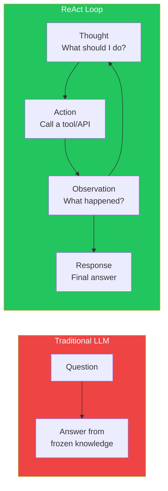
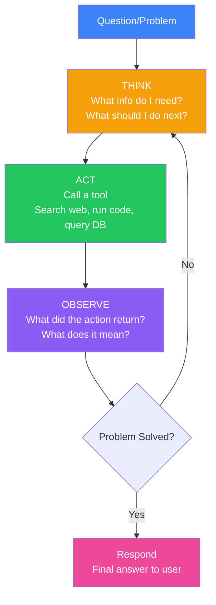
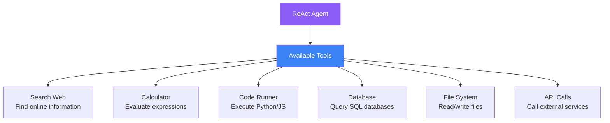
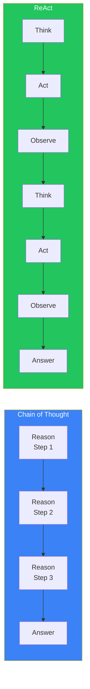

## Introduction

> **ReAct (Reasoning + Acting) is the prompting pattern that enables AI agents to think, act, and observe — just like a human solving a problem.**

Instead of just generating text, ReAct prompts the model to reason about a situation, decide on an action, observe the result, and repeat — creating a feedback loop that powers autonomous agents.

---

## Why This Concept Exists

### The Story

A traditional LLM can answer questions. But what if you need the AI to actually DO something — search the web, run code, query a database?

Without ReAct:
```
User: "What's the current stock price of Apple?"
LLM: "I'm sorry, I don't have access to real-time data."
```

With ReAct:
```
Thought: The user wants Apple's current stock price.
I don't know it from training. I should search for it.

Action: search_stock_price("AAPL")
Observation: $178.50

Thought: I now have the current price. I should format it nicely.

Response: Apple's current stock price is $178.50.
```



---

## Real-World Analogy

### The Scientist

A scientist doesn't just sit and think. They:

1. **Think**: Form a hypothesis
2. **Act**: Run an experiment
3. **Observe**: Analyze results
4. **Repeat**: Refine the hypothesis

This think-act-observe loop is the foundation of the scientific method — and ReAct prompting.

> **ReAct gives LLMs the scientific method.**

---

## The ReAct Loop



### The Three Components

| Component | Description | Example |
|-----------|-------------|---------|
| **Thought** | Reasoning about the current state | "I need to find the user's email address from the database" |
| **Action** | A specific operation to perform | `query_database("SELECT email FROM users WHERE id = 5")` |
| **Observation** | The result of the action | `{ "email": "john@example.com" }` |

---

## ReAct Prompt Template

```
You are an AI assistant that can use tools to answer questions.

For each step, you will:
1. THINK about what you need to do
2. ACT using one of the available tools
3. OBSERVE the result

Available Tools:
- search(query): Search the web for information
- calculate(expression): Evaluate a mathematical expression
- read_file(path): Read a file from the filesystem

Format your response as:

Thought: [your reasoning]
Action: [tool_name]([parameters])
---

When you have enough information to answer, respond with:

Answer: [your final answer]

Now, begin!

User: {{user_question}}
```

---

## ReAct in Practice

### Example 1: Research

```
User: "Who won the 2024 Super Bowl and what was the score?"

Thought: I need to find the 2024 Super Bowl winner and score.
I don't have this information in my training data (cutoff is earlier).
I should search for it.

Action: search("2024 Super Bowl winner score")

Observation: The Kansas City Chiefs won Super Bowl LVIII (2024)
against the San Francisco 49ers with a score of 25-22 in overtime.

Thought: I now have the information. Let me format the response.

Answer: The Kansas City Chiefs won Super Bowl LVIII in 2024,
defeating the San Francisco 49ers 25-22 in overtime.
```

### Example 2: Multi-Step Research

```
User: "What's the weather in Tokyo this weekend and should I pack an umbrella?"

Thought: I need to check the weather forecast for Tokyo this weekend.

Action: search("Tokyo weather forecast this weekend")

Observation: Saturday: 22°C, partly cloudy. Sunday: 19°C, 80% chance of rain.

Thought: Sunday has 80% chance of rain. I should recommend an umbrella.

Answer: This weekend in Tokyo: Saturday will be pleasant at 22°C with
partly cloudy skies. Sunday will be cooler at 19°C with an 80% chance
of rain. Yes, you should definitely pack an umbrella for Sunday!
```

### Example 3: Computation

```
User: "If I invest $10,000 at 7% annual interest compounded monthly
for 5 years, what's the total?"

Thought: I need to calculate compound interest.
Formula: A = P(1 + r/n)^(nt)
P = 10000, r = 0.07, n = 12, t = 5

Action: calculate("10000 * (1 + 0.07/12)^(12*5)")

Observation: 14176.25

Thought: The calculation is complete. The result is $14,176.25.

Answer: After 5 years, your investment of $10,000 at 7% annual
interest compounded monthly would grow to approximately $14,176.25.
```

---

## Tools in ReAct



| Tool | Purpose | Example Action |
|------|---------|----------------|
| **search** | Find online information | `search("latest React version")` |
| **calculate** | Math operations | `calculate("45 * 12")` |
| **run_code** | Execute code | `run_code("import pandas; df.head()")` |
| **query_db** | Database lookups | `query_db("SELECT * FROM users")` |
| **read_file** | Read files | `read_file("./config.json")` |
| **call_api** | External APIs | `call_api("https://api.github.com/repos/user/repo")` |

---

## ReAct vs Chain of Thought

| Aspect | CoT | ReAct |
|--------|-----|-------|
| **Purpose** | Better reasoning | Taking actions |
| **Output** | Text only | Text + actions |
| **Tools** | None | Any number of tools |
| **Loop** | Single pass | Multiple iterations |
| **State** | Static | Changes with each action |
| **Cost** | Lower | Higher (multiple calls) |



---

## Common Mistakes

| Mistake | Why It's Wrong |
|---------|----------------|
| ❌ Not limiting the loop | Without a max iterations limit, the agent can loop forever |
| ❌ Vague tool descriptions | The model needs clear descriptions of what each tool does |
| ❌ Mixing thought and action | Keep them separate so you can parse the action reliably |
| ❌ No error handling | What if the tool fails? The model needs to handle errors. |
| ❌ Too many tools | More tools = more decisions = more errors. Start with 2-3 tools. |

---

## Bad Prompt vs Good Prompt

| Aspect | Bad ReAct | Good ReAct |
|--------|-----------|------------|
| **Tool descriptions** | "search for things" | "search(query): Search the web for current information. Returns text results with URLs." |
| **Loop control** | No limit | "You have a maximum of 5 action steps." |
| **Error handling** | None | "If a tool returns an error, try an alternative approach." |
| **Format** | Free-form | Structured: "Thought: ...\nAction: tool(args)\n---\nObservation: ..." |
| **Stopping condition** | Vague | "When you have enough information to answer confidently, output: Answer: ..." |

---

## Production Examples

### LangGraph Agents

LangGraph provides a production framework for ReAct agents:

```python
from langgraph.graph import StateGraph

# Define the ReAct loop as a state machine
graph = StateGraph(AgentState)
graph.add_node("think", think_node)
graph.add_node("act", act_node)
graph.add_node("observe", observe_node)
graph.add_conditional_edges("observe", should_continue, {...})
```

### AutoGen

Microsoft's AutoGen uses ReAct patterns for multi-agent conversations where agents think, act, and observe.

### OpenAI Assistants API

OpenAI's Assistants API uses ReAct-like loops for code interpreter and file search tools.

---

## Interview Questions

### Easy

**Q: What is the ReAct pattern in prompt engineering?**

> ReAct (Reasoning + Acting) is a prompting pattern where the model alternates between thinking about what to do, taking an action (like searching the web or running code), and observing the result — creating a loop that enables autonomous problem-solving.

### Intermediate

**Q: How is ReAct different from Chain of Thought?**

> CoT is purely about reasoning — the model generates intermediate reasoning steps. ReAct adds actions — the model can call tools, observe results, and incorporate new information into its reasoning. ReAct is more powerful but requires tool definitions and loop management.

### Senior

**Q: Design a production ReAct agent that can't loop infinitely and handles errors gracefully.**

> I'd design: (1) A state machine with max 10 iterations, (2) Each action has a timeout and retry logic, (3) Tool definitions include expected input/output schemas, (4) Observation parsing validates tool output before passing to reasoning, (5) A "dead end" detection: if the last 3 actions produced no new information, stop and ask for help, (6) All actions are logged for debugging and audit, (7) A circuit breaker stops the agent if error rate exceeds threshold.

---

## Summary

| Concept | Key Point |
|---------|-----------|
| **ReAct** | Reasoning + Acting loop for autonomous agents |
| **Thought** | Reason about what to do next |
| **Action** | Call a tool or perform an operation |
| **Observation** | See what the action produced |
| **Key Principle** | Think → Act → Observe → Repeat (until solved) |

---

## Navigation

**Previous:** [13 — Tree of Thought →](./13-tree-of-thought)

**Next:** [15 — Self-Consistency →](./15-self-consistency)
