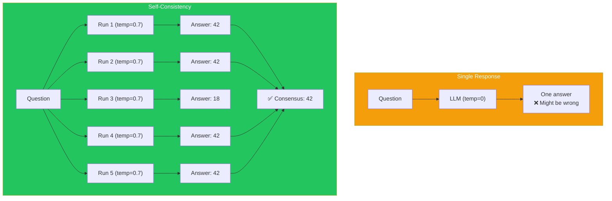
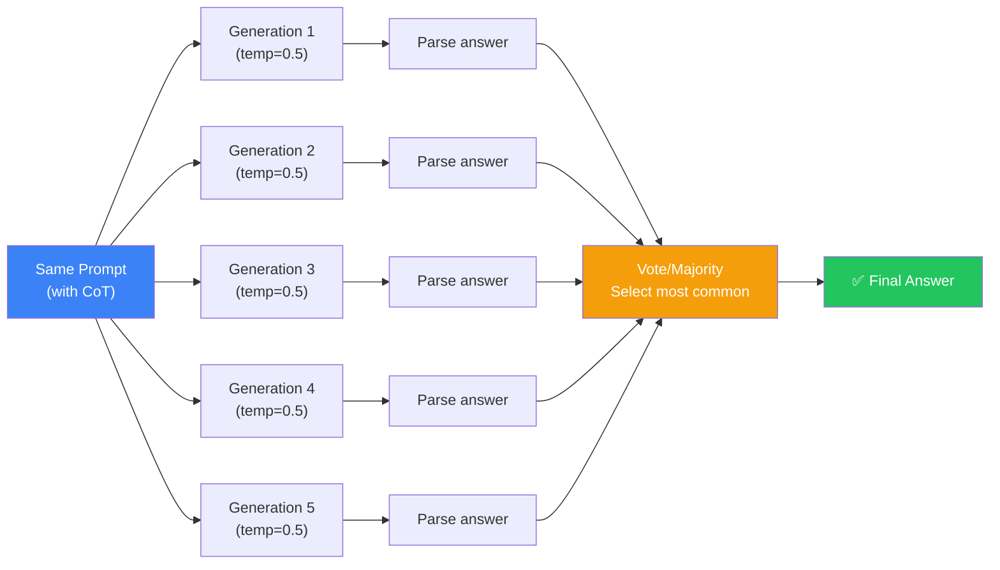
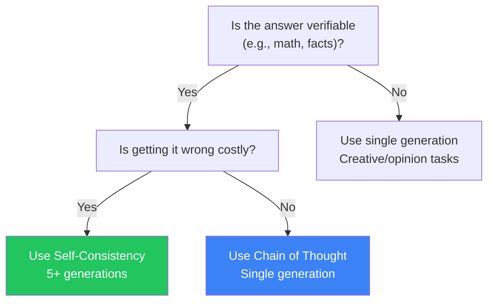

## Introduction

> **One answer might be wrong. Five answers that agree are almost certainly right.**

Self-consistency is a technique where you generate multiple responses to the same prompt (using temperature > 0) and select the most common or consistent answer. It's like asking several experts and going with the majority.

---

## Why This Concept Exists

### The Story

You ask an LLM a math problem. The first time, it gets it right. The second time (with a slightly different generation), it makes a mistake.

Which answer do you trust?

You can't tell with a single response. But if you ask the model 5 times and 4 give the same answer, you can be highly confident that answer is correct.



---

## Real-World Analogy

### The Panel of Doctors

When you have a serious medical condition, you don't ask one doctor. You get a second opinion — sometimes a third.

If three out of four doctors agree on the diagnosis, you trust that diagnosis.

Self-consistency is the same principle: multiple independent generations that agree provide much higher confidence than any single generation.

> **Self-consistency is the "second opinion" for LLM outputs.**

---

## How Self-Consistency Works



### The Process

1. **Generate multiple responses** using the same prompt with `temperature > 0` (e.g., 0.3-0.7)
2. **Extract the final answer** from each response (often after a CoT reasoning chain)
3. **Select the most common answer** (majority voting)
4. **(Optional) Weight by confidence** — some answers may have higher model confidence

---

## Temperature and Diversity

The temperature setting controls how different the generations are:

| Temperature | Diversity | Use Case |
|-------------|-----------|----------|
| 0.0 | None (deterministic) | Not useful for self-consistency |
| 0.3 | Low diversity | Good for factual tasks |
| 0.5 | Moderate diversity | Balanced approach |
| 0.7 | High diversity | Creative tasks |
| 1.0 | Very high diversity | Exploration |

**Recommended:** For self-consistency, use `temperature = 0.3` to `0.5`. High enough for diversity, low enough to avoid random answers.

---

## When to Use Self-Consistency



| Task Type | Self-Consistency Benefit | Recommended Generations |
|-----------|-------------------------|------------------------|
| **Math problems** | High | 3-5 |
| **Factual QA** | High | 3-5 |
| **Code generation** | Medium | 2-3 |
| **Classification** | Medium | 3-5 |
| **Creative writing** | Low | 1 (prefer diversity) |
| **Opinion tasks** | None | 1 |

---

## Beyond Majority Voting

### Weighted Voting

Not all answers are equally likely. Some models output token probabilities you can use:

```
Answer A: 42 (avg token prob: 0.95) → Weight: 0.95
Answer B: 42 (avg token prob: 0.87) → Weight: 0.87
Answer C: 18 (avg token prob: 0.72) → Weight: 0.72

Weighted score for 42: 0.95 + 0.87 = 1.82
Weighted score for 18: 0.72
→ Answer 42 wins with higher confidence
```

### Confidence Thresholds

```
If consensus > 80% → Accept answer
If consensus 60-80% → Accept with warning
If consensus < 60% → Flag for human review
```

### Marginal Distribution

For tasks with multiple possible answers, look at the full distribution:

```
Question: "What's the primary color?"
- Red: 40%
- Blue: 35%
- Green: 25%
→ Low consensus — task may be ambiguous
```

---

## Real-World Examples

### Example 1: Math Problem

```
Question: "A shirt costs $45. It's on sale for 20% off.
Then an additional 10% off the sale price. What's the final price?"

Generation 1: 20% off = $36. 10% off $36 = $32.40. Answer: $32.40
Generation 2: $45 - 20% = $36. $36 - 10% = $32.40. Answer: $32.40
Generation 3: 20% of 45 = 9. 45 - 9 = 36. 10% of 36 = 3.60. 36 - 3.60 = 32.40. Answer: $32.40
Generation 4: Discount 1: 45 × 0.8 = 36. Discount 2: 36 × 0.9 = 32.40. Answer: $32.40
Generation 5: 20% off = $36. Then 10% off sale price = $32.40. Answer: $32.40

Consensus: 5/5 chose $32.40 → High confidence ✅
```

### Example 2: Classification

```
Question: "Classify this email: 'Your invoice #1234 for $500 is overdue.
Please pay within 7 days to avoid late fees.'"

Generation 1: Category: Billing → Reminder
Generation 2: Category: Billing → Payment Reminder
Generation 3: Category: Finance → Invoice
Generation 4: Category: Billing → Overdue Notice
Generation 5: Category: Billing → Invoice Reminder

Consensus: 4/5 chose Billing category → Accept
Sub-category varies → Lower confidence, use with warning
```

---

## Common Mistakes

| Mistake | Why It's Wrong |
|---------|----------------|
| ❌ Using temperature = 0 | All generations produce identical results — no point |
| ❌ Too few generations | 2 generations isn't enough for meaningful consensus |
| ❌ Too many generations | 10+ generations shows diminishing returns (5 is usually enough) |
| ❌ Not using CoT with self-consistency | CoT + self-consistency is much more effective than either alone |
| ❌ Ignoring the cost | 5 generations = 5x cost. Only use when accuracy matters. |

---

## Bad Prompt vs Good Prompt

| Aspect | Without Self-Consistency | With Self-Consistency |
|--------|------------------------|----------------------|
| **Generations** | 1 | 3-5 |
| **Temperature** | 0 (deterministic) | 0.3-0.5 (some randomness) |
| **Answer selection** | Single output | Majority voting |
| **Confidence** | Unknown | Measurable (consensus %) |
| **Cost** | 1x | 3-5x |

---

## Production Examples

### Google's Self-Consistency Research

Google's research showed self-consistency improves accuracy on math reasoning tasks by 15-20% compared to single-path CoT.

### Production Systems

- Automated math tutoring systems use self-consistency to verify answers
- Medical diagnosis assistants use it to reduce false positives
- Code generation tools use it to suggest the most reliable solution

---

## Interview Questions

### Easy

**Q: What is self-consistency in prompt engineering?**

> Self-consistency generates multiple responses to the same prompt (using temperature > 0) and selects the most common answer through majority voting. It improves reliability by finding consensus across diverse generations.

### Intermediate

**Q: How do you choose the right temperature for self-consistency?**

> Use 0.3-0.5 for factual/math tasks. High enough to get diverse results, low enough to avoid random answers. If temperature is too low, all answers are the same (waste). If too high, answers are random (unreliable).

### Senior

**Q: Design a production system that uses self-consistency cost-efficiently.**

> I'd use adaptive generation: (1) Generate 2 responses first, (2) If they agree → accept (saves cost for easy cases), (3) If they disagree → generate 3 more, (4) Use weighted voting based on token probabilities, (5) If still no consensus → flag for human review. This averages ~2.5 generations per query instead of always doing 5.

---

## Summary

| Concept | Key Point |
|---------|-----------|
| **Self-Consistency** | Multiple generations → majority voting |
| **Why It Works** | Random errors cancel out, patterns emerge |
| **When to Use** | Factual/math tasks where accuracy matters |
| **Temperature** | 0.3-0.5 for good diversity |
| **Generations** | 3-5 is usually optimal |

---

## Navigation

**Previous:** [14 — ReAct Prompting →](./14-react-prompting)

**Next:** [16 — Step-Back Prompting →](./16-step-back-prompting)
