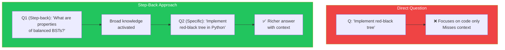
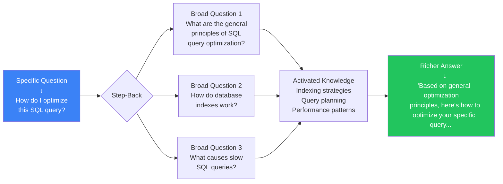
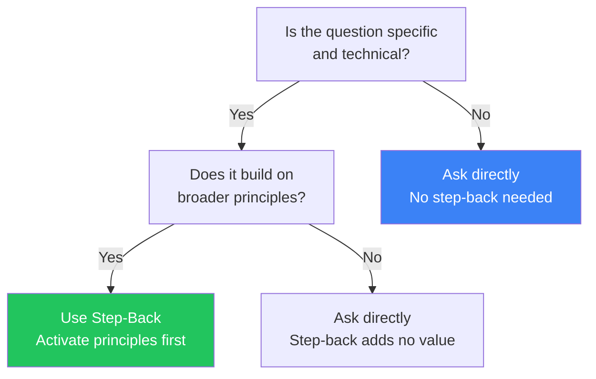

## Introduction

> **Sometimes the best way to answer a specific question is to first ask a broader one.**

Step-back prompting is a technique where you first prompt the model to think about the general principles or high-level context before answering the specific question. This activates relevant knowledge that the model might not use when focused on the narrow question.

---

## Why This Concept Exists

### The Story

You ask a direct question:

```
Q: "How do I implement a red-black tree in Python?"
```

The model jumps straight to implementation details. It might miss discussing:
- When to use red-black trees vs other balanced trees
- The fundamental properties that make them work
- Alternative approaches

But if you first ask:

```
Step-back: "What are the fundamental properties and use cases
of balanced binary search trees?"

Then: "Given those principles, how do I implement a red-black tree in Python?"
```

The second answer is richer because the model's relevant knowledge was activated first.



---

## Real-World Analogy

### The Doctor

A patient comes in with a headache. The doctor could immediately prescribe painkillers.

But a good doctor first asks broader questions:
- "What's your general health like?"
- "Have you had any recent injuries?"
- "What's your stress level?"

These broader questions activate relevant medical knowledge that helps diagnose the root cause — not just treat the symptom.

> **Step-back prompting is asking "what's your general health like?" before treating the headache.**

---

## How Step-Back Works



---

## Step-Back Prompt Template

```
You are an expert in {{domain}}.

First, let me ask a broader question:

{{step_back_question}}

Now, applying the principles above, answer this specific question:

{{specific_question}}
```

### Example: Physics Problem

```
You are a physics expert.

First, let me think about the general principles:
What are Newton's laws of motion and how do they apply to projectile motion?

Now, applying those principles:
A ball is thrown at 20 m/s at a 30-degree angle.
How far does it travel before hitting the ground?
```

---

## When to Use Step-Back Prompting



| Task Type | Step-Back Benefit | Example |
|-----------|-------------------|---------|
| **Technical implementation** | High | "Implement X" — first ask about X's principles |
| **Troubleshooting** | High | "Fix this bug" — first ask about common causes |
| **Decision making** | High | "Choose between A and B" — first ask about decision frameworks |
| **Simple facts** | None | "What's the capital of France?" |
| **Creative tasks** | Low | "Write a poem" |

---

## Real-World Examples

### Example 1: Code Optimization

```
❌ Direct:
"How do I make this React component faster?"
→ Specific suggestions for this component only

✅ Step-Back:
"First, what are the general principles of React performance optimization?
(Memoization, virtualization, avoiding unnecessary re-renders, code splitting...)

Now, applying those principles, how do I optimize this specific component?"
→ Broader solution with multiple approaches
```

### Example 2: Debugging

```
❌ Direct:
"Why is my Docker container not starting?"
→ Debugs one specific case

✅ Step-Back:
"First, what are the common reasons Docker containers fail to start?
(Port conflicts, missing dependencies, volume mount issues, resource limits...)

Now, given my specific container that's failing with this error:
[error message]
Which of these common causes is most likely?"
→ Systematic debugging approach
```

---

## Common Mistakes

| Mistake | Why It's Wrong |
|---------|----------------|
| ❌ Step-back is irrelevant | If the broad question doesn't relate to the specific one, it adds no value |
| ❌ Step-back is too broad | "What is life?" before "How do I sort an array?" — not helpful |
| ❌ Forgetting to connect back | Ask the step-back, then explicitly connect it to the specific question |
| ❌ Using it for simple questions | "What's 2+2?" doesn't need step-back about arithmetic principles |
| ❌ Too many step-backs | One level of abstraction is usually enough. Two is too many. |

---

## Bad Prompt vs Good Prompt

| Aspect | Direct | Step-Back |
|--------|--------|-----------|
| **Approach** | "Answer this specific question" | "First think about general principles, then apply to specific question" |
| **Knowledge Activation** | Narrow, focused | Broad, contextual |
| **Answer Quality** | Usually correct but shallow | Richer, more nuanced |
| **Best For** | Simple facts, direct instructions | Complex problems requiring understanding |

---

## Production Examples

### Educational Systems

AI tutoring systems use step-back prompting to first activate relevant concepts before explaining specific problems.

### Technical Support Bots

Support bots first ask about general troubleshooting principles (what could cause this type of error?) before diving into the specific issue.

---

## Interview Questions

### Easy

**Q: What is step-back prompting?**

> Step-back prompting first asks the model a broader, principle-level question before asking the specific question. This activates relevant general knowledge that improves the quality of the specific answer.

### Intermediate

**Q: When is step-back prompting most effective?**

> When the specific question builds on broader principles — like asking about a specific algorithm after reviewing algorithm design principles, or troubleshooting a specific error after reviewing common error categories.

### Senior

**Q: How would you automate step-back prompting in a production system?**

> I'd use a two-stage pipeline: (1) A "step-back generator" prompt that takes the user's specific question and generates a relevant broader question, (2) A "reasoner" prompt that receives both the step-back answer and the specific question. This can be automated with LLM chaining.

---

## Summary

| Concept | Key Point |
|---------|-----------|
| **Step-Back** | Ask a broader question before the specific one |
| **Why It Works** | Activates relevant general knowledge |
| **When to Use** | Complex problems building on principles |
| **When NOT to Use** | Simple facts, direct instructions |
| **Template** | "First, [broad question]. Now, [specific question]." |

---

## Navigation

**Previous:** [15 — Self-Consistency →](./15-self-consistency)

**Next:** [17 — Meta Prompting →](./17-meta-prompting)
