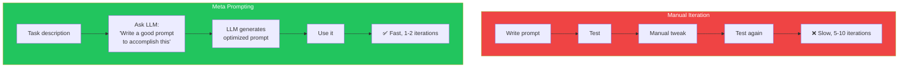
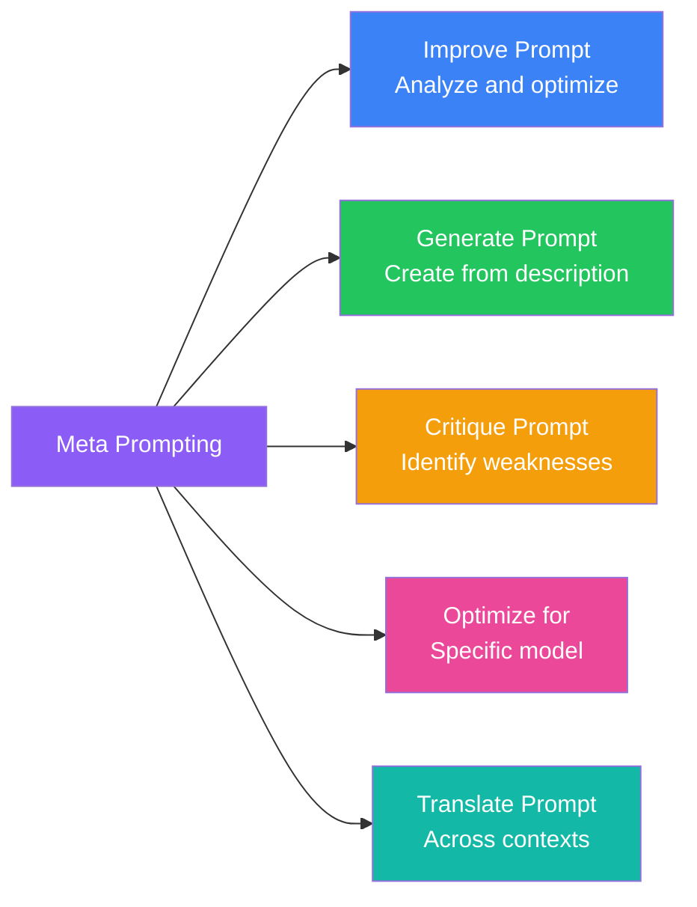

## Introduction

> **Meta prompting is using AI to improve your prompts for AI. It's prompt engineering bootstrapping itself.**

Instead of manually iterating on prompts, you ask the LLM to analyze, improve, or generate prompts for you. It's the recursive power-up of prompt engineering.

---

## Why This Concept Exists

### The Story

You spend 30 minutes iterating on a prompt to get it right. You test 5 variations, tweak wording, adjust format.

What if you could ask the LLM: "Here's my prompt. How can I improve it?"

Or: "Here's my task. Write me a good prompt for it."

That's meta prompting.



---

## Real-World Analogy

### The Master Teacher

A master teacher doesn't just teach students. They also teach other teachers HOW to teach. The meta-skill of "teaching teaching" amplifies their impact.

Meta prompting is the same — it's the skill of writing prompts that write prompts.

> **Meta prompting is "teaching teaching" for LLMs.**

---

## Types of Meta Prompting



---

## Meta Prompting Patterns

### Pattern 1: Prompt Improvement

```
I have this prompt:

[your prompt]

Please analyze it and suggest improvements:
1. What's missing?
2. What's unnecessary?
3. How could the structure be better?
4. How could the wording be clearer?
5. Are there any ambiguities?

Then provide an improved version of the prompt.
```

### Pattern 2: Prompt Generation

```
I need a prompt for the following task:

Task: [describe what you want the AI to do]
Context: [relevant background]
Target Audience: [who will use the output]
Output Requirements: [format, constraints]

Please generate an optimized prompt that will produce the best results.
Include:
- System prompt (persona, rules)
- User prompt structure
- Output format specification
- Example (if helpful)
```

### Pattern 3: Prompt Critique

```
Evaluate this prompt for potential issues:

[prompt]

Consider:
1. Clarity: Is the instruction clear?
2. Completeness: Is anything missing?
3. Bias: Does it lead the model?
4. Robustness: How does it handle edge cases?
5. Token efficiency: Is it concise?

Rate each aspect 1-10 and provide specific recommendations.
```

---

## Meta Prompting Templates

### Template 1: Chain of Thought Optimizer

```
I'm using Chain of Thought prompting for this task. Here's my current prompt:

[CoT prompt]

How can I make the reasoning steps clearer or more effective?
Suggest 3 specific improvements.
```

### Template 2: Output Format Optimizer

```
I need the LLM to output in this format:

[describe format]

Here's my current prompt for this:

[prompt]

Is there a better way to specify this format to ensure
the model follows it consistently?
```

### Template 3: Few-Shot Selector

```
I'm using few-shot prompting for [task type].
Here are my current examples:

[examples]

Are these the right examples? Should I add, remove, or replace any?
What edge cases should I cover?
```

---

## Real-World Examples

### Example 1: Prompt Generation

```
User:
"I need a prompt that helps junior developers debug React
performance issues. The prompt should guide them through
a systematic debugging process. Output should be actionable."

Meta-LLM Response:
System: You are a senior React performance engineer mentoring a junior developer.

Prompt:
"Walk through debugging this React performance issue step by step:

1. FIRST — Identify the symptom:
   [describe what's slow - renders? interactions? load time?]

2. CHECK — Common causes:
   - Is it unnecessary re-renders? (check React DevTools)
   - Is it expensive computations? (check useMemo opportunities)
   - Is it large lists? (check virtualization needs)

3. DIAGNOSE — Use React DevTools Profiler to:
   - Record a profile of the slow interaction
   - Identify which component re-rendered most
   - Check if props changed unexpectedly

4. FIX — Based on diagnosis:
   - memo() for stable props
   - useMemo for expensive calculations
   - useCallback for stable callbacks
   - Key props for list stability
   - Virtualization for long lists

5. VERIFY — Profile again to confirm improvement

Output format:
## Symptom
## Likely Cause
## Diagnosis Steps
## Recommended Fix
## Verification"
```

### Example 2: Prompt Improvement

```
User:
"Here's my prompt for extracting data from invoices:

'Extract the invoice number, date, vendor name, and total amount
from this invoice text. Return as JSON.'

How can I improve it?"

Meta-LLM Response:
"Issues with current prompt:
1. ❌ No output format example — model may guess field names
2. ❌ No handling for missing fields — what if date is missing?
3. ❌ No instructions for amounts — should they be numbers or strings?
4. ❌ No constraints on extra text — model may add explanations

Improved version:

Extract the following fields from this invoice text.
If a field is not found, use null.
Return ONLY the JSON object with no additional text.

Fields to extract:
- invoice_number: string (e.g., "INV-001")
- date: string in YYYY-MM-DD format (or null)
- vendor_name: string (or null)
- total_amount: number (decimal, no currency symbol)

Example output format:
{
  "invoice_number": "INV-001",
  "date": "2024-01-15",
  "vendor_name": "Acme Corp",
  "total_amount": 1500.50
}

Invoice text:
[invoice text here]"
```

---

## Common Mistakes

| Mistake | Why It's Wrong |
|---------|----------------|
| ❌ Meta prompt is too vague | "Improve this prompt" without guidance on what to improve |
| ❌ Accepting meta output blindly | The meta LLM can also make mistakes — review its suggestions |
| ❌ Not testing the improved prompt | An improved-looking prompt isn't necessarily better — test it |
| ❌ Over-optimizing | Meta prompting can produce overly complex prompts |
| ❌ Ignoring the model difference | A prompt optimized by GPT-4 may not work well with Claude |

---

## Bad Prompt vs Good Prompt

| Aspect | Bad Meta Prompt | Good Meta Prompt |
|--------|-----------------|------------------|
| **Context** | "Improve this" | "Improve this prompt for extracting invoice data as JSON" |
| **Specifics** | None | "Focus on clarity, missing fields, and format consistency" |
| **Constraints** | None | "Keep it under 500 tokens. Don't add unnecessary sections." |
| **Examples** | None | "Show me the improved version with a before/after comparison" |

---

## Production Examples

### LangChain Hub

The LangChain Hub is a community-driven repository of prompts, where meta-prompting is used to improve and refine shared prompts.

### Prompt Management Platforms

Platforms like Agenta, PromptLayer, and LangSmith use meta-prompting to automatically suggest prompt improvements based on evaluation metrics.

---

## Interview Questions

### Easy

**Q: What is meta prompting?**

> Meta prompting is using an LLM to analyze, improve, or generate prompts for other tasks. Instead of manually writing and iterating on prompts, you ask the LLM to help you create better prompts.

### Intermediate

**Q: What are the risks of meta prompting?**

> The meta LLM can generate prompts that look good but don't actually work better. Always test the generated prompts. Also, meta prompts can produce overly complex prompts that waste tokens.

### Senior

**Q: Design a self-improving prompt system that uses meta prompting.**

> I'd design: (1) A prompt registry with versioned prompts, (2) An evaluation pipeline that measures prompt performance (accuracy, token usage), (3) A meta-prompting agent that periodically reviews underperforming prompts, (4) A/B testing framework to compare current vs suggested versions, (5) Automatic promotion of winning variants, (6) Feedback loop: unsuccessful changes are logged to avoid repeating mistakes.

---

## Summary

| Concept | Key Point |
|---------|-----------|
| **Meta Prompting** | Using LLMs to improve LLM prompts |
| **Improve** | Analyze and optimize existing prompts |
| **Generate** | Create prompts from task descriptions |
| **Critique** | Identify weaknesses in prompts |
| **Key Insight** | Prompt engineering bootstrapping itself |

---

## Navigation

**Previous:** [16 — Step-Back Prompting →](./16-step-back-prompting)

**Next:** [18 — Prompt Optimization →](./18-prompt-optimization)
