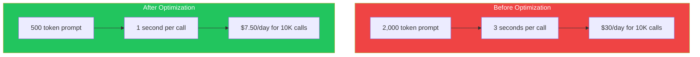
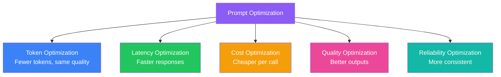
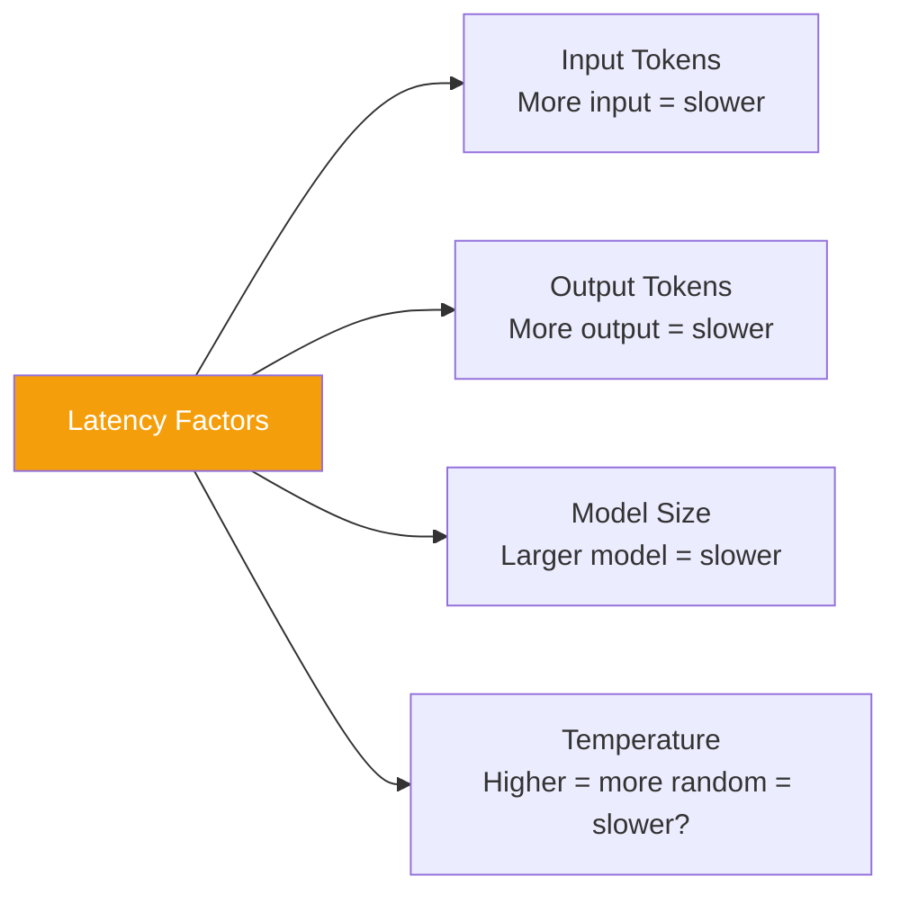
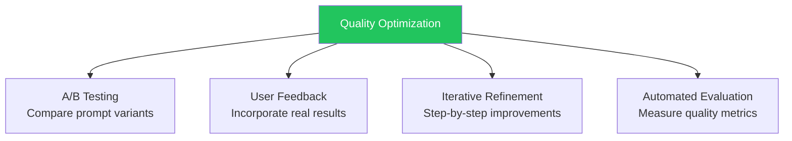
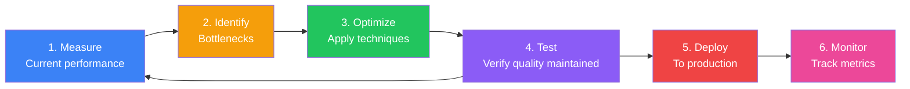

## Introduction

> **A prompt that works is good. A prompt that works efficiently is production-ready.**

Prompt optimization is the practice of making prompts faster, cheaper, and more reliable — reducing token count, improving accuracy, and minimizing latency while maintaining or improving output quality.

---

## Why This Concept Exists

### The Story

You have a prompt that works. It produces good results. But in production, every token costs money and every millisecond of latency matters.

Your prompt is 2,000 tokens and takes 3 seconds per call. At 10,000 calls per day, that's $30/day and 8 hours of total latency.

After optimization, your prompt is 500 tokens and takes 1 second. At 10,000 calls/day, that's $7.50/day and 2.8 hours of total latency.

Over a year, that's **$8,000+ saved** and **2,000 hours of latency eliminated**.



---

## Real-World Analogy

### Code Optimization

A junior developer writes code that works but is slow and memory-intensive. A senior engineer refactors it to be efficient — same output, fewer resources.

Prompt optimization is the same: same output quality, fewer tokens, faster response.

> **Prompt optimization is code refactoring for LLM prompts.**

---

## Optimization Dimensions



---

## Token Optimization

### Techniques

| Technique | Token Savings | Impact on Quality |
|-----------|--------------|-------------------|
| **Remove filler words** | 5-10% | None |
| **Use concise instructions** | 10-20% | Slightly positive |
| **Replace descriptions with examples** | 20-40% | Positive |
| **Reduce persona description** | 5-15% | Minimal |
| **Remove redundant constraints** | 5-10% | Neutral |
| **Use abbreviations for common terms** | 2-5% | Minimal risk |

### Before and After

```
❌ Before (150 tokens):
"I would like you to please act as a senior software engineer
who has extensive experience with the Python programming language
and specifically with the Django web framework. Could you please
take a look at the following code and provide me with your feedback
on any potential issues or improvements that you might notice?"

✅ After (50 tokens):
"Role: Senior Django engineer
Task: Review this code for issues and improvements
Code: [code]"
```

---

## Latency Optimization



| Technique | Latency Reduction | Trade-off |
|-----------|------------------|-----------|
| **Limit max tokens** | Significant | Shorter responses |
| **Use smaller model** | Significant | Lower quality |
| **Reduce input context** | Proportional | Might lose context |
| **Prompt caching** | Variable | Implementation overhead |
| **Stream responses** | Perceived reduction | Same total time |

---

## Cost Optimization

### Cost Calculation

```
Cost per call = (Input Tokens × Input Price) + (Output Tokens × Output Price)

Example (GPT-4o):
Input: 500 tokens × $2.50/1M = $0.00125
Output: 200 tokens × $10.00/1M = $0.00200
Total: $0.00325 per call

At 10,000 calls/day: $32.50/day = ~$975/month
```

### Optimization Strategies

| Strategy | Cost Reduction | Implementation |
|----------|---------------|----------------|
| **Reduce prompt size** | 20-50% | Edit and compress |
| **Use shorter outputs** | 30-60% | Limit max_tokens |
| **Cache common requests** | 40-80% | Cache layer |
| **Batch requests** | 15-25% | Combine multiple inputs |
| **Use cheaper model** | 50-90% | Try smaller/older models |

---

## Quality Optimization

### Techniques Beyond Token Reduction



| Technique | Quality Impact | Effort |
|-----------|---------------|--------|
| **Add examples** | High | Medium |
| **Better structure** | Medium | Low |
| **Add constraints** | High | Low |
| **Use system prompt** | Medium | Low |
| **Chain of thought** | High | Medium |

---

## Optimization Workflow



---

## Real-World Examples

### Example 1: Production Optimization

```
Before (1,200 tokens):
"As an AI assistant with expertise in customer support for e-commerce
platforms, I need you to analyze the following customer inquiry and
determine the most appropriate response based on our company policies
and procedures. Please consider the customer's tone, the nature of
their issue, their order history if available, and our current return
and refund policies..."

After (400 tokens):
"System: E-commerce support agent
Follow policy guidelines below for each issue type.

[Customer inquiry]
[policies]

Respond with: resolution, policy_ref, customer_tone, needs_escalation"
→ 67% token reduction, same quality
```

### Example 2: Format Optimization

```
Before: "Please return the data in a JSON format with the following fields..."
After: "Return JSON: { field1: type, field2: type }"
→ 50% token reduction, more consistent outputs
```

---

## Common Mistakes

| Mistake | Why It's Wrong |
|---------|----------------|
| ❌ Optimizing before measuring | You don't know what to improve without baselines |
| ❌ Reducing tokens at the expense of quality | A 50% cheaper wrong answer isn't valuable |
| ❌ Over-optimizing for one model | Prompts optimized for GPT-4 may fail on Claude |
| ❌ Ignoring output tokens | Output tokens often cost more than input tokens |
| ❌ Not testing optimized prompts | Always verify quality after optimization |

---

## Bad Prompt vs Good Prompt

| Aspect | Unoptimized | Optimized |
|--------|-------------|-----------|
| **Length** | 1,000+ tokens | 200-500 tokens |
| **Clarity** | Wordy, polite, indirect | Direct, concise, specific |
| **Structure** | Paragraph form | Structured, labeled sections |
| **Instructions** | Implicit | Explicit and prioritized |
| **Format** | Described | Shown with example |
| **Redundancy** | High | Minimal |

---

## Production Examples

### OpenAI Prompt Optimization

OpenAI's documentation shows how to optimize prompts by removing unnecessary context, using shorter instructions, and specifying exact output formats.

### Anthropic Prompt Engineering

Anthropic recommends XML-style prompting and keeping prompts under 500 tokens when possible.

---

## Interview Questions

### Easy

**Q: Why is prompt optimization important in production?**

> Because every token costs money and every millisecond of latency adds up at scale. Optimizing prompts can reduce costs by 50-80% and improve response times significantly while maintaining quality.

### Intermediate

**Q: What techniques can reduce prompt token count without sacrificing quality?**

> Remove filler words, replace descriptions with examples, use structured formats instead of paragraphs, reduce persona descriptions, remove redundant constraints, and specify output format with examples.

### Senior

**Q: Design a prompt optimization pipeline for a production system handling 1M+ requests per day.**

> I'd implement: (1) Automated prompt profiling (token count, latency, cost per call), (2) A/B testing framework for prompt variants, (3) Evaluation pipeline comparing output quality (automated + sampled human review), (4) Caching layer for identical requests, (5) Model routing (simple queries → cheaper/faster model), (6) Dynamic prompt compression based on context length, (7) Continuous monitoring with alerts for quality regression.

---

## Summary

| Concept | Key Point |
|---------|-----------|
| **Token Optimization** | Same quality, fewer tokens |
| **Latency Optimization** | Faster response times |
| **Cost Optimization** | Cheaper per call at scale |
| **Quality Optimization** | Better, more consistent outputs |
| **Key Principle** | Measure before optimizing, test after |

---

## Navigation

**Previous:** [17 — Meta Prompting →](./17-meta-prompting)

**Next:** [19 — Prompt Testing →](./19-prompt-testing)
