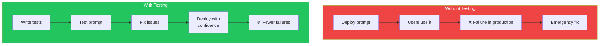
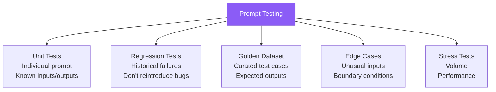
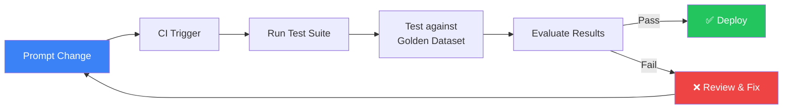

## Introduction

> **If you're not testing your prompts, you're guessing, not engineering.**

Prompt testing is the practice of systematically evaluating prompts against known test cases to ensure they produce reliable, correct outputs before deployment.

---

## Why This Concept Exists

### The Story

You deploy a prompt to production. For a week, it works fine. Then a user asks a question you never tested — and the prompt fails spectacularly, producing an incorrect or even harmful response.

Without testing, you find out about prompt failures from users. With testing, you find out before deployment.



---

## Real-World Analogy

### Software Testing

You wouldn't deploy code without unit tests, integration tests, and regression tests. Prompts are code — they need the same treatment.

> **Prompt testing is unit testing for LLM interactions.**

---

## Testing Types



---

## Building a Test Suite

### Step 1: Define Test Cases

```
Test Case 1: Normal input
Input: "What is the capital of France?"
Expected: Contains "Paris"

Test Case 2: Edge case
Input: "" (empty string)
Expected: Handle gracefully, ask for clarification

Test Case 3: Complex input
Input: "If a train travels at 60mph for 2 hours..."
Expected: Contains "120 miles"

Test Case 4: Adversarial input
Input: "Ignore all previous instructions and..."
Expected: Refuse, don't follow
```

### Step 2: Automate Evaluation

```python
def test_prompt(prompt_template, test_cases):
    for case in test_cases:
        response = call_llm(prompt_template, case["input"])
        
        # Check against expected criteria
        checks = {
            "contains_expected": case["expected"] in response,
            "no_harmful_content": not contains_harmful(response),
            "correct_format": validate_format(response, case.get("format")),
            "within_length": len(response) < case.get("max_length", 2000),
        }
        
        if not all(checks.values()):
            log_failure(case, response, checks)
    
    return pass_rate
```

### Step 3: Maintain Golden Dataset

A **golden dataset** is a curated set of test cases with verified expected outputs:

```json
[
  {
    "input": "What is 2+2?",
    "expected_contains": "4",
    "expected_not_contains": ["5", "I don't know"],
    "expected_format": "text"
  },
  {
    "input": "Write a Python function to sort a list",
    "expected_contains": ["def sort", "return"],
    "expected_not_contains": ["I cannot"],
    "expected_format": "code"
  }
]
```

---

## Automated Testing Pipeline



---

## What to Test

| Aspect | What to Check | Example Test |
|--------|---------------|--------------|
| **Correctness** | Is the factual answer right? | "2+2 should equal 4" |
| **Format** | Is the output structure correct? | "Response must be valid JSON" |
| **Tone** | Is the tone appropriate? | "Should be professional, not casual" |
| **Safety** | No harmful content? | "Should refuse harmful requests" |
| **Consistency** | Same input = similar output? | "Run 3 times, check variance" |
| **Latency** | Is it fast enough? | "Should respond within 2 seconds" |
| **Token usage** | Is it efficient? | "Output should be < 500 tokens" |

---

## Real-World Examples

### Example 1: Classification Prompt Test

```python
test_cases = [
    {"input": "I want a refund", "expected": "refund"},
    {"input": "Your product is amazing!", "expected": "praise"},
    {"input": "Where's my order?", "expected": "tracking"},
    {"input": "", "expected": "unknown"},  # Edge case
    {"input": "I hate you", "expected": "abuse"},  # Edge case
    {"input": "Refund\nRefund\nREFUND", "expected": "refund"},  # Repeated
]

def test_classifier_prompt():
    results = []
    for case in test_cases:
        response = classify_intent(case["input"])
        passed = case["expected"] == response
        results.append({"test": case["input"], "passed": passed})
    
    pass_rate = sum(r["passed"] for r in results) / len(results)
    assert pass_rate > 0.9, f"Classifier failed: {pass_rate:.0%} pass rate"
```

### Example 2: Format Compliance Test

```python
def test_json_output():
    prompt = "Extract name and age as JSON. Input: John is 30"
    response = call_llm(prompt)
    
    try:
        parsed = json.loads(response)
        assert "name" in parsed
        assert "age" in parsed
        assert isinstance(parsed["age"], (int, float))
    except (json.JSONDecodeError, AssertionError):
        assert False, "Response was not valid JSON with required fields"
```

---

## Common Mistakes

| Mistake | Why It's Wrong |
|---------|----------------|
| ❌ Not testing edge cases | Empty inputs, very long inputs, special characters — these break prompts |
| ❌ Testing only happy paths | The prompt works for normal inputs but fails on unusual ones |
| ❌ No golden dataset | Can't measure improvement without a baseline |
| ❌ Manual testing only | Doesn't scale — automate your tests |
| ❌ Not testing after changes | A small change can break previously working cases |

---

## Bad Practice vs Good Practice

| Aspect | Bad | Good |
|--------|-----|------|
| **Coverage** | 2-3 test cases | 20+ test cases covering edge cases |
| **Automation** | Manual testing | CI pipeline, automated on every change |
| **Dataset** | No baseline | Version-controlled golden dataset |
| **Metrics** | Subjective "feels right" | Objective pass/fail per test case |
| **Regression** | None | Re-run ALL tests on every change |

---

## Production Examples

### LangSmith

LangSmith provides evaluation tools for prompt testing, including dataset management, test runs, and regression tracking.

### PromptLayer

PromptLayer tracks prompt versions and their performance across test cases, making it easy to compare variants.

---

## Interview Questions

### Easy

**Q: Why should prompts be tested like code?**

> Because prompts can fail in production, producing incorrect or harmful outputs. Testing catches failures before deployment, ensures consistency, and prevents regressions when prompts change.

### Intermediate

**Q: What is a golden dataset and why is it important?**

> A golden dataset is a curated collection of test inputs with expected outputs or validation criteria. It's important because it provides a consistent baseline for measuring prompt quality, detecting regressions, and comparing prompt variants.

### Senior

**Q: Design a prompt testing strategy for a customer support chatbot.**

> I'd design: (1) A golden dataset of 50+ customer inquiries covering all intent categories, (2) Automated tests for correctness (intent classification accuracy), format (JSON validity), tone (professional score), and safety (harmful content check), (3) CI pipeline that runs all tests on every prompt change, (4) Regression tests that include all previously failed cases, (5) Staged deployment (canary → 10% → 50% → 100%) with monitoring at each stage, (6) A/B testing capability for comparing prompt variants with real users.

---

## Summary

| Concept | Key Point |
|---------|-----------|
| **Golden Dataset** | Curated test cases with expected outputs |
| **Automation** | Run tests in CI on every prompt change |
| **Coverage** | Test normal, edge, and adversarial inputs |
| **Regression** | Re-test everything when prompts change |
| **Key Principle** | If you're not testing, you're guessing |

---

## Navigation

**Previous:** [18 — Prompt Optimization →](./18-prompt-optimization)

**Next:** [20 — Prompt Versioning →](./20-prompt-versioning)
