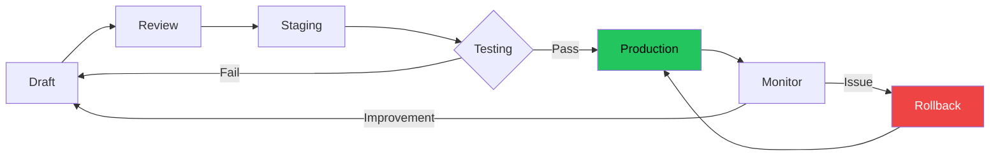
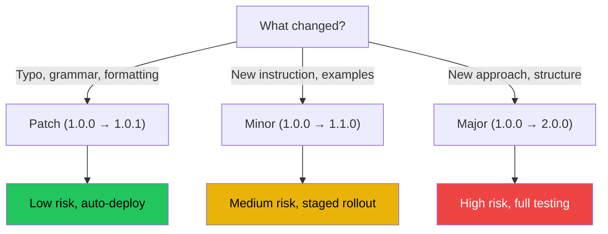
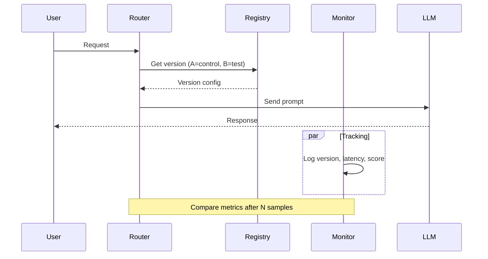
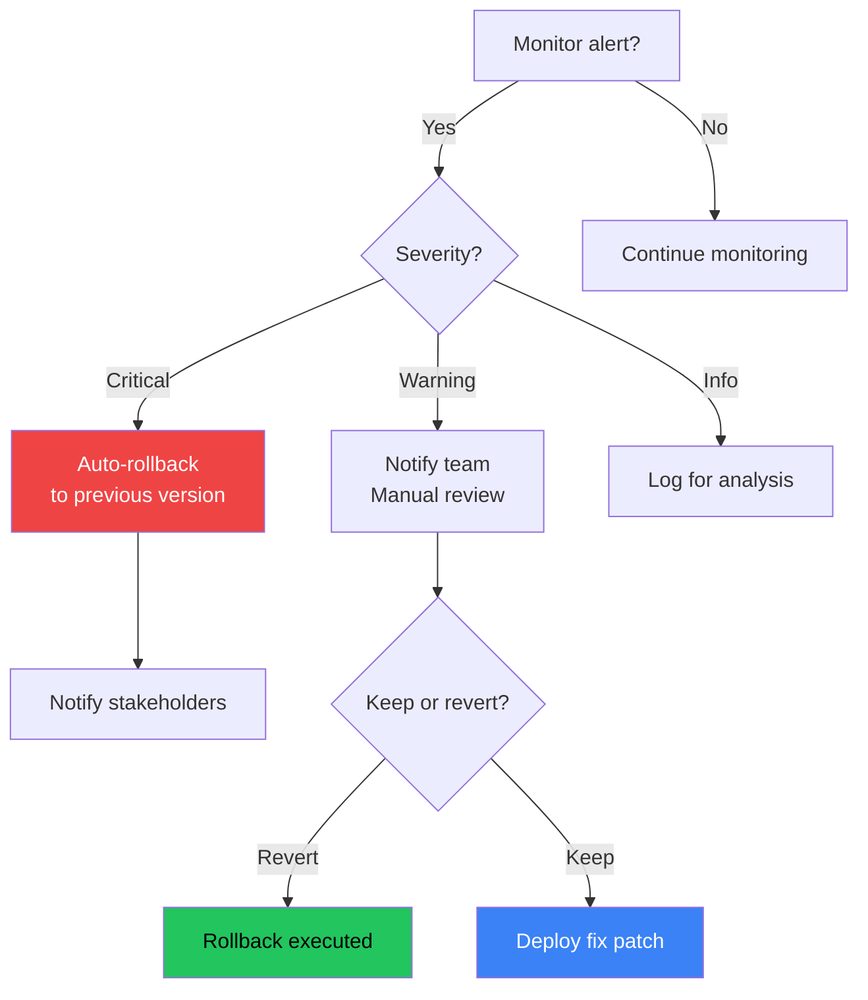

# Prompt Versioning

## The Problem

You deploy a prompt update. Accuracy drops 15%. Users complain. The client notices.

Which version was working? What changed? Who approved the update? How do you roll back?

Without versioning, every prompt change is a **blind deployment**.

---

## Why Prompt Versioning Exists

Prompt versioning exists because:

- **Prompts are code** — they need the same rigor as application code
- **Small changes cause big swings** — a single word can halve accuracy
- **Multiple environments** — dev, staging, production need different versions
- **Audit trails** — compliance requires knowing what prompt ran when
- **Experimentation** — A/B testing needs version tracking

> "A prompt without a version is a production incident waiting to happen." — Prompt Engineering Handbook

---

## Story: The Chatbot Outage

**Scenario:** You manage a customer support chatbot.

**Version 1.0:** "You are a helpful support agent."

- Accuracy: 92%
- Sentiment: Positive

**Version 1.1:** "You are a helpful support agent. Be concise."

- Accuracy: 94%
- Sentiment: Neutral

**Version 1.2:** "You are a helpful support agent. Be very concise and direct."

- Accuracy: 88%
- Sentiment: Negative

Without versioning, you can't identify which change caused the drop. With versioning, you roll back to 1.1 in 30 seconds.

---

## What is a Prompt Version?

A prompt version captures:

| Component | Description |
|-----------|-------------|
| **Version ID** | Semantic version or UUID |
| **Prompt Content** | The full prompt text |
| **Template** | Variable definitions |
| **Model** | Target model (gpt-4, claude-3, etc.) |
| **Parameters** | Temperature, max tokens, etc. |
| **Metadata** | Author, date, changelog |
| **Status** | Draft, staging, production, deprecated |

---

## Mermaid: Prompt Version Lifecycle



---

## Prompt Registry

A prompt registry is a centralized store for all prompt versions.

### Registry Schema

```json
{
  "prompt_id": "customer-support-v1",
  "versions": [
    {
      "version": "1.0.0",
      "content": "You are a helpful support agent.",
      "model": "gpt-4",
      "temperature": 0.3,
      "author": "alice@company.com",
      "date": "2025-01-15",
      "status": "deprecated",
      "changelog": "Initial version"
    },
    {
      "version": "1.1.0",
      "content": "You are a helpful support agent. Be concise.",
      "model": "gpt-4",
      "temperature": 0.3,
      "author": "bob@company.com",
      "date": "2025-02-01",
      "status": "production",
      "changelog": "Added conciseness instruction"
    }
  ]
}
```

### Storage Options

| Option | Pros | Cons |
|--------|------|------|
| **Database** | Queryable, auditable | Setup overhead |
| **Version Control** | Free with code | Not real-time |
| **Prompt Management Tools** | Built-in features | Cost |
| **Config Files** | Simple, git-tracked | Scalability limits |

---

## Semantic Versioning for Prompts

Adopt semver for prompt changes:

| Change Type | Version Bump | Example |
|-------------|-------------|---------|
| **Patch** | 1.0.0 → 1.0.1 | Fix typo, reword |
| **Minor** | 1.0.0 → 1.1.0 | Add new instruction, improve examples |
| **Major** | 1.0.0 → 2.0.0 | New structure, different approach |

---

## Mermaid: Version Bump Decision Tree



---

## Version Management Strategies

### 1. Git-Based Versioning

Store prompts in a `prompts/` directory:

```
prompts/
  customer-support/
    v1.0.0.yaml
    v1.1.0.yaml
    v1.2.0.yaml
    current -> v1.1.0.yaml
```

### 2. Database Versioning

```sql
CREATE TABLE prompt_versions (
  id UUID PRIMARY KEY,
  prompt_id VARCHAR(255) NOT NULL,
  version VARCHAR(20) NOT NULL,
  content TEXT NOT NULL,
  parameters JSONB,
  status VARCHAR(20),
  author VARCHAR(255),
  changelog TEXT,
  created_at TIMESTAMP DEFAULT NOW(),
  UNIQUE(prompt_id, version)
);
```

### 3. Managed Prompt Services

Tools like **LangSmith**, **Weights & Biases Prompts**, or **Agenta** provide:

- Version history
- Diff viewer
- Rollback buttons
- Approval workflows

---

## A/B Testing with Versions

### Mermaid: A/B Testing Flow



### Example A/B Configuration

```yaml
ab_test:
  experiment_id: "conciseness-v1"
  variants:
    control:
      version: "1.0.0"
      traffic: 50%
    treatment:
      version: "1.1.0"
      traffic: 50%
  metrics:
    - accuracy
    - response_length
    - user_satisfaction
  duration: "7d"
  decision: "rollout_if_improvement > 5%"
```

---

## Rollback Strategy

### Mermaid: Rollback Decision Flow



---

## Bad vs Good: Versioning

| Bad Practice | Good Practice |
|-------------|---------------|
| Edit prompt in production directly | Always version changes |
| No changelog | Document every change |
| Overwrite previous version | Keep full history |
| Manual rollback process | One-click rollback |
| No audit trail | Complete audit log |

---

## Production Prompt Management

### Deployment Pipeline

```yaml
prompt_deployment:
  stages:
    - name: draft
      checks: []
    - name: review
      checks: [peer_review, safety_scan]
    - name: staging
      checks: [unit_tests, eval_suite]
    - name: canary
      checks: [metrics_monitor, 10min_stable]
    - name: production
      checks: [gradual_rollout]
    - name: deprecated
      checks: [archive]
```

### Monitoring

| Metric | What to Track | Alert Threshold |
|--------|---------------|-----------------|
| **Accuracy** | Response quality | Drop > 5% |
| **Latency** | Response time | Increase > 20% |
| **Token Usage** | Cost per prompt | Increase > 15% |
| **Error Rate** | Failures/refusals | Rate > 1% |
| **Version** | Active version | Unknown = alert |

---

## Common Mistakes

| Mistake | Why It Hurts | Fix |
|---------|-------------|-----|
| No versioning | Can't rollback | Start with git |
| Too many versions | Confusion | Clean up deprecated |
| Manual deploys | Human error | Automate pipeline |
| Ignoring metadata | Lost context | Always log author/reason |
| No testing | Regression | Add eval suite |

---

## Best Practices

| Practice | Description |
|----------|-------------|
| **Version everything** | System, user, and assistant prompts |
| **Automate deploys** | CI/CD pipeline for prompts |
| **Log all inferences** | Record which version generated each response |
| **Canary releases** | Roll out to 5% before 100% |
| **Regular audits** | Review deprecated versions quarterly |
| **Diff reviews** | Compare versions before promotion |

---

## Interview Questions

### Beginner
1. What is prompt versioning and why is it important?
2. What information should a prompt version track?

### Intermediate
3. How would you implement an A/B testing system for prompts?
4. Compare git-based vs database-based prompt versioning.

### Senior
5. Design a prompt deployment pipeline with canary releases.
6. How would you handle a critical prompt regression in production?

### Staff Engineer
7. Design a prompt governance system for a team of 50 engineers.
8. How would you version prompts across multiple models and languages?

---

## Summary

- **Prompts are code** — version them with the same rigor
- **Semantic versioning** gives clear change semantics
- **A/B testing** enables data-driven prompt decisions
- **Rollback strategy** is essential for production safety
- **Automation** reduces human error in prompt management

> **Key Insight:** The best prompt versioning system is the one your team will actually use. Start simple (git), then graduate to dedicated tools as complexity grows.

---

*Next: Document 21 — Prompt Evaluation*
