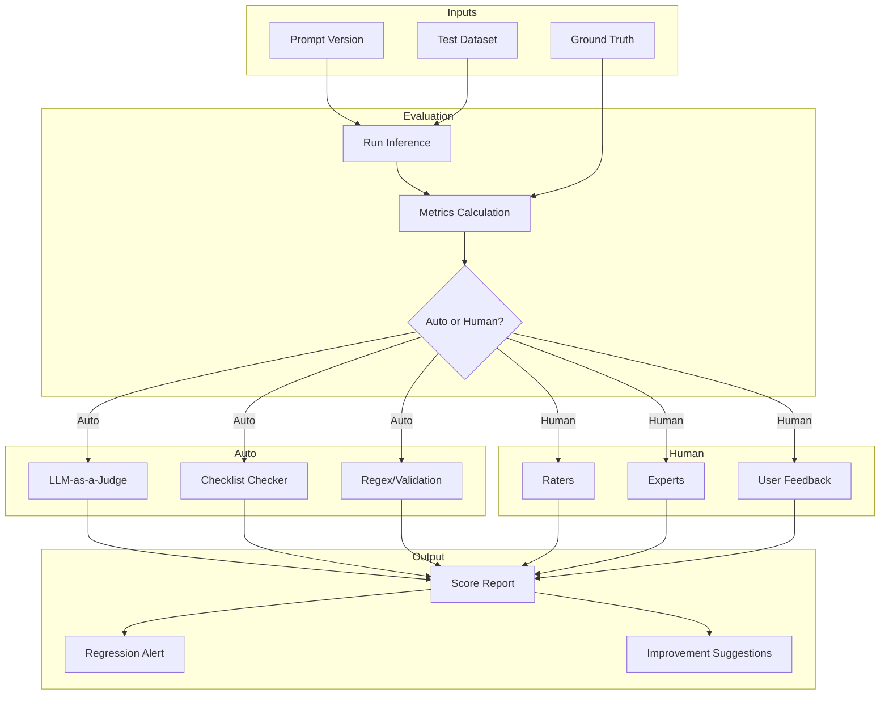
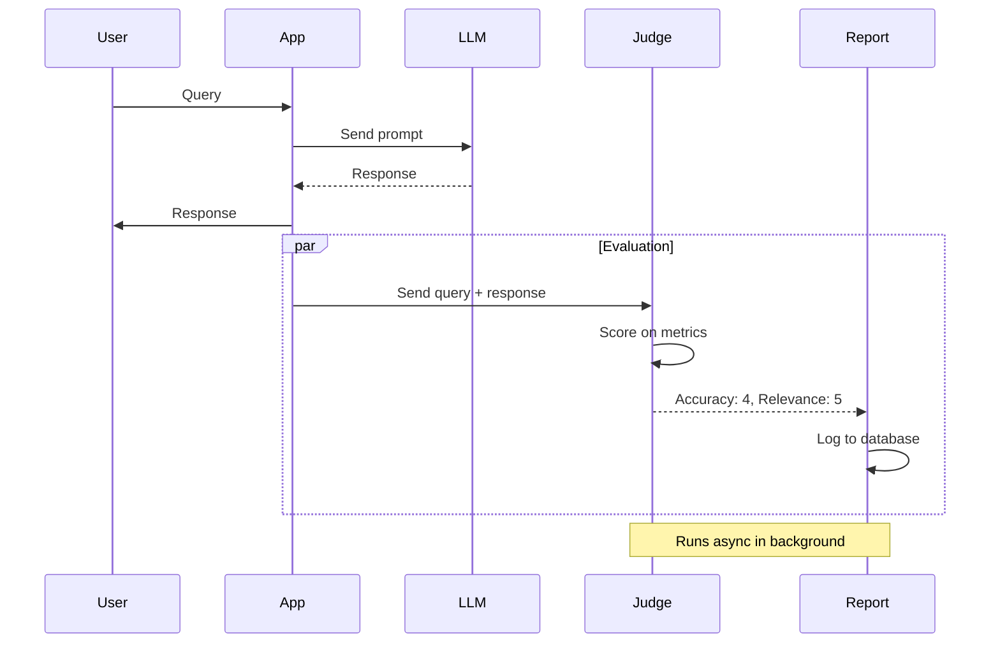
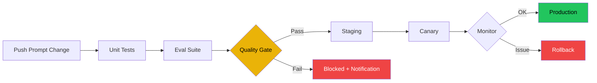

# Prompt Evaluation

## The Problem

Your prompt produces great results 80% of the time. But which 20% fails? And why?

Without evaluation, you're flying blind. You can't:

- Know if a prompt change improved quality
- Compare different prompt strategies objectively
- Detect regressions before users do
- Prove quality to stakeholders

---

## Why Prompt Evaluation Exists

Prompt evaluation exists because:

- **Prompts are probabilistic** — same prompt, different results
- **Quality is subjective** — but needs objective measurement
- **Regressions happen** — changes break existing behavior
- **ROI needs proof** — justify prompt engineering effort
- **Production needs guardrails** — enforce quality standards

> "If you can't measure it, you can't improve it." — Peter Drucker (applied to prompts)

---

## Story: The E-commerce Search

**Scenario:** Your team builds a product search prompt.

**Version A:** "Return products matching the query."

- Works for "red shoes"
- Fails for "birthday gift under $50 for mom"

**Version B:** "Recommend products for the user's intent and budget."

- Works for both
- But sometimes returns irrelevant results

**Without evaluation:** You guess which is better.
**With evaluation:** You measure both on 100 test cases and know objectively.

---

## What to Evaluate

### Core Metrics

| Metric | What It Measures | How to Measure |
|--------|-----------------|----------------|
| **Correctness** | Factually accurate | Compare to ground truth |
| **Relevance** | Answers the question | Human rating / LLM score |
| **Completeness** | Covers all requirements | Checklist |
| **Conciseness** | No unnecessary info | Token count |
| **Groundedness** | Based on provided context | Check against source |
| **Safety** | No harmful content | Moderation API |
| **Consistency** | Same input → similar output | Run N times, measure variance |

### Business Metrics

| Metric | What It Measures |
|--------|-----------------|
| **Task Success Rate** | Did the user complete their goal? |
| **User Satisfaction** | Ratings, feedback, retention |
| **Cost per Query** | Token usage × model price |
| **Latency** | Time from request to response |
| **Escalation Rate** | How often human intervention needed |

---

## Mermaid: Evaluation Framework



---

## Evaluation Methods

### 1. LLM-as-a-Judge

Use an LLM to evaluate prompt outputs.

```python
evaluation_prompt = """
You are an expert evaluator. Rate the following response on:
- Accuracy (1-5): Is the information correct?
- Relevance (1-5): Does it answer the query?
- Completeness (1-5): Does it cover everything?

Query: {query}
Response: {response}

Return JSON only:
{"accuracy": 4, "relevance": 5, "completeness": 3}
"""
```

### 2. Checklist-Based Evaluation

```yaml
checklist:
  response_includes_answer: true
  response_mentions_price: true
  response_under_200_tokens: true
  response_no_hallucinations: true
  response_formatted_correctly: true
```

### 3. Human Evaluation

```yaml
human_eval:
  method: "pairwise_comparison"
  raters: 3
  scale: "A > B, B > A, or Equal"
  criteria:
    - helpfulness
    - accuracy
    - tone
```

---

## Mermaid: LLM-as-a-Judge Architecture



---

## Creating an Evaluation Dataset

### Structure

```json
[
  {
    "id": "test-001",
    "query": "What is the return policy?",
    "expected": "30-day return window, unopened items",
    "context": "E-commerce support",
    "difficulty": "easy",
    "category": "policy"
  },
  {
    "id": "test-002",
    "query": "My order hasn't arrived in 2 weeks. What should I do?",
    "expected": "Apologize, offer tracking lookup, explain escalation path",
    "context": "E-commerce support",
    "difficulty": "medium",
    "category": "issue"
  }
]
```

### Dataset Sizing

| Use Case | Minimum Size | Recommended |
|----------|-------------|-------------|
| Development | 10-20 | Quick iteration |
| Regression Testing | 50-100 | Core scenarios |
| Production Release | 200-500 | Comprehensive |
| Model Comparison | 500-1000 | Statistical significance |

---

## Bad vs Good: Evaluation

| Bad Practice | Good Practice |
|-------------|---------------|
| "Feels better" | "Score improved 12%" |
| Evaluate once | Regular automated evaluation |
| Single metric | Balanced scorecard |
| Same test always | Rotating + regression tests |
| No golden dataset | Versioned golden dataset |

---

## Evaluation Pipeline

### Mermaid: CI/CD Evaluation Pipeline



### Quality Gates

```yaml
quality_gates:
  accuracy:
    minimum: 0.85
    action: block
  relevance:
    minimum: 0.80
    action: warn
  safety:
    minimum: 0.99
    action: block
  latency:
    maximum: "2000ms"
    action: warn
```

---

## Tools for Prompt Evaluation

| Tool | Type | Best For |
|------|------|----------|
| **LangSmith** | Managed | Evaluation + tracing |
| **Weights & Biases** | Managed | Experiment tracking |
| **PromptLayer** | Managed | Logging + evaluation |
| **DeepEval** | Open Source | Unit testing for LLMs |
| **Ragas** | Open Source | RAG evaluation |
| **EleutherAI LM Eval** | Open Source | Model evaluation |

---

## Common Mistakes

| Mistake | Why It Hurts | Fix |
|---------|-------------|-----|
| No evaluation at all | Blind changes | Start with 10 test cases |
| Bias in evaluation | Judge favors certain styles | Use multiple judges |
| Overfitting to dataset | Doesn't generalize | Rotate test cases |
| Only auto-evaluation | Miss nuance | Add human sampling |
| Ignoring edge cases | Unexpected failures | Include adversarial tests |

---

## Best Practices

| Practice | Description |
|----------|-------------|
| **Version datasets** | Golden dataset changes over time |
| **Multiple judges** | Use 3+ LLM judges, take majority |
| **Sample human eval** | 10% of production calls manually reviewed |
| **Track over time** | Metrics dashboard with history |
| **Calibrate judges** | Check LLM judge against human ratings |
| **Test regressions first** | Run existing tests before new ones |

---

## Interview Questions

### Beginner
1. What is prompt evaluation and why is it important?
2. Name three metrics to evaluate prompt quality.

### Intermediate
3. How does LLM-as-a-Judge work? What are its limitations?
4. Design an evaluation dataset for a customer support chatbot.

### Senior
5. How would you detect prompt regressions automatically?
6. Design a quality gate system for prompt deployments.

### Staff Engineer
7. How do you ensure evaluation is not biased toward specific prompt styles?
8. Design a company-wide prompt evaluation framework across multiple teams and use cases.

---

## Summary

- **Measure what matters** — choose metrics aligned with business goals
- **Automate evaluation** — catch regressions before users do
- **Combine methods** — auto for scale, human for nuance
- **Maintain datasets** — golden datasets evolve with product
- **Gate deployments** — enforce quality thresholds

> **Key Insight:** Good evaluation turns prompt engineering from an art into an engineering discipline.

---

*Next: Document 22 — Prompt Security*
