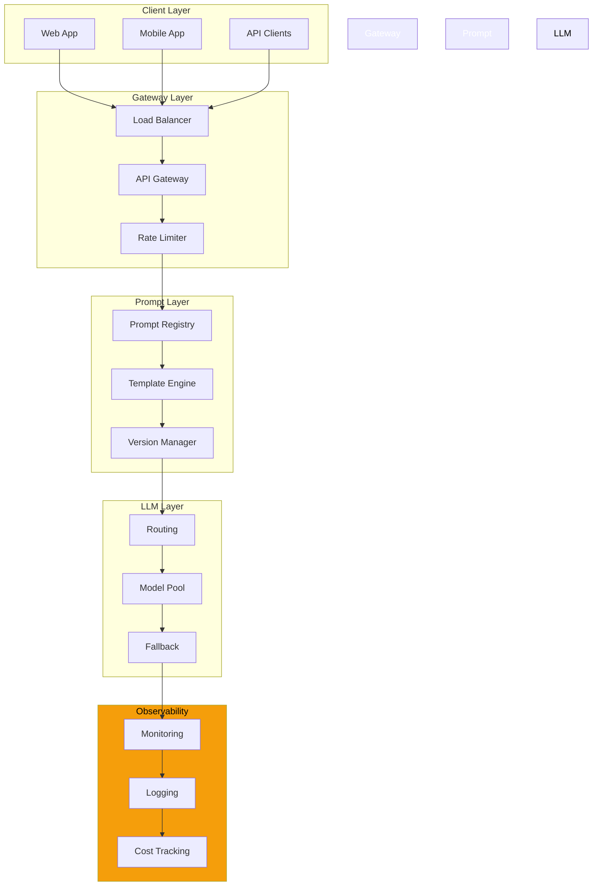
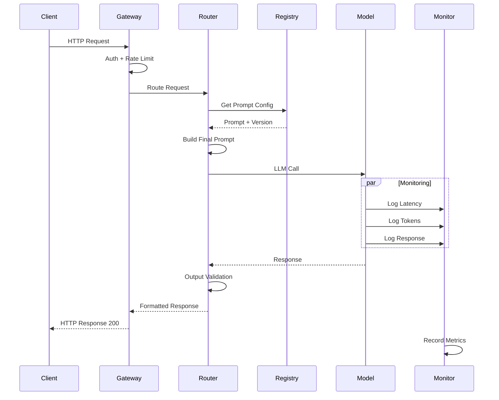
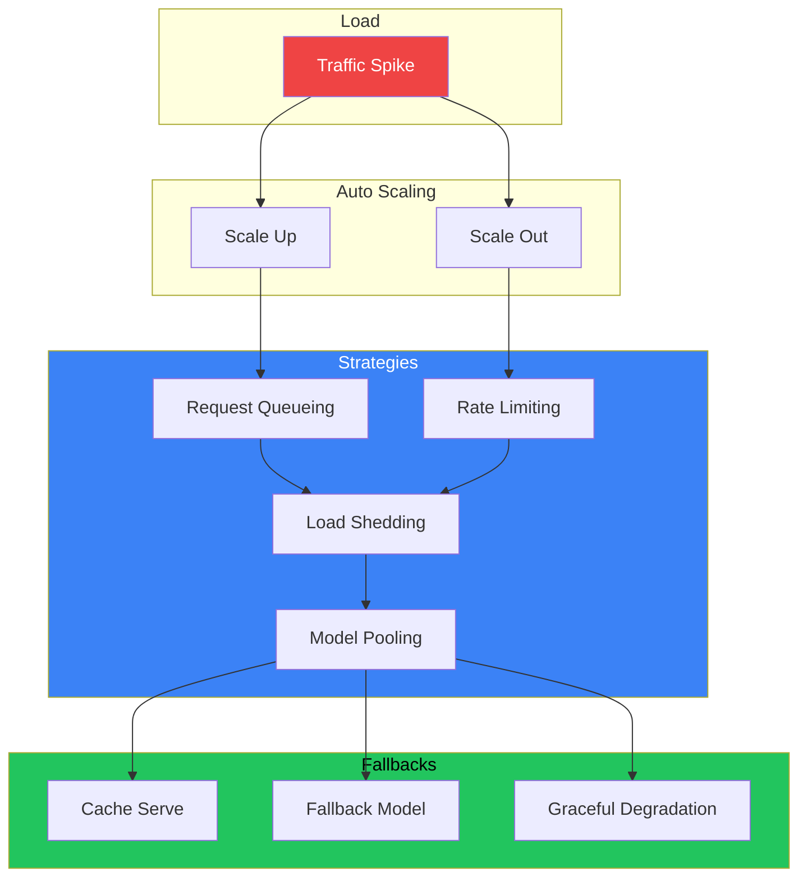
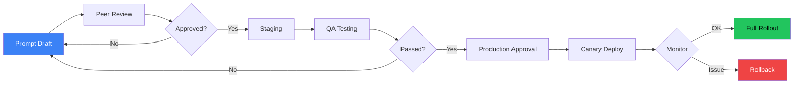

# Production Prompt Engineering

## The Problem

You've mastered prompt design. Your prompts work in the notebook. Now you need to:

- Serve 10,000 requests per minute
- Maintain 99.9% reliability
- Keep latency under 500ms
- Monitor costs in real-time
- Deploy updates without downtime
- Comply with SOC 2 and GDPR

This is **production prompt engineering** — where prompt craft meets software engineering.

---

## Why Production Prompt Engineering Exists

Production prompt engineering exists because:

- **Scale changes everything** — patterns that work for 10 users fail at 10,000
- **Reliability is non-negotiable** — downtime costs money
- **Costs grow linearly** — with volume, every token counts
- **Monitoring is essential** — you can't fix what you can't see
- **Governance is required** — compliance, audit, and security

> "A prompt that works in a notebook is a prototype. A prompt that works at scale is an engineering achievement."

---

## Story: The Startup vs Enterprise

**Startup:** One prompt, one model, one developer. Works great for 100 users.

**Enterprise:** 
- 47 prompts across 12 teams
- 8 different models
- A/B testing in production
- Latency SLO of 200ms
- Monthly token budget of $50K
- Audit requirements from 3 regulators

The same prompt engineering skills apply, but the infrastructure around them is completely different.

---

## Enterprise Prompt Architecture

### Mermaid: Production Prompt Architecture



---

## Production Components

### 1. Prompt Registry

Centralized store for all prompts:

```yaml
prompt_registry:
  storage: postgresql
  cache: redis
  access_patterns:
    - prompt_id + version
    - environment (dev/staging/prod)
  
  schema:
    id: "customer-support-v3"
    version: "3.2.1"
    content: "You are a support agent..."
    model: "claude-3-opus"
    parameters:
      temperature: 0.3
      max_tokens: 1024
    metadata:
      owner: "support-team"
      created: "2025-01-15"
      tags: ["production", "critical"]
```

### 2. Prompt Router

Route requests to the right prompt version:

```python
class PromptRouter:
    def get_prompt(self, request: Request) -> PromptConfig:
        """Route to correct prompt based on context."""
        
        # A/B test routing
        if self.ab_testing_enabled(request.user_id):
            variant = self.get_ab_variant(request.user_id)
            return self.registry.get("customer-support", variant)
        
        # Feature flag routing
        if feature_flags.is_enabled("new_prompt_v2", request.user_id):
            return self.registry.get("customer-support", "2.0.0")
        
        # Default routing
        return self.registry.get("customer-support", "production")
```

### 3. Model Router

Route to the best model for each request:

```python
class ModelRouter:
    def route_request(self, request: Request) -> str:
        """Route to appropriate model based on requirements."""
        
        if request.requires_reasoning:
            return "claude-3-opus"  # Best reasoning
        elif request.requires_speed:
            return "gpt-4o-mini"    # Fastest
        elif request.is_simple:
            return "claude-3-haiku" # Cheapest
        else:
            return "gpt-4o"         # Balanced
```

---

## Mermaid: Request Lifecycle



---

## Monitoring & Observability

### Key Metrics

| Category | Metrics | Alert Threshold |
|----------|---------|----------------|
| **Latency** | p50, p95, p99 | p95 > 2s |
| **Throughput** | RPM, RPS | Drop > 20% |
| **Errors** | 4xx, 5xx, timeout | Rate > 1% |
| **Cost** | Cost/request, daily spend | Budget > 80% |
| **Quality** | Accuracy, relevance | Score < 0.8 |
| **Model** | Token usage, context | > 90% of limit |

### Logging Structure

```json
{
  "timestamp": "2025-06-15T10:30:00Z",
  "request_id": "req_abc123",
  "prompt_id": "customer-support-v3",
  "version": "3.2.1",
  "model": "claude-3-opus",
  "tokens": {
    "input": 450,
    "output": 120,
    "total": 570
  },
  "latency_ms": 340,
  "success": true,
  "user_id": "user_xyz",
  "environment": "production"
}
```

---

## Cost Optimization

### Cost Breakdown

```yaml
cost_model:
  token_costs:
    claude-3-opus:
      input: $15/M tokens
      output: $75/M tokens
    gpt-4o:
      input: $5/M tokens
      output: $15/M tokens
    claude-3-haiku:
      input: $0.25/M tokens
      output: $1.25/M tokens
  
  daily_estimate:
    requests: 100,000
    avg_input_tokens: 400
    avg_output_tokens: 100
    daily_cost: ~$200-800
    monthly_cost: ~$6,000-24,000
```

### Optimization Strategies

| Strategy | Savings | Impact |
|----------|---------|--------|
| **Model tiering** | 40-60% | Match complexity to model |
| **Prompt compression** | 20-30% | Shorter context = lower cost |
| **Caching** | 30-50% | Cache identical requests |
| **Batching** | 15-25% | Combine related requests |
| **Response streaming** | 0% | Better UX, same cost |

### Caching Strategy

```python
class PromptCache:
    def __init__(self):
        self.cache = RedisCache(ttl=3600)
    
    def get_or_compute(self, request, compute_fn):
        """Return cached response or compute new one."""
        
        cache_key = self._build_key(request)
        
        # Check cache
        cached = self.cache.get(cache_key)
        if cached:
            metrics.record("cache_hit")
            return cached
        
        # Compute and cache
        response = compute_fn(request)
        self.cache.set(cache_key, response)
        metrics.record("cache_miss")
        
        return response
```

---

## Scaling Strategies

### Mermaid: Scaling Architecture



### Horizontal Scaling

```
Requests → [Load Balancer] → [App Instance 1]
                            → [App Instance 2]  → [LLM API Pool]
                            → [App Instance N]
```

### Fallback Chain

```yaml
fallback_chain:
  primary: "claude-3-opus"
  fallback_1: "gpt-4o"           # Different provider
  fallback_2: "claude-3-sonnet"  # Cheaper, faster
  fallback_3: "cache-only"       # Degraded mode
  ultimate: "static_response"    # Pre-written response
```

---

## Governance & Compliance

### Required Controls

| Requirement | Implementation |
|-------------|---------------|
| **Audit Trail** | Log all prompt versions + inferences |
| **Approval Workflow** | PR-based prompt updates |
| **PII Protection** | Automatic PII redaction |
| **Retention Policy** | Auto-delete logs after 90 days |
| **Access Control** | Role-based prompt access |
| **Change Management** | Versioned, reviewed, tested |

### Approval Workflow



---

## Bad vs Good: Production

| Bad Practice | Good Practice |
|-------------|---------------|
| Prompts in code | Prompts in registry |
| Manual deploy | CI/CD pipeline |
| No monitoring | Full observability |
| Single model | Model pool + fallback |
| No caching | Multi-level caching |
| Deploy to all at once | Canary + staged rollout |
| No cost tracking | Real-time cost dashboard |

---

## Production Checklist

```yaml
production_readiness:
  reliability:
    - [ ] Load testing completed
    - [ ] Fallback chain configured
    - [ ] Rate limiting enabled
    - [ ] Timeout handling implemented
    
  observability:
    - [ ] Latency monitoring
    - [ ] Error tracking
    - [ ] Cost dashboard
    - [ ] Quality metrics
    
  security:
    - [ ] Input sanitization
    - [ ] Output validation
    - [ ] PII scanning
    - [ ] Rate limiting
    
  operations:
    - [ ] Deployment pipeline
    - [ ] Rollback procedure
    - [ ] Runbook created
    - [ ] On-call rotation
    
  compliance:
    - [ ] Audit logging
    - [ ] Data retention
    - [ ] Access control
    - [ ] Approval workflow
```

---

## Common Mistakes

| Mistake | Why It Hurts | Fix |
|---------|-------------|-----|
| No fallback strategy | Complete outage | Configure fallback chain |
| Missing cost monitoring | Budget shock | Real-time cost dashboard |
| Single model dependency | Vendor lock-in | Multi-model pool |
| No load testing | Fail under traffic | Regular load tests |
| Manual deployments | Human error | Automate pipeline |
| Ignoring latency | Poor UX | Set latency SLOs |

---

## Best Practices

| Practice | Description |
|----------|-------------|
| **Design for failure** | Every component should have a fallback |
| **Monitor everything** | If it moves, measure it |
| **Automate deploys** | No manual prompt changes in production |
| **Cost is a feature** | Track and optimize aggressively |
| **Test at scale** | Load test with production traffic patterns |
| **Document runbooks** | Incident response procedures |
| **Gradual rollouts** | Canary → 10% → 50% → 100% |

---

## Interview Questions

### Beginner
1. What changes when you move prompt engineering from development to production?
2. Name three metrics you should monitor in production.

### Intermediate
3. Design a fallback strategy for LLM API failures.
4. How would you reduce LLM costs in production without sacrificing quality?

### Senior
5. Design a production prompt architecture handling 10K requests per minute.
6. How would you implement gradual rollouts and A/B testing for prompts?

### Staff Engineer
7. Design a multi-region, multi-model prompt infrastructure with 99.99% availability.
8. How do you balance cost, latency, and quality across different prompt use cases in a large organization?

---

## Summary

- **Scale requires infrastructure** — prompts need registries, routers, caches
- **Monitor everything** — latency, cost, errors, quality
- **Design for failure** — fallbacks, caching, graceful degradation
- **Automate deploys** — no manual changes in production
- **Track costs** — optimize aggressively as volume grows
- **Governance is essential** — audit, compliance, access control

> **Key Insight:** Production prompt engineering is 20% prompt design and 80% software engineering around the prompt.

---

*Next: Document 25 — Phase Summary*
