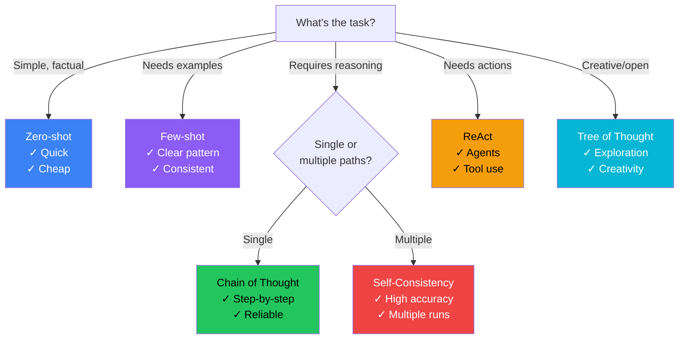
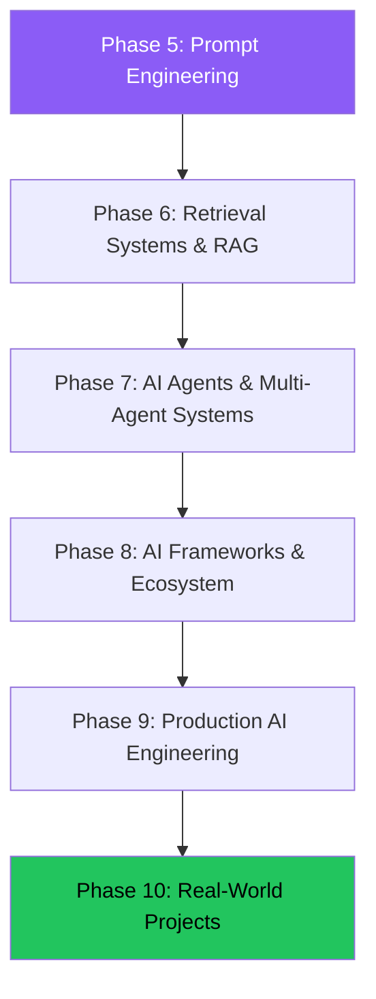

# Phase 5: Prompt Engineering — Summary

## Complete Prompt Engineering Roadmap

### Mermaid: Learning Journey

```mermaid
flowchart LR
    subgraph Foundation
        A[What is PE?]
        B[How LLMs Understand]
        C[Prompt Anatomy]
    end
    
    subgraph Core Skills
        D[System/User/Assistant]
        E[Zero/Few Shot]
        F[Role/Persona]
        G[Context Engineering]
        H[Output Formatting]
    end
    
    subgraph Structured Output
        I[JSON & Structured]
        J[Prompt Templates]
        K[Prompt Chaining]
    end
    
    subgraph Advanced Patterns
        L[Chain of Thought]
        M[Tree of Thought]
        N[ReAct]
        O[Self-Consistency]
        P[Step-Back]
        Q[Meta Prompting]
    end
    
    subgraph Production
        R[Optimization]
        S[Testing]
        T[Versioning]
        U[Evaluation]
        V[Security]
        W[Production Deploy]
    end
    
    A --> B --> C
    C --> D --> E --> F --> G --> H
    H --> I --> J --> K
    K --> L --> M --> N --> O --> P --> Q
    Q --> R --> S --> T --> U --> V --> W
    
    style Foundation fill:#3b82f6,color:#fff
    style Core Skills fill:#8b5cf6,color:#fff
    style Structured Output fill:#06b6d4,color:#fff
    style Advanced Patterns fill:#22c55e,color:#000
    style Production fill:#f59e0b,color:#000
```



---

## Quick Reference Cheat Sheet

### Prompt Anatomy

```
[INSTRUCTION] + [CONTEXT] + [INPUT] + [CONSTRAINTS] + [OUTPUT FORMAT] + [EXAMPLES]
```

### Prompt Types

| Type | Description | When to Use |
|------|-------------|-------------|
| **System** | Base instructions | Always |
| **User** | The actual request | Every request |
| **Assistant** | Example responses | Few-shot learning |

### Shot Types

| Type | # of Examples | Best For |
|------|:------------:|----------|
| **Zero-shot** | 0 | Simple tasks |
| **One-shot** | 1 | Clear pattern tasks |
| **Few-shot** | 2-5 | Complex or nuanced tasks |

---

### Advanced Prompt Patterns

| Pattern | Key Idea | Best For |
|---------|----------|----------|
| **Chain of Thought** | Step-by-step reasoning | Math, logic, complex problems |
| **Tree of Thought** | Multiple reasoning paths | Open-ended problems, creativity |
| **ReAct** | Reason → Act → Observe | Agent-based tasks |
| **Self-Consistency** | Multiple paths → majority vote | High-stakes decisions |
| **Step-Back** | Abstract first → details | Complex domain problems |
| **Meta Prompting** | Prompts that generate prompts | Prompt optimization |

---

### Parameter Guide

| Parameter | Range | Effect |
|-----------|-------|--------|
| **Temperature** | 0-1 | Lower = more deterministic |
| **Top P** | 0-1 | Lower = more focused |
| **Max Tokens** | Varies | Response length limit |
| **Frequency Penalty** | 0-2 | Reduce repetition |
| **Presence Penalty** | 0-2 | Encourage new topics |

---

## Mermaid: Prompt Selection Guide



---

## Glossary

| Term | Definition |
|------|------------|
| **Prompt** | The input text given to an LLM to guide its response |
| **System Prompt** | Base instructions that define the model's behavior |
| **User Prompt** | The user's actual request or query |
| **Assistant Prompt** | Example responses used for few-shot learning |
| **Temperature** | Controls randomness of output (0 = deterministic) |
| **Token** | The basic unit of text an LLM processes (~0.75 words) |
| **Context Window** | Maximum tokens an LLM can process in one request |
| **Chain of Thought** | Prompting technique that elicits step-by-step reasoning |
| **ReAct** | Reasoning + Acting pattern for agent-based tasks |
| **RAG** | Retrieval-Augmented Generation — combining prompts with retrieved context |
| **Structured Output** | Generating formatted output (JSON, XML, etc.) |
| **Prompt Injection** | Attack where malicious input overrides instructions |
| **Guardrails** | Safety constraints applied to LLM inputs and outputs |
| **LLM-as-a-Judge** | Using an LLM to evaluate outputs of another LLM |
| **Few-Shot** | Providing examples of expected behavior in the prompt |

---

## Best Practices Summary

### Prompt Design

| # | Practice |
|:-:|----------|
| 1 | Be specific and clear |
| 2 | Provide context before asking |
| 3 | Use examples for complex tasks |
| 4 | Specify output format explicitly |
| 5 | Break complex tasks into steps |
| 6 | Use role/persona for tone and expertise |
| 7 | Iterate based on evaluation |

### Production

| # | Practice |
|:-:|----------|
| 1 | Version all prompts |
| 2 | Test before deploying |
| 3 | Monitor latency, cost, quality |
| 4 | Implement fallbacks |
| 5 | A/B test changes |
| 6 | Secure against injection |
| 7 | Automate deployment pipeline |

---

## Common Mistakes to Avoid

| Mistake | Why It's Harmful |
|---------|-----------------|
| **Vague instructions** | Model fills gaps incorrectly |
| **Too much context** | Wastes tokens, dilutes focus |
| **No output format** | Inconsistent responses |
| **Skipping evaluation** | Can't measure improvement |
| **No versioning** | Can't roll back bad changes |
| **Over-engineering** | Simple prompts often work best |
| **Ignoring security** | Vulnerable to injection |

---

## Production Checklist

```yaml
pre_deployment:
  prompt:
    - [ ] Tested on 10+ edge cases
    - [ ] Evaluation score meets threshold
    - [ ] No PII in system prompt
    - [ ] Output format validated
    
  infrastructure:
    - [ ] Prompt registered in registry
    - [ ] Version tagged
    - [ ] Fallback configured
    - [ ] Monitoring in place
    
  security:
    - [ ] Input sanitization enabled
    - [ ] Output validation configured
    - [ ] Rate limiting active
    - [ ] Injection tests passed
```

---

## Interview Guide

### Common Questions by Level

#### Beginner
- What is prompt engineering?
- Name three prompt patterns
- Difference between system and user prompts

#### Intermediate
- When would you use few-shot over zero-shot?
- How does Chain of Thought improve reasoning?
- Design a prompt for a customer support bot

#### Senior
- How would you evaluate prompt quality in production?
- Design a prompt deployment pipeline
- How do you handle prompt injection?

#### Staff Engineer
- Design a prompt governance framework for 50 engineers
- How do you balance cost, latency, and quality?
- How would you version prompts across multiple models?

### Answering Framework

```
1. Understand the use case
2. Choose the right pattern
3. Design the prompt structure
4. Evaluate and iterate
5. Productionize with monitoring
```

---

## Learning Path After Phase 5



---

## What You've Learned

✓ **What Prompt Engineering is** — and why it exists
✓ **How LLMs understand prompts** — tokens, instructions, context
✓ **Prompt anatomy** — instruction, context, input, constraints, format, examples
✓ **System, user, and assistant roles** — how to use each effectively
✓ **Zero-shot, one-shot, few-shot** — when to use each
✓ **Role and persona prompting** — improving response quality
✓ **Context engineering** — giving models the right information
✓ **Output formatting** — Markdown, JSON, XML, YAML, and more
✓ **JSON and structured outputs** — reliable, parseable responses
✓ **Prompt templates** — reusable, parameterized prompts
✓ **Prompt chaining** — breaking complex tasks into steps
✓ **Chain of Thought** — step-by-step reasoning
✓ **Tree of Thought** — exploring multiple reasoning paths
✓ **ReAct prompting** — reasoning + action for agents
✓ **Self-Consistency** — majority voting for reliable answers
✓ **Step-Back Prompting** — abstract first, then details
✓ **Meta Prompting** — prompts that generate prompts
✓ **Prompt optimization** — compressing, refining, simplifying
✓ **Prompt testing** — unit tests, regression tests, golden datasets
✓ **Prompt versioning** — registries, history, rollbacks
✓ **Prompt evaluation** — LLM-as-a-Judge, metrics, quality gates
✓ **Prompt security** — PII, jailbreaks, guardrails
✓ **Prompt injection** — direct, indirect, leakage, defenses
✓ **Production prompt engineering** — scaling, monitoring, cost optimization

---

> **Next:** Continue to **Phase 6 — Retrieval Systems & Retrieval-Augmented Generation (RAG)** where you'll learn how prompts combine with external knowledge to build intelligent AI applications.
