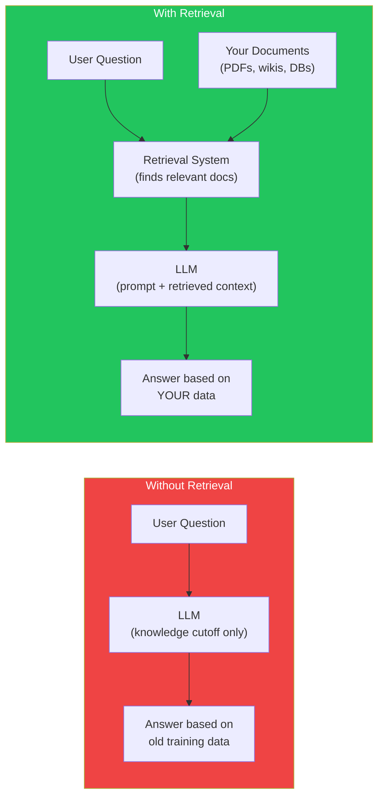
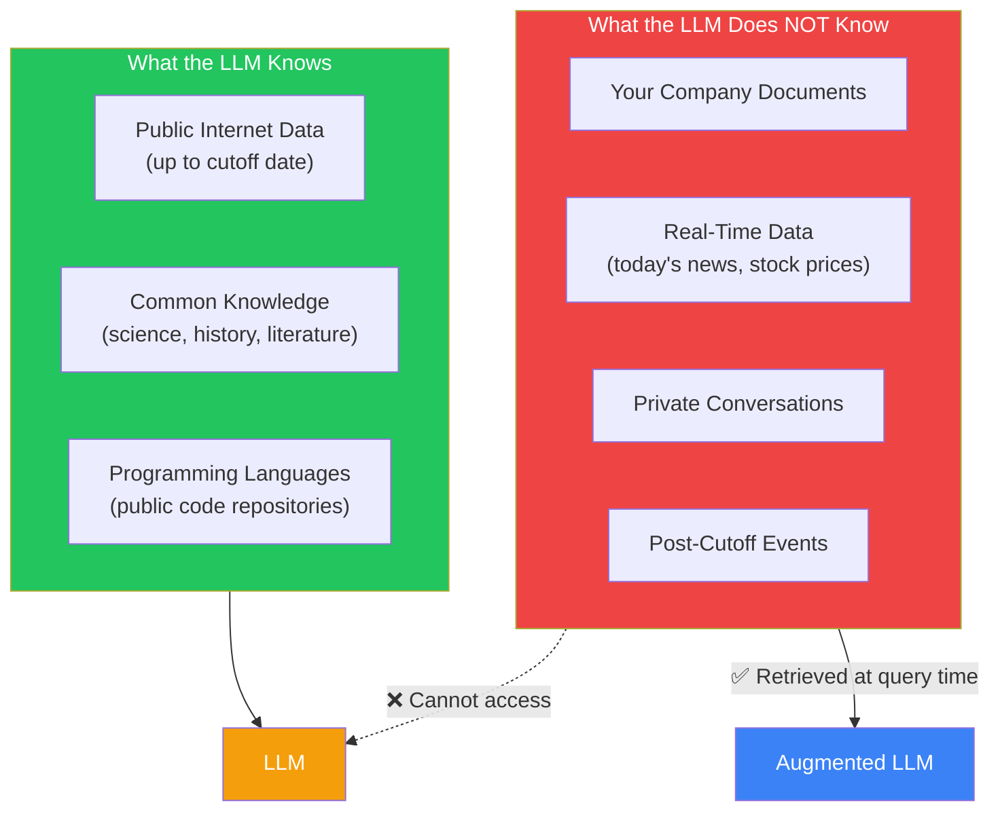
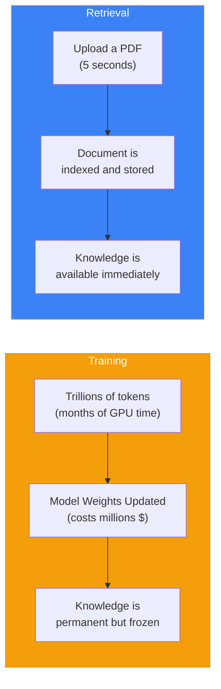

## Introduction

> **A Large Language Model knows what the internet knew when it stopped training. A Retrieval System knows what you asked it to read five seconds ago.**

This is the single most important concept in production AI: LLMs don't automatically know your data. You have to *give* it to them. Retrieval Systems are how you do that.

---

## Why This Concept Exists

### The Problem

ChatGPT was trained on data up to a certain date. Ask it about your company's Q3 earnings report (released yesterday) and it has no idea. Ask it about a confidential legal document you just uploaded — it can't see it. Ask it about the internal API documentation your team wrote last week — nothing.

This isn't a flaw. It's a fundamental constraint:

| Concept | What It Means |
|---------|---------------|
| **Training Data** | Everything the model learned during training |
| **Knowledge Cutoff** | The date when training ended |
| **Private Data** | Documents the model has never seen |
| **Retrieval** | Giving the model relevant information *at query time* |

### The Story

Imagine a brilliant student who graduated top of her class. She knows everything from her textbooks. But tomorrow, the curriculum changes. New research is published. Company policies are updated.

If you hand her the new textbook right before the exam, she can read it and answer questions about it.

That's retrieval.

Without the textbook, she can only answer based on what she already knows — which might be outdated or incomplete.

---

## Real-World Analogy

### The Librarian

You walk into a library. The librarian has read every book in existence — but all the books are from 2022. You need information from a research paper published last month.

The librarian can't magically know the paper. But if you *hand them the paper* and ask a question, they can read it and answer.

**That's the difference between a pure LLM and an LLM with retrieval.**



---

## Why LLMs Cannot Memorize New Information

### Training is Frozen

When an LLM is trained, billions of parameters are updated to predict the next token. This process takes months and costs millions of dollars. You cannot (and should not) retrain a model every time a new document is created.

### The Knowledge Cutoff

Every LLM has a training cutoff date:

| Model | Knowledge Cutoff |
|-------|-----------------|
| GPT-4o | ~Oct 2023 |
| Claude 3.5 | ~Apr 2024 |
| Gemini 1.5 | ~Mar 2023 |
| Llama 3 | ~Dec 2023 |

Anything after that date is unknown to the model unless you provide it at query time.

### Private Data is Invisible

Your company's internal documents, your personal notes, your confidential contracts — none of these exist in any public training dataset. The model has literally never seen them.



---

## Training vs Retrieval



| Aspect | Training | Retrieval |
|--------|----------|-----------|
| **Cost** | Millions of dollars | Pennies per query |
| **Time** | Weeks to months | Milliseconds |
| **Freshness** | Frozen at cutoff | Always up-to-date |
| **Privacy** | Public data only | Your private data |
| **Update** | Retrain from scratch | Add new documents instantly |

---

## What Retrieval Actually Means

Retrieval is the process of finding relevant information from a knowledge base and providing it to the LLM *as part of the prompt*.

```
User: "What was our Q3 revenue?"

Step 1 — Retrieve: Search the knowledge base for documents about Q3 revenue
Step 2 — Augment: Insert those documents into the prompt
Step 3 — Generate: LLM reads the documents and answers

Prompt (simplified):

System: Answer using the context below.
Context: [Q3 revenue was $12.4M, up 18% YoY...]
User: What was our Q3 revenue?

Response: Your Q3 revenue was $12.4M, up 18% year over year.
```

---

## Production Examples

### Real Systems Using Retrieval

| Product | What It Retrieves | Why It Matters |
|---------|------------------|----------------|
| **ChatGPT with Search** | Live web results | Answers about current events |
| **Perplexity** | Web pages + citations | Every answer has sources |
| **NotebookLM** | Your uploaded documents | Answer questions about your notes |
| **GitHub Copilot** | Your codebase | Autocomplete uses your code context |
| **Claude Projects** | Your uploaded files | Project-specific knowledge |
| **Cursor** | Your codebase | AI that knows your entire project |

---

## Common Mistakes

| Mistake | Why It's Wrong |
|---------|----------------|
| ❌ "I'll just retrain the model on my documents" | Impractical for most use cases — expensive, slow, and the model may forget old knowledge (catastrophic forgetting) |
| ❌ "I'll put everything in the prompt" | Context windows are limited (128K-200K tokens). You can't fit an entire company wiki in one prompt |
| ❌ "The model will remember what I told it earlier" | LLMs have no persistent memory between conversations (unless you implement it via retrieval) |

---

## Interview Questions

### Easy

**Q: Why can't an LLM answer questions about documents it wasn't trained on?**

> Because the model's knowledge is frozen at the time of training. It doesn't have access to new or private documents unless they are provided at query time through retrieval.

### Intermediate

**Q: What's the difference between training a model on your data and retrieving documents at query time?**

> Training updates the model's weights — expensive, slow, permanent. Retrieval finds relevant documents at query time and inserts them into the prompt — cheap, fast, and easy to update. Use training for fundamental capabilities, retrieval for specific knowledge.

### Senior

**Q: Design a retrieval system for a company with 10,000 internal documents. What are the key considerations?**

> Key considerations: (1) Chunking strategy — how to split documents into searchable pieces, (2) Embedding model choice — balancing accuracy vs cost, (3) Vector database — scalability and filtering, (4) Hybrid search — combining keyword and semantic search for better results, (5) Relevance scoring — ensuring only high-quality results reach the LLM, (6) Caching — reducing latency for frequent queries, (7) Access control — ensuring users only retrieve documents they're authorized to see.

---

## Summary

| Concept | Key Point |
|---------|-----------|
| **Knowledge Cutoff** | LLMs only know data up to their training date |
| **Private Data** | LLMs cannot see your documents unless you provide them |
| **Retrieval** | Finding relevant documents at query time |
| **Augmentation** | Inserting retrieved documents into the LLM's prompt |
| **Why It Matters** | Without retrieval, LLMs are limited to public, frozen knowledge |

---

## Navigation

**Previous:** [Phase 4: Large Language Models →](/ai/phase-04-large-language-models)

**Next:** [02 — Embeddings Deep Dive →](./02-embeddings-deep-dive)
