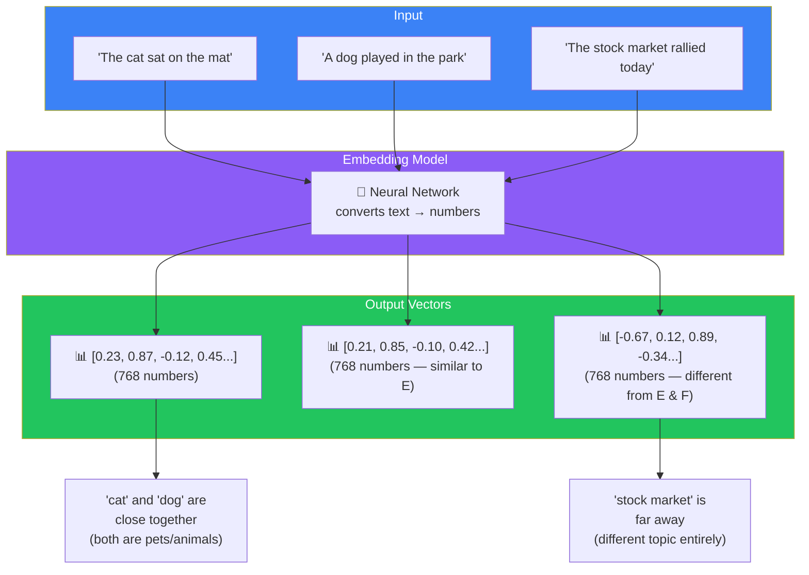
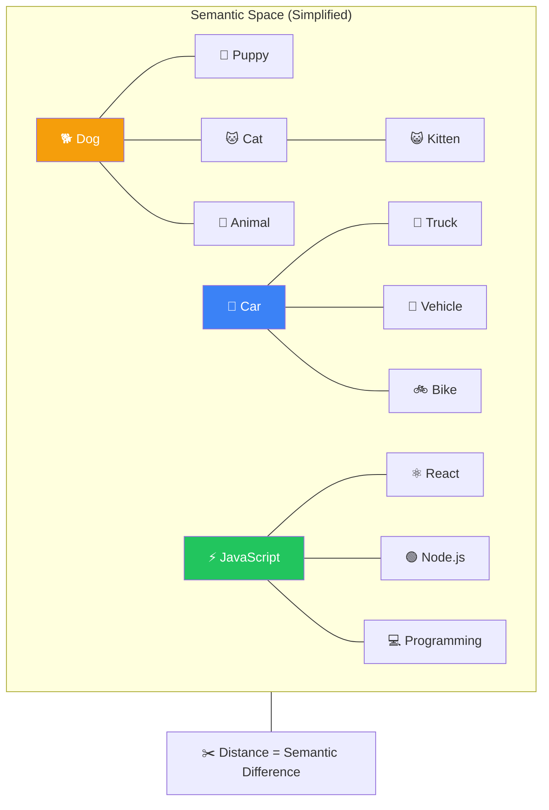
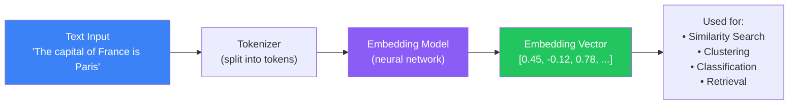
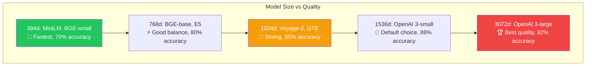
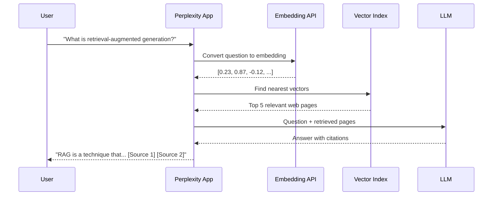

## Introduction

> **An embedding is a list of numbers that captures the *meaning* of a piece of text. Words with similar meanings have similar numbers. That's how computers understand semantics.**

This is one of the most important concepts in AI. Every search engine, recommendation system, and RAG pipeline relies on embeddings. They are the bridge between human language and mathematical computation.

---

## Why This Concept Exists

### The Problem

Computers don't understand words. They understand numbers.

If you give a computer the word "dog", it sees a string of characters — not the concept of a furry four-legged animal. If you give it "puppy", it sees another string — with no idea that "puppy" is just a baby dog.

**Computers need numbers that carry meaning.**

### The Story

Imagine a huge city. Every restaurant in the city has coordinates — a latitude and longitude.

Thai restaurants tend to be on the same block. Italian restaurants cluster together. Fast food places are across the street from each other.

If you're standing at a Thai restaurant and want to find another Thai restaurant, you look at nearby coordinates. You don't walk across town to the Italian district.

**Embeddings work exactly like this.**

Words and sentences with similar meanings are placed close together in a high-dimensional space. "Dog" and "Puppy" are neighbors. "Dog" and "Car" are far apart.

---

## Real-World Analogy

### The Coordinate System

Think of a 2D map, but instead of latitude and longitude, every word has a position based on meaning.

On this map:
- "Dog" is at position (10, 20)
- "Puppy" is at position (11, 21) — very close to "Dog"
- "Cat" is at position (12, 19) — close to both
- "Car" is at position (80, 90) — far away
- "Stock" is at position (90, 10) — far from everything

**The distance between points represents semantic difference.**

In reality, embeddings don't use 2D. They use 384, 768, 1024, 1536, or even 3072 dimensions. A 2D map captures some meaning but misses nuance. A 1536-dimensional space captures extremely fine-grained semantic relationships.

---

## How Embeddings Are Created

### Text → Numbers Pipeline

1. **Input text** — Any text: a word, a sentence, a paragraph, or an entire document
2. **Tokenize** — Convert text into tokens (subword units)
3. **Embedding model** — A neural network processes the tokens and outputs a vector
4. **Vector** — A fixed-size array of floating-point numbers representing the text's meaning

### What the Numbers Mean

Every dimension in an embedding vector captures a *latent feature* — something the model learned to track during training. In practice, these features are not human-interpretable. You can't say "dimension 5 means happiness." But the *pattern* of all dimensions together encodes meaning.

| Dimension | Represents (hypothetically) | High Value | Low Value |
|-----------|---------------------------|------------|-----------|
| 1 | How "animal-like" a word is | "dog" = 0.9 | "table" = 0.1 |
| 2 | How "technology-related" | "computer" = 0.8 | "tree" = 0.2 |
| 3 | Sentiment (positive vs negative) | "happy" = 0.7 | "sad" = -0.6 |
| ... | Hundreds more subtle features | ... | ... |

---

## Popular Embedding Models

| Model | Provider | Dimensions | Best For | Cost |
|-------|----------|-----------|----------|------|
| **text-embedding-3-small** | OpenAI | 512-1536 | General purpose | $ |
| **text-embedding-3-large** | OpenAI | 256-3072 | High accuracy | $$ |
| **voyage-3** | Voyage AI | 1024-1536 | Code + multilingual | $$ |
| **BGE (BAAI General Embedding)** | BAAI | 384-1024 | Open-source | Free |
| **E5 (Embedding from Sentences)** | Microsoft | 384-768 | Academic benchmarks | Free |
| **all-MiniLM-L6-v2** | Sentence Transformers | 384 | Lightweight, fast | Free |
| **Cohere Embed** | Cohere | 4096 | Enterprise | $$ |
| **GTE** | Alibaba | 768-1024 | Multilingual | Free |

---

## Why Higher Dimensions Help

Think of dimensions like resolution on a screen:

- **384 dimensions** — 480p: You see the general shape, but details are blurry
- **768 dimensions** — 720p: Clear enough for most tasks
- **1536 dimensions** — 1080p: Sharp, captures nuanced differences
- **3072 dimensions** — 4K: Maximum detail, but slower and more expensive

Higher dimensions allow the model to distinguish between more subtle differences. "Excited" and "eager" might overlap in 384 dimensions but be separated in 1536 dimensions.

**The trade-off:** More dimensions = better accuracy but:
- More storage space
- Slower search
- Higher cost (for API-based models)

---

## Real Production Example

### How Perplexity Uses Embeddings

When you ask Perplexity a question:

1. Your question is converted to an embedding vector
2. Perplexity searches millions of web pages for vectors close to yours
3. The closest matches are retrieved
4. The LLM reads those pages and generates a response with citations

---

## Common Mistakes

| Mistake | Why It's Wrong |
|---------|----------------|
| ❌ "I can use any embedding model interchangeably" | Different models have different vector spaces. Vectors from OpenAI cannot be compared directly with vectors from Cohere |
| ❌ "Higher dimensions are always better" | Higher dimensions mean more storage and slower search. Choose based on your accuracy vs speed needs |
| ❌ "Embeddings capture exact facts" | Embeddings capture *meaning*, not facts. Two sentences with opposite facts but similar wording will have similar embeddings |
| ❌ "I only need one embedding per document" | Long documents need multiple embeddings (one per chunk). A single embedding for a 50-page document loses too much information |

---

## Interview Questions

### Easy

**Q: What is an embedding in the context of AI?**

> An embedding is a numerical representation of text — a fixed-size vector of floating-point numbers that captures the semantic meaning. Similar texts have similar embeddings (vectors that are close together in space).

### Intermediate

**Q: Why do different embedding models produce different vector dimensions? How do you choose?**

> Different models use different architectures and training data. Higher dimensions (1536-3072) capture more nuance but cost more to store and search. Lower dimensions (384-768) are faster and cheaper but may miss subtle differences. Choose based on your accuracy requirements and latency budget.

### Senior

**Q: You're building a multilingual retrieval system. How do embeddings handle language differences?**

> Most embedding models are trained primarily on English. For multilingual search, you need a model specifically trained on multiple languages (e.g., BGE-m3, GTE, Voyage-multilingual). Even then, cross-language search is less accurate than same-language search. A common pattern is to detect the language and route to language-specific embedding models, or use a translation layer before embedding.

---

## Summary

| Concept | Key Point |
|---------|-----------|
| **Embedding** | A vector of numbers representing text meaning |
| **Similarity** | Similar texts have similar vectors (close together) |
| **Dimensions** | Higher dimensions = more nuance, more cost |
| **Models** | OpenAI, Voyage, BGE, E5, Cohere — each with different trade-offs |
| **Usage** | Search, clustering, classification, RAG |

---

## Navigation

**Previous:** [01 — Why Retrieval Systems Exist →](./01-why-retrieval-systems)

**Next:** [03 — Vector Space →](./03-vector-space)
